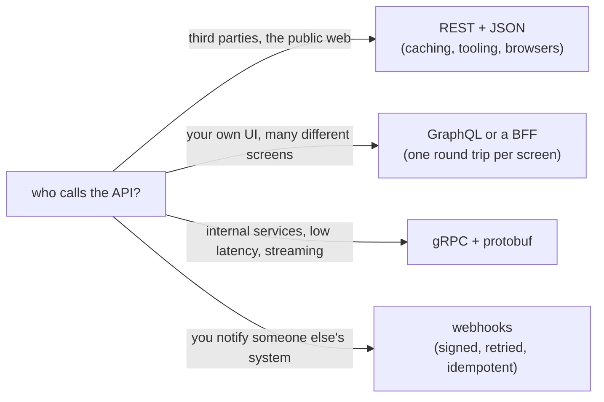

## Mental Model

All three popular API styles ride on HTTP, but they answer "how does a client ask for something?" differently:

- **REST**: "here are **resources** at URLs; use HTTP's methods, status codes and caching on them."
- **gRPC**: "here are **functions** you can call, with strongly typed binary messages" — RPC over HTTP/2.
- **GraphQL**: "here is a **typed graph**; send a query describing exactly the shape of data you want" — usually one POST endpoint.

Webhooks flip the direction: the **server calls you** when something happens.

## Definition

- **REST**: an architectural style using resource-oriented URLs, standard HTTP methods and representations (usually JSON), statelessness and cacheability.
- **gRPC**: an RPC framework using Protocol Buffers for schemas and serialization, HTTP/2 for transport (streams, flow control, trailers), with unary, server-streaming, client-streaming and bidirectional-streaming calls.
- **GraphQL**: a query language and runtime where clients request precisely the fields they need from a typed schema; resolvers fetch data per field.
- **Webhook**: an HTTP callback the provider POSTs to your endpoint when an event occurs.

## Why It Exists

**The problem.** Two programs need to talk over HTTP, but HTTP only says "send a request, get a response". It doesn't say how to name operations, shape data, or evolve the interface without breaking callers.

**Why three styles.** Each style is optimised for a different kind of caller. Different consumers have different needs:
- public APIs value simplicity, cacheability and universal tooling (REST);
- internal microservices value performance, strict contracts and streaming (gRPC);
- UI-heavy clients with many views value fetching exactly the data needed in one round trip (GraphQL).

:::callout[That's all it is]{type=insight}
REST: nouns at URLs, HTTP verbs on them. gRPC: typed function calls over HTTP/2. GraphQL: one endpoint where the client describes the exact data shape it wants. Webhooks: the server calls you.
:::

## How It Works

### Comparison

| | REST (JSON/HTTP) | gRPC | GraphQL |
|---|---|---|---|
| Contract | OpenAPI (optional) | `.proto` (required, codegen) | Schema (SDL, required) |
| Payload | Text JSON | Binary protobuf (smaller, faster to parse) | JSON |
| Transport | HTTP/1.1, /2, /3 | HTTP/2 (HTTP/3 emerging) | Usually HTTP POST |
| HTTP caching | Natural (GET + Cache-Control) | Not via HTTP caches | Hard (POST, single URL) — persisted queries help |
| Browser support | Native | Needs gRPC-Web proxy | Native |
| Streaming | SSE/WebSockets separately | Built in (4 modes) | Subscriptions (often WebSockets) |
| Over/under-fetching | Common | Designed per call | Solved — client picks fields |
| Errors | HTTP status codes | gRPC status codes (+ HTTP 200) | Usually HTTP 200 with `errors` array |
| Typical home | Public APIs, CRUD services | Internal service-to-service | Frontend-facing aggregation (BFF) |

Which style fits depends mostly on who calls the API:



### A gRPC service definition

```protobuf
service OrderService {
  rpc GetOrder (GetOrderRequest) returns (Order);
  rpc WatchOrders (WatchRequest) returns (stream OrderEvent);   // server streaming
}
message GetOrderRequest { string id = 1; }
message Order { string id = 1; int64 total_cents = 2; repeated Item items = 3; }
```

Each call is an HTTP/2 stream: `POST /OrderService/GetOrder` with `content-type: application/grpc`, length-prefixed protobuf messages, and status in **trailers** (`grpc-status`). Field numbers give backward/forward compatibility (never reuse numbers).

### A GraphQL query

```graphql
query {
  order(id: "ord_5521") {
    id
    total
    customer { name }
    items { sku qty product { title imageUrl } }
  }
}
```

One round trip fetches what REST might need 3–4 calls for. The server-side cost is real, though. Naive resolvers cause the **N+1 query problem** (one query for items, then one per item for its product), solved with batching (DataLoader). And clients can craft **expensive queries**, so servers enforce depth and complexity limits and timeouts.

### Webhooks

The provider POSTs events to your URL. Production-grade webhooks need: **signature verification** (HMAC header — [Crypto Foundations](lesson:cn-crypto-foundations)), **idempotent handling** (deliveries are at-least-once and may be retried or duplicated), fast 2xx acknowledgment then async processing, and replay/backfill mechanisms for missed events.

## Internal Mechanism

### Cross-cutting concerns for any style

- **Timeouts and deadlines**: every call needs a deadline; gRPC propagates deadlines across services automatically — use it.
- **Retries**: only for idempotent operations, with exponential backoff + jitter and a retry budget ([Proxies & Load Balancers](lesson:cn-proxies-load-balancers)).
- **Idempotency keys** for create/payment operations ([HTTP Fundamentals](lesson:cn-http-fundamentals)).
- **Pagination**: prefer **cursor/keyset pagination** (`?after=ord_5521&limit=50`) over offset pagination (`?offset=100000`), which gets slower and inconsistent as data changes — the database reason is in [Query Optimization](lesson:db-query-optimization).
- **Versioning**: additive, backward-compatible changes; URL (`/v2/`) or header versioning for breaking changes; protobuf field-number discipline.
- **Rate limiting** with `429` + `Retry-After`.

:::depth{level=advanced}
### Load balancing and gRPC

gRPC's long-lived HTTP/2 connections defeat L4 load balancing; use L7 proxies (Envoy), client-side load balancing with service discovery (the gRPC `round_robin` policy over resolved addresses), or a service mesh. Configure keepalive pings and max connection age to rebalance and detect dead connections.
:::

## Example

A mobile app screen showing an order with its items and product images:

- **REST**: `GET /orders/5521`, then `GET /orders/5521/items`, then `GET /products?ids=…` → 3 sequential round trips (≈ 3 × 150 ms on mobile) unless you design a composite endpoint.
- **GraphQL**: one request with a nested query → 1 round trip; server fans out internally (fast, same data center).
- **gRPC** (from the BFF to internal services): low-latency binary calls, possibly in parallel.

This is why many architectures use GraphQL or a REST "backend for frontend" at the edge and gRPC internally.

## Complexity & Performance

- Protobuf payloads are typically several times smaller and faster to (de)serialize than JSON.
- GraphQL shifts the cost of aggregation to the server; per-request cost varies by query.
- HTTP caching (REST GET) can eliminate requests entirely — a major advantage for read-heavy public APIs.

## Trade-offs

- REST: universal, cacheable, simple vs chatty for complex UIs and weaker contracts.
- gRPC: performance, contracts, streaming vs browser support and debuggability (binary), needs L7-aware infra.
- GraphQL: client flexibility vs server complexity (N+1, query cost control, caching, authorization per field).

## Failure Modes

- Missing timeouts → threads/pools exhausted when a dependency hangs.
- Retrying non-idempotent calls → duplicate orders/payments.
- Offset pagination on large tables → slow queries and skipped/duplicated items.
- GraphQL denial of service via deeply nested queries.
- Breaking changes deployed without versioning.
- Webhook handlers doing slow work synchronously → provider retries → duplicate processing.

## In Production

- Public APIs: REST + OpenAPI, idempotency keys, cursor pagination, rate limits.
- Internal: gRPC with deadlines, retries policies, mTLS via service mesh.
- Frontend aggregation: GraphQL with persisted queries, DataLoader, complexity limits.
- From Java: REST calls go through `HttpClient` with explicit timeouts ([Java Networking](lesson:cn-java-networking)). grpc-java sets a deadline per call with `stub.withDeadlineAfter(300, TimeUnit.MILLISECONDS)`, and the deadline travels to the server in the `grpc-timeout` header.

## Deeper Connections

- gRPC relies on HTTP/2 streams and flow control ([HTTP/2](lesson:cn-http2)); retries and idempotency connect to exactly-once myths in [Distributed Transactions](lesson:db-distributed-transactions).

## Common Misconceptions

- **"REST means JSON over HTTP."** REST is about resources, uniform interface and statelessness; many "REST" APIs are RPC over HTTP.
- **"GraphQL is faster than REST."** It saves client round trips; server-side it can be slower without batching.
- **"gRPC can't be used from browsers."** It needs gRPC-Web (or Connect) via a proxy.

## Interview Questions

### [L1 · compare] REST vs gRPC?

REST models resources with standard HTTP methods and usually JSON over HTTP/1.1 or 2; it's universal, human-readable and cacheable. gRPC defines typed RPC methods in protobuf and runs over HTTP/2 with binary messages; it's faster and more compact, supports streaming and deadlines, and generates clients, but needs HTTP/2-aware infrastructure and isn't natively usable from browsers.

### [L2 · why] Why might a mobile client prefer GraphQL over REST?

A screen often needs data from several resources; with REST that means multiple sequential round trips (costly on high-latency mobile networks) or over-fetching large representations. GraphQL fetches exactly the needed fields from multiple entities in one request, reducing latency and bandwidth.

### [L2 · compare] Offset vs cursor pagination?

Offset pagination (`LIMIT 50 OFFSET 100000`) makes the database scan and discard all skipped rows (slow for deep pages) and can skip or duplicate items when rows are inserted/deleted between pages. Cursor (keyset) pagination filters by the last seen sort key (`WHERE id > :last ORDER BY id LIMIT 50`), using an index to start directly at the right place — fast at any depth and stable under concurrent changes.

### [L3 · design] How would you design a reliable webhook consumer?

Verify the HMAC signature and timestamp (reject replays), respond 2xx quickly after persisting the event (e.g., to a queue/table) rather than processing inline, make processing idempotent using the event ID (deduplicate), handle out-of-order delivery (compare versions/timestamps), monitor failures, and support reconciliation by polling the provider's API for missed events.

### [L2 · how] How does a gRPC call map onto HTTP/2?

Each call is one HTTP/2 stream: a POST to `/package.Service/Method` with `content-type: application/grpc`, a body of length-prefixed protobuf messages (one for unary calls, many for streaming), and the result status in **trailers** (`grpc-status`, `grpc-message`) after the response body. Because the HTTP status is 200 even for failed calls, proxies and monitoring must read the trailers. Deadlines travel as the `grpc-timeout` header, so each service knows how long its caller will wait.

### [L3 · design] How do you evolve a protobuf/gRPC API without breaking existing clients?

Only make additive changes: add new fields with new field numbers, and never reuse or change the type of an existing number. Removed fields have their numbers (and names) marked `reserved`. Old clients ignore unknown fields, and new clients see defaults for fields old servers don't send, so both directions keep working. Breaking changes get a new method or a new package version (`orders.v2`), run side by side until clients move.

## Practice

### [mcq] Which API style natively supports bidirectional streaming over HTTP/2 with protobuf?

- [ ] REST
- [x] gRPC
- [ ] GraphQL queries
- [ ] Webhooks

gRPC supports unary and three streaming modes.

### [mcq] A GraphQL API becomes slow because fetching 100 orders triggers 100 separate customer queries. What is this called and how is it fixed?

- [ ] Head-of-line blocking — use HTTP/3
- [x] The N+1 problem — batch resolver lookups (e.g., DataLoader)
- [ ] Cache stampede — add TTL jitter
- [ ] Over-fetching — use REST

Batching collapses per-item lookups into one query.

### [numeric 300 unit=ms] A mobile screen needs 3 REST calls that must be made one after another, on a network with a 150 ms round trip. A GraphQL query fetches the same data in one request (the server's internal calls are fast). How much time does GraphQL save?

:::answer
REST: 3 × 150 = 450 ms of round trips. GraphQL: 1 × 150 = 150 ms. Saving: **300** ms, because the fan-out happens inside the data centre, where calls take a millisecond or two.
:::

### [numeric 49950] Offset pagination with 50 items per page: how many rows must the database read and throw away to return page 1,000?

:::answer
Page 1,000 starts at offset (1,000 − 1) × 50 = **49,950**, and the database must walk past all of them before returning the next 50. Cursor (keyset) pagination, `WHERE id > :last_seen ORDER BY id LIMIT 50`, reads only the 50 rows it returns.
:::

### [mcq] A gRPC call fails with "deadline exceeded", but the access logs show HTTP 200. Why?

- [ ] The proxy rewrote the status
- [x] gRPC reports the call's result in trailers (`grpc-status`), and the HTTP status stays 200
- [ ] The server succeeded and the client failed to parse the reply
- [ ] HTTP/2 doesn't have status codes

HTTP-level monitoring sees 200 for most gRPC failures. Dashboards and alerts must be built on `grpc-status`.

### [exercise] Design a reliable webhook consumer for payment events that may arrive late, twice, or out of order.

:::solution
1. **Verify** the HMAC signature over the raw body, and reject stale timestamps to stop replays ([Crypto Foundations](lesson:cn-crypto-foundations)).
2. **Respond fast:** store the event (with its provider event ID) and return 2xx immediately; process it asynchronously from a queue. Slow responses cause the provider to time out and resend.
3. **Deduplicate:** a unique constraint on the event ID makes a second delivery a no-op. Providers deliver at least once, never exactly once.
4. **Handle ordering:** don't assume events arrive in order. Compare each event's version or timestamp with the stored state and ignore older ones, or fetch the current state from the provider's API when an event arrives.
5. **Reconcile:** periodically list recent events or objects from the provider to catch anything missed during an outage.
:::

## Quick Revision

- REST = resources + HTTP semantics + caching; gRPC = typed RPC, protobuf, HTTP/2, streaming, deadlines; GraphQL = client-shaped queries, one endpoint, N+1 & cost limits; webhooks = provider → you, at-least-once, verify + idempotent.
- For all: deadlines, idempotent retries with backoff/jitter, idempotency keys, cursor pagination, backward-compatible evolution, 429 + Retry-After.
- gRPC needs L7/client-side LB.
- gRPC = HTTP/2 POST + length-prefixed protobuf + status in trailers (HTTP 200 even on errors); evolve with new field numbers only, `reserved` for removed ones.
- Offset pagination reads (page − 1) × size rows to skip; prefer keyset pagination. Webhooks: verify, ack fast, dedupe by event ID, don't trust order.
