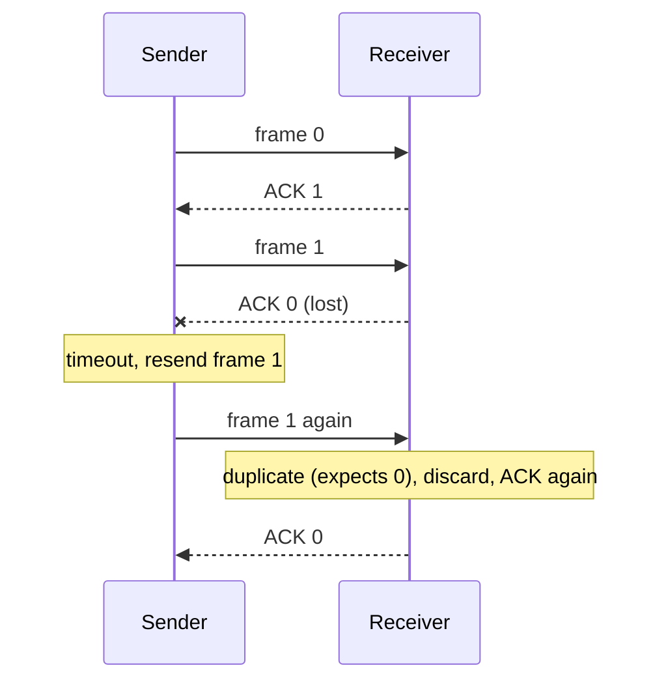
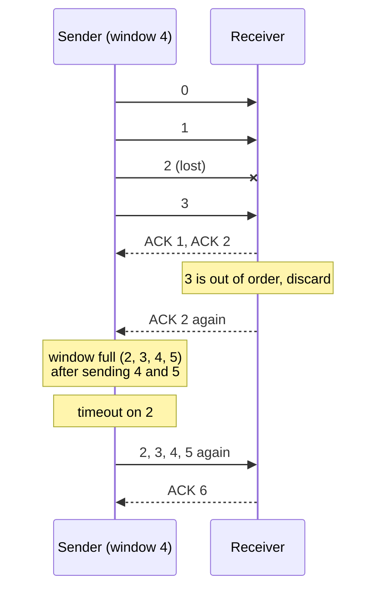

## Mental Model

You are posting the pages of a manuscript to an editor across the country, and some letters get lost.

- **Stop-and-wait**: post one page, wait for the editor's "got page 1" postcard, then post the next. Safe, but you spend almost all your time waiting for the post.
- **Go-Back-N**: post several pages without waiting. The editor only files pages in order; if page 3 goes missing, pages 4 and 5 are thrown away, and you resend 3, 4 and 5.
- **Selective Repeat**: the editor keeps pages 4 and 5 in a tray and tells you exactly which page is missing. You resend only page 3.

All three are **ARQ** (automatic repeat request): the receiver acknowledges what arrived, and the sender resends what wasn't acknowledged in time.

## Definition

- **ACK**: an acknowledgement from the receiver. A **cumulative ACK** n means "I have everything before n"; an **individual ACK** confirms one frame.
- **NAK**: a negative acknowledgement asking for one frame again.
- **Timeout**: how long the sender waits for an ACK before resending.
- **Sequence number**: a frame's number, so the receiver can spot duplicates and gaps. With k bits, numbers run from 0 to 2^k − 1 and then wrap.
- **Window**: how many frames the sender may have sent but not yet had acknowledged.
- **Transmission time** T_t = frame size ÷ link rate; **propagation delay** T_p = distance ÷ signal speed; **a** = T_p ÷ T_t.
- **Utilization** U: the fraction of time the link carries new data.

## Why It Exists

**The problem.** Frames get lost or damaged, and error detection only *drops* damaged frames ([Error Detection](lesson:cn-error-detection)). The sender has to find out what didn't arrive and send it again, and the receiver has to avoid accepting a resent frame twice.

**The first answer.** Send one frame, wait for its ACK, resend on timeout. It's correct, but on a link where a frame takes 8 ms to transmit and the signal takes 20 ms each way, the sender transmits for 8 ms and then sits idle for 40 ms.

**The idea.** Keep many numbered frames in flight, enough to cover the round trip, and recover from losses using the numbers. The two classic designs differ in how much the receiver is willing to buffer.

:::callout[That's all it is]{type=insight}
Number the frames, acknowledge what arrived, resend what wasn't acknowledged in time. A window lets several frames travel at once; Go-Back-N resends from the first loss onward, Selective Repeat resends only the lost frames.
:::

## How It Works

### Stop-and-wait

1. Send frame 0 and start a timer.
2. The receiver checks it and replies ACK.
3. On the ACK, send the next frame. On a timeout, resend the same one.

If the **ACK** is the thing that got lost, the sender resends a frame the receiver already has. A 1-bit sequence number (frames alternate 0, 1, 0, 1: the *alternating-bit protocol*) lets the receiver recognize the duplicate, discard it, and ACK it again.



**Utilization.** Each frame costs T_t to send plus a round trip of 2·T_p before the next can go:

```text
U = T_t / (T_t + 2·T_p) = 1 / (1 + 2a)

8,000-bit frame on 1 Mb/s:  T_t = 8 ms;  one-way propagation T_p = 20 ms
U = 8 / (8 + 40) = 16.7%     (a satellite hop with T_p = 270 ms: 8 / 548 = 1.5%)
```

### Sliding windows

Let the sender have up to W frames outstanding. The first ACK comes back after T_t + 2·T_p, so to keep sending the whole time, W frames must fill that interval:

```text
U = W / (1 + 2a)     if W < 1 + 2a,  otherwise U = 1 (100%)
window for full utilization:  W ≥ 1 + 2a = 1 + 2 × (20 / 8) = 6 frames
```

This is the bandwidth-delay product counted in frames, the same reason TCP needs large windows on long paths ([TCP Flow Control](lesson:cn-tcp-flow-control)).

### Go-Back-N

- The sender keeps up to N unacknowledged frames; the **receiver accepts only the next frame in order** and discards anything else.
- ACKs are **cumulative**.
- When the oldest frame times out, the sender resends it **and every frame after it**.

Frame 2 is lost while frames 0–5 are sent with a window of 4:



The receiver needs no buffer, but one loss costs a whole window of resends.

### Selective Repeat

- The **receiver buffers out-of-order frames** within its window and acknowledges each one individually.
- The sender resends **only** the frame whose timer expired (or that was NAKed).
- When the missing frame arrives, the receiver delivers it and everything buffered behind it, in order.

Same loss: the receiver keeps 3, 4 and 5; the sender resends only 2.

### How large can the window be?

Sequence numbers wrap, so after an ambiguous loss the receiver must not confuse an old frame with a new one carrying the same number. With k-bit sequence numbers:

| Protocol | Sender window | Receiver window | Maximum sender window |
|---|---|---|---|
| Stop-and-wait | 1 | 1 | 1 (1-bit numbers suffice) |
| Go-Back-N | N | 1 | **2^k − 1** |
| Selective Repeat | N | N | **2^(k−1)** (half the sequence space) |

Why Go-Back-N can't use all 2^k numbers: take k = 2 and a window of 4. The sender sends 0, 1, 2, 3; all arrive, so the receiver now expects 0 again, but **every ACK is lost**. The sender times out and resends the old frame 0, which the receiver accepts as the *new* frame 0: duplicated data, silently. With a window of 3 the receiver would expect 3, and the old 0 would be rejected.

Selective Repeat's receiver accepts a whole window of numbers, so the old and new windows must not overlap: at most half the sequence space each.

Run all three protocols over the same link in the lab. Choose the window, the propagation delay and the lost frames, then compare the timelines, the resends and the utilization.

::lab{id=arq-protocols}

## Internal Mechanism

### Comparing the three

| | Stop-and-wait | Go-Back-N | Selective Repeat |
|---|---|---|---|
| Frames in flight | 1 | Up to N | Up to N |
| Receiver buffering | None | None | Up to N frames |
| ACKs | Per frame | Cumulative | Individual (often plus a cumulative edge) |
| Resent after one loss | 1 frame | The lost frame and everything sent after it | Only the lost frame |
| Best for | Short links, simple devices | Low loss, simple receivers | High loss or long round trips |

**Piggybacking**: when data flows both ways, the receiver puts its ACK inside its own next data frame instead of sending a separate ACK, saving frames and headers.

### TCP is a hybrid

TCP numbers bytes rather than frames, and it borrows from both designs:
- Cumulative ACKs, as in Go-Back-N.
- Receivers buffer out-of-order data, and **SACK** tells the sender exactly which ranges arrived, so it resends only what's missing, as in Selective Repeat.
- Fast retransmit after three duplicate ACKs, instead of always waiting for a timeout ([TCP Reliability](lesson:cn-tcp-reliability)).

TCP's sequence numbers are 32 bits and count bytes, so wrap-around is only a concern on very fast links; the timestamp option (PAWS) handles it there.

:::depth{level=advanced}
### Choosing the timeout

Too short and the sender resends frames that were only delayed, wasting the link; too long and every loss stalls the sender. On one physical link the round trip is nearly constant, so a fixed timeout slightly above T_t + 2·T_p works. Across the internet, round trips vary widely, so TCP measures them continuously and sets the timeout from the smoothed RTT and its variance.
:::

## Example

A satellite link: 1 Mb/s, 1,000-byte frames, one-way propagation 270 ms.

```text
T_t = 8,000 bits / 10⁶ bit/s = 8 ms
a   = 270 / 8 = 33.75
stop-and-wait:     U = 1 / (1 + 67.5) = 1.46%      → about 14.6 kb/s of a 1 Mb/s link
full utilization:  W ≥ 1 + 2a = 68.5  → a window of 69 frames
sequence numbers:  Go-Back-N needs 2^k − 1 ≥ 69 → k = 7 bits
                   Selective Repeat needs 2^(k−1) ≥ 69 → k = 8 bits
```

## Complexity & Performance

- Stop-and-wait throughput falls as distance grows: U = 1 / (1 + 2a).
- With a large enough window, both sliding-window protocols run at line rate when nothing is lost.
- Under loss, Go-Back-N resends up to a full window per loss; Selective Repeat resends only lost frames, at the cost of receiver memory and per-frame bookkeeping.

## Trade-offs

- Window size: bigger fills long links but needs more sequence-number bits and more buffering.
- Go-Back-N vs Selective Repeat: simple receiver vs efficient recovery.
- Timeout: fast recovery vs needless resends.

## Failure Modes

- **Window too large for the sequence space**: old and new frames become indistinguishable, and duplicates are accepted as new data.
- **Timeout shorter than the round trip**: every frame is sent twice.
- **Go-Back-N under heavy loss**: resends crowd out new data and the link spends most of its time repeating itself.

## In Production

- Wi-Fi retransmits at the link layer (with block ACKs, a Selective Repeat style) because radio losses are common; wired Ethernet doesn't and leaves recovery to TCP.
- QUIC never reuses packet numbers: a resent frame goes in a new packet with a new number, removing the "is this ACK for the original or the resend?" ambiguity ([HTTP/3 & QUIC](lesson:cn-http3-quic)).

## Deeper Connections

- The window-size formula W ≥ 1 + 2a is the bandwidth-delay product in frames ([Latency & Bandwidth](lesson:cn-latency-bandwidth)).
- Producers and consumers with bounded buffers face the same "how much can be in flight" question ([Classic Synchronization Problems](lesson:os-classic-sync-problems)).

## Common Misconceptions

- **"Bigger windows are always safe."** The window must stay within 2^k − 1 (Go-Back-N) or 2^(k−1) (Selective Repeat), or duplicates go undetected.
- **"Go-Back-N resends everything from the beginning."** It resends from the first unacknowledged frame onward.
- **"TCP is Go-Back-N."** TCP's ACKs are cumulative, but receivers buffer out-of-order data and SACK lets senders resend selectively.

## Interview Questions

### [L1 · compare] Stop-and-wait vs Go-Back-N vs Selective Repeat?

Stop-and-wait sends one frame and waits for its ACK, which wastes the link whenever the round trip is longer than a frame's transmission time. Go-Back-N keeps up to N frames in flight with cumulative ACKs; the receiver accepts only in-order frames, so after a loss the sender resends the lost frame and everything after it. Selective Repeat also keeps N frames in flight, but the receiver buffers out-of-order frames and acknowledges each one, so only lost frames are resent.

### [L2 · numerical] What is the utilization of stop-and-wait, and what window keeps a link fully busy?

U = T_t / (T_t + 2·T_p) = 1 / (1 + 2a), where a = T_p / T_t. A sliding window of W frames gives U = W / (1 + 2a) up to 100%, so full utilization needs W ≥ 1 + 2a. With 8 ms frames and 20 ms propagation, stop-and-wait reaches 16.7%, and a window of 6 fills the link.

### [L2 · why] Why is Go-Back-N's window limited to 2^k − 1 and Selective Repeat's to 2^(k−1)?

So that a resent old frame can't be mistaken for a new one with the same number. In Go-Back-N with a window of 2^k, if all ACKs for a full window are lost, the receiver expects number 0 again while the sender resends the old frame 0, which the receiver wrongly accepts. Selective Repeat's receiver accepts a whole window of numbers, so the old and new windows must not overlap, which limits each to half the sequence space.

### [L2 · compare] When does Selective Repeat beat Go-Back-N?

When losses are frequent or the window is large, for example on long, lossy links. Each loss costs Go-Back-N up to a full window of resends, while Selective Repeat resends only the lost frame. Go-Back-N wins on simplicity: the receiver needs no buffer and keeps a single expected number, which mattered for cheap hardware and still suits low-loss links.

### [L2 · conceptual] Why does stop-and-wait need sequence numbers at all, if only one frame is ever in flight?

Because an ACK can be lost. The sender times out and resends a frame the receiver already delivered. Without a number, the receiver would accept it as new data and pass a duplicate up. A single alternating bit is enough to tell "the same frame again" from "the next frame".

### [L3 · how] How does TCP relate to these protocols?

TCP is a hybrid. Its ACKs are cumulative like Go-Back-N's, but receivers keep out-of-order data, and the SACK option tells the sender exactly which byte ranges arrived, so it resends only what's missing, like Selective Repeat. It adds fast retransmit on three duplicate ACKs, adaptive timeouts from measured round trips, and windows limited by both the receiver (flow control) and the network (congestion control).

## Practice

### [numeric 16.67 ±0.1 unit=%] A 1 Mb/s link carries 8,000-bit frames, and the one-way propagation delay is 20 ms. What is the utilization of stop-and-wait (ignore ACK size and processing time)?

:::answer
T_t = 8,000 ÷ 10⁶ = 8 ms. U = 8 ÷ (8 + 2 × 20) = 8 ÷ 48 = **16.67**%.
:::

### [numeric 6] On the same link, what is the smallest sliding window, in frames, that keeps the link 100% busy?

:::answer
a = 20 ÷ 8 = 2.5, so W ≥ 1 + 2a = **6** frames: the sender is still transmitting the sixth frame when the first ACK returns.
:::

### [numeric 7] With 3-bit sequence numbers, what is the largest sender window Go-Back-N can use safely?

:::answer
2^3 − 1 = **7**. With a window of 8, a lost round of ACKs would make a resent old frame indistinguishable from a new one.
:::

### [numeric 4] With 3-bit sequence numbers, what is the largest window Selective Repeat can use safely?

:::answer
2^(3−1) = **4**: half of the 8 sequence numbers, so the receiver's window never overlaps the numbers of frames the sender might still resend.
:::

### [numeric 12] Go-Back-N with a window of 4 sends frames 0–7. Only the first transmission of frame 2 is lost. The sender sends 0–5, then its timer for frame 2 expires. How many frame transmissions does it take to deliver all eight frames?

:::answer
After 0 and 1 are acknowledged, frames 2–5 fill the window: 6 transmissions so far. The timeout makes the sender resend 2, 3, 4 and 5 (the receiver discarded 3–5 as out of order): 4 more. Then it sends 6 and 7: 2 more. Total **12**.
:::

### [numeric 9] Same situation with Selective Repeat: how many frame transmissions does it take?

:::answer
Frames 0–7 once each, 8 transmissions, plus one resend of frame 2: **9**. The receiver buffered 3, 4 and 5 and delivers them as soon as 2 arrives.
:::

### [exercise] Show, with a trace, why Go-Back-N with 2-bit sequence numbers must not use a window of 4. Then show that a window of 3 is safe in the same scenario.

:::solution
**Window 4.** The sender sends frames numbered 0, 1, 2, 3. All four arrive, so the receiver delivers them and now expects the next number, which wraps to **0**. All four ACKs are lost. The sender times out and resends its *old* frame 0. The receiver expects 0, so it accepts the old frame as new data and delivers a duplicate: an undetectable error.

**Window 3.** The sender sends 0, 1, 2; all arrive and the receiver expects **3**. All ACKs are lost; the sender resends old frame 0. The receiver expects 3, so it discards 0 as a duplicate and re-sends its ACK, and the sender recovers. Keeping one sequence number unused makes old and new frames impossible to confuse.
:::

### [exercise] In the [sliding window lab](lab:sliding-window), lose one segment in the middle of a window. Note what the receiver acknowledges and what the sender resends. Would Go-Back-N have resent the same data? Would Selective Repeat?

:::solution
The receiver keeps acknowledging the first missing byte (duplicate cumulative ACKs) while it buffers the segments after the gap. The sender resends only the lost segment (after three duplicate ACKs or a timeout), and then the cumulative ACK jumps past everything that was buffered.

Go-Back-N would have resent the lost segment *and* every segment after it, because its receiver discards out-of-order data. TCP's behaviour is closer to Selective Repeat: only the gap is resent. The difference is that TCP's plain ACKs are cumulative, which is why SACK exists, so that the sender knows exactly which later ranges arrived when more than one is lost.
:::

### [mcq] What is piggybacking?

- [ ] Sending a frame on two links at once for redundancy
- [x] Carrying an acknowledgement inside a data frame going the other way
- [ ] Combining several small frames into one
- [ ] Resending a frame before its timer expires

When both sides send data, each puts its latest ACK into its own outgoing data frames, so no separate ACK frames are needed.

### [exercise] In the [ARQ lab](lab:arq-protocols), set 8 frames, a window of 4 and a = 1. Lose frame 2 and count the transmissions under Go-Back-N and under Selective Repeat. Then lose frames 2 and 5. Which protocol pays for the second loss, and why doesn't the other?

:::solution
With only frame 2 lost, Go-Back-N makes 12 transmissions and Selective Repeat 9.

With frames 2 and 5 lost, Go-Back-N still makes **12**, while Selective Repeat makes **10**. Go-Back-N's receiver would have discarded the first copy of frame 5 anyway, because it arrived after the gap at 2. The resend from 2 onward covers it at no extra cost. Selective Repeat buffered everything except the lost frames, so each loss costs exactly one more transmission.

The pattern: Go-Back-N pays up to a window of resends per timeout, however many frames in that window were lost. Selective Repeat pays one resend per lost frame.
:::

## Quick Revision

- ARQ: ACK what arrived, resend on timeout (or NAK); sequence numbers catch duplicates and gaps.
- Stop-and-wait: U = 1 / (1 + 2a), a = T_p / T_t; 1-bit numbers (alternating bit).
- Sliding window: U = W / (1 + 2a), capped at 1; full utilization needs W ≥ 1 + 2a.
- Go-Back-N: receiver window 1, cumulative ACKs, resend from the loss onward; window ≤ 2^k − 1.
- Selective Repeat: receiver buffers, individual ACKs, resend only lost frames; window ≤ 2^(k−1).
- TCP: cumulative ACKs + receiver buffering + SACK + fast retransmit; piggybacked ACKs.
