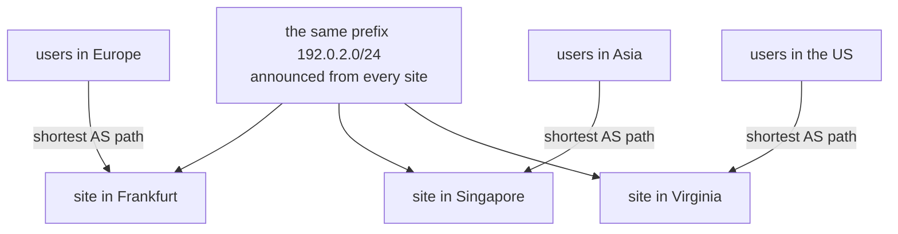

## Mental Model

The internet is a **federation of ~75,000 independently operated networks** — ISPs, clouds, universities, enterprises — called **autonomous systems (ASes)**. BGP is the protocol they use to tell each other "**I can reach these address prefixes, via this path of ASes**". Each network decides by its own **policy** (money, contracts, preferences) which routes to accept and which to advertise. There's no central authority checking the claims — which is why a single misconfigured announcement can reroute or black-hole traffic for large parts of the internet.

**Anycast** is a clever use of this: announce the **same prefix from many locations**, and BGP naturally delivers each user's packets to a nearby location.

## Definition

- **Autonomous system (AS)**: a network under one administrative control with a unified routing policy, identified by an **ASN** (e.g., AS15169 Google, AS13335 Cloudflare).
- **BGP (Border Gateway Protocol, v4)**: the path-vector inter-domain routing protocol. **eBGP** between ASes; **iBGP** within an AS to distribute external routes.
- **Route announcement**: "prefix P reachable via AS path [A, B, C]".
- **Anycast**: the same IP prefix announced from multiple sites; routing delivers packets to one of them (typically the "closest" in BGP terms).

## Why It Exists

**The problem.** The internet has no owner. ~75,000 independent networks must agree on how to reach each other's addresses, without revealing their internal layouts and while respecting who pays whom.

**Why internal routing protocols don't work here.** Inside one organization, IGPs (OSPF, IS-IS) compute shortest paths over a known topology ([Routing](lesson:cn-routing)). Between organizations, topology is private, business relationships matter more than distance, and the system must scale to ~1 million prefixes. BGP exchanges reachability plus attributes and lets each AS apply policy.

**The idea.** Each network only tells its neighbors "I can reach these prefixes, and here's the list of networks the path goes through". The list prevents loops and lets each network choose by its own rules. Nobody needs the whole map.

:::callout[That's all it is]{type=insight}
BGP is networks telling their neighbors "I can reach these addresses via this chain of networks", and each one picking which claim to believe by policy. Anycast is announcing the same addresses from many places so users land on the nearest one.
:::

## How It Works

### Announcements and path selection

1. An AS originates its prefixes (e.g., `203.0.113.0/24` from AS64500).
2. Neighbors receive the route with AS path `[64500]`, prepend themselves when re-advertising: `[64501, 64500]`, and so on.
3. The AS path prevents loops (a router rejects routes containing its own ASN).
4. Each router selects the best route per prefix by an ordered list of attributes, roughly:
   - highest **local preference** (policy);
   - shortest **AS path**;
   - origin type, then lowest **MED** (the neighbour's hint);
   - eBGP over iBGP, then lowest IGP cost to the exit;
   - then tiebreakers.
5. The best route goes into the forwarding table; forwarding still uses **longest-prefix match** — a more specific /24 beats a /16 regardless of path.

### Business relationships shape routes

- **Transit**: a customer pays a provider to reach the whole internet.
- **Peering**: two networks exchange traffic for their own customers, often settlement-free, at internet exchange points (IXPs) or private interconnects.
- Networks prefer routes learned from customers (they get paid) over peers over providers (they pay) — so the path your packets take is shaped by economics, not just distance.

### Anycast

A side effect of "each network picks the best-looking announcement": if the *same* addresses are announced from many places, each user is sent to whichever place looks closest. That turns BGP into a free, global load balancer. The same prefix (say `1.1.1.0/24`) is announced from 300 cities. Each network's BGP picks the "best" (usually nearest in AS hops/IGP cost) announcement, so users in Frankfurt reach the Frankfurt site and users in Tokyo reach Tokyo — **one IP, many servers**.

Used for:

- **DNS**: root servers, TLDs, public resolvers (8.8.8.8, 1.1.1.1) ([DNS](lesson:cn-dns-fundamentals)).
- **CDNs and edge networks**: route users to nearby PoPs ([CDN](lesson:cn-cdn)).
- **DDoS absorption**: attack traffic is spread across all sites instead of concentrating on one.
- **L4 load balancers**: within a data center, many LB servers announce the same VIP; routers ECMP-hash flows across them ([Proxies & Load Balancers](lesson:cn-proxies-load-balancers)).



Caveat: if routing changes mid-connection, packets may land on a different site that has no state for the TCP connection → resets. Anycast suits short/stateless interactions (DNS over UDP) best; CDNs mitigate with stable routing and connection handoff; QUIC connection IDs help.

## Internal Mechanism

:::depth{level=senior}
### Why BGP incidents are so disruptive

- **Route hijack**: an AS announces a prefix it doesn't own, or a more-specific part of it, and longest-prefix match pulls traffic toward it. In 2008 Pakistan Telecom accidentally hijacked YouTube worldwide this way, by announcing a more-specific /24.
- **Route leak**: an AS re-advertises routes it shouldn't (e.g., routes learned from one provider to another), turning itself into unintended transit and congesting paths.
- **Withdrawal outages**: an AS withdraws its own routes (the 2021 Facebook outage: a configuration change withdrew the routes to Facebook's DNS servers, making its domains unresolvable worldwide and locking engineers out of internal tools).
- Convergence after changes can take seconds to minutes; flapping routes are dampened.

Defenses: **RPKI** (cryptographically signed Route Origin Authorizations; routers drop RPKI-invalid announcements — Route Origin Validation), prefix filtering on customer sessions, max-prefix limits, IRR-based filters, and BGPsec/ASPA for path validation (limited deployment).
:::

## Example

```bash
$ whois -h whois.cymru.com " -v 1.1.1.1"
AS      | IP       | BGP Prefix  | CC | Registry | Allocated  | AS Name
13335   | 1.1.1.1  | 1.1.1.0/24  | US | arin     | 2010-07-14 | CLOUDFLARENET
$ traceroute 1.1.1.1      # from different cities you'd reach different anycast sites in a few hops
```

Public looking-glass servers and tools like bgp.he.net or RIPEstat show which ASes announce a prefix and the AS paths seen worldwide.

## Complexity & Performance

- Global routing table: ~1M IPv4 and ~200K+ IPv6 prefixes; routers need significant memory/TCAM.
- BGP chooses by policy and AS-path length, not latency — paths can be geographically suboptimal ("tromboning").

## Trade-offs

- Policy-based routing gives operators control and business alignment vs suboptimal paths and slow convergence.
- Anycast gives proximity and resilience vs mid-connection route changes and harder debugging (which site answered?).

## Failure Modes

- Hijacks and leaks redirecting or black-holing traffic.
- Self-inflicted withdrawals (config pushes) causing total outages, especially when DNS and management access depend on the same routes.
- Anycast site overload when routing shifts a large region's traffic to one site.

## In Production

- Clouds and CDNs operate large anycast networks; enterprises use BGP for multi-homing (two ISPs) and to announce their own address space.
- Kubernetes: Calico and MetalLB can use BGP to advertise pod and service IPs to data-center routers ([Container Networking](lesson:cn-container-networking)).

## Deeper Connections

- Longest-prefix match and intra-domain routing: [Routing](lesson:cn-routing). Anycast front ends for DNS and CDNs: [DNS](lesson:cn-dns-fundamentals), [CDN](lesson:cn-cdn).

## Common Misconceptions

- **"The internet routes over the shortest path."** It routes by policy and AS-path length.
- **"BGP announcements are verified."** Largely trust-based; RPKI adoption is growing but incomplete.
- **"Anycast means load balancing across all sites."** It routes each user to one (usually nearby) site; load follows routing, not server load.

## Interview Questions

### [L2 · conceptual] What is BGP and why is it needed?

BGP is the inter-domain routing protocol by which autonomous systems announce which IP prefixes they can reach and via which AS paths. It's needed because the internet is made of independently managed networks with private topologies and business policies; BGP lets each exchange reachability and choose routes by policy, scaling to around a million prefixes.

### [L3 · conceptual] What is anycast and where is it used?

Announcing the same IP prefix from multiple locations so routers deliver each client's packets to one of them, typically the nearest by routing metrics. Used by DNS root and public resolvers, CDNs, DDoS mitigation networks and L4 load balancer fleets. Best for short-lived/stateless traffic since route changes can shift a connection to another site.

### [L4 · incident] A company's entire online presence disappears after a routine network change: its websites and even its internal tools are unreachable. What might have happened and how could the blast radius be reduced?

A BGP change withdrew (or failed to announce) the prefixes containing the company's authoritative DNS servers and services, so the world lost routes to them; DNS answers expired from caches, making domains unresolvable, and internal tools and remote access depended on the same network and DNS. Reduce blast radius with staged/canaried network config changes with automatic rollback, audit tooling that blocks withdrawing critical prefixes, DNS hosted on independent infrastructure (secondary providers), and out-of-band management access that doesn't depend on production routing or DNS.

### [L2 · compare] eBGP vs iBGP?

eBGP runs between routers in different autonomous systems, usually over a direct link, and is where AS paths grow (each AS prepends its number). iBGP runs between routers inside one AS to share what the edges learned, so every internal router knows the external routes. Routes learned over iBGP aren't re-advertised to other iBGP peers (that is how loops are avoided without an AS-path change), so iBGP needs a full mesh of sessions, or route reflectors that relay routes on everyone's behalf.

### [L2 · how] How can an operator influence how traffic *enters* its network?

Mostly with AS-path prepending: announcing a prefix with its own AS number repeated (for example `64500 64500 64500`) over a less-preferred link makes that path look longer, so other networks prefer the shorter one. More-specific announcements (a /24 over one link, the covering /23 over both) steer traffic too, because longest-prefix match beats path length. Both are hints: other networks' local preference, set by their business policy, still wins.

### [L3 · how] What does RPKI route origin validation protect against, and what doesn't it cover?

Prefix holders publish signed Route Origin Authorizations stating which AS may originate their prefixes, and up to what prefix length. Routers that validate drop announcements from the wrong origin AS, or more-specific than allowed, which stops accidental hijacks and simple origin forgeries. It doesn't validate the rest of the AS path: an attacker can still claim to be one hop from the legitimate origin, and route leaks with a correct origin pass. BGPsec and ASPA address path validation.

## Practice

### [mcq] Two routes to 198.51.100.0/24 are learned: one with AS path length 2 but local preference 100, another with AS path length 4 and local preference 200. Which does BGP prefer?

- [ ] The shorter AS path
- [x] The higher local preference
- [ ] The one learned first
- [ ] It load-balances equally

Local preference (policy) is evaluated before AS path length.

### [mcq] Which mechanism cryptographically validates that an AS is authorized to originate a prefix?

- [ ] DNSSEC
- [x] RPKI Route Origin Validation
- [ ] TLS certificates
- [ ] OSPF authentication

RPKI ROAs bind prefixes to authorized origin ASNs.

### [numeric 2] An attacker wants to pull traffic for a victim's 203.0.113.0/24 without announcing the /24 itself. How many /25 announcements cover the whole /24?

:::answer
**2**: 203.0.113.0/25 and 203.0.113.128/25. Because longest-prefix match beats any path attribute, routers that accept them send all the victim's traffic to the attacker. RPKI ROAs with a maximum length of /24 make such more-specifics invalid.
:::

### [numeric 4] A network announces its prefix to provider A with AS path `64500` and to provider B prepended as `64500 64500 64500 64500`. How many AS hops does the path through B look, from B's side?

:::answer
**4** (versus 1 through A). Networks comparing path lengths prefer A, so most inbound traffic arrives through A and B carries traffic only for those who can't reach A, or whose local preference favours B.
:::

### [mcq] Why is anycast a good fit for DNS resolvers but needs care for long TCP connections?

- [ ] Anycast only works over UDP
- [x] A routing change can send later packets of a connection to a different site that has no state for it, which resets long TCP connections; DNS lookups finish in one short exchange
- [ ] Anycast adds latency to TCP handshakes
- [ ] TCP checksums break when the destination site changes

DNS over UDP is one request and one response, so a mid-flight route change hardly matters. CDNs serving long downloads over anycast rely on stable routing, and on connection handoff or QUIC connection IDs.

### [exercise] A company's website, DNS and email all disappear from the internet after "a routine change to the backbone". Its own employees can't reach internal tools either, and staff can't get into the building because the badge system is down. Using what you know about BGP, explain what probably happened and why recovery took hours.

:::solution
The change most likely **withdrew the company's BGP announcements** for the prefixes holding its DNS servers and data centres (this is what happened to Facebook in October 2021). With no routes announced, no network on the internet knows how to reach those addresses:
- Its authoritative DNS servers become unreachable, so resolvers worldwide can't resolve any of its names. Websites and email fail even where the servers themselves are fine.
- Internal tools that depend on the same DNS, network and identity services fail too, including remote management tools and the badge system.

Recovery is slow because the tools engineers would use to fix the routers (remote access, configuration systems, internal DNS) depend on the network that is down. People have to reach the routers physically, past security systems that are also failing. Once the routes are re-announced, resolvers also take a while to recover from the flood of failed lookups.

Lessons: keep out-of-band management access, avoid making the recovery path depend on the thing being recovered, and validate changes that withdraw routes.
:::

## Quick Revision

- Internet = ~75K ASes; BGP (path vector) announces prefixes with AS paths; loops prevented by AS path.
- Best path by policy first (local pref), then AS-path length, MED, etc.; forwarding still uses longest-prefix match.
- Transit vs peering; economics shape routes.
- Anycast: same prefix from many sites → nearest site; DNS, CDNs, DDoS, LB VIPs; mid-connection shifts possible.
- Hijacks, leaks, withdrawals → big outages; RPKI and filtering defend.
- eBGP between ASes (paths grow), iBGP inside an AS (full mesh or route reflectors). Steer inbound traffic with prepending and more-specifics. RPKI validates origins, not whole paths.
