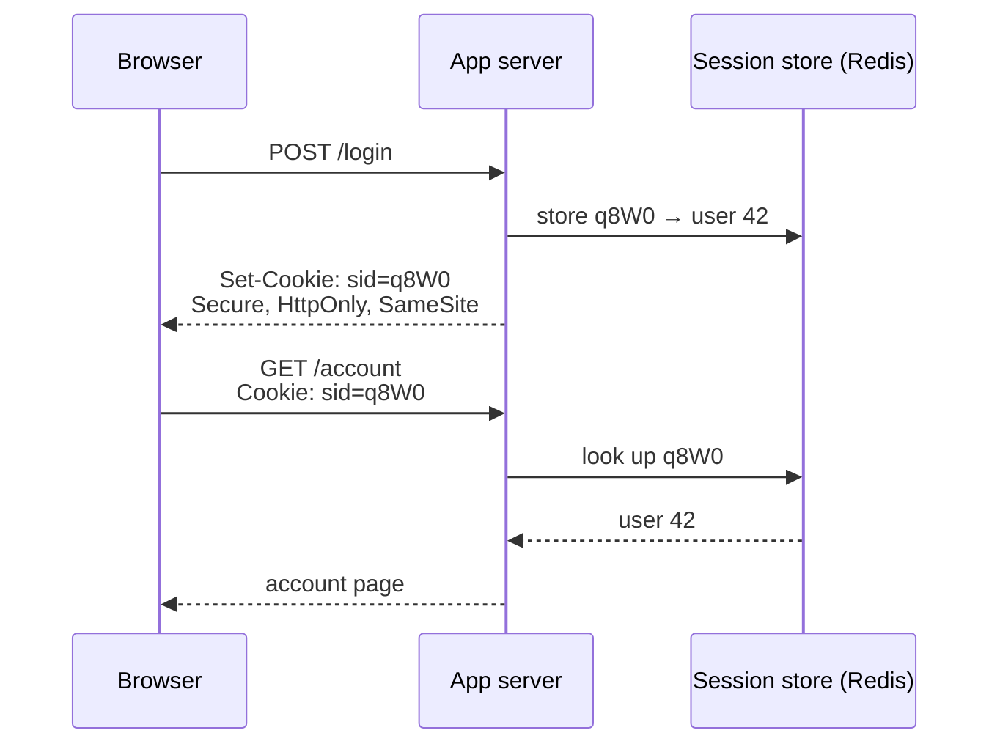

## Mental Model

HTTP forgets you after every request. A **cookie** is a **wristband** the server hands you ("Set-Cookie"); your browser automatically shows it on every later request to that site ("Cookie"). What's written on the wristband is the design decision:

- a **random ticket number** that the server looks up in its own records (**server-side session**), or
- a **signed statement** "this is user 42, admin=false, valid until 11:00" that the server can verify without looking anything up (**self-contained token**, e.g., a JWT).

## Definition

- **Cookie**: a small name/value pair set by `Set-Cookie` and returned by the browser in `Cookie` headers to matching requests, subject to attributes (Domain, Path, Expires/Max-Age, Secure, HttpOnly, SameSite).
- **Session**: server-side state associated with a user, referenced by an unguessable **session ID** (usually in a cookie).
- **Token-based auth**: the client presents a token (often in `Authorization: Bearer …`) that carries or references identity and permissions. **JWT** (JSON Web Token) = base64url(header).base64url(claims).signature.

## Why It Exists

**The problem.** Logins, carts and preferences need continuity across stateless HTTP requests. HTTP's statelessness is what lets any server handle any request — but it also means the server can't tell that request #2 came from the same person who logged in with request #1.

**The idea.** Since the server can't remember the client, make the client carry something on every request that identifies it. The browser stores it and attaches it automatically (cookies). The only real design question is *what* to carry: a pointer to state the server keeps (session ID), or the state itself, signed so it can't be forged (token).

:::callout[That's all it is]{type=insight}
The server gives the browser a value; the browser sends it back on every request. Either it's a random ID the server looks up, or it's signed data the server just verifies. Cookie attributes control when the browser is allowed to send it.
:::

## How It Works

### Cookie attributes that matter

```http
Set-Cookie: sid=5c1f...9e; Path=/; Secure; HttpOnly; SameSite=Lax; Max-Age=86400
```

| Attribute | Effect | Why |
|---|---|---|
| `Secure` | Only sent over HTTPS | Prevent leaking over plain HTTP |
| `HttpOnly` | Not readable by JavaScript (`document.cookie`) | Limits theft via XSS |
| `SameSite=Lax` (browser default) / `Strict` / `None` | Controls sending on cross-site requests | Primary CSRF defense ([CORS & CSRF](lesson:cn-cors-csrf)); `None` requires `Secure` |
| `Domain` | Which hosts receive it (omit = exact host only) | Setting `Domain=example.com` shares with all subdomains — broader exposure |
| `Path` | URL path prefix | Weak isolation; not a security boundary |
| `Expires` / `Max-Age` | Persistence (absent = session cookie until browser closes) | |
| `__Host-` prefix | Forces Secure, Path=/, no Domain | Hardened session cookies |

### Server-side sessions vs self-contained tokens

The trade-off is "where does the state live?" — on the server (easy to change and revoke, but needs a lookup) or inside the token (no lookup, but hard to take back once issued).

| | Server-side session (opaque ID) | Self-contained token (JWT) |
|---|---|---|
| What the client holds | Random ID | Signed claims |
| Server lookup per request | Yes (session store: Redis/DB) | No (verify signature) |
| Revocation / logout | Immediate (delete session) | Hard until expiry (needs denylist or short lifetimes) |
| Size | Tiny | Hundreds of bytes to KBs (every request) |
| Scaling | Needs a shared store (or sticky sessions) | Stateless verification by any service |
| Data freshness | Always current | Claims (roles) stale until reissued |
| Typical use | Web apps with browsers | APIs, service-to-service, federated identity (OIDC) |

Common hybrid: short-lived **access tokens** (5–15 min JWTs) + long-lived **refresh tokens** stored server-side and rotated — fast stateless checks with bounded revocation delay.

A server-side session, from login to the next request:



### Where to store tokens in browsers

- **HttpOnly Secure SameSite cookie**: not readable by JS (XSS can't exfiltrate it, though it can still make requests as the user); automatically sent (needs CSRF protections).
- **localStorage**: easy for SPAs, but any XSS can steal it; not sent automatically (no CSRF issue).

For browser apps, HttpOnly cookies are generally the safer default; the real defense against XSS is preventing XSS (output encoding, CSP).

## Internal Mechanism

:::depth{level=advanced}
### JWT pitfalls

- JWTs are **signed, not encrypted** — anyone can base64-decode the claims; never put secrets in them.
- Validate properly: fixed expected algorithm (reject `alg: none` and algorithm confusion between HS256/RS256), issuer, audience, expiry, not-before, and key ID against a trusted JWKS.
- Size bloat: large role lists in every request header.
- Revocation: design for short expiry plus refresh-token rotation (detect reuse of an old refresh token as theft).

### Session fixation and rotation

Always issue a **new session ID at login** (and privilege changes). Otherwise an attacker who planted a known session ID in the victim's browser before login inherits the authenticated session.
:::

## Example

```http
POST /login → 200 OK
Set-Cookie: __Host-sid=q8W0...; Path=/; Secure; HttpOnly; SameSite=Lax

GET /account
Cookie: __Host-sid=q8W0...
→ server: GET session:q8W0... from Redis → {user_id: 42, csrf: "..."} → render
```

## Complexity & Performance

- Session store lookups add a network round trip (~0.2–1 ms to Redis) per request — usually fine, cacheable in-process briefly.
- Token verification costs a signature check (HMAC: µs; RSA/ECDSA verify: tens of µs) and bytes on every request.

## Trade-offs

- Stateful sessions: control and revocation vs a shared dependency (session store availability becomes login availability).
- Stateless tokens: scalability and decentralization vs revocation difficulty and stale claims.
- **Sticky sessions** (LB pins a user to one server holding in-memory sessions): simple vs uneven load, lost sessions on server failure, hard autoscaling — prefer a shared store ([Proxies & Load Balancers](lesson:cn-proxies-load-balancers)).

## Failure Modes

- Missing `Secure`/`HttpOnly`/`SameSite` → session theft or CSRF.
- Session store outage → everyone logged out or unable to log in.
- Long-lived JWTs that can't be revoked after compromise or role removal.
- Cookie size bloat → requests exceed header limits (431 errors).
- Session fixation; predictable session IDs.

## In Production

- Session stores: Redis with TTLs (sliding expiration), replicated for availability ([Redis & Caching](lesson:db-redis-caching)).
- Identity providers (OAuth 2.0/OIDC) issue tokens; APIs validate JWTs against the provider's JWKS with caching.

## Deeper Connections

- CSRF and cross-origin rules decide when cookies are sent ([CORS & CSRF](lesson:cn-cors-csrf)); HMAC/signatures from [Crypto Foundations](lesson:cn-crypto-foundations).

## Common Misconceptions

- **"JWTs are encrypted."** Usually only signed (JWS); claims are readable.
- **"Stateless auth has no downsides."** Revocation and claim freshness are the hard parts.
- **"HttpOnly prevents XSS."** It prevents reading the cookie via JS; XSS can still act as the user.

## Interview Questions

### [L1 · compare] Cookies vs sessions?

A cookie is client-side storage the browser sends with requests; a session is server-side state for a user. Typically the cookie holds only a random session ID that references the session data stored on the server (e.g., in Redis).

### [L2 · compare] Session-based authentication vs JWT-based authentication?

Session auth stores state server-side and gives the client an opaque ID: easy revocation and always-fresh data, but requires a shared session store lookup per request. JWT auth gives the client a signed token containing claims: any service can verify it without a lookup (stateless, scalable), but revocation before expiry is hard, claims can go stale, and tokens are larger. Many systems combine short-lived JWTs with server-stored refresh tokens.

### [L2 · conceptual] What do the HttpOnly, Secure and SameSite cookie attributes do?

HttpOnly hides the cookie from JavaScript, limiting theft through XSS. Secure sends it only over HTTPS. SameSite controls whether the cookie is sent with cross-site requests (Strict: never; Lax: only top-level navigations like following a link; None: always, requires Secure), which mitigates CSRF.

### [L3 · design] How would you implement logout-everywhere for a system using JWT access tokens?

Keep access tokens short-lived (e.g., 5–10 minutes) and store refresh tokens server-side; logout-everywhere deletes/revokes all the user's refresh tokens so no new access tokens can be minted, and existing ones expire shortly. For immediate effect, maintain a per-user "tokens issued before T are invalid" timestamp or a denylist of token IDs checked by services (cached), accepting that this reintroduces a lookup.

### [L2 · how] How do access tokens and refresh tokens work together?

The access token is short-lived (5–15 minutes) and self-contained: every service can verify its signature without a lookup. The refresh token is long-lived, stored server-side (or tracked there), and only sent to the authorization server to get a new access token. Revoking a user means revoking the refresh token: their access token keeps working only until it expires. Rotating the refresh token on every use, and treating reuse of an old one as theft, limits the damage if one leaks.

### [L2 · why] Why must the session ID change at login?

To prevent session fixation. If the ID stays the same, an attacker who planted a known session ID in the victim's browser before login (through a crafted link or a subdomain cookie) shares the session once the victim authenticates. Issuing a new ID at login, and at any privilege change, makes the planted one worthless. Frameworks do this automatically (Spring Security's session-fixation protection, for example), provided it isn't turned off.

## Practice

### [mcq] Which cookie attribute prevents JavaScript from reading a session cookie?

- [ ] Secure
- [x] HttpOnly
- [ ] SameSite=Strict
- [ ] Path=/

HttpOnly cookies are sent with requests but hidden from document.cookie.

### [mcq] What is the main drawback of long-lived stateless JWT access tokens?

- [ ] They can't be verified without a database
- [x] They can't easily be revoked before expiry
- [ ] They must be sent over UDP
- [ ] They can't carry user IDs

Verification is stateless, so revocation requires extra state or short lifetimes.

### [numeric 32] Access tokens last 15 minutes and are refreshed just as they expire. How many refreshes does one client make during an 8-hour working day?

:::answer
8 × 60 ÷ 15 = **32**. Shorter tokens shrink the window in which a stolen token works, at the cost of more refreshes; the refresh is a cheap call, so 5–15 minutes is common.
:::

### [numeric 24 unit=hours] A cookie is set with `Max-Age=86400`. For how many hours does the browser keep it?

:::answer
86,400 s ÷ 3,600 = **24** hours. Without Max-Age or Expires it would be a session cookie, deleted when the browser closes.
:::

### [mcq] A session cookie has `SameSite=Lax`. Which request from a page on another site still carries it?

- [ ] A form POST to your site
- [ ] A `fetch()` call to your API
- [x] A top-level navigation (the user clicks a link to your site)
- [ ] An `` loading from your site

Lax sends cookies only on top-level navigations with safe methods (GET), so links keep working while cross-site POSTs and subrequests arrive without the cookie, which defeats classic CSRF.

### [mcq] What does the `__Host-` prefix on a cookie name guarantee?

- [ ] The cookie is encrypted
- [x] The cookie was set with Secure, Path=/ and no Domain attribute, so it is bound to this exact host
- [ ] The cookie can only be read by JavaScript from the same host
- [ ] The cookie expires when the host's certificate does

Browsers reject `__Host-` cookies that don't meet those rules. That stops a compromised or less-trusted subdomain from setting or overwriting the session cookie for the main host.

### [exercise] An app uses 24-hour JWT access tokens with no refresh tokens. Security asks for "log out everywhere" when a password changes. Explain why that is hard with this design, and propose two designs that make it work.

:::solution
**Why it's hard.** A JWT is valid until its expiry, and services verify it without asking anyone. After a password change, every token already issued keeps working for up to 24 hours.

**Design 1: short access tokens plus server-side refresh tokens.** Access tokens of 5–15 minutes, refresh tokens stored in a database. A password change deletes the user's refresh tokens; within one access-token lifetime every session is gone. This is the common choice.

**Design 2: a token version or denylist check.** Store a `tokensValidAfter` timestamp (or version number) per user, and put the issue time in the token. A password change bumps the timestamp, and services reject older tokens. That costs a lookup per request, usually a cached one, which brings back some of the state JWTs avoided.

Both are simpler than either long-lived JWTs with a full denylist, or abandoning JWTs for opaque server-side sessions, which also solves it.
:::

## Quick Revision

- Cookie = browser-stored name/value sent automatically; attributes: Secure, HttpOnly, SameSite, Domain, Path, Max-Age, `__Host-`.
- Session = server-side state keyed by random ID (Redis); revocable, needs shared store.
- JWT = signed (not encrypted) claims; stateless verification; revocation/staleness hard → short access + rotated refresh tokens.
- Store browser tokens in HttpOnly cookies (+ CSRF defense); rotate session ID at login; avoid sticky sessions.
- Access token short (5–15 min) + refresh token server-side (rotate; reuse = theft); new session ID at login (fixation). SameSite=Lax: cookies only on top-level GET navigations from other sites. `__Host-` = Secure, Path=/, no Domain.
