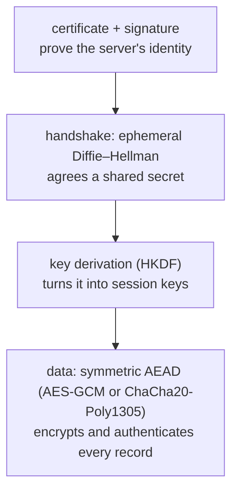

## Mental Model

Secure communication needs four properties, and each cryptographic tool delivers one or two:

| Property | Question | Tool |
|---|---|---|
| **Confidentiality** | Can eavesdroppers read it? | Encryption (symmetric for bulk data) |
| **Integrity** | Was it modified in transit? | MAC / AEAD tag |
| **Authentication** | Am I talking to the real server? | Digital signatures + certificates |
| **Key agreement** | How do we get a shared secret over a public wire? | Diffie–Hellman key exchange |

TLS glues them together: **asymmetric crypto** (slow, but works between strangers) is used briefly at the start to **authenticate** and **agree on keys**; then **symmetric crypto** (fast) protects all the data.

## Definition

- **Symmetric encryption**: the same secret key encrypts and decrypts (AES-GCM, ChaCha20-Poly1305). Fast — GB/s per core with hardware AES instructions.
- **Asymmetric (public-key) cryptography**: a key pair; the **public key** can be shared, the **private key** is secret. Used for key exchange and signatures (RSA, elliptic curves: ECDSA, Ed25519, X25519). Orders of magnitude slower than symmetric.
- **Cryptographic hash**: a one-way function producing a fixed-size digest (SHA-256): infeasible to invert or to find two inputs with the same digest.
- **MAC (message authentication code)**: a keyed checksum (HMAC-SHA256) proving integrity and authenticity to anyone holding the shared key.
- **AEAD (authenticated encryption with associated data)**: encryption + integrity in one operation (AES-GCM, ChaCha20-Poly1305) — what TLS 1.3 uses for records.
- **Digital signature**: created with a private key, verifiable with the public key — proves who signed and that the data is unmodified.
- **Diffie–Hellman (DH / ECDHE)**: two parties each combine their private value with the other's public value to derive the same shared secret, which an eavesdropper seeing only the public values can't compute.
- **Forward secrecy**: compromise of a server's long-term private key doesn't expose past sessions (achieved with ephemeral DH keys per connection).

## Why It Exists

**The problem.** The internet is a hostile shared medium: packets cross networks you don't control (coffee-shop Wi-Fi, ISPs, transit providers). Without encryption, anyone on the path can read passwords and cookies; without integrity, they can inject content; without authentication, they can impersonate the server (man-in-the-middle).

**The core puzzle.** Encryption needs a shared secret key — but you've never met the server, and anyone can read what you send to set one up. How do two strangers agree on a secret in public? Public-key cryptography is the answer to exactly that puzzle; everything else (hashes, MACs, AEAD) handles integrity once a secret exists.

:::callout[That's all it is]{type=insight}
Use slow public-key maths for a moment at the start, to prove who the server is and to agree on a secret key. Then use fast symmetric encryption with that key for all the data.
:::

## How It Works

### Why both symmetric and asymmetric?

- Symmetric crypto is fast but requires both sides to **already share** a secret key — the chicken-and-egg problem on the open internet.
- Asymmetric crypto solves key distribution (publish the public key) but is ~100–10,000× slower.
- So protocols use **asymmetric for the handshake** (authenticate, agree on a secret) and **symmetric for the data** (hybrid cryptography).

### Diffie–Hellman intuition (paint mixing)

The puzzle: agree on a secret when every message you send is visible. The trick is an operation that's easy to do and practically impossible to undo.

1. Alice and Bob agree publicly on a common paint color.
2. Each secretly picks a private color, mixes it with the common color, and sends the mixture.
3. Each adds their own private color to the mixture they received.
4. Both end up with the same final color; an eavesdropper who saw both mixtures can't "unmix" them.

Real systems use elliptic-curve DH (X25519): the "unmixing" is the elliptic-curve discrete logarithm problem. **Ephemeral** keys (fresh per connection, discarded after) give **forward secrecy**. Plain DH doesn't authenticate anyone — a man in the middle could run DH with both sides — so the server **signs** its DH share with its certificate's private key.

### Signatures vs encryption with key pairs

| Operation | Uses | Purpose |
|---|---|---|
| Sign | Signer's **private** key | Prove authorship/integrity |
| Verify signature | Signer's **public** key | Anyone can check |
| Encrypt (RSA key transport, legacy) | Recipient's **public** key | Only recipient can read |
| Decrypt | Recipient's **private** key | |

TLS 1.3 no longer uses RSA key transport (encrypting the session key with the server's public key) because it lacks forward secrecy; it always uses ephemeral (EC)DHE and uses the certificate key only for **signing**.

### Hashes, MACs and passwords

- Hashes detect accidental or malicious changes when the digest is obtained securely; they're also the basis of signatures (sign the hash) and of content addressing (Git, ETags).
- A plain hash of a message doesn't authenticate it (an attacker can recompute it); a **MAC** requires the key.
- **Passwords** must be stored with slow, salted password-hashing functions (bcrypt, scrypt, Argon2), not SHA-256 — fast hashes make brute force cheap.

The pieces fit together in every TLS connection:



### Block ciphers, stream ciphers and modes

- **AES** is a **block cipher**: it encrypts one 16-byte block at a time with a key of 128, 192 or 256 bits. A **mode** turns it into something that can encrypt a whole message.
- **ECB** mode encrypts each block independently, so equal plaintext blocks give equal ciphertext blocks, and patterns show through. Never use it.
- **CBC** chains blocks together but needs padding, and was the source of padding-oracle attacks.
- **GCM** turns AES into a stream cipher (counter mode) and adds an authentication tag: it is an **AEAD** (authenticated encryption with associated data), which encrypts and detects tampering in one step. Its 96-bit nonce must **never repeat** under the same key, or both confidentiality and authenticity fail.
- **ChaCha20-Poly1305** is an AEAD built on a **stream cipher**, fast on CPUs without AES instructions (many phones).

TLS 1.3 allows only AEAD ciphers.

### RSA and Diffie–Hellman with small numbers

Real keys are hundreds of digits long, but the arithmetic is the same.

**RSA.** Pick primes p = 3 and q = 11. Then n = 33 and φ(n) = (p − 1)(q − 1) = 20. Choose e = 3; d is its inverse mod 20, so d = 7 (3 × 7 = 21 = 1 mod 20). The public key is (e, n) = (3, 33) and the private key is d = 7.

```text
encrypt m = 4:   c = 4³ mod 33 = 64 mod 33 = 31
decrypt c = 31:  m = 31⁷ mod 33 = 4
```

Security rests on factoring: given n, recovering p and q (and so d) is easy for 33 and infeasible for a 2,048-bit n.

**Diffie–Hellman.** Public values: prime p = 23 and generator g = 5. Alice secretly picks a = 6, Bob picks b = 15.

```text
Alice sends A = 5⁶ mod 23 = 8          Bob sends B = 5¹⁵ mod 23 = 19
Alice computes 19⁶ mod 23 = 2          Bob computes 8¹⁵ mod 23 = 2
```

Both reach the shared secret 2. An eavesdropper sees 23, 5, 8 and 19, but recovering a or b from them is the discrete logarithm problem.

## Internal Mechanism

:::depth{level=advanced}
### Key derivation and nonces

TLS 1.3 feeds the DH shared secret into **HKDF** (an HMAC-based key derivation function) with transcripts of the handshake to derive separate keys for each direction and purpose (handshake traffic, application traffic, resumption). AEAD ciphers need a unique **nonce** per record under the same key — TLS constructs it from a sequence number; nonce reuse with AES-GCM is catastrophic (it can reveal the authentication key and plaintext relationships).

### Post-quantum transition

A large quantum computer would break RSA and elliptic-curve cryptography (Shor's algorithm). Because encrypted traffic recorded today could be decrypted later ("harvest now, decrypt later"), browsers and CDNs have begun deploying **hybrid key exchange** (e.g., X25519 combined with ML-KEM/Kyber) in TLS 1.3. Symmetric ciphers and hashes are much less affected (larger key sizes suffice).
:::

## Example

```bash
$ openssl s_client -connect example.com:443 -servername example.com </dev/null 2>/dev/null | grep -E "Protocol|Cipher|Server Temp Key|Peer signature"
Protocol  : TLSv1.3
Cipher    : TLS_AES_256_GCM_SHA384            # symmetric AEAD for data + hash for key derivation
Server Temp Key: X25519, 253 bits             # ephemeral ECDH → forward secrecy
Peer signature type: ECDSA                    # certificate key signs the handshake
```

## Visualization

See where each primitive is used in the TLS 1.3 handshake:

::viz{id=tls-handshake}

## Complexity & Performance

| Operation | Rough cost (modern CPU) |
|---|---|
| AES-GCM with AES-NI | Several GB/s per core |
| X25519 key agreement | ~tens of µs |
| ECDSA P-256 sign | ~tens of µs |
| RSA-2048 sign | ~1 ms (verify is much cheaper) |
| bcrypt/Argon2 password hash (tuned) | ~50–500 ms (deliberately slow) |

Handshakes are the expensive part of TLS at scale — hence session resumption and connection reuse.

## Trade-offs

- RSA vs ECC certificates: ECC keys are smaller and signing is faster; RSA has broader legacy compatibility.
- Forward secrecy (ephemeral DH) costs a little CPU per handshake but protects past traffic.
- Encryption everywhere removes middlebox visibility (debugging, filtering) — a deliberate trade.

## Failure Modes

- Rolling your own crypto or misusing primitives (ECB mode, nonce reuse, unauthenticated encryption, fast hashes for passwords).
- Weak or deprecated algorithms (MD5, SHA-1 signatures, RC4, TLS 1.0/1.1).
- Leaked private keys (committed to Git, exposed in images) — revoke and rotate immediately.
- Timing side channels in hand-written comparisons (use constant-time comparison for MACs/tokens).

## In Production

- Use well-maintained libraries (OpenSSL/BoringSSL, libsodium, platform TLS) and modern defaults (TLS 1.3, AEAD suites).
- Keep private keys in HSMs/KMS where possible; automate certificate and key rotation.

## Deeper Connections

- Certificates bind public keys to names ([Certificates & PKI](lesson:cn-certificates-pki)); the handshake choreography ([TLS Handshake](lesson:cn-tls-handshake)); HMAC-signed tokens and cookies ([Cookies & Sessions](lesson:cn-cookies-sessions)).

## Common Misconceptions

- **"HTTPS encrypts data with the server's public key."** Modern TLS uses the certificate key only to sign; data is encrypted with symmetric keys derived from ephemeral DH.
- **"Hashing is encryption."** Hashes are one-way; encryption is reversible with the key.
- **"Encoding (Base64) protects data."** It's just a representation.

## Interview Questions

### [L1 · compare] What's the difference between symmetric and asymmetric encryption?

Symmetric encryption uses one shared secret key for encryption and decryption; it's fast and used for bulk data, but both parties must already share the key. Asymmetric cryptography uses a public/private key pair; it solves key distribution and enables signatures, but is much slower. Protocols like TLS use asymmetric crypto to authenticate and agree on keys, then symmetric crypto for the data.

### [L2 · compare] Hash vs MAC vs digital signature?

A hash is an unkeyed digest detecting changes but not proving origin (anyone can recompute it). A MAC is a keyed digest: anyone with the shared key can create and verify it, proving integrity and that the sender knew the key. A digital signature uses a private key to sign and a public key to verify: anyone can verify, only the key holder can sign — providing non-repudiation.

### [L2 · conceptual] What is forward secrecy and how is it achieved?

Forward secrecy means recording encrypted traffic and later stealing the server's long-term private key doesn't allow decrypting past sessions. It's achieved by using ephemeral Diffie-Hellman keys generated per connection (ECDHE) and discarded afterward; the long-term key only signs the handshake.

### [L3 · why] Why shouldn't passwords be stored as SHA-256 hashes?

SHA-256 is designed to be fast, so attackers who steal the database can test billions of guesses per second on GPUs, and unsalted hashes enable precomputed tables. Password storage needs salted, deliberately slow, memory-hard functions (Argon2id, scrypt, bcrypt) with tunable cost.

### [L2 · numerical] Walk through RSA with p = 3, q = 11, e = 3, encrypting m = 4.

n = pq = 33 and φ(n) = (p − 1)(q − 1) = 20. The private exponent d is the inverse of e modulo 20: 3 × 7 = 21 ≡ 1, so d = 7. Encrypt: c = mᵉ mod n = 4³ mod 33 = 64 mod 33 = 31. Decrypt: m = c^d mod n = 31⁷ mod 33 = 4. The public key (3, 33) can be shared freely; anyone who could factor 33 into 3 × 11 could compute d, which is why real moduli are 2,048 bits or more.

### [L2 · why] What is AEAD, and why must an AES-GCM nonce never repeat?

AEAD (authenticated encryption with associated data) encrypts the data and produces an authentication tag over it and over unencrypted associated data (such as headers), so one operation gives confidentiality and tamper detection. AES-GCM encrypts by XORing the data with a keystream derived from the key and the nonce. Reusing a nonce with the same key reuses the keystream: XORing two ciphertexts cancels it and leaks the XOR of the plaintexts, and it also lets an attacker forge authentication tags. Implementations use a counter or a random 96-bit nonce per message, and rotate keys long before random nonces could collide.

## Practice

### [mcq] Which key does a server use to create a digital signature in the TLS handshake?

- [ ] The client's public key
- [ ] The session key
- [x] The server's private key (matching the certificate's public key)
- [ ] The CA's private key

The client verifies it with the public key from the certificate.

### [mcq] Which mechanism allows two parties to agree on a shared secret over an insecure channel without having shared anything beforehand?

- [ ] HMAC
- [ ] SHA-256
- [x] Diffie–Hellman key exchange
- [ ] AES

It must be combined with authentication (signatures) to stop man-in-the-middle attacks.

### [numeric 31] RSA with n = 33 and public exponent e = 3. What is the ciphertext for the message m = 4?

:::answer
c = 4³ mod 33 = 64 mod 33 = **31**. With the private exponent d = 7, 31⁷ mod 33 gives back 4.
:::

### [numeric 27] RSA with p = 5, q = 11 and e = 3. What is the private exponent d?

:::answer
φ(n) = 4 × 10 = 40, and d must satisfy 3d ≡ 1 (mod 40). 3 × 27 = 81 = 2 × 40 + 1, so d = **27**. (Check: encrypting 9 gives 9³ mod 55 = 14, and 14²⁷ mod 55 = 9.)
:::

### [numeric 2] Diffie–Hellman with p = 23 and g = 5. Alice's secret is 6 and Bob's is 15. What shared secret do they compute?

:::answer
Alice sends 5⁶ mod 23 = 8 and Bob sends 5¹⁵ mod 23 = 19. Alice computes 19⁶ mod 23 = 2 and Bob computes 8¹⁵ mod 23 = 2: the shared secret is **2**.
:::

### [mcq] Why is AES in ECB mode unsafe for real data?

- [ ] AES keys are too short in ECB mode
- [x] Identical plaintext blocks encrypt to identical ciphertext blocks, so patterns in the data remain visible
- [ ] ECB can't decrypt messages longer than one block
- [ ] ECB uses a public key

The well-known "ECB penguin" image, encrypted with ECB, still shows the penguin's outline. Use an AEAD mode such as GCM instead.

### [exercise] A payment provider signs each webhook with HMAC-SHA256 over the raw request body, using a shared secret, and sends the result in a header. Write the Java check, and explain why a plain SHA-256 hash of the body would be useless, and why the comparison must be constant-time. Then find where HMAC and signatures appear in the [TLS handshake visualization](viz:tls-handshake).

:::solution
```java
static boolean validWebhook(byte[] rawBody, byte[] receivedTag, byte[] secret) throws GeneralSecurityException {
    Mac mac = Mac.getInstance("HmacSHA256");
    mac.init(new SecretKeySpec(secret, "HmacSHA256"));
    byte[] expected = mac.doFinal(rawBody);                // over the exact bytes received, before parsing
    return MessageDigest.isEqual(expected, receivedTag);   // constant-time comparison
}
```

- **Why not a plain hash:** anyone can compute SHA-256 of a forged body; only someone with the secret can compute the HMAC. The key is what makes it authentication rather than just integrity.
- **Why constant-time:** `Arrays.equals` stops at the first different byte. By timing many attempts, an attacker could learn how many leading bytes of a guessed tag were right, and build a valid tag byte by byte. `MessageDigest.isEqual` takes the same time whatever the input.
- **Also:** compute it over the raw body bytes, since re-serialized JSON may differ, and reject old timestamps to stop replays.

In the TLS handshake, the server's **CertificateVerify** is a *signature* (with the certificate's private key) over the transcript, and both **Finished** messages are HMACs over the transcript with keys derived from the handshake.
:::

## Quick Revision

- Confidentiality (encryption), integrity (MAC/AEAD), authentication (signatures + certs), key agreement (DH).
- Symmetric (AES-GCM, ChaCha20) = fast bulk; asymmetric (RSA, ECC) = handshake: key exchange + signatures.
- Hash (unkeyed) vs MAC (shared key) vs signature (private sign / public verify).
- Ephemeral (EC)DHE → forward secrecy; TLS 1.3 dropped RSA key transport.
- Passwords → Argon2/bcrypt/scrypt with salt. Don't roll your own crypto.
- AES = block cipher; never ECB; GCM / ChaCha20-Poly1305 = AEAD (encrypt + authenticate); never reuse a GCM nonce with the same key.
- RSA: n = pq, φ = (p−1)(q−1), d = e⁻¹ mod φ, c = mᵉ mod n (p=3, q=11, e=3, m=4 → c=31, d=7). DH: A = gᵃ mod p, shared = Bᵃ = Aᵇ.
- Java: `Mac` (HMAC) + `MessageDigest.isEqual` (constant time); `Cipher.getInstance("AES/GCM/NoPadding")`.
