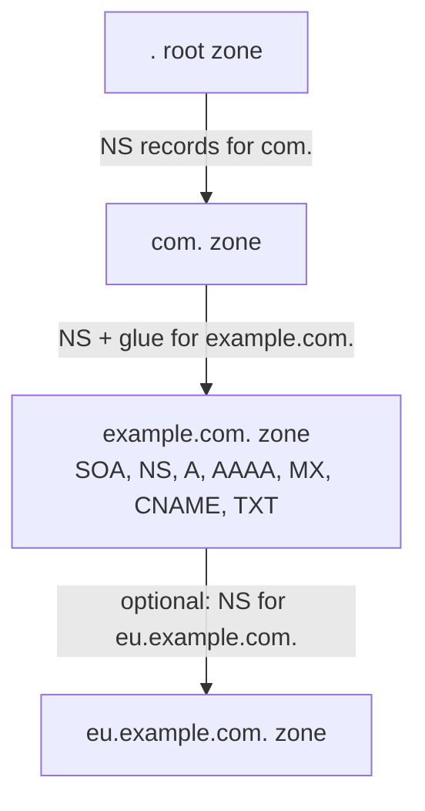

## Mental Model

A DNS zone is a small **key-value table** where the key is (name, type) and the value is a list of records, each with a TTL. Different record **types** answer different questions:
- *what's the IPv4 address?* (A), and the IPv6 address (AAAA);
- *what's this really called?* (CNAME);
- *where does mail go?* (MX);
- *who's in charge of this zone?* (NS);
- *what else should I know?* (TXT).

## Definition

| Type | Maps a name to | Example |
|---|---|---|
| **A** | IPv4 address | `www IN A 93.184.215.14` |
| **AAAA** | IPv6 address | `www IN AAAA 2606:2800:21f:cb07::1` |
| **CNAME** | Another name (canonical name / alias) | `www IN CNAME example.cdnprovider.net.` |
| **MX** | Mail servers with priorities | `@ IN MX 10 mx1.example.com.` |
| **NS** | Authoritative name servers for a zone (delegation) | `@ IN NS ns1.example-dns.net.` |
| **SOA** | Zone metadata: primary server, admin, serial, refresh/retry/expire, negative-cache TTL | one per zone |
| **TXT** | Arbitrary text | SPF, DKIM, DMARC, domain verification tokens |
| **SRV** | Service host + port + priority/weight | `_sip._tcp IN SRV 10 60 5060 sip1.example.com.` |
| **PTR** | Reverse DNS: IP → name | `14.215.184.93.in-addr.arpa. IN PTR www.example.com.` |
| **CAA** | Which CAs may issue certificates | `@ IN CAA 0 issue "letsencrypt.org"` |

## Why It Exists

**The problem.** Different protocols need different lookups: browsers need addresses, mail servers need to know where to deliver mail, certificate authorities need to check issuance policy, service discovery needs ports.

**The idea.** Don't build a separate directory per question. Keep one distributed, cached system and add a *type* to the key: (name, type) → answers. A new kind of question just needs a new type. One extensible system of typed records serves them all.

:::callout[That's all it is]{type=insight}
DNS is a lookup on (name, type). A asks for IPv4, AAAA for IPv6, CNAME says "look up this other name instead", MX says where mail goes, NS says who answers for a zone. Each has its own TTL.
:::

## How It Works

### Zones and delegation

The DNS namespace is a tree, and each **zone** is a part of it run by one operator. A parent zone delegates a child zone by publishing its name servers (NS records), plus **glue** addresses when the name servers live inside the child zone:



Every zone starts with an **SOA** (start of authority) record. It holds the primary name server, a contact address, and a serial number that secondaries compare to decide whether to copy the zone. It also holds refresh and retry intervals, and the TTL for caching negative answers.

### CNAME chains

The problem CNAME solves: your site is hosted by a CDN whose IP addresses change often. You don't want to edit your zone every time — you want to say "whatever the CDN says". A CNAME is that pointer.

```text
www.shop.com.          300  CNAME  shop.cdn-provider.net.
shop.cdn-provider.net.  60  CNAME  edge-eu.cdn-provider.net.
edge-eu.cdn-provider.net. 20 A    198.51.100.23
```

The resolver follows the chain and returns all records; each hop can have its own TTL (the shortest effectively bounds how long the full answer is valid). CNAMEs let a third party (a CDN, a SaaS host) change the final addresses without you touching your zone.

**CNAME rules:**

- A name with a CNAME **cannot have any other records** (no MX, TXT… at the same name).
- Therefore the **zone apex** (`example.com` itself, which must have SOA and NS records) **cannot be a CNAME**. Providers work around this with proprietary **ALIAS/ANAME/"CNAME flattening"** records that resolve the target server-side and return A/AAAA answers; the newer standard **HTTPS/SVCB** records also help.
- CNAME chains add lookups (latency) and dependencies.

### DNS-based load balancing and failover

Since every connection starts with a DNS lookup, the answer itself is a cheap steering wheel: give different clients different addresses.

- **Multiple A records**: the resolver returns a list; clients usually try the first and may fall back to others. Order is often rotated (round-robin DNS). Crude: no health awareness unless the DNS provider removes dead IPs.
- **Health-checked failover**: the authoritative provider stops returning unhealthy endpoints — effective only as fast as TTLs expire.
- **GeoDNS / latency-based routing**: answers depend on the resolver's location (or EDNS Client Subnet) — how CDNs and global services direct users to nearby PoPs ([CDN](lesson:cn-cdn)).
- **Weighted records**: canary/blue-green traffic shifting (e.g., 5% to the new stack).

Limitations: clients cache beyond TTL, resolvers aggregate many users (a large resolver can send a whole city to one IP), and DNS can't see per-request load. Anycast and load balancers complement it ([BGP & Anycast](lesson:cn-bgp-anycast)).

### Email records in one paragraph

**MX** points to mail servers (lower preference number = tried first). **SPF** (TXT) lists servers allowed to send mail for the domain; **DKIM** (TXT) publishes public keys verifying message signatures; **DMARC** (TXT at `_dmarc`) tells receivers what to do with mail failing SPF/DKIM alignment. Misconfigured records send your mail to spam.

::viz{id=dns-resolver}

## Internal Mechanism

:::depth{level=advanced}
### Delegation and lame delegations

The parent zone (e.g., `.com`) holds NS records (and glue) pointing to your authoritative servers; your zone should hold matching NS records. When they disagree or point to servers that don't serve the zone (**lame delegation**) — common after switching DNS providers without updating the registrar — some resolvers succeed and others fail, producing confusing partial outages. Changing providers safely: add the new provider's records, verify it serves the full zone, update NS at the registrar, keep the old provider serving until the parent's NS TTL (often 1–2 days) expires.

### SRV and service discovery

SRV records carry ports and weights, enabling clients to discover `host:port` pairs (`_http._tcp.service.namespace.svc.cluster.local` in Kubernetes, Consul DNS). Many HTTP clients don't use SRV, so service meshes and client-side discovery libraries often use other mechanisms ([Service Networking](lesson:cn-service-networking)).
:::

## Example

```bash
$ dig example.com MX +short
10 mx1.example.com.
20 mx2.example.com.
$ dig _dmarc.example.com TXT +short
"v=DMARC1; p=quarantine; rua=mailto:dmarc@example.com"
$ dig -x 8.8.8.8 +short              # reverse lookup (PTR)
dns.google.
$ dig www.github.com +short          # CNAME chain then A
github.com.
140.82.112.3
```

## Complexity & Performance

- Each CNAME hop may cost an extra resolution if not cached.
- DNS-based steering reacts at the speed of TTLs (tens of seconds to minutes), not per request.

## Trade-offs

- CNAME to third parties: flexibility and delegation of operations vs extra lookups and dependency on their DNS.
- DNS load balancing: simple, global, cheap vs coarse, cache-bound, health-unaware without provider features.

## Failure Modes

- CNAME at the apex (rejected by providers or breaks MX/TXT).
- Registrar NS mismatch / lame delegation after provider migration.
- Expired domain registrations (surprisingly common real outages).
- Accidentally deleting or mistyping records during changes; negative caching prolongs the damage.
- Missing CAA or incorrect CAA blocking certificate renewal ([Certificates](lesson:cn-certificates-pki)).
- Mail rejection from missing SPF/DKIM/DMARC.

## In Production

- Manage DNS as code (Terraform, OctoDNS) with review; low TTLs during changes.
- Use provider health checks + low TTL for failover, but prefer load balancers/anycast for fast failover.
- Monitor certificate issuance dependencies (CAA) and domain expiration.

## Deeper Connections

- CDNs rely on CNAMEs + GeoDNS ([CDN](lesson:cn-cdn)); Kubernetes service discovery is DNS ([Service Networking](lesson:cn-service-networking)); ACME DNS-01 challenges use TXT records ([Certificates](lesson:cn-certificates-pki)).

## Common Misconceptions

- **"CNAME redirects HTTP traffic."** It only aliases names at the DNS level; HTTP `Host` headers still carry the original name.
- **"Multiple A records give real load balancing."** They give coarse distribution without health checks or load awareness.
- **"You can put a CNAME on example.com."** Not standards-compliant at the apex.

## Interview Questions

### [L1 · compare] A vs AAAA vs CNAME records?

An A record maps a name to an IPv4 address, AAAA to an IPv6 address, and CNAME maps a name to another (canonical) name, which the resolver then resolves further.

### [L2 · why] Why can't you put a CNAME record at the zone apex?

A CNAME must be the only record at its name, but the apex must have SOA and NS records (and usually MX/TXT). DNS providers offer ALIAS/ANAME or CNAME flattening, resolving the target server-side and returning A/AAAA records instead.

### [L2 · how] How can DNS be used for load balancing, and what are its limitations?

By returning multiple A/AAAA records (round-robin), weighted answers, geographic or latency-based answers, and removing unhealthy endpoints with health checks. Limitations: changes propagate only as fast as TTLs (and clients may cache longer), resolvers aggregate many users, answers can't reflect real-time load, and clients may not fail over across returned IPs gracefully.

### [L3 · incident] After migrating DNS to a new provider, some users can't resolve the domain while others can. What happened?

Likely an inconsistent delegation: the registrar/TLD NS records still point to the old provider (or a mix), and resolvers with different cached NS sets query different servers — some of which no longer serve the zone or serve a different version. Fix: ensure the parent NS records match the new provider, keep the old provider serving an identical zone until NS TTLs (often 48 h) expire, and verify with `dig +trace` from multiple resolvers.

### [L2 · how] How does reverse DNS work, and what name is queried for 203.0.113.7?

Reverse lookups use PTR records in a special tree: the address's octets are reversed and `in-addr.arpa` is appended, so the query is a PTR for **7.113.0.203.in-addr.arpa**. Reversing puts the most general part (203) at the top of the tree, so blocks of addresses can be delegated to their owners, just like forward zones. IPv6 uses `ip6.arpa` with one label per hex digit. Reverse records are set by whoever owns the IP block (often the ISP or cloud provider), and mail servers commonly check them.

### [L2 · conceptual] What is in an SOA record, and why does it matter for caching?

The SOA (start of authority) heads every zone: the primary name server, the administrator's address, a serial number (secondary servers copy the zone when it increases), refresh/retry/expire timers for those secondaries, and the **negative-caching TTL**: how long resolvers may remember that a name doesn't exist. A large negative TTL makes a record created just after someone queried for it invisible to that user for a long time.

## Practice

### [mcq] Which record type tells other mail servers where to deliver email for a domain?

- [ ] TXT
- [x] MX
- [ ] SRV
- [ ] PTR

MX records list mail exchangers with priorities.

### [mcq] Which record type is used for reverse DNS (IP to name)?

- [ ] CNAME
- [ ] A
- [x] PTR
- [ ] NS

PTR records live under in-addr.arpa (IPv4) and ip6.arpa (IPv6).

### [numeric 20 unit=s] A resolver follows the chain `www.shop.com` CNAME (TTL 300) → `shop.cdn.net` CNAME (TTL 60) → `edge.cdn.net` A (TTL 20). For how long can it serve the whole answer from cache without re-resolving any part of it?

:::answer
The answer is only valid as long as its shortest-lived part: **20** s, the A record's TTL. After that the resolver must at least re-resolve `edge.cdn.net`; the longer-lived CNAMEs can still come from its cache.
:::

### [mcq] A domain has MX records with preferences 20, 10 and 5. Which mail server does a sender try first?

- [ ] The one with preference 20
- [ ] The one with preference 10
- [x] The one with preference 5
- [ ] A random one, for load balancing

Lower preference numbers are tried first; higher ones are fallbacks. Equal preferences share the load.

### [exercise] Write the reverse-DNS query name for the IPv4 address 198.51.100.42, and explain why the octets are reversed.

:::solution
The PTR query is for **42.100.51.198.in-addr.arpa**.

DNS names grow more specific from right to left (`www.example.com`), while IP addresses grow more specific from left to right (198 → 198.51 → 198.51.100). Reversing the octets puts the most general part next to `in-addr.arpa`, so the `in-addr.arpa` tree can be delegated just like forward zones: `198.in-addr.arpa`, then `51.198.in-addr.arpa`, down to the organization that owns `100.51.198.in-addr.arpa`.
:::

### [mcq] What does a DKIM record publish?

- [ ] The list of IP addresses allowed to send mail for the domain
- [x] A public key that receiving servers use to verify signatures in outgoing mail headers
- [ ] The policy telling receivers what to do with mail that fails checks
- [ ] The mail server that accepts mail for the domain

SPF lists the permitted senders, DKIM publishes signature-checking keys, DMARC states the policy and reporting address, and MX names the receiving servers ([Email & File Transfer](lesson:cn-email-file-transfer)).

### [exercise] In the [DNS resolution simulator](lab:dns-resolver), resolve a name that is a CNAME into another zone. List every query the resolver sends and explain why a CNAME into a different zone costs extra lookups.

:::solution
The resolver first resolves the original name: root, TLD and the authoritative server for the first zone. That server answers with a **CNAME** pointing into another domain, not with an address. The resolver must then resolve the *target* name as a new question: it may need the target's TLD and authoritative servers too, unless their referrals are already cached. Only the final server returns the A record, and the resolver returns the whole chain to the client.

Each hop into a new zone can add a full walk down the hierarchy. That is why long CNAME chains (common with CDNs and SaaS hosting) add latency on cold caches, and why the shortest TTL in the chain limits how long the result stays cached.
:::

## Quick Revision

- A (IPv4), AAAA (IPv6), CNAME (alias; exclusive at its name; not at apex → ALIAS/flattening), MX (mail), NS (delegation), SOA (zone meta + negative TTL), TXT (SPF/DKIM/DMARC, verification), SRV (host+port), PTR (reverse), CAA (allowed CAs).
- DNS load balancing: multiple A, weighted, GeoDNS, health-checked — TTL-bound and coarse.
- Provider migrations: registrar NS + overlap for NS TTL; lame delegation = partial outages.
- Zones delegate children with NS (+ glue); SOA holds serial, timers and the negative-caching TTL.
- Reverse DNS: PTR at reversed-octets.in-addr.arpa (203.0.113.7 → 7.113.0.203.in-addr.arpa). MX: lowest preference first.
