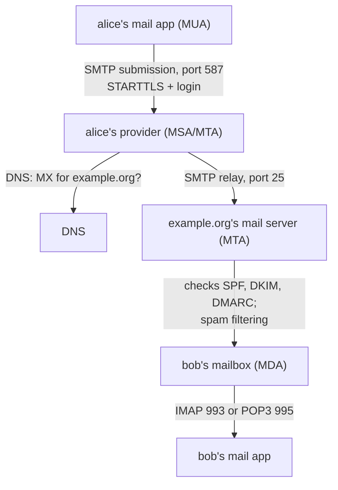
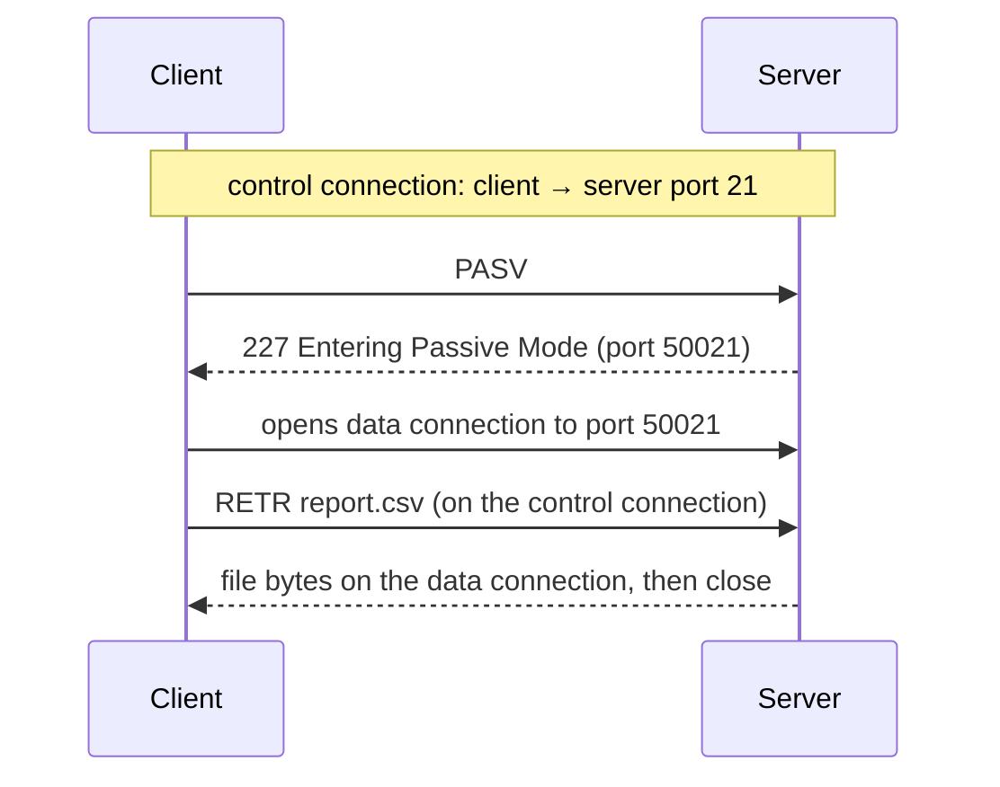

## Mental Model

**Email is the postal system.** You hand a letter to your local post office (your provider's submission server). It looks up which post office serves the recipient's town (the MX record) and passes the letter along. The recipient's post office files it in their mailbox, and the recipient later collects it, either taking everything home (POP3) or reading it at the counter where it stays filed (IMAP). Like paper mail, the "From" written on the envelope was never checked by anyone, until signatures were added.

**FTP is a phone call that arranges a delivery.** The control conversation happens on one line; each file is shipped over a separate connection set up just for it.

**SSH is an armoured tunnel to another machine.** Once you've verified the machine's identity, everything inside the tunnel (a shell, file copies, forwarded ports) is encrypted and authenticated.

## Definition

- **SMTP** (Simple Mail Transfer Protocol): pushes mail from a client to a server and between servers. Port 25 for server-to-server relay, **587** for submission by mail clients (STARTTLS + login), 465 for submission over implicit TLS.
- **MUA / MSA / MTA / MDA**: mail user agent (your mail app), mail submission agent, mail transfer agent (relays mail between domains), mail delivery agent (files it in a mailbox).
- **IMAP** (143, or **993** with TLS): reads mail that stays on the server, synchronized across devices.
- **POP3** (110, or **995** with TLS): downloads mail to one device, usually deleting it from the server.
- **MIME**: the format for attachments, non-ASCII text and multipart messages inside an email.
- **SPF, DKIM, DMARC**: DNS-published policies that let receivers check whether mail claiming to come from a domain really does.
- **FTP** (File Transfer Protocol): a control connection on port **21** plus a separate data connection for each transfer and listing.
- **SSH** (Secure Shell, port **22**): encrypted remote login, command execution, file transfer (SCP, SFTP) and port forwarding.

## Why It Exists

**The problem.** Before the web, the internet's main jobs were sending messages between people on different systems, moving files between machines, and logging into remote computers. Each needed an agreed protocol between programs written by different vendors.

**The ideas.**
- **Email** needs store-and-forward: the recipient may be offline, so mail is pushed to a server that holds it, and read later with a separate protocol.
- **File transfer** separates the conversation (commands and replies) from the bulk data, so a session can move many files.
- **Remote access** originally (Telnet, rlogin) sent everything, passwords included, in clear text. SSH replaced it with an encrypted, authenticated channel that can also carry other protocols.

:::callout[That's all it is]{type=insight}
SMTP pushes mail toward the recipient's server, found through the MX record; IMAP or POP3 pulls it out of the mailbox. FTP talks on one connection and moves data on another. SSH wraps logins, file copies and forwarded ports in one encrypted, authenticated connection.
:::

## How It Works

### An email's journey



1. Alice's app **submits** the message over SMTP to her provider (port 587), after logging in.
2. Her provider looks up the **MX records** of the recipient's domain and connects to the lowest-preference server on port 25 ([DNS Records](lesson:cn-dns-records)).
3. The receiving server checks the sender's authenticity and spam signals, then stores the message in Bob's mailbox.
4. Bob's app **reads** it with IMAP or POP3.

If the receiving server is down, the sender's server **queues** the message and retries for days before bouncing it.

### An SMTP conversation

SMTP is a text protocol of commands and three-digit replies:

```text
S: 220 mx.example.org ESMTP ready
C: EHLO mail.alice.net
S: 250-mx.example.org  250-STARTTLS  250 SIZE 52428800
C: MAIL FROM:<alice@alice.net>                 ← the envelope sender (where bounces go)
S: 250 OK
C: RCPT TO:<bob@example.org>                   ← the envelope recipient
S: 250 OK
C: DATA
S: 354 End data with <CR><LF>.<CR><LF>
C: From: Alice <alice@alice.net>               ← the header From, what the reader sees
C: To: Bob <bob@example.org>
C: Subject: Lunch?
C:
C: Thursday at one?
C: .
S: 250 OK: queued as 4F2A1
C: QUIT
S: 221 Bye
```

Reply codes work like HTTP's: 2xx success, 3xx "send more" (354), 4xx temporary failure (try again later), 5xx permanent failure (550: no such user).

The **envelope** (MAIL FROM, RCPT TO) is what servers use for delivery; the **headers** (From, To) are just text inside the message. Nothing in classic SMTP checks either, which is why forged senders are so easy.

### SPF, DKIM and DMARC: proving where mail came from

| Check | Published as | What the receiver verifies |
|---|---|---|
| **SPF** | TXT record listing the servers allowed to send for the domain | The sending server's IP is on the envelope sender domain's list |
| **DKIM** | TXT record with a public key | A signature over the headers and body, added by the sending domain, is valid |
| **DMARC** | TXT record at `_dmarc.domain` with a policy | SPF or DKIM passed *for the domain in the visible From header*; if not, apply the policy (none, quarantine, reject) and send reports |

DMARC ties the checks to the address the reader actually sees, closing the gap between envelope and header. Large mail providers now require all three from bulk senders.

### IMAP vs POP3

| | IMAP | POP3 |
|---|---|---|
| Where mail lives | On the server; clients sync a view of it | Downloaded to the client, usually deleted from the server |
| Several devices | Yes: read state and folders sync everywhere | Awkward: each device downloads separately |
| Folders, search | On the server | Only locally |
| Typical use | Almost everything today | Single-device setups, mail archiving |

### FTP: two connections

FTP keeps a **control connection** on port 21 for commands (`USER`, `PASS`, `LIST`, `RETR file`, `STOR file`) and opens a new **data connection** for every listing or file. Who opens the data connection depends on the mode:



- **Active mode**: the client sends `PORT` with its own address and a port, and the **server connects back** to the client (from port 20). A NAT or firewall in front of the client blocks that incoming connection.
- **Passive mode**: the client sends `PASV` (or `EPSV`), the server names a port, and the **client connects out** to it. Outgoing connections pass NAT, so passive is the default today.

FTP sends passwords and data in clear text. **FTPS** adds TLS to FTP; **SFTP** is a different protocol that runs inside SSH, on one connection, and is what most people use now.

### SSH

1. **Key exchange**: the client and server run an ephemeral Diffie–Hellman exchange and derive session keys, as TLS does ([Crypto Foundations](lesson:cn-crypto-foundations)).
2. **Server authentication**: the server proves it holds its **host key**. There are no certificate authorities by default: on first connection the client asks you to accept the key's fingerprint and stores it in `~/.ssh/known_hosts`. If the key later changes, SSH warns loudly, because that is exactly what a man-in-the-middle would cause.
3. **User authentication**: a password, or (better) a **public key**: the client proves it holds the private key matching one in the server's `authorized_keys`.
4. **Channels**: one connection carries an interactive shell, commands, SCP/SFTP transfers and **port forwards** side by side.

**Port forwarding** makes SSH a quick tunnel: `ssh -L 5433:db.internal:5432 bastion` lets you reach a private database at `localhost:5433`, through the bastion host, encrypted all the way.

## Internal Mechanism

### Well-known ports worth remembering

| Port | Protocol | Transport |
|---|---|---|
| 20, 21 | FTP data, control | TCP |
| 22 | SSH (and SFTP, SCP) | TCP |
| 23 | Telnet (insecure, legacy) | TCP |
| 25 | SMTP relay | TCP |
| 53 | DNS | UDP and TCP |
| 67, 68 | DHCP server, client | UDP |
| 80, 443 | HTTP, HTTPS (443 also HTTP/3 over UDP) | TCP (and UDP) |
| 110, 995 | POP3, POP3 over TLS | TCP |
| 123 | NTP | UDP |
| 143, 993 | IMAP, IMAP over TLS | TCP |
| 161, 162 | SNMP, SNMP traps | UDP |
| 389, 636 | LDAP, LDAP over TLS | TCP |
| 465, 587 | SMTP submission (implicit TLS, STARTTLS) | TCP |
| 3389 | RDP | TCP |

Ports below 1,024 are "well-known" and, on Linux, need privilege to bind ([Protection & Security](lesson:os-protection-security)).

:::depth{level=advanced}
### STARTTLS and its weakness

SMTP, IMAP and POP3 began as clear-text protocols. **STARTTLS** upgrades an existing connection: the server advertises it, the client sends `STARTTLS`, and both switch to TLS. An attacker on the path can strip the advertisement, and a careless client then continues in clear text. Submission clients should require TLS (or use implicit TLS on 465/993/995). Between mail servers, **MTA-STS** and DANE let a domain publish "always use TLS with this certificate".
:::

## Example

Sending mail from a Java service usually goes through Jakarta Mail (or Spring's `JavaMailSender` on top of it). Whatever the library, it should:
- submit to the provider on **587 with STARTTLS required**, or 465 with implicit TLS, never plain port 25;
- authenticate with credentials from a secret store;
- set connect and read timeouts, since an unreachable mail server otherwise hangs the calling thread ([Networking in Java](lesson:cn-java-networking));
- send from a domain whose SPF, DKIM and DMARC records include the provider, or the mail will be marked as spam.

Checking a domain's mail setup from the command line:

```bash
$ dig +short MX example.org
10 mx1.example.org.
$ dig +short TXT example.org | grep spf
"v=spf1 include:_spf.mailprovider.net -all"
$ dig +short TXT _dmarc.example.org
"v=DMARC1; p=reject; rua=mailto:dmarc@example.org"
```

## Complexity & Performance

- SMTP is chatty (a round trip per command), which matters little for mail but explains pipelining extensions.
- FTP opens a TCP connection per file, so transferring thousands of small files is slow; SFTP and archives help.
- SSH multiplexing (`ControlMaster`) reuses one connection for many commands, avoiding repeated handshakes.

## Trade-offs

- IMAP keeps mail consistent across devices at the cost of server storage; POP3 keeps the server simple.
- FTP is simple and widely supported but insecure and NAT-hostile; SFTP is secure and uses one connection, but needs SSH accounts.
- SSH's trust-on-first-use is easy to set up but relies on users checking fingerprints; SSH certificates fix that for large fleets.

## Failure Modes

- **Mail marked as spam or rejected** because SPF/DKIM/DMARC don't cover the sending service.
- **Active FTP failing behind NAT**: the control connection works, but listings and transfers hang.
- **"REMOTE HOST IDENTIFICATION HAS CHANGED"** after a server rebuild, or during a real man-in-the-middle attack. Verify before accepting the new key.
- **Open relays**: mail servers that relay for anyone are abused for spam within hours.

## In Production

- Applications rarely run their own mail servers; they submit to a provider (SES, SendGrid, Microsoft 365) over 587 and keep the domain's DNS records in line with it.
- Cloud providers often block outbound port 25 from VMs to stop spam.
- SSH bastion hosts, or managed alternatives like session managers, are the usual way into private networks.

## Deeper Connections

- SPF, DKIM and DMARC live in DNS TXT records, so mail security depends on DNS ([DNS Records](lesson:cn-dns-records)).
- SSH's key exchange and TLS's are the same idea: ephemeral Diffie–Hellman for forward secrecy, plus a long-term key to prove identity ([TLS Handshake](lesson:cn-tls-handshake)).
- FTP's server-to-client data connection is the same NAT problem as peer-to-peer connections ([NAT](lesson:cn-nat)).

## Common Misconceptions

- **"The From address proves who sent an email."** Classic SMTP never checks it; only DMARC alignment with SPF or DKIM gives any assurance.
- **"SFTP is FTP over TLS."** SFTP is a separate protocol inside SSH; FTP over TLS is FTPS.
- **"POP3 and IMAP send mail."** They only read mail; sending is always SMTP.

## Interview Questions

### [L1 · compare] SMTP vs IMAP vs POP3?

SMTP *sends*: a mail client submits a message to its provider, and mail servers relay it to the recipient's server (found through MX records). IMAP and POP3 *read*: IMAP keeps mail on the server and synchronizes folders and read state across devices; POP3 downloads mail to one device and usually deletes it from the server. Every email uses SMTP on the way in, and IMAP or POP3 (or webmail) on the way out.

### [L2 · trace] Trace an email from alice@alice.net to bob@example.org.

Alice's mail app submits the message over SMTP on port 587, with STARTTLS and a login, to her provider. The provider looks up example.org's MX records in DNS and connects over SMTP on port 25 to the lowest-preference mail server, sending the envelope (MAIL FROM, RCPT TO) and then the message (DATA). The receiving server checks SPF, DKIM, DMARC and spam signals, and files the message in Bob's mailbox. Bob's app fetches it with IMAP (or POP3). If the receiving server is unreachable, Alice's provider queues the message and retries.

### [L2 · why] Why is it easy to forge an email's sender, and how do SPF, DKIM and DMARC help?

SMTP doesn't verify the envelope sender or the From header: any server can claim any address. SPF lets a domain list the servers allowed to send its mail, and receivers check the connecting IP against it. DKIM has the sending domain sign headers and body, with the public key published in DNS. DMARC requires that one of those checks passes for the domain shown in the visible From header, and tells receivers what to do otherwise (quarantine or reject) and where to send reports.

### [L2 · compare] FTP active vs passive mode? Why does passive work through NAT?

FTP uses a control connection (port 21) and a separate data connection per transfer. In active mode the client announces an address and port with PORT, and the server connects back to it; a NAT or firewall in front of the client blocks that unexpected incoming connection. In passive mode the client asks with PASV, the server names a port, and the client connects out to it. Outgoing connections pass through NAT, so passive is the default.

### [L2 · compare] SFTP vs FTPS?

FTPS is the FTP protocol with TLS added: still two connections (control and data), so it inherits FTP's firewall and NAT problems, now with encrypted control traffic that middleboxes can't inspect. SFTP is a separate file-transfer protocol that runs inside an SSH connection: one port (22), SSH's authentication and keys, and no separate data connections. SFTP is the usual choice today.

### [L2 · how] What does SSH's "host key has changed" warning mean, and what should you do?

On first connection, SSH stores the server's host key in `known_hosts` (trust on first use). Later connections check that the server still holds the same key. A changed key means either the server was rebuilt or re-keyed, or someone is intercepting the connection. Confirm the new fingerprint through another channel (the administrator, the cloud console, or SSH certificates) before removing the old entry. Ignoring the warning defeats SSH's protection against man-in-the-middle attacks.

## Practice

### [numeric 587] On which port should a mail app or a Java service submit outgoing mail to its provider with STARTTLS?

:::answer
**587**, the submission port, where the server requires authentication and STARTTLS. Port 25 is for server-to-server relay (often blocked for cloud VMs), and 465 is submission with implicit TLS.
:::

### [numeric 993] On which port does IMAP over TLS listen?

:::answer
**993**. Plain IMAP is 143; POP3 is 110 (plain) and 995 (TLS).
:::

### [numeric 21] On which port does an FTP server accept the control connection?

:::answer
**21**. Port 20 is the server's source port for active-mode data connections; passive mode uses a port the server announces.
:::

### [mcq] Which statement about the SMTP envelope and the message headers is true?

- [ ] Servers deliver mail according to the To header
- [x] Servers deliver to the envelope recipient (RCPT TO), and bounces go to the envelope sender (MAIL FROM); the From and To headers are only text the reader sees
- [ ] The envelope and headers must always match, or the message is rejected
- [ ] The envelope is encrypted while the headers are not

Bcc works exactly because of this: a Bcc recipient appears in RCPT TO but not in the headers. And the visible From can differ from MAIL FROM, which is the gap DMARC closes.

### [mcq] A user reads mail on a phone, a laptop and webmail, and wants read status and folders to match everywhere. Which protocol should the clients use?

- [x] IMAP
- [ ] POP3
- [ ] SMTP
- [ ] FTP

IMAP keeps the mailbox on the server and synchronizes state; POP3 downloads to one device.

### [exercise] A Java batch job uploads reports to a partner's FTP server in active mode from inside a corporate network with NAT. Logging in works, but every `LIST` and upload hangs and times out. Explain, and give two fixes.

:::solution
Login uses the **control connection**, which the client opened outward to port 21, so NAT handles it. In active mode, `LIST` and `STOR` make the client send a `PORT` command with its own address and a port, and the **server then connects back** to it for the data. The client's address is private, or the NAT and firewall don't expect an incoming connection, so the server's connection never arrives and the transfer hangs.

Fixes:
1. **Use passive mode** (`PASV`/`EPSV`): the client opens the data connection outward too, which NAT allows. Most FTP libraries have a single setting for it.
2. **Use SFTP** instead: one SSH connection carries everything, it is encrypted, and only outbound port 22 needs to be allowed.

(A third option, an FTP-aware NAT helper that rewrites PORT commands, is fragile and doesn't work once the control channel is encrypted.)
:::

### [exercise] Put these SMTP client commands in the right order and give the reply code you expect after each: `DATA`, `QUIT`, `RCPT TO:<bob@example.org>`, `EHLO client.example.net`, the message ending with a single `.`, `MAIL FROM:<alice@alice.net>`.

:::solution
1. `EHLO client.example.net` → **250** with the server's extensions (after the server's initial 220 greeting).
2. `MAIL FROM:<alice@alice.net>` → **250**.
3. `RCPT TO:<bob@example.org>` → **250** (or 550 if the mailbox doesn't exist).
4. `DATA` → **354**, "start mail input".
5. The headers, a blank line, the body, and a line with a single `.` → **250**, queued.
6. `QUIT` → **221**.

The envelope (MAIL FROM, RCPT TO) comes before DATA; the From and To headers travel inside the message after DATA.
:::

## Quick Revision

- Email: MUA → (SMTP 587, STARTTLS + auth) → provider → (DNS MX, SMTP 25) → recipient's MTA → mailbox → (IMAP 993 / POP3 995) → reader.
- SMTP: EHLO, MAIL FROM, RCPT TO, DATA (354), "." (250), QUIT (221); 4xx temporary, 5xx permanent. Envelope ≠ headers.
- SPF (allowed sender IPs), DKIM (signature, key in DNS), DMARC (alignment with the visible From + policy).
- IMAP: mail stays on the server, synced; POP3: download to one device.
- FTP: control 21 + data connection per transfer; active (server connects back, breaks with NAT) vs passive (client connects out). FTPS = FTP + TLS; SFTP = file transfer inside SSH.
- SSH 22: DH key exchange, host key in known_hosts (TOFU), public-key login, channels, port forwarding (`ssh -L`).
