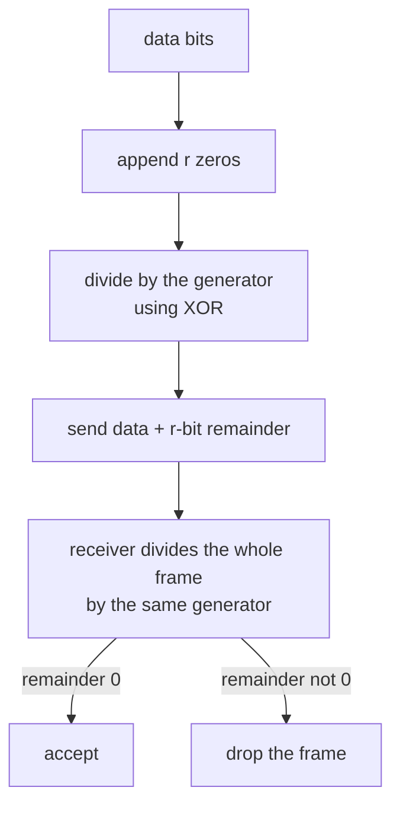

## Mental Model

A bank account number often ends in a **check digit** computed from the other digits. Mistype one digit and the check fails, so the form rejects it before money goes to the wrong account. Error detection on a link is the same idea at the level of bits: the sender adds a few extra bits computed from the data, and the receiver recomputes them. A mismatch means the frame was damaged on the way.

Detection only says *something* is wrong. To **correct** an error, the extra bits must also say *where* it is, which takes more of them. Most networks detect and resend; correction is used where resending is expensive, such as radio links and satellites.

Before any of this, the receiver has a more basic problem: on a stream of bits, where does one frame end and the next begin? That is **framing**.

## Definition

- **Framing**: marking frame boundaries in a bit stream, with a length field, special flag patterns plus stuffing, or physical-layer signals.
- **Parity bit**: one extra bit making the number of 1s even (even parity) or odd (odd parity).
- **Checksum**: an arithmetic sum of the data words, sent along with it. The **Internet checksum** (IPv4 header, TCP, UDP) is a 16-bit one's-complement sum.
- **CRC (cyclic redundancy check)**: the remainder of dividing the data, treated as a binary polynomial, by a fixed **generator polynomial**. Ethernet and Wi-Fi use a 32-bit CRC.
- **Hamming distance**: the number of bit positions in which two codewords differ. A code's minimum distance decides how many errors it can detect or correct.
- **Hamming code**: an error-correcting code whose check bits locate any single flipped bit.
- **FEC (forward error correction)**: sending enough redundancy that the receiver repairs errors itself, without asking for a resend.

## Why It Exists

**The problem.** Noise, interference and weak signals flip bits. A Wi-Fi link may corrupt one frame in a hundred; even good fibre has a bit error rate around one in a trillion. Without a check, a corrupted frame would be passed up as if it were correct: a wrong digit in a bank transfer, a broken file, a misrouted packet.

**The idea.** Spend a few bits per frame on redundancy derived from the content. If the receiver's recomputation disagrees, the frame is damaged. Cheap checks (parity, checksums) catch common errors with simple hardware or software; stronger ones (CRC) catch almost every realistic error pattern; correcting codes trade even more bits for not having to resend.

:::callout[That's all it is]{type=insight}
Mark where each frame starts and ends, then add a few bits computed from its contents. The receiver recomputes them: a mismatch means "damaged, drop it", or, with enough extra bits, "damaged here, fix it".
:::

## How It Works

### Framing

| Method | How it marks boundaries | Used by |
|---|---|---|
| Length field | A header says how many bytes follow | Simple, but one corrupted length desynchronizes everything after it |
| Byte stuffing | A FLAG byte (0x7E) starts and ends each frame; a FLAG or ESC byte (0x7D) inside the data is escaped | PPP |
| Bit stuffing | The flag is the bit pattern 01111110; inside the data, a 0 is inserted after every five consecutive 1s, so the flag can't appear by accident | HDLC |
| Physical signals | A preamble and start-frame delimiter begin each frame; silence between frames ends it | Ethernet |

**Bit stuffing.** The sender inserts a 0 after any run of five 1s; the receiver removes the 0 that follows five 1s:

```text
data:      0 1 1 1 1 1 1 0 1 1
stuffed:   0 1 1 1 1 1 0 1 0 1 1        a 0 inserted after the fifth 1
on the wire: 01111110 | 01111101011 | 01111110   (flag, stuffed data, flag)
```

**Byte stuffing (PPP).** A 0x7E in the data becomes 0x7D 0x5E, and a 0x7D becomes 0x7D 0x5D. The data bytes 41 7E 42 7D are sent as 41 7D 5E 42 7D 5D.

### Parity

With even parity, the sender adds one bit so the total number of 1s is even. `1011001` has four 1s, so its parity bit is 0: `10110010`.

One flipped bit makes the count odd, so it is detected. Two flipped bits make it even again, so they are **not** detected: parity catches any odd number of errors and misses every even number.

**Two-dimensional parity** arranges the data in a grid with a parity bit per row and per column. It detects all 1-, 2- and 3-bit errors, and a single flipped bit shows up in exactly one row and one column, so it can even be corrected.

### The Internet checksum

Add the data as 16-bit words in one's-complement arithmetic (a carry out of the top bit is added back in at the bottom), then invert the result:

```text
0x1234 + 0xF0F0 = 0x1_0324  →  carry wraps around: 0x0324 + 1 = 0x0325
0x0325 + 0x0F0F = 0x1234
checksum = NOT 0x1234 = 0xEDCB

receiver:  0x1234 + 0xF0F0 + 0x0F0F + 0xEDCB  =  0xFFFF  → valid
```

It is fast in software, which is why IP, TCP and UDP use it, but it is weak: swapping two words, or errors that cancel in the sum, go unnoticed. The link layer's CRC is the stronger check underneath.

### CRC: division without carries

Treat the bits as polynomial coefficients (`10011` is x⁴ + x + 1) and do long division with XOR instead of subtraction:

1. The generator G has degree r (here r = 4). Append r zeros to the data.
2. Divide by G using XOR; the r-bit **remainder** is the CRC.
3. Send the data followed by the CRC. The whole frame is now exactly divisible by G.
4. The receiver divides what it received by G. Remainder 0: accept. Anything else: drop.

Data `1101011011`, generator `10011`:

```text
1101011011 0000      ← data with 4 zeros appended
10011                 XOR wherever the leading bit is 1, then move right
 10011
  ...
remainder = 1110
sent:      1101011011 1110
receiver:  11010110111110 ÷ 10011 → remainder 0000 ✔
one bit flipped in transit → remainder 0111 ✘ (drop)
```



A well-chosen r-bit CRC detects:
- every single-bit and double-bit error;
- every error affecting an odd number of bits (if G has x + 1 as a factor);
- every burst of errors no longer than r bits.

 Ethernet's CRC-32 misses a random corruption with probability about 1 in 4 billion.

### Correcting errors: Hamming codes

To **detect** up to d flipped bits, a code needs minimum Hamming distance **d + 1**: d flips can't turn one valid codeword into another. To **correct** d flipped bits, it needs **2d + 1**: the damaged word is then still closer to the original than to any other codeword.

Hamming(7,4) protects 4 data bits with 3 check bits. Positions are numbered 1 to 7; the check bits sit at the powers of two (1, 2, 4), and each covers the positions whose binary number contains its bit:

| Check bit | Covers positions |
|---|---|
| p1 | 1, 3, 5, 7 |
| p2 | 2, 3, 6, 7 |
| p4 | 4, 5, 6, 7 |

Data `1011` goes into positions 3, 5, 6, 7. Even parity gives p1 = 0, p2 = 1, p4 = 0, so the codeword is **`0110011`**.

If position 6 flips in transit, the receiver rechecks each group: p2's group (2, 3, 6, 7) and p4's group (4, 5, 6, 7) fail, p1's passes. The failing check bits add up to 2 + 4 = **6**, the position of the error, so the receiver flips it back.

With m data bits, the number of check bits r must satisfy **2^r ≥ m + r + 1**: there must be enough syndrome values to name every position, plus one for "no error". For example, 4 data bits need 3 check bits; 7 or 8 need 4; 64 need 7.

Try all three in the lab: divide by a generator step by step, damage bits in transit, and watch the Hamming syndrome name the flipped bit.

::lab{id=error-detection}

## Internal Mechanism

### Detect-and-resend or correct-in-place?

| | Detect and retransmit (ARQ) | Forward error correction (FEC) |
|---|---|---|
| Redundancy | A few bits per frame (CRC-32 on up to 1,500 bytes) | Many more bits |
| On error | Drop; the sender resends after a timeout or a NAK | The receiver repairs it immediately |
| Cost of an error | One round trip or more | None, unless the errors exceed what the code can fix |
| Best when | Errors are rare and round trips are short | Errors are frequent or round trips are long: radio, satellite, deep space, live video |

Wired Ethernet just drops bad frames and leaves recovery to TCP ([ARQ Protocols](lesson:cn-arq-protocols), [TCP Reliability](lesson:cn-tcp-reliability)). Wi-Fi and cellular radios use strong FEC (LDPC and turbo codes) *and* retransmit at the link layer. Very fast Ethernet links (25 Gb/s and above) add Reed–Solomon FEC because their raw bit error rates are higher. QR codes and CDs use Reed–Solomon codes too.

:::depth{level=advanced}
### Why CRCs are so good at bursts

Noise tends to damage several neighbouring bits at once (a burst). An error pattern E is missed only if E, as a polynomial, is divisible by the generator G. A burst of length ≤ r is xⁱ times a polynomial of degree below r, which can't be a multiple of a degree-r generator with a non-zero constant term, so every such burst is caught. Hardware computes CRCs with a shift register and a few XOR gates, at line rate.
:::

## Example

Checking a real IPv4 header by hand. The ten 16-bit words of the header, with the checksum field set to 0, are:

```text
4500 0073 0000 4000 4011 0000 c0a8 0001 c0a8 00c7
one's-complement sum = 0x479E  →  checksum = NOT 0x479E = 0xB861
```

The sender writes `b861` into the checksum field. Every router recomputes it after decrementing the TTL ([IP & ICMP](lesson:cn-ip-packet-icmp)).

The same two checks in Java: the Internet checksum by hand, and CRC-32 from the standard library:

```java
import java.util.zip.CRC32;

static int internetChecksum(byte[] data) {
    long sum = 0;
    for (int i = 0; i < data.length; i += 2) {
        int word = (data[i] & 0xFF) << 8 | (i + 1 < data.length ? data[i + 1] & 0xFF : 0);
        sum += word;
        sum = (sum & 0xFFFF) + (sum >>> 16);          // fold the carry back in
    }
    return (int) (~sum & 0xFFFF);
}

static long crc32(byte[] data) {
    CRC32 crc = new CRC32();                           // java.util.zip: Ethernet's CRC-32 polynomial
    crc.update(data);
    return crc.getValue();                             // "hello" → 0x3610A686
}
```

`java.util.zip.CRC32` uses the same polynomial as Ethernet, and ZIP files, PNG images and Kafka record batches all carry CRCs computed this way (Kafka uses the CRC-32C variant, `java.util.zip.CRC32C`).

## Complexity & Performance

- Parity and checksums: one pass over the data, a few instructions per word.
- CRC: one pass; hardware does it at line rate, and CPUs have instructions for CRC-32C.
- Hamming and other FEC codes: more redundancy per bit and more decoding work, paid in exchange for avoiding round trips.

## Trade-offs

- More check bits catch more errors but carry less data.
- Detection is cheap but turns every error into a resend; correction costs bandwidth all the time but saves round trips.
- Checksums are cheap in software but weak; CRCs are strong and cheap in hardware.

## Failure Modes

- **Undetected errors**: rare with CRC-32, more likely with 16-bit checksums. This is why some applications add their own end-to-end checks (TLS's message authentication, checksums in storage formats).
- **Framing loss**: a corrupted length field or flag can make a receiver lose track of frame boundaries until it resynchronizes.
- **Errors beyond the code's power**: an FEC code that can fix 1 bit miscorrects when 2 flip, so strong codes are paired with a detection check.

## In Production

- `ip -s link` and `ethtool -S eth0` show `rx_crc_errors`. A climbing count points to a bad cable, a dirty fibre connector or a failing port, not to software.
- Storage systems checksum their own data (ZFS, Btrfs, database pages, Kafka records), because a bit can also rot on disk or in RAM, where no link CRC protects it.

## Deeper Connections

- RAID 5's parity is the same idea as a parity bit, applied across disks to *correct* a known-missing block ([RAID](lesson:os-raid)).
- TLS's authentication tags detect deliberate tampering, which no CRC can: an attacker can recompute a CRC, but not a MAC without the key ([Crypto Foundations](lesson:cn-crypto-foundations)).

## Common Misconceptions

- **"A checksum proves the data wasn't tampered with."** Anyone can recompute a checksum or CRC; only a cryptographic MAC or signature detects tampering.
- **"Ethernet fixes corrupted frames."** Ethernet only detects them and drops them; TCP or the application resends.
- **"Parity detects any single error, so it detects any error."** It misses every even number of flipped bits.

## Interview Questions

### [L1 · compare] Parity vs checksum vs CRC?

A parity bit counts 1s: it detects any odd number of flipped bits and misses every even number. A checksum adds the data as numbers (the Internet checksum uses 16-bit one's-complement addition): fast in software, but it misses swapped words and errors that cancel out. A CRC is the remainder of polynomial division by a generator: it catches all single and double errors, all odd numbers of errors, and every burst up to its length, which is why link layers like Ethernet use CRC-32.

### [L2 · how] How does CRC work?

The data is treated as a binary polynomial. The sender appends r zeros (r is the generator's degree), divides by the generator polynomial using XOR, and sends the data followed by the r-bit remainder. The whole frame is then an exact multiple of the generator. The receiver divides what arrives by the same generator; a non-zero remainder means the frame was damaged, and it is dropped.

### [L2 · how] What is bit stuffing, and why is it needed?

When frames are delimited by the flag pattern 01111110 (HDLC), the same pattern might appear inside the data and end the frame early. The sender therefore inserts a 0 after every five consecutive 1s in the data, so six 1s in a row can only be a flag. The receiver deletes any 0 that follows five 1s. Byte stuffing does the same with escape bytes for byte-oriented protocols like PPP.

### [L2 · numerical] How many errors can a code with minimum Hamming distance 5 detect, and how many can it correct?

Detection needs distance d + 1, so it detects up to **4** errors. Correction needs 2d + 1, so it corrects up to **2**. Generally, distance D detects D − 1 errors and corrects ⌊(D − 1)/2⌋.

### [L2 · how] How does a Hamming code locate a flipped bit?

Check bits sit at positions 1, 2, 4, 8 and so on, and each covers the positions whose binary number contains its bit. The receiver recomputes every check; the positions of the failing check bits add up to the position of the flipped bit (the syndrome), and 0 means no error. With m data bits it needs r check bits where 2^r ≥ m + r + 1.

### [L3 · compare] When would you choose forward error correction over detect-and-retransmit?

When errors are frequent or a round trip is expensive. Satellite links, deep-space probes, live video and radio links use FEC because waiting a long round trip for a resend costs more than the redundancy. Wired LANs, with rare errors and microsecond round trips, just detect with a CRC and let TCP resend. Many radio systems do both: FEC fixes most errors, and link-layer retransmission handles what's left.

## Practice

### [numeric 0] Using even parity, what parity bit is added to 1011001?

:::answer
The data has four 1s, already even, so the parity bit is **0** and the sent word is 10110010.
:::

### [numeric 4] How many check bits does a Hamming code need to correct single-bit errors in 7 data bits?

:::answer
The smallest r with 2^r ≥ 7 + r + 1: r = 3 gives 8 ≥ 11, which fails; r = 4 gives 16 ≥ 12, which holds. **4** check bits, an 11-bit codeword.
:::

### [numeric 5] What minimum Hamming distance must a code have to correct any 2 flipped bits?

:::answer
2d + 1 with d = 2: **5**. The same code could instead detect up to 4 errors if it never tried to correct.
:::

### [numeric 6] A Hamming(7,4) receiver finds that check p1 passes, while p2 and p4 fail. Which position holds the flipped bit?

:::answer
Add the positions of the failing checks: 2 + 4 = **6**. Flipping bit 6 back restores the codeword.
:::

### [exercise] Bit-stuff the data 111111111111 (twelve 1s) for HDLC. How many 0s are inserted, and what does the receiver do with them?

:::solution
After every run of five 1s the sender inserts a 0: `11111 0 11111 0 11`, giving **11111011111011**. Two 0s are inserted. The receiver removes any 0 that directly follows five 1s, getting back the twelve 1s. Because six consecutive 1s can now only be part of the flag 01111110, the receiver can't mistake data for the end of the frame.
:::

### [exercise] Compute the CRC for the data 1101011011 with generator 10011 (x⁴ + x + 1). What is transmitted? Then flip the fourth bit of the transmitted frame and show that the receiver detects it.

:::solution
Append four zeros, 11010110110000, and divide by 10011 with XOR, writing the generator under each leading 1. The remainder is **1110**, so the frame sent is **11010110111110**.

The receiver divides 11010110111110 by 10011 and gets remainder 0000: accepted.

With the fourth bit flipped, 11000110111110, the remainder is 0111, which is not zero: the frame is dropped. A single-bit error is always caught, because x⁴ + x + 1 has more than one term.
:::

### [mcq] Which errors can a single even-parity bit NOT detect?

- [ ] One flipped bit
- [x] Two flipped bits
- [ ] Three flipped bits
- [ ] Five flipped bits

Any even number of flips leaves the count of 1s even, so the parity still checks out. Odd numbers of flips are always detected.

### [numeric 3] The Hamming(7,4) codeword 0110011 (data 1011) arrives with bits 3 and 5 both flipped. The receiver computes the syndrome and corrects the bit it names. How many of the 4 data bits it delivers are wrong?

:::answer
The received word is 0100111. p1's group (1, 3, 5, 7) contains both flipped bits, so it still passes. p2's group (2, 3, 6, 7) and p4's group (4, 5, 6, 7) each contain one, so they fail, and the syndrome is 2 + 4 = 6.

The receiver flips bit 6, which was correct. Now bits 3, 5 and 6 are wrong, and all three are data bits: it delivers 0101 instead of 1011, so **3** data bits are wrong. A code that corrects one error can make two errors worse. You can reproduce this in the [error detection lab](lab:error-detection).
:::

### [exercise] In the [error detection lab](lab:error-detection), CRC view, keep the data 1101011011 and the generator 10011. Damage the frame three ways: flip bit 7; flip bits 6 and 7; flip bits 1, 4 and 5. Which damage does the receiver miss, and why? Then, in the checksum view, swap two of the header words. Does the checksum notice?

:::solution
Flipping bit 7 gives a non-zero remainder, and so does flipping bits 6 and 7 (a burst of 2, shorter than the 4-bit CRC). Both are caught.

Flipping bits 1, 4 and 5 is missed: the remainder is 0000. That error pattern, 10011 followed by zeros, is the generator itself shifted left, so it divides exactly, just like a valid frame. A CRC misses an error only when the error pattern is a multiple of the generator. Real generators are chosen so that likely patterns (single bits, pairs, short bursts) never are.

The checksum doesn't notice the swap. Addition doesn't depend on order, so the sum, and therefore the checksum, stays the same. A CRC almost always catches reordering, because a bit's position changes what it contributes to the remainder.
:::

## Quick Revision

- Framing: length field, byte stuffing (PPP: 7E → 7D 5E, 7D → 7D 5D), bit stuffing (HDLC: 0 after five 1s; flag 01111110), physical preambles (Ethernet).
- Parity: catches odd numbers of errors, misses even; 2D parity corrects 1 bit.
- Internet checksum: 16-bit one's-complement sum, inverted; receiver's total = 0xFFFF. Weak, cheap; IP/TCP/UDP.
- CRC: append r zeros, XOR-divide by a degree-r generator, send the remainder; catches all bursts ≤ r. Ethernet: CRC-32; Java: `java.util.zip.CRC32`.
- Hamming distance D: detect D − 1, correct ⌊(D − 1)/2⌋. Hamming code: check bits at 1, 2, 4…; syndrome = error position; 2^r ≥ m + r + 1.
- ARQ (detect + resend) for rare errors, short RTTs; FEC for noisy or long-delay links.
