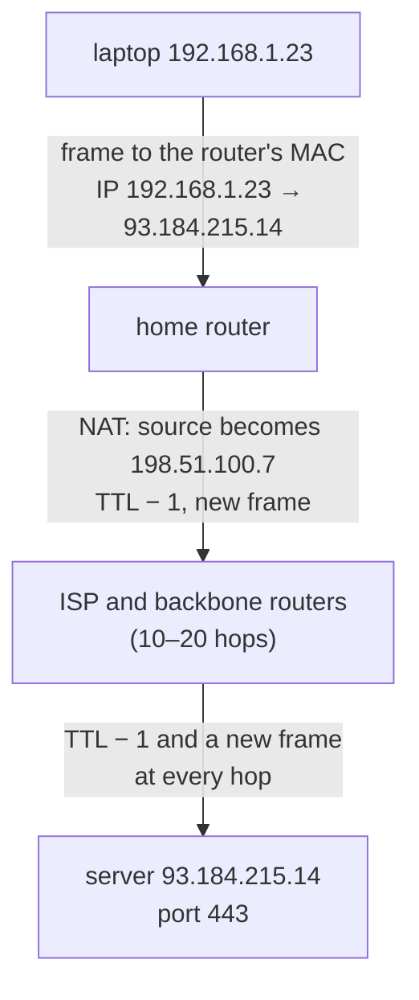

## Mental Model

Sending data across the internet is like **mailing a book through a postal system that only accepts postcards**:

1. You tear the book into pages and put each page on a postcard (**packets**), numbered so the recipient can reassemble them.
2. Each postcard carries a **destination address** (the recipient's building — an **IP address**) and an **apartment number** (the program on that machine — a **port**).
3. Postcards travel hop by hop. At each local post office (**router**), a clerk looks only at the destination and decides the next post office. Nobody plans the whole route in advance.
4. Between two post offices, the postcard rides a specific truck on a specific road (**a link**). For that ride it's put in an envelope addressed to the next stop's loading dock (a **frame** with **MAC addresses**).
5. Postcards can get lost, arrive out of order, or be duplicated. If you need the whole book intact, the sender and receiver must run a **protocol** on top: number pages, acknowledge receipt, resend missing ones (**TCP**).

Everything in computer networking elaborates one of those five sentences.

## Definition

- **Bit / signal**: data on a wire, fiber or radio is a physical signal (voltage levels, light pulses, radio waves) encoding bits.
- **Frame**: a unit of data on a single link (Layer 2, e.g., Ethernet, Wi-Fi), addressed with **MAC addresses**.
- **Packet**: a unit of data routed across networks (Layer 3, IP), addressed with **IP addresses**.
- **Segment / datagram**: transport-layer unit (TCP segment, UDP datagram), addressed with **ports**.
- **Switch**: forwards frames within a local network using MAC addresses.
- **Router**: forwards packets between networks using IP addresses.
- **Protocol**: an agreed format and set of rules for exchanging messages (HTTP, TCP, IP, Ethernet).

## Why It Exists

**The problem.** Millions of computers need to exchange data with any of millions of others, over shared cables, with no central coordinator — and links and routers fail all the time.

**The first answer, and why it didn't fit.** Early telephone networks used **circuit switching**: a dedicated path reserved for the whole call. Computers communicate in **bursts**, so reserving a path wastes capacity. A phone call talks continuously; a computer sends a burst, then goes quiet for seconds.

**The idea.** The internet uses **packet switching**: data is chopped into packets that share links with everyone else's packets, each routed independently. Every packet carries its own destination, so no route has to be set up in advance and a broken link just means "send the next packet another way".

| | Circuit switching | Packet switching |
|---|---|---|
| Resources | Reserved end-to-end for the session | Shared, on demand |
| Utilization for bursty traffic | Poor | High |
| Guarantees | Fixed bandwidth and latency | Best effort: delay varies, packets can be lost |
| Failure handling | A broken link breaks the call | Packets route around failures |
| Examples | Classic telephone network | Internet |

The price of packet switching is **queueing**: when many packets want the same link at once, they wait in router buffers (delay) or get dropped (loss). Much of networking — TCP congestion control, QoS, tail latency — exists to cope with that price.

**From idea to mechanism.** Once you decide "independent packets on shared links", the rest of the course falls out. Packets need addresses to find hosts (**IP**) and something to choose each next hop (**routing**). They need a way to cross each individual link (**Ethernet, MAC addresses**) and a way to reach the right program on the host (**ports**). And because packets can be lost or reordered, the ends need a way to rebuild a reliable stream (**TCP**).

:::callout[That's all it is]{type=insight}
Data is cut into packets with an address on each. Every router looks at the address and passes the packet one hop closer. The two ends fix up whatever goes wrong on the way: losses, reordering, duplicates.
:::

## How It Works

### Four kinds of addresses, four jobs

Why so many addresses? Because "deliver to that program on that machine across the world" is really four questions:
- which program (port);
- which machine, globally (IP);
- which device on this cable right now (MAC);
- what humans type (domain name).

| Address | Example | Scope | Who uses it |
|---|---|---|---|
| **MAC address** | `3c:22:fb:9a:10:4e` | One link / LAN | Switches, NICs |
| **IP address** | `93.184.215.14` | Global (or private network) | Routers |
| **Port** | `443` | One host | The OS, to find the right socket/program |
| **Domain name** | `example.com` | Human-friendly | DNS turns it into an IP address |

A connection between two programs is identified by the **5-tuple**: (protocol, source IP, source port, destination IP, destination port).

### One request's journey

You run `curl https://example.com` on a laptop on home Wi-Fi:

::::steps
1. **DNS**: the laptop asks a resolver for the IP of `example.com` ([DNS](lesson:cn-dns-fundamentals)).
2. **Is the destination local?** The laptop compares the IP with its own subnet — it isn't, so the packet goes to the **default gateway** (the home router).
3. **ARP**: to put the frame on the Wi-Fi link, the laptop needs the router's MAC address; it asks "who has 192.168.1.1?" ([ARP & DHCP](lesson:cn-arp-dhcp)).
4. **TCP handshake**: the laptop opens a TCP connection to port 443 ([TCP handshake](lesson:cn-tcp-handshake)); **TLS** then encrypts the channel.
5. **Framing**: the HTTP request is wrapped in TCP, then IP, then a Wi-Fi/Ethernet frame addressed to the router's MAC ([Encapsulation](lesson:cn-encapsulation)).
6. **NAT**: the home router rewrites the private source IP/port to its public IP/port ([NAT](lesson:cn-nat)).
7. **Routing**: across the ISP and the internet backbone, perhaps 10–20 routers each look up the destination IP and forward the packet one hop closer. At every hop the frame is rebuilt for the next link; the IP packet stays (mostly) the same.
8. **Delivery**: the server's NIC receives the frame; the kernel strips headers layer by layer and hands the bytes to the socket listening on port 443 — the web server process.
9. **Response** follows the same path backward.
::::

### What each device looks at

| Device | Reads | Changes |
|---|---|---|
| Switch | Destination MAC | Nothing (just forwards the frame) |
| Router | Destination IP | New Ethernet header per hop; decrements TTL; recomputes IPv4 checksum |
| NAT router | IP + port | Also rewrites source IP/port |
| Load balancer / proxy | Up to HTTP (Layer 7) | May terminate TCP/TLS and open a new connection |
| End host | Everything | Delivers to the socket |



The IP addresses survive the whole trip (apart from NAT at the edge); the frame around the packet is rebuilt on every link.

### Store-and-forward: why packets beat whole messages

A router must receive a whole packet before it can check it and send it on. This is **store-and-forward**, and it means every hop costs one full transmission time. Cutting a message into packets lets the hops work at the same time, like an assembly line: while hop 2 sends packet 1, hop 1 is already sending packet 2.

Send a 1 MB message (8,000,000 bits) across 3 links of 1 Mb/s, ignoring propagation:

```text
whole message (message switching): 8 s per hop → 3 × 8 s = 24 s
1,000 packets of 1,000 bytes:      8 ms per packet per hop
  the first packet arrives after 3 × 8 ms; the other 999 follow, one every 8 ms
  total = (3 + 999) × 8 ms = 8.016 s
```

In general, N packets of L bits over Q store-and-forward links of rate R take **(Q + N − 1) × L / R**, plus propagation. Smaller packets pipeline better, but each one carries its own headers, so there is a limit: on Ethernet a packet carries at most 1,500 bytes.

### Network types and topologies

Networks are often classified by how far they reach:

| Type | Span | Example |
|---|---|---|
| PAN | A few metres | A phone and a Bluetooth headset |
| LAN | A building or campus | Office Ethernet and Wi-Fi |
| MAN | A city | A city-wide fibre ring |
| WAN | Countries and continents | The internet; a company's links between offices |

They are also described by **topology**, the shape in which devices are connected:

| Topology | Shape | Strength | Weakness |
|---|---|---|---|
| Bus | Every device on one shared cable | Cheap, little cable | One cable fault cuts everyone off; collisions |
| Star | Every device to a central switch | Easy to manage; a bad cable affects one device | The centre is a single point of failure |
| Ring | Each device linked to two neighbours | Predictable access (token passing) | One break can stop the ring (dual rings fix it) |
| Mesh | Devices linked directly to many others | Many paths; survives failures | A full mesh of n devices needs n(n − 1)/2 links |
| Tree | Stars joined in a hierarchy | Grows by adding branches | Losing an upper branch cuts off everything below |

A modern office LAN is a star, or a tree of stars, built around switches. The internet's core is a partial mesh: routers have several links each, but not to every other router.

## Internal Mechanism

### Where delay comes from

Every hop adds four kinds of delay ([Latency & Bandwidth](lesson:cn-latency-bandwidth)):

- **Processing**: examining headers, looking up routes (ns–µs).
- **Queueing**: waiting behind other packets in the output buffer (0 to many ms — the variable part).
- **Transmission**: pushing the bits onto the link = packet size / link bandwidth (1500 B at 1 Gb/s = 12 µs).
- **Propagation**: the signal travelling the distance at about 2/3 of the speed of light in fibre, ~5 µs per km. New York to London is ~5,600 km on a great circle, about 28 ms one way, and more in practice because cables don't follow great circles.

### The end-to-end principle

A design philosophy that explains why the internet looks the way it does. The network core (routers) is deliberately **simple and stateless** — "best effort" delivery of individual packets. Reliability, ordering, encryption and flow control are implemented at the **ends** (in hosts' TCP stacks and applications). Only the ends know what "correct" means for their application, and a smart network can't guarantee end-to-end correctness anyway. This is why the internet scaled: routers don't track your connections. (Middleboxes like NATs and firewalls do keep state, and they're a constant source of breakage — which is why QUIC encrypts almost everything.)

:::depth{level=advanced}
### Physical layer in one paragraph

Copper Ethernet encodes bits as voltage patterns (e.g., PAM levels), fiber as light pulses at specific wavelengths, Wi-Fi as modulated radio (OFDM/QAM). Link speed is the rate at which bits can be placed on the medium. Errors from noise are detected by a **CRC** in every frame ([Error Detection](lesson:cn-error-detection)); corrupted Ethernet frames are dropped, never "fixed" at Layer 2, and higher layers retransmit. Wireless links lose and reorder far more than wired ones. That is why Wi-Fi does its own link-layer retransmissions, and why TCP performance on mobile networks is its own discipline.
:::

## Example

See the hops yourself:

```bash
$ traceroute -n example.com
 1  192.168.1.1      1.9 ms     # home router (default gateway)
 2  100.64.0.1       8.7 ms     # ISP (carrier-grade NAT range)
 3  203.0.113.9     10.2 ms
 ...
 9  93.184.215.14   23.4 ms     # destination
```

Each line is a router that decremented the packet's TTL to zero and sent back an ICMP "time exceeded" message — that's how traceroute discovers the path ([IP & ICMP](lesson:cn-ip-packet-icmp)).

## Visualization

::viz{id=encapsulation}

## Complexity & Performance

- Latency is dominated by **propagation** for long distances and by **queueing** under congestion.
- Throughput is limited by the slowest link (the **bottleneck**) and, for TCP, by window size and round-trip time ([Latency & Bandwidth](lesson:cn-latency-bandwidth)).

## Trade-offs

- Packet switching: efficient and resilient, but no guaranteed latency.
- Keeping the core simple (end-to-end): scalable and evolvable, but pushes complexity (reliability, security) into every endpoint.
- Layering ([next lesson](lesson:cn-layered-models)): independent evolution of technologies, at the cost of header overhead and occasional layer violations.

## Failure Modes

- **Packet loss** from full buffers (congestion), bad links, or misconfigured MTU.
- **Wrong routes** (misconfiguration, BGP incidents) sending traffic nowhere.
- **Name resolution failures** that look like "the internet is down" ([DNS](lesson:cn-dns-fundamentals)).
- **Middlebox interference**: NATs and firewalls dropping idle connections or unfamiliar protocols.

## In Production

- The "what happens when you type a URL" question tests exactly this model; see [Opening a Website, End to End](lesson:x-website-journey).
- Cloud networks are virtual: your VM's "Ethernet" is emulated, and packets between VMs are encapsulated in overlay networks — the same concepts, one level up ([Container Networking](lesson:cn-container-networking)).

## Deeper Connections

- A packet is to the network what a page is to memory: a fixed-size unit that makes sharing and placement flexible.
- Queues in routers behave like run queues and I/O queues in the OS: latency explodes near saturation ([Performance Fundamentals](lesson:os-performance-method)).

## Common Misconceptions

- **"Data flows through a dedicated connection."** TCP "connections" exist only as state in the two endpoints; the network forwards independent packets.
- **"Routers know the whole path."** Each router knows only the next hop for each destination prefix.
- **"MAC addresses are used to reach remote servers."** MAC addresses are only meaningful on one link; they change at every hop.

## Interview Questions

### [L1 · compare] What is the difference between a switch and a router?

A switch forwards frames within a local network (Layer 2) based on destination MAC addresses it has learned. A router forwards packets between different networks (Layer 3) based on destination IP addresses and its routing table, rewriting the link-layer header at each hop and decrementing the TTL.

### [L1 · compare] MAC address vs IP address vs port?

A MAC address identifies a network interface on a single link and is used for delivery within a LAN. An IP address identifies a host's interface across networks and is used for routing end to end. A port identifies an application endpoint (socket) on a host. Together with the protocol, source/destination IPs and ports form the 5-tuple identifying a connection.

### [L2 · compare] Packet switching vs circuit switching?

Circuit switching reserves a dedicated path and bandwidth for the duration of a session (predictable, wasteful for bursty data). Packet switching splits data into packets that share links on demand and are routed independently (efficient and resilient, but with variable delay and possible loss). The internet is packet-switched.

### [L2 · trace] Which headers change as a packet goes from your laptop through your home router to a web server?

The Ethernet/Wi-Fi frame header is replaced at every hop (new source/destination MAC for each link). The IP header keeps its source and destination addresses across routers, except that TTL is decremented (and the IPv4 checksum updated) at every hop — and at the home router, NAT rewrites the source IP and port. TCP ports stay the same end to end except for NAT's source-port rewrite.

### [L3 · why] What is the end-to-end principle and why does it matter?

Functions like reliability, ordering and security should be implemented at the endpoints rather than in the network core, because only the endpoints can ensure correctness for the application and the core stays simple, stateless and scalable. It's why routers do best-effort forwarding and TCP/TLS live in hosts. Middleboxes that violate it (NATs, firewalls, TCP-modifying proxies) cause ossification — one reason QUIC runs over UDP and encrypts its headers.

### [L1 · compare] What are the common network topologies, and which one does a modern office LAN use?

Bus (one shared cable), star (everything to a central device), ring (each device to two neighbours), mesh (many direct links; a full mesh of n devices needs n(n − 1)/2 links) and tree (stars in a hierarchy). An office LAN is a star or tree of stars around switches: a broken cable affects one device, and each switch port is its own full-duplex link, so there are no collisions. The trade-off is that the switch is a single point of failure, which is why critical networks add redundant switches and links, a partial mesh.

### [L2 · numerical] Why does sending a message as many packets cross several routers faster than sending it whole?

Routers are store-and-forward: each must receive a whole unit before sending it on, so every hop costs one transmission time. A whole message pays that cost once per hop, in sequence. Packets pipeline: while the second router forwards packet 1, the first is already forwarding packet 2. N packets of L bits over Q links of rate R take (Q + N − 1) × L / R instead of Q × N × L / R. For 1 MB over 3 links at 1 Mb/s, that is 8.016 s instead of 24 s.

## Practice

### [mcq] Which device primarily uses destination IP addresses to forward traffic between networks?

- [ ] Switch
- [x] Router
- [ ] Hub
- [ ] Network interface card

Routers work at Layer 3.

### [numeric 12 unit=µs] How long does it take to transmit a 1,500-byte packet onto a 1 Gb/s link (transmission delay), in microseconds?

:::answer
1,500 × 8 = 12,000 bits; 12,000 / 10⁹ bits/s = 12 × 10⁻⁶ s = **12 µs**.
:::

### [numeric 45] A full mesh connects every one of 10 routers directly to every other. How many links does it need?

:::answer
Each link joins a pair of routers, so count the pairs: 10 × 9 / 2 = **45** links. Doubling to 20 routers needs 190, which is why large networks use partial meshes and hierarchies instead.
:::

### [numeric 10 unit=ms] A signal travels through optical fibre at about 2 × 10⁸ m/s. What is the one-way propagation delay over 2,000 km of fibre, in milliseconds?

:::answer
2,000,000 m ÷ 2 × 10⁸ m/s = 0.01 s = **10** ms. Propagation depends only on distance, so a faster link doesn't reduce it.
:::

### [numeric 802.4 ±0.5 unit=ms] A 1,000,000-byte file is sent as 1,000 packets of 1,000 bytes across 4 store-and-forward links, each 10 Mb/s. Ignoring propagation and headers, how long until the last packet arrives, in milliseconds?

:::answer
One packet takes 8,000 bits ÷ 10⁷ bit/s = 0.8 ms per link. With Q = 4 links and N = 1,000 packets: (Q + N − 1) × 0.8 ms = 1,003 × 0.8 ms = **802.4** ms. Sent as one 8,000,000-bit message, it would take 4 × 0.8 s = 3.2 s.
:::

### [mcq] In an office wired as a star around one switch, the cable to one desktop is cut. What happens?

- [ ] Every device on the LAN loses connectivity
- [x] Only that desktop loses its connection
- [ ] The switch floods all traffic until the cable is replaced
- [ ] Devices on either side of the break can no longer reach each other

In a star each device has its own cable to the centre, so a cable fault isolates one device. In a bus, a single cable fault cuts off everyone; in a ring, one break can stop the whole ring.

### [exercise] Open the [encapsulation visualization](viz:encapsulation) and step the request across the router. List what the router changes and what it leaves alone. Why must the MAC addresses change at every hop, while the IP addresses stay the same?

:::solution
**The router changes:**
- the whole Ethernet header: the new destination MAC is the next hop, and the new source MAC is the router's outgoing interface;
- the IP TTL, decremented by 1;
- the IP header checksum, recomputed because the TTL changed.

**It leaves alone:** the source and destination IP addresses, the TCP header and the data (unless the router also does NAT, which rewrites the source address and port).

**Why:** a MAC address only means something on one link: it names the next device that will physically receive the frame. Each hop is a different link with a different next device, so the frame is rebuilt every time. The IP addresses name the two ends of the whole journey, and every router needs the destination IP to choose its next hop, so they must survive the trip unchanged.
:::

## Quick Revision

- Packet switching: data split into packets sharing links; best effort; queues → delay and loss.
- Addresses: **MAC** (per link), **IP** (end to end), **port** (program), **name** (DNS). Connection = 5-tuple.
- Switch = Layer 2 (MAC), router = Layer 3 (IP, next hop only, TTL−1, new frame each hop).
- Delay = processing + queueing + transmission + propagation.
- End-to-end principle: simple core, smart endpoints (TCP, TLS in hosts).
- Store-and-forward: N packets of L bits over Q links of rate R take (Q + N − 1)·L/R; packets pipeline across hops, whole messages don't.
- Network types: PAN, LAN, MAN, WAN. Topologies: bus, star, ring, mesh (full mesh = n(n − 1)/2 links), tree; office LANs are stars of switches.
