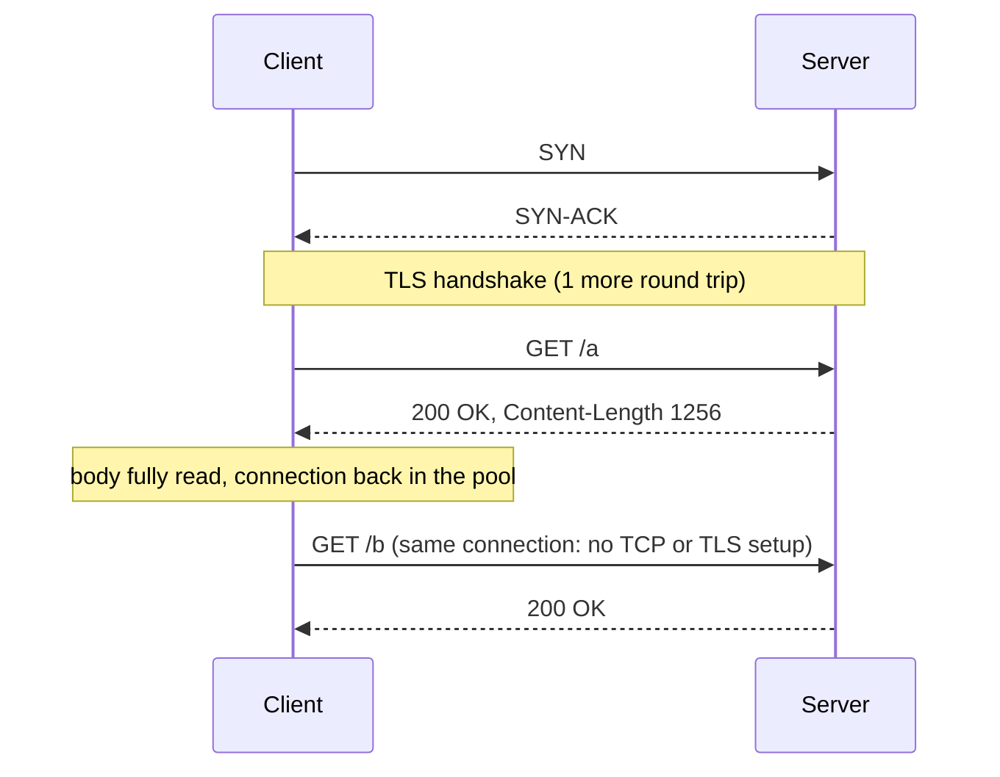

## Mental Model

A TCP connection (plus TLS) is expensive to set up — like dialing and authenticating a phone line. **HTTP/1.0** hung up after every question. **HTTP/1.1** keeps the line open and asks question after question (**keep-alive**) — but still strictly one at a time: ask, wait for the full answer, ask again. Browsers compensate by opening **several lines in parallel** (typically 6 per host). HTTP/2 later puts many conversations on one line at once.

## Definition

- **Non-persistent connection (HTTP/1.0 default)**: one request/response per TCP connection.
- **Persistent connection / keep-alive (HTTP/1.1 default)**: multiple requests reuse one connection sequentially; `Connection: close` ends it.
- **Pipelining**: sending several requests without waiting for responses; responses must come back **in order**.
- **Message framing**: how the receiver knows where a body ends — `Content-Length`, `Transfer-Encoding: chunked`, or connection close.

## Why It Exists

**The problem.** Web pages load dozens of resources. Paying a TCP (and TLS) handshake plus slow start for each would dominate load time.

**The idea.** The expensive part is setting up the connection, not using it — so set it up once and send many requests over it. Reusing connections saves round trips and keeps congestion windows warm.

**The catch that drives the rest of the lesson.** Once requests share a connection, the receiver must know where each message ends (framing). And HTTP/1.1 can answer only one request at a time per connection, which is what parallel connections, pipelining and eventually HTTP/2 each tried to fix.

:::callout[That's all it is]{type=insight}
Keep-alive = reuse the TCP connection for the next request instead of opening a new one. HTTP/1.1 still sends one request at a time on it, which is why browsers open about six per host.
:::

## How It Works

### One connection, many requests



### Cost comparison: 10 small resources, RTT = 50 ms

| Strategy | Round trips (approx.) | Time |
|---|---|---|
| HTTP/1.0, sequential, new connection each (TCP 1 RTT + request 1 RTT) | 10 × 2 = 20 | ~1,000 ms (+TLS: +10–20 more RTTs) |
| HTTP/1.1 keep-alive, 1 connection, sequential | 1 + 10 = 11 | ~550 ms |
| HTTP/1.1, 6 parallel keep-alive connections | ~1 + 2 = 3 | ~150 ms (but 6 handshakes, 6 slow starts) |
| HTTP/2, 1 connection, multiplexed | ~1 + 1 = 2 | ~100 ms |

### Why pipelining failed

Pipelining lets a client send requests 1, 2, 3 back to back, but the server must return responses in the same order. If response 1 is slow (a big file or slow query), responses 2 and 3 wait behind it even if ready — **application-level head-of-line blocking**. Combined with buggy proxies that mishandled pipelined requests, browsers shipped it disabled. HTTP/2's multiplexing replaced it.

::viz{id=hol-blocking}

### Framing: where does the body end?

When one connection carried one response, "the server closed the connection" meant "the body ended". With reuse, that signal is gone. With persistent connections, the receiver must know exactly where one message ends and the next begins:

1. **`Content-Length: 1256`** — exactly this many bytes follow.
2. **`Transfer-Encoding: chunked`** — the body is sent as chunks, each prefixed with its size in hex, terminated by a zero-length chunk. Lets servers stream responses whose size isn't known in advance (server-rendered pages, streaming APIs, large exports):

Each chunk starts with its size in hexadecimal: `7` means the next 7 bytes, `9` the next 9, and `0` ends the body.

```http
HTTP/1.1 200 OK
Content-Type: text/plain
Transfer-Encoding: chunked

7\r\n
Mozilla\r\n
9\r\n
Developer\r\n
0\r\n
\r\n
```

3. **Connection close** — only for responses (HTTP/1.0 style): the body ends when the server closes.

(HTTP/2 and HTTP/3 have their own binary framing; `Transfer-Encoding: chunked` doesn't exist there.)

## Internal Mechanism

### Client connection pools

Reuse needs somewhere to keep idle connections between requests. HTTP client libraries keep a **pool** of idle keep-alive connections per origin (host + port + scheme): a request borrows one, returns it after reading the full response. Key settings:

- **max connections per host** (browser: ~6 for HTTP/1.1; libraries: configurable) — beyond it, requests queue;
- **idle timeout / max lifetime** — must be **shorter** than the server's and any load balancer's idle timeout. Otherwise the client reuses a connection the server already closed, and the first request fails with a reset;
- **response draining** — a connection returns to the pool only after the body is fully read; forgetting to read or close response bodies leaks connections. In Java that means closing the `InputStream` from `BodyHandlers.ofInputStream()` or the response entity in Apache HttpClient on every path, error paths included ([Networking in Java](lesson:cn-java-networking)).

:::depth{level=advanced}
### Request smuggling

When a front-end proxy and a back-end server disagree on where a request ends, an attacker can smuggle a second request inside the first one's body. For example, one honours `Content-Length` and the other `Transfer-Encoding: chunked` when both are present. The smuggled request poisons the connection for the next user (cache poisoning, bypassing auth). Defenses: reject ambiguous messages, normalize at the edge, use HTTP/2 end to end, and keep proxies and servers patched. It's a direct consequence of text framing plus connection reuse.

### Domain sharding (historical)

To exceed the 6-connections-per-host limit, sites spread assets across `img1.`, `img2.` subdomains. With HTTP/2 this is harmful (extra DNS lookups, handshakes, lost prioritization) — undo it when migrating.
:::

## Example

```bash
$ curl -sv https://example.com/a https://example.com/b -o /dev/null -o /dev/null 2>&1 | grep -E "Connected|Re-using|left intact"
* Connected to example.com (93.184.215.14) port 443
* Connection #0 to host example.com left intact
* Re-using existing connection #0 with host example.com
```

The second request skips DNS, TCP and TLS entirely.

## Complexity & Performance

- Keep-alive saves 1 RTT (TCP) + 1–2 RTTs (TLS) per request and keeps cwnd warm.
- 6 parallel HTTP/1.1 connections compete with each other for bandwidth and multiply server connection counts.
- Idle keep-alive connections cost server memory and file descriptors — servers cap them (`keepalive_timeout`, max requests per connection).

## Trade-offs

- Long keep-alive: fewer handshakes vs idle resource usage on servers and LBs.
- More parallel connections: more concurrency vs congestion unfairness and server load → HTTP/2.

## Failure Modes

- Stale pooled connections (pool timeout > server/LB timeout) → sporadic "connection reset" on the first request after idle.
- Pool exhaustion when responses aren't consumed/closed.
- Head-of-line blocking behind a slow response on a connection.
- Framing ambiguities → request smuggling.

## In Production

- Configure upstream keep-alive between reverse proxies and app servers (e.g., Nginx `upstream { keepalive N; }` with `proxy_http_version 1.1`) — otherwise every proxied request opens a new backend connection.
- Retry idempotent requests once on connection-reset errors from reused connections.

## Deeper Connections

- Multiplexing on one connection: [HTTP/2](lesson:cn-http2); connection teardown and TIME_WAIT: [TCP Termination](lesson:cn-tcp-termination); pools across the stack: [Connection Management](lesson:x-connection-management).

## Common Misconceptions

- **"HTTP keep-alive is TCP keep-alive."** HTTP keep-alive reuses a connection for multiple requests; TCP keep-alive probes idle connections.
- **"HTTP/1.1 sends requests in parallel on one connection."** Not effectively — pipelining is disabled in practice; parallelism comes from multiple connections.
- **"Chunked encoding compresses data."** It only frames it; compression is `Content-Encoding`.

## Interview Questions

### [L1 · compare] What's the difference between HTTP/1.0 and HTTP/1.1?

HTTP/1.1 made persistent connections the default (keep-alive), required the Host header (enabling virtual hosting), added chunked transfer encoding, better caching controls (Cache-Control, ETags, conditional requests), range requests, and pipelining (rarely used). HTTP/1.0 typically opened a new TCP connection per request.

### [L2 · why] Why was HTTP pipelining never widely used?

Responses must be returned in request order, so one slow response blocks all later ones (head-of-line blocking), and many proxies and servers handled pipelined requests incorrectly, causing corrupted or mismatched responses. Browsers disabled it and opened multiple connections instead, until HTTP/2 multiplexing solved the problem.

### [L2 · how] How does a client know where an HTTP/1.1 response body ends?

From Content-Length (exact byte count), from chunked transfer encoding (size-prefixed chunks ending with a zero-length chunk), or — for responses without either — when the server closes the connection.

### [L3 · debugging] A service calling another over HTTP sees a small percentage of requests fail with "connection reset by peer", mostly the first request after a quiet period. Why?

The client reuses an idle pooled connection that the server or an intermediate load balancer already closed after its idle timeout. The client's pool idle timeout is longer than the server's. Fix: set the client pool's idle timeout/max lifetime below the server/LB timeouts, enable connection validation, and retry idempotent requests once on reset.

### [L2 · how] How does a client reuse connections, and what breaks reuse in practice?

The client library keeps idle keep-alive connections in a pool per origin and lends one to each request, returning it once the response body has been fully read. Reuse breaks when: the body isn't read or closed (the connection never returns, the pool drains); a load balancer or server closes idle connections before the client's pool evicts them (the next request on that connection fails with a reset); the server sends `Connection: close`; or a new client object is created per request, so there is no pool to reuse.

### [L2 · compare] Content-Length vs chunked transfer encoding?

With `Content-Length` the server states the body size up front, so it must know it before sending the headers. With `Transfer-Encoding: chunked` the body is sent as size-prefixed chunks ending with a zero-size chunk, so the server can stream output whose length it doesn't know yet: generated reports, proxied streams, server-sent events. Both let the connection be reused, because the receiver knows exactly where the body ends. HTTP/2 and HTTP/3 replace both with their own framing.

## Practice

### [numeric 3] With HTTP/1.1 keep-alive on one connection, how many round trips does it take to fetch 2 small resources sequentially, including the TCP handshake (ignore TLS)?

:::answer
1 RTT for the TCP handshake + 1 RTT per request = 1 + 2 = **3**.
:::

### [mcq] Which header lets a server stream a response of unknown length over HTTP/1.1?

- [ ] Content-Encoding: gzip
- [x] Transfer-Encoding: chunked
- [ ] Connection: keep-alive
- [ ] Content-Length: 0

Chunked encoding frames the body in pieces.

### [numeric 26 unit=bytes] In a chunked HTTP/1.1 response, a chunk starts with the size line `1A`. How many bytes of data follow?

:::answer
Chunk sizes are hexadecimal: 0x1A = **26** bytes. A size line of `0` marks the end of the body.
:::

### [numeric 20] Fetching 10 small resources with HTTP/1.0, one new TCP connection each and no TLS, how many round trips does it take sequentially?

:::answer
Each resource needs one round trip for the TCP handshake and one for the request and response: 10 × 2 = **20**. With keep-alive on one connection it is 1 + 10 = 11; with HTTP/2 multiplexing, about 2.
:::

### [mcq] What does a server mean by sending `Connection: close` in an HTTP/1.1 response?

- [ ] The client must close every connection to this server
- [x] The server will close this connection after this response, so the client must not reuse it
- [ ] The response body is empty
- [ ] The client should switch to HTTP/2

HTTP/1.1 connections are persistent by default; `Connection: close` opts out for this connection. Clients then open a new connection for the next request.

### [exercise] In the [head-of-line blocking visualization](viz:hol-blocking), compare "HTTP/1.1, one connection" with "HTTP/1.1, 3 connections", first with no loss and then losing one of A's packets. Explain why browsers opened up to 6 connections per host for HTTP/1.1, and what that cost.

:::solution
- **No loss, one connection:** responses come back strictly in order, so B and C wait for all of A even though nothing went wrong: head-of-line blocking at the HTTP level.
- **No loss, 3 connections:** A, B and C travel in parallel and each finishes on its own schedule.
- **A's packet lost, one connection:** A stalls until the retransmission arrives, and B and C stall behind it.
- **A's packet lost, 3 connections:** only A's connection stalls; B and C are unaffected.

Browsers opened several HTTP/1.1 connections per host to get that parallelism and that isolation. The cost: a TCP (and TLS) handshake and a slow start for every connection, more sockets and memory on the server, and connections that compete instead of sharing one congestion window. HTTP/2 gets the parallelism on one connection, but brings back the shared-loss problem at the TCP level, which HTTP/3 then removes.
:::

## Quick Revision

- HTTP/1.0: new connection per request. HTTP/1.1: keep-alive default, Host required, chunked encoding, caching headers.
- Pipelining = in-order responses → HOL blocking → disabled; browsers use ~6 connections per host.
- Framing: Content-Length, chunked, or close.
- Client pools: max per host, idle timeout < server/LB timeout, always drain/close responses.
- Request smuggling from framing disagreements.
- Chunk sizes are hex (1A = 26 bytes; 0 = end). Connection: close = don't reuse. Java: always close response bodies, or the pool drains.
