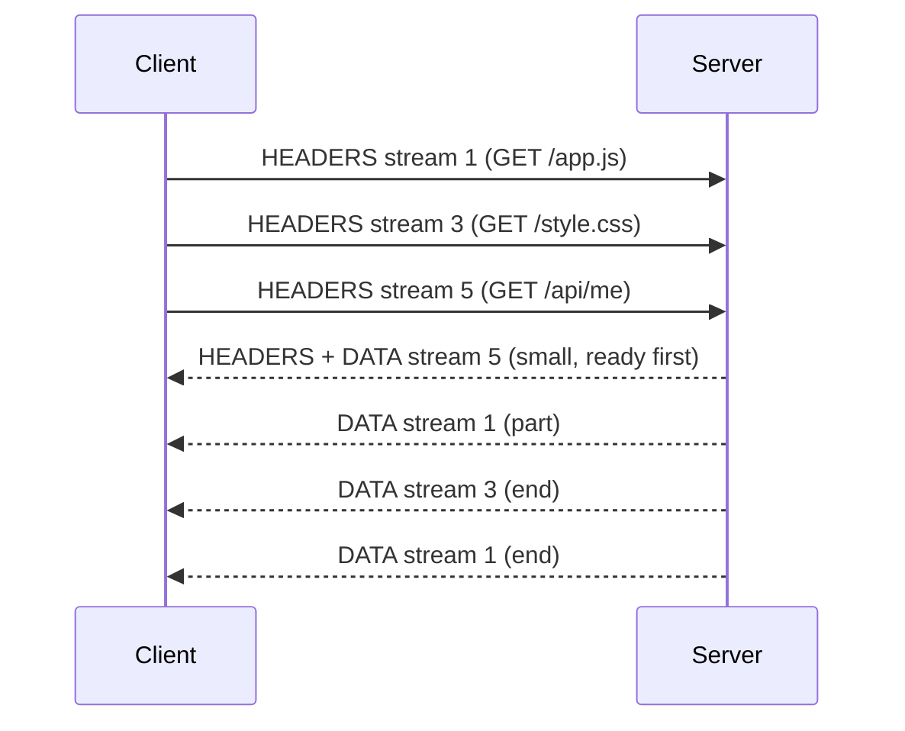

## Mental Model

HTTP/1.1 is a **single-lane road**: one request-response at a time per connection, so browsers open six roads. HTTP/2 turns one connection into a **multi-lane highway**: every request/response is a **stream**, streams are chopped into small **frames**, and frames from different streams are interleaved on the same TCP connection. A slow response no longer blocks others at the HTTP level.

But the highway still runs through one **TCP tunnel**: if a single packet is lost, TCP holds back *all* bytes behind it — every lane stops until it's retransmitted.

## Definition

**HTTP/2 (RFC 9113)** keeps HTTP semantics (methods, headers, status codes) but changes the wire format:

- **Binary framing**: messages are split into frames (HEADERS, DATA, SETTINGS, WINDOW_UPDATE, PING, RST_STREAM, GOAWAY…), each tagged with a **stream ID**.
- **Multiplexing**: many concurrent streams on one connection.
- **HPACK**: header compression with static and dynamic tables.
- **Stream-level flow control** and **prioritization**.
- Negotiated via TLS **ALPN** (`h2`); browsers only support HTTP/2 over TLS.

## Why It Exists

**The problem.** Web pages grew to hundreds of resources. HTTP/1.1's workarounds (multiple connections, domain sharding, spriting, concatenation, inlining) wasted connections and fought TCP's congestion control. SPDY (Google, 2009) proved multiplexing worked; it became HTTP/2 (2015).

**The idea.** HTTP/1.1 can only do one request at a time per connection because a message is one long piece of text — nothing can be slipped in until it ends. So cut every message into small labelled frames ("this piece belongs to request 5"). Now pieces of many requests can share one connection, interleaved, and the receiver reassembles them by label.

:::callout[That's all it is]{type=insight}
HTTP/2 is the same HTTP, cut into numbered frames so many requests can share one TCP connection at once. Its one big unfixed problem is that TCP below it still stops everything when a single packet is lost.
:::

## How It Works

### Streams and frames



The same frames as they cross the connection:

```text
One TCP connection:
[HEADERS s1][HEADERS s3][DATA s1][DATA s5][HEADERS s5][DATA s3][DATA s1 END][DATA s3 END]...
```

- Client-initiated streams use odd IDs (1, 3, 5…).
- Each request = HEADERS frame (+ optional DATA); each response = HEADERS + DATA frames.
- A stream can be cancelled with RST_STREAM without killing the connection (unlike HTTP/1.1, where cancelling a request often meant closing the connection).
- `GOAWAY` gracefully drains a connection (servers use it during deploys).

### What multiplexing fixes

- **HTTP-level head-of-line blocking**: a slow response no longer blocks later responses — its frames are simply interleaved with others.
- **Connection count**: one connection per origin instead of six → one handshake, one TLS session, one congestion window that warms up once and shares bandwidth fairly.
- **Workarounds** like domain sharding and concatenation become unnecessary (even counterproductive).

### HPACK

A cost that became visible once requests were cheap: headers repeat heavily between requests (cookies, user-agent, accept…). HPACK replaces them with indexes into a **static table** (common headers) and a **dynamic table** of previously sent headers, Huffman-encoding the rest. A repeated 800-byte header block can shrink to a few bytes. (It was designed to resist the CRIME attack that broke naive compression of encrypted headers.)

### Flow control and prioritization

Each stream and the connection have flow-control windows (WINDOW_UPDATE frames), so one huge download can't monopolize the receiver's buffers. Clients signal priority (the original dependency-tree scheme was complex and poorly implemented; RFC 9218 "Extensible Priorities" simplified it to urgency + incremental).

### Server push (deprecated in practice)

Push let servers send resources before they were requested. In practice it often pushed things the browser already had cached, wasted bandwidth, and was hard to get right; Chrome removed support. `103 Early Hints` + `preload` replaced it.

## Internal Mechanism

### What HTTP/2 did not fix: TCP head-of-line blocking

All streams share one TCP byte stream. Suppose a packet carrying a DATA frame for stream 5 is lost. TCP then delivers *no* later bytes until the retransmission fills the gap, not even complete frames for streams 1 and 3 that arrived ([TCP Reliability](lesson:cn-tcp-reliability)). On lossy networks (mobile, Wi-Fi), one HTTP/2 connection can perform **worse** than six HTTP/1.1 connections, where a loss stalls only one. This is the core motivation for **HTTP/3 over QUIC** ([HTTP/3 & QUIC](lesson:cn-http3-quic)).

::viz{id=hol-blocking}

:::depth{level=advanced}
### HTTP/2 behind proxies and load balancers

- Many deployments speak HTTP/2 to clients but HTTP/1.1 from the proxy to backends — fine for web traffic, but gRPC requires HTTP/2 end to end (trailers, streaming).
- **L4 load balancing of long-lived HTTP/2 connections is uneven**: one connection carries many requests, so balancing *connections* doesn't balance *requests*. Services using gRPC behind L4 balancers often end up hot-spotting one backend. Use L7 (per-request) balancing or client-side balancing ([Proxies & Load Balancers](lesson:cn-proxies-load-balancers)).
- Attacks on the new features: "Rapid Reset" (CVE-2023-44487) abused cheap stream creation + RST_STREAM to overload servers; HPACK bombs; settings floods. Servers limit concurrent streams (`SETTINGS_MAX_CONCURRENT_STREAMS`) and reset rates.
:::

## Example

```bash
$ curl -sI --http2 https://example.com | head -1
HTTP/2 200
$ nghttp -nv https://example.com 2>&1 | grep -E "SETTINGS|HEADERS" | head -4
[  0.043] recv SETTINGS frame <length=18, flags=0x00, stream_id=0>
[  0.043] send HEADERS frame <length=36, flags=0x25, stream_id=13>
```

In Chrome DevTools, the Protocol column shows `h2`; all requests to one origin share a single connection ID.

## Complexity & Performance

- Fewer connections and handshakes; better use of the congestion window; header compression saves significant bytes on request-heavy pages.
- On lossy links, TCP HOL blocking hurts all streams at once.
- More CPU for framing and HPACK state per connection (modest).

## Trade-offs

| | HTTP/1.1 | HTTP/2 |
|---|---|---|
| Concurrency | ~6 connections per origin | Many streams on 1 connection |
| HOL blocking | Per connection (HTTP level) | Removed at HTTP level; remains at TCP level |
| Headers | Plain text, repeated | HPACK compressed |
| Debuggability | Human-readable | Binary (needs tools) |
| Load balancing | Per connection ≈ per request | Needs L7 for request-level balance |

## Failure Modes

- Performance regressions on lossy networks vs multiple HTTP/1.1 connections.
- Uneven load across backends with L4 balancing of long-lived HTTP/2/gRPC connections.
- `SETTINGS_MAX_CONCURRENT_STREAMS` too low → requests queue client-side.
- Protocol-level DoS (rapid reset) without server mitigations.

## In Production

- gRPC is built on HTTP/2 (streams, trailers, flow control) ([API Styles](lesson:cn-api-styles)).
- When migrating from HTTP/1.1, remove domain sharding and aggressive bundling where it no longer helps.
- Monitor per-backend request rates, not just connections, behind load balancers.

## Deeper Connections

- The HOL blocking root cause is TCP's in-order byte stream ([TCP Reliability](lesson:cn-tcp-reliability)); QUIC's fix ([HTTP/3 & QUIC](lesson:cn-http3-quic)).
- One connection, many logical streams — the same multiplexing idea as threads over cores or goroutines over OS threads.

## Common Misconceptions

- **"HTTP/2 eliminated head-of-line blocking."** Only at the HTTP layer; TCP HOL blocking remains.
- **"HTTP/2 changed HTTP semantics."** Methods, status codes and headers are the same; only framing changed.
- **"Server push is how to make HTTP/2 fast."** It's deprecated in browsers.

## Interview Questions

### [L1 · compare] What are the main improvements of HTTP/2 over HTTP/1.1?

Binary framing; multiplexing of many concurrent request/response streams over a single TCP connection (removing HTTP-level head-of-line blocking and the need for multiple connections); HPACK header compression; per-stream flow control and prioritization; stream cancellation without closing the connection. Semantics are unchanged.

### [L2 · how] How does HTTP/2 multiplexing work?

Each request/response exchange is a stream with an ID. Messages are split into frames (HEADERS, DATA) labeled with their stream ID and interleaved on the connection; the receiver reassembles frames per stream. Streams progress independently at the HTTP layer, so a slow response doesn't block others.

### [L2 · why] Why can HTTP/2 perform worse than HTTP/1.1 on lossy networks?

All HTTP/2 streams share one TCP connection; TCP delivers bytes in order, so a single lost packet blocks delivery of data for every stream until retransmitted. With six HTTP/1.1 connections, a loss stalls only one of them, and congestion-window reductions affect one sixth of the traffic.

### [L3 · debugging] After moving a gRPC service behind an L4 load balancer, one backend pod is at 90% CPU while others are idle. Why?

gRPC uses long-lived HTTP/2 connections that multiplex many requests. An L4 balancer distributes connections, not requests, so a few clients' connections — and all their requests — land on one pod. Fix with L7 (HTTP/2-aware) load balancing, client-side load balancing across backends, or periodic connection recycling (max connection age) to rebalance.

### [L2 · how] What is HPACK, and why did HTTP/2 need it?

Requests on one connection repeat almost the same headers every time (cookies, user agent, accept headers, authorization), often more bytes than small request bodies. HPACK replaces header fields with indexes into a static table of common headers and a dynamic table built up during the connection, and Huffman-codes the rest. Repeated headers then cost a byte or two. It was designed after compression-oracle attacks (CRIME) on compressing headers together with attacker-controlled data, so it compresses each field separately. HTTP/3 uses the similar QPACK.

### [L3 · how] How does a server shut down an HTTP/2 connection gracefully during a deploy?

It sends a GOAWAY frame naming the last stream it will process. The client stops opening new streams on that connection and starts new requests on a fresh connection (to another instance), while in-flight streams up to that ID complete normally. Without GOAWAY, closing the connection would fail every in-flight request, and the client couldn't know which ones were processed.

## Practice

### [mcq] Which HTTP/2 feature reduces the size of repeated request headers?

- [ ] Server push
- [ ] Stream prioritization
- [x] HPACK compression
- [ ] Chunked encoding

HPACK uses static/dynamic tables and Huffman coding.

### [mcq] In HTTP/2, what is the unit that carries a portion of a request or response and is tagged with a stream ID?

- [x] Frame
- [ ] Segment
- [ ] Chunk
- [ ] Packet

Frames are interleaved on the connection.

### [numeric 9] A client opens five streams on a new HTTP/2 connection. What is the ID of the fifth?

:::answer
Client-initiated streams use odd IDs in increasing order: 1, 3, 5, 7, **9**. Server-initiated streams (push) used even IDs.
:::

### [numeric 1] A browser loads 40 resources from one origin over HTTP/2. How many TCP connections does it normally use for them?

:::answer
**1**. All 40 requests are multiplexed as streams on a single connection; HTTP/1.1 would have used up to 6.
:::

### [mcq] One TCP packet carrying a DATA frame of stream 5 is lost. What happens to streams 1 and 3, whose frames arrived intact after it?

- [ ] They are delivered, because HTTP/2 streams are independent
- [x] They wait: TCP won't hand any later bytes to HTTP/2 until the lost packet is retransmitted
- [ ] They are cancelled with RST_STREAM
- [ ] The connection is reset

HTTP/2 removed head-of-line blocking at the HTTP level but not at the TCP level, which is the problem HTTP/3 over QUIC solves.

### [exercise] Use the [head-of-line blocking visualization](viz:hol-blocking) to compare HTTP/2 and HTTP/3 when one packet is lost. Then explain why HTTP/2 can perform worse than HTTP/1.1 with six connections on a lossy mobile network.

:::solution
In the visualization, HTTP/2 stalls **every** response after the lost packet until it is retransmitted, because all streams share one TCP byte stream. With HTTP/3, only the stream whose data was in the lost packet waits; the others are delivered.

On a lossy network, HTTP/1.1 with six connections spreads the risk: a loss stalls only the one connection it hit, and the other five keep delivering. Each connection also has its own congestion window, so one loss halves only a sixth of the total sending rate. HTTP/2's single connection turns every loss into a stall for all requests, and halves its single window. At low loss HTTP/2 wins easily; at high loss it can lose, which is the gap HTTP/3 was built to close.
:::

## Quick Revision

- Same semantics; binary **frames** tagged with **stream IDs**, interleaved on **one TCP connection**.
- Fixes HTTP-level HOL blocking and the 6-connection workaround; RST_STREAM cancels one request; GOAWAY drains.
- **HPACK** header compression; per-stream flow control; priorities (RFC 9218).
- Server push deprecated → 103 Early Hints.
- **TCP HOL blocking remains** → HTTP/3/QUIC. L4 balancing of HTTP/2 connections is uneven → L7/client-side LB.
- Client streams: odd IDs 1, 3, 5…; GOAWAY drains a connection gracefully. One lost TCP packet stalls all streams (TCP HOL).
