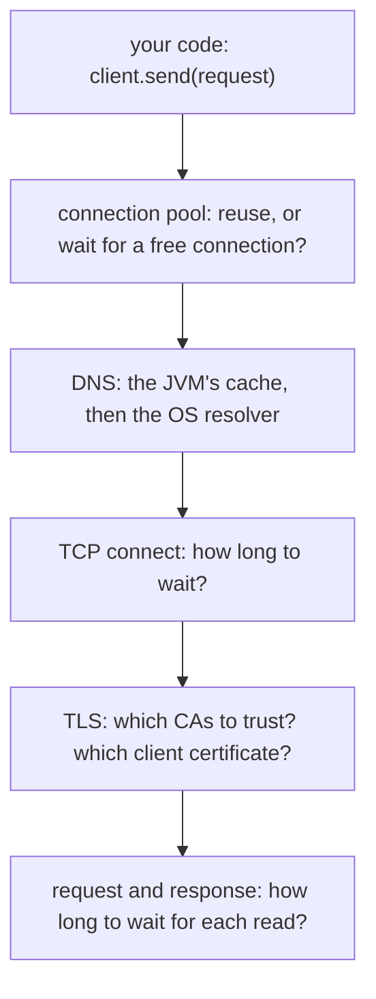
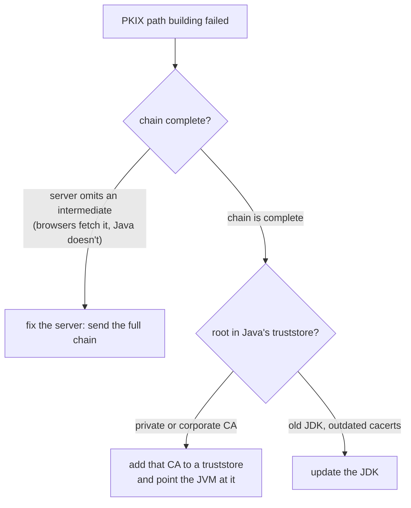

## Mental Model

Every network call your Java code makes ends up as a socket call into the kernel. But the JVM and your libraries add their own layer of **policy** on top: how long to wait, how many connections to keep, how long to trust a DNS answer, which certificates to believe. The kernel's mechanisms are the same for every language. Java services break in production because of that policy layer's *defaults*: waits with no limit, pools that are too small or never refreshed, DNS answers cached past a failover, and truststores missing a certificate.

So think of a Java network call as a stack of decisions, each with a setting you should choose on purpose:



## Definition

- **`java.net.Socket` / `ServerSocket`**: blocking sockets; one thread waits in each `read()`.
- **NIO (`SocketChannel`, `Selector`)**: non-blocking channels and an epoll-based selector, so one thread can serve many connections. Netty is built on it.
- **`java.net.http.HttpClient`** (Java 11+): the JDK's HTTP/1.1 and HTTP/2 client, with a built-in connection pool, synchronous and asynchronous APIs.
- **Virtual threads** (Java 21): lightweight threads that release their carrier thread while blocked on socket I/O, so blocking code can serve many thousands of connections.
- **Connect timeout**: the limit for establishing a TCP (and TLS) connection.
- **Read / request timeout**: the limit for waiting on data or on the whole response.
- **Pool acquisition timeout**: the limit for waiting for a free connection from a pool.
- **`networkaddress.cache.ttl`**: how many seconds the JVM caches successful DNS lookups.
- **Truststore**: the CA certificates a client trusts (by default the JDK's `cacerts`). **Keystore**: your own private key and certificate, for servers and for mutual TLS clients.

## Why It Exists

**The problem.** Networks fail partially: a dependency becomes slow rather than dead, an IP changes behind a DNS name, a load balancer closes idle connections, a certificate chain changes. A Java service that waits forever, caches forever or opens a new connection for every call turns each of those into an outage, usually by exhausting threads while the CPU sits idle.

**The idea.** Decide every limit explicitly: how long to wait at each stage, how many connections to keep and for how long, how long to believe DNS, and which certificates to trust. Then a failing dependency costs a bounded amount of time and capacity, and the service degrades instead of stopping.

:::callout[That's all it is]{type=insight}
Reuse connections, put a time limit on every wait (connect, pool, read), size pools from your traffic, keep DNS answers no longer than they deserve, and trust exactly the certificates you mean to.
:::

## How It Works

### Three ways to wait on the network

| Model | How it waits | Connections per thread | Use |
|---|---|---|---|
| Blocking sockets, platform threads | Each thread blocks in `read()` | 1 | Simple servers and clients; thousands of connections means thousands of 1 MB stacks |
| NIO selector (Netty, Undertow, Reactor) | One thread loops over `Selector.select()`, handling whichever sockets are ready | Thousands | High-concurrency proxies and gateways; callback or reactive code |
| Blocking sockets, virtual threads (Java 21) | A blocked virtual thread unmounts; the JDK's poller (epoll on Linux) wakes it when the socket is ready | One virtual thread each, millions possible | Thread-per-request code that scales like an event loop |

All three end in the same kernel mechanisms ([I/O Models](lesson:os-io-models)). With virtual threads you get the event loop's efficiency while writing plain blocking code. Before JDK 24, blocking inside a `synchronized` block pinned the carrier thread and lost that benefit.

### HttpClient, configured on purpose

```java
HttpClient client = HttpClient.newBuilder()
        .connectTimeout(Duration.ofSeconds(2))           // TCP + TLS setup
        .version(HttpClient.Version.HTTP_2)              // falls back to HTTP/1.1 if the server can't
        .build();                                        // build once and share: it owns the connection pool

HttpRequest request = HttpRequest.newBuilder(URI.create("https://api.example.com/orders/42"))
        .timeout(Duration.ofSeconds(5))                  // deadline for the response headers
        .header("Accept", "application/json")
        .GET()
        .build();

HttpResponse<String> response = client.send(request, HttpResponse.BodyHandlers.ofString());
```

- **Share one client.** The client holds the connection pool. Building a new client per request throws away warm connections, and costs a TCP and TLS handshake every time.
- **Set both timeouts.** Without `connectTimeout`, a connect to a host that drops packets waits for the operating system to give up. Without a request `timeout`, a server that accepts the request and never answers holds the calling thread for as long as the connection lives.
- **Read or close every body.** With `BodyHandlers.ofInputStream()`, an unread, unclosed stream keeps its connection out of the pool. Leak enough and the client stalls, or the server sees sockets stuck in `CLOSE_WAIT`.

### The timeouts every call needs

| Stage | What hangs without a limit | JDK HttpClient | Apache HttpClient 5 | JDBC (typical driver) |
|---|---|---|---|---|
| Waiting for a pooled connection | All connections busy → callers queue | (pool grows without limit by default) | `setConnectionRequestTimeout` | Pool setting, e.g. HikariCP `connectionTimeout` |
| Connecting | Host drops SYNs → ~2 min | `connectTimeout` | `setConnectTimeout` | `connectTimeout` / `loginTimeout` |
| Waiting for data | Peer silent → forever | `HttpRequest.timeout` | `setResponseTimeout` | `socketTimeout`, `Statement.setQueryTimeout` |

On top of these, give each incoming request an overall **deadline**, and pass what is left of it to downstream calls, so no layer waits longer than its caller will ([Tail Latency](lesson:cn-tail-latency)).

### Sizing a connection pool

A pool needs enough connections for the requests in flight. By Little's law, in-flight = arrival rate × time each request holds a connection ([Performance Fundamentals](lesson:os-performance-method)):

```text
400 requests/s × 50 ms per request = 20 connections busy on average
```

20 is the *average*. Requests arrive in bursts, so a pool of exactly 20 makes many of them wait. The [speedup & queueing lab](lab:speedup-queueing) shows that 24 connections keep the mean response under 55 ms, and 27 make waiting rare. A pool far larger than needed has its own cost: more idle connections, more load on the server, and less protection when a dependency slows down.

Also keep pooled connections **younger than the server's idle timeout**. If a load balancer drops idle connections after 60 s while the pool keeps them for 5 minutes, the first request on a stale connection fails with "Connection reset" or `NoHttpResponseException`. Evict idle connections sooner, cap connection lifetime, and retry idempotent requests once ([HTTP Connections](lesson:cn-http-connections)).

### The JVM's DNS cache

`InetAddress` caches lookups inside the JVM, in front of whatever the operating system does ([DNS](lesson:cn-dns-fundamentals)):

| Property (in `java.security`, or `Security.setProperty` at startup) | Default without a security manager |
|---|---|
| `networkaddress.cache.ttl`: successful lookups | 30 s (forever with a security manager installed) |
| `networkaddress.cache.negative.ttl`: failed lookups | 10 s |

The JVM ignores the record's own TTL and applies its fixed value. Two consequences:
- After a DNS failover, a JVM can keep using the old address for up to 30 s past whatever the resolvers cached.
- **Pooled connections ignore DNS entirely**: a connection opened to the old IP keeps going there until it is closed. A maximum connection lifetime is what moves traffic to the new address.

Old applications sometimes set the TTL to `-1` (forever), which breaks every failover; set a short positive value instead. Java 18 also added a pluggable resolver (`InetAddressResolver`) for custom DNS behaviour.

### TLS in Java: truststores and keystores

- The client trusts the CAs in its **truststore**: the JDK's `lib/security/cacerts` unless you pass `-Djavax.net.ssl.trustStore=…` or build an `SSLContext` yourself.
- A server, or a client in mutual TLS, presents its key and certificate from a **keystore** (PKCS#12).
- `HttpClient` and `HttpsURLConnection` verify the hostname against the certificate's SAN, as browsers do.

The classic failure is `PKIX path building failed: unable to find valid certification path to requested target`. It means Java couldn't build a chain from the server's certificate to a CA in its truststore:



`curl` succeeding while Java fails usually means curl used the operating system's CA store, or fetched a missing intermediate itself. Never "fix" it by trusting all certificates or disabling hostname checks: that removes the authentication TLS exists to provide. `-Djavax.net.debug=ssl:handshake` prints the handshake for debugging ([Certificates & PKI](lesson:cn-certificates-pki)).

## Internal Mechanism

### What happens on a pooled HTTPS call

1. **Pool**: find an idle connection to the same scheme, host and port, or start a new one.
2. **DNS** (new connections only): the JVM cache, then the OS resolver.
3. **TCP connect**: one round trip, bounded by the connect timeout.
4. **TLS handshake**: one more round trip with TLS 1.3, plus certificate validation against the truststore.
5. **Request**: the request goes out; with HTTP/2 it is a new stream on a shared connection.
6. **Response**: bounded by the request timeout. The connection returns to the pool once the body has been fully read.

Steps 2–4 cost two round trips and noticeable CPU per new connection, which is why reuse matters so much on high-latency paths.

:::depth{level=advanced}
### Virtual threads and the JDK poller

When a virtual thread calls `read()` on a socket with no data, the JDK registers the socket with an internal poller (epoll on Linux, kqueue on macOS). It then unmounts the virtual thread from its carrier platform thread. When the poller reports the socket readable, the virtual thread is scheduled again on a carrier. The kernel sees a handful of carrier threads and one epoll set, while your code sees a blocking `read()` ([epoll & Event Loops](lesson:os-epoll-event-loops)). File I/O and some native calls still block the carrier, and JDKs before 24 also pinned it inside `synchronized` blocks.
:::

## Example

A production-minded call path, with the decisions spelled out:

```java
// one shared client per downstream service, created at startup
HttpClient client = HttpClient.newBuilder()
        .connectTimeout(Duration.ofMillis(500))
        .executor(Executors.newVirtualThreadPerTaskExecutor())
        .build();

HttpResponse<String> getOrder(String id, Instant deadline) throws IOException, InterruptedException {
    Duration left = Duration.between(Instant.now(), deadline);
    if (left.isNegative() || left.isZero()) throw new HttpTimeoutException("deadline already passed");
    HttpRequest request = HttpRequest.newBuilder(URI.create("https://orders.internal/orders/" + id))
            .timeout(left)                              // never wait longer than the caller will
            .build();
    return client.send(request, HttpResponse.BodyHandlers.ofString());
}
```

At startup, `Security.setProperty("networkaddress.cache.ttl", "10")` keeps DNS answers short-lived, before any lookup happens.

## Complexity & Performance

- A new HTTPS connection costs 2 round trips (TCP + TLS 1.3) before the request; a pooled one costs 0.
- Platform threads cost about 1 MB of stack each, so blocking I/O with 10,000 concurrent calls needs 10,000 threads; virtual threads cost a few KB.
- Each pooled idle connection costs a socket on both ends; idle eviction keeps the count down.

## Trade-offs

- Short timeouts fail fast and protect capacity, but cut off slow-but-healthy calls; tie them to measured latency (above p99) and to the caller's deadline.
- Large pools absorb bursts but put more load on the dependency; small pools protect it but queue callers.
- A short DNS cache follows failovers quickly but performs more lookups.

## Failure Modes

- **Thread exhaustion** from missing timeouts: a slow dependency takes every request thread while the CPU is idle.
- **Stale pooled connections** after a load balancer's idle timeout: intermittent "Connection reset" on the first call after a quiet period.
- **DNS failover ignored**: connections and JVM cache keep using the old IP.
- **Leaked response bodies**: connections never return to the pool, the pool stalls, sockets pile up in `CLOSE_WAIT` on the other side.
- **PKIX errors** after a certificate rotation that dropped an intermediate, or a private CA missing from a container image's truststore.

## In Production

- Thread dumps show where requests wait: many threads in `SocketInputStream.socketRead0`, or `sun.nio.ch.NioSocketImpl.park`, means a slow dependency; many waiting in a pool's `getConnection` means the pool is too small or connections are leaking ([JVM on Linux](lesson:os-jvm-on-linux)).
- Export pool metrics (active, idle, pending, acquisition time). Rising pending counts come before user-visible latency.
- Container base images sometimes ship their own CA bundle; check which truststore the JVM inside actually uses.

## Deeper Connections

- Connect and read timeouts are the client side of TCP behaviour: SYN retransmission backoff, and silence on idle connections ([Sockets](lesson:cn-sockets), [TCP Termination](lesson:cn-tcp-termination)).
- Pool sizing is Little's law plus queueing near saturation ([Speedup & Queueing lab](lab:speedup-queueing)).

## Common Misconceptions

- **"HttpClient has sensible default timeouts."** The JDK client has no request timeout and no connect timeout unless you set them.
- **"The JVM respects DNS TTLs."** It applies its own fixed cache time, and pooled connections ignore DNS altogether.
- **"Trusting all certificates in test code is harmless."** Such code tends to reach production, and then TLS no longer authenticates anything.

## Interview Questions

### [L2 · how] Which timeouts does an outgoing HTTP call from a Java service need?

Three, plus an overall deadline. A **pool acquisition** timeout bounds the wait for a free connection; a **connect** timeout bounds TCP and TLS setup; a **read/response** timeout bounds the wait for data. The overall deadline comes from the incoming request, and what remains of it is passed to each downstream call, so no call outlives its caller. Without them, a slow or silent dependency holds threads indefinitely and the service stops while idle.

### [L2 · why] Why should you create one HttpClient (or RestTemplate/WebClient) and reuse it, rather than one per request?

The client owns the connection pool. Reusing it reuses warm TCP and TLS connections; a new client per request pays a TCP round trip, a TLS round trip and the certificate checks every time, adds load on the server, and can leave sockets in TIME_WAIT on the client. Clients are thread-safe and designed to be shared.

### [L2 · how] How does the JVM cache DNS, and how can that break a failover?

`InetAddress` caches successful lookups for `networkaddress.cache.ttl` seconds (30 s by default without a security manager; forever with one) and failed lookups for 10 s, regardless of the record's TTL. After a DNS failover, the JVM may keep the old address for that long on top of the resolvers' caching. Worse, pooled connections already open to the old IP keep using it until closed. The fix: a short cache TTL, a maximum connection lifetime in the pool, and never `-1`.

### [L2 · debugging] A Java client fails with "PKIX path building failed", while curl to the same URL works. What's going on?

Java can't build a chain from the server's certificate to a CA in its truststore. Either the server doesn't send an intermediate certificate (browsers and some curl builds fetch or cache it, Java doesn't), or the root is a private or corporate CA that is in the OS store curl uses but not in the JVM's `cacerts`. Fix the server to send its full chain, or add the CA to a truststore the JVM is configured to use. Don't disable certificate validation.

### [L3 · design] How do you size an HTTP client's connection pool to a dependency?

Start from Little's law: requests per second × average time each holds a connection gives the average number in use (400/s × 50 ms = 20). Add headroom for bursts, because a pool sized at the average makes requests queue (around 20–30% more, or model it as an M/M/c queue). Set a pool acquisition timeout so callers fail fast when the dependency slows down instead of queueing without limit, cap connection lifetime below load balancers' idle timeouts, and watch pending-acquisition metrics.

### [L3 · compare] Blocking threads, NIO event loops or virtual threads for a service with 20,000 concurrent slow calls?

Platform threads blocking in I/O would need 20,000 threads, about 20 GB of stack reservations and heavy scheduling. An NIO event loop (Netty, reactive code) handles them with a few threads, but forces asynchronous code. Virtual threads (Java 21) let you write plain blocking code: each blocked call unmounts, and the JDK's epoll-based poller resumes it. They are the simplest choice today, provided long-held `synchronized` blocks around I/O are avoided on JDKs before 24 and downstream pools still limit concurrency.

### [L3 · debugging] After quiet periods, the first request to a partner API fails with "Connection reset", and a retry succeeds. Why?

The client's pool keeps idle connections longer than something in the path keeps them open: a load balancer or NAT with a shorter idle timeout drops them silently. The client then sends on a dead connection, and gets an RST. Fix it by evicting idle connections before the shortest idle timeout on the path, enabling TCP keep-alive, or validating connections, and by retrying idempotent requests once.

## Practice

### [numeric 20] A service makes 400 calls per second to a dependency, and each call holds a connection for 50 ms on average. How many connections are in use on average?

:::answer
Little's law: L = λ × W = 400/s × 0.05 s = **20**. That is the average; the pool needs more to absorb bursts.
:::

### [numeric 24] Model the same pool as an M/M/c queue (400 arrivals/s, 50 ms service time). What is the smallest pool that keeps the mean response time under 55 ms? Use the queueing tab of the [speedup & queueing lab](lab:speedup-queueing).

:::answer
With 20 connections the queue is unstable (100% busy). 21 gives 88 ms, 22 gives 64 ms, 23 gives 56.9 ms, and **24** gives 53.7 ms at 83% utilization. Sizing at the average guarantees heavy queueing; 20% headroom fixes it.
:::

### [numeric 90 unit=s] A DNS record has TTL 60 s, and the JVM uses its default 30 s cache. After the record changes, at most how long can a JVM keep connecting new sockets to the old address (ignoring connections already open)?

:::answer
The recursive resolver may serve the old answer for up to 60 s after the change. A JVM that looked it up just before the resolver's copy expired then caches it for 30 s more: **90** s. Pooled connections already open to the old address can last even longer, until they are closed.
:::

### [numeric 100 unit=ms] A client calls a server 50 ms away (RTT) over HTTPS with TLS 1.3. How much time does reusing a pooled connection save per request, compared with opening a new one?

:::answer
A new connection needs a TCP handshake (1 RTT) and a TLS 1.3 handshake (1 RTT) before the request can go: 2 × 50 = **100** ms, plus the server's signature and certificate checks. A pooled connection sends the request at once.
:::

### [mcq] Which setting decides how long the JVM caches a successful DNS lookup?

- [ ] The record's TTL from the DNS server
- [x] The `networkaddress.cache.ttl` security property
- [ ] `HttpClient.connectTimeout`
- [ ] `sun.net.inetaddr.ttl` set by the operating system

The JVM applies its own fixed cache time (30 s by default without a security manager) and ignores the record's TTL. `sun.net.inetaddr.ttl` is an older system property with the same effect, set on the JVM, not by the OS.

### [mcq] `BodyHandlers.ofInputStream()` is used, and on error responses the code returns early without touching the stream. What eventually happens?

- [ ] Nothing: the stream is closed by the garbage collector immediately
- [x] Those connections are never returned to the pool, and the client (or the server, in CLOSE_WAIT) runs out of connections
- [ ] The JDK retries the request automatically
- [ ] The request timeout closes the stream for you

An unread, unclosed body keeps its connection busy. Wrap the stream in try-with-resources, or use `ofString()` / `ofByteArray()` for small responses, which read and release the connection for you.

### [exercise] Review this client code for a service handling 300 requests/s, and list every networking problem you can find, with a fix for each:

```java
public Order fetch(String id) throws Exception {
    HttpClient client = HttpClient.newHttpClient();
    HttpRequest req = HttpRequest.newBuilder(URI.create("https://orders/api/" + id)).build();
    HttpResponse<InputStream> resp = client.send(req, HttpResponse.BodyHandlers.ofInputStream());
    if (resp.statusCode() != 200) return null;
    return mapper.readValue(resp.body(), Order.class);
}
```

:::solution
1. **A new client per call**: no connection reuse, so each request pays TCP and TLS handshakes, and sockets pile up in TIME_WAIT. Create one client at startup and share it.
2. **No connect timeout**: a host that drops packets holds the thread for minutes. Set `connectTimeout` on the builder.
3. **No request timeout**: a server that never answers holds the thread indefinitely. Set `HttpRequest.Builder.timeout`, ideally from the caller's remaining deadline.
4. **Leaked body on non-200 responses**: the stream is never closed, so the connection never returns to the pool (CLOSE_WAIT on the server). Use try-with-resources on `resp.body()`, or `ofString()` for small bodies.
5. **No retry policy or circuit breaker**: transient resets on idempotent GETs fail the user's request; a slow dependency isn't shed. Retry GETs once with backoff, and add a circuit breaker.
6. **Hidden in the URI**: "orders" as a bare hostname depends on DNS search domains, and the JVM's DNS cache plus pooled connections decide how fast a failover takes effect. Use the full name, and cap connection lifetime.
:::

## Quick Revision

- Blocking sockets (thread per connection) · NIO Selector (event loop, Netty) · virtual threads (blocking code, JDK poller underneath).
- HttpClient: build once and share; set `connectTimeout` and per-request `timeout`; always read or close bodies.
- Every call: pool-acquisition, connect and read timeouts, plus an overall deadline passed downstream.
- Pool size ≈ rate × hold time (Little's law) + headroom; evict idle connections before LB/NAT idle timeouts; cap lifetime.
- JVM DNS cache: `networkaddress.cache.ttl` (30 s default without a security manager), negative 10 s; pooled connections ignore DNS.
- TLS: truststore (`cacerts`) for CAs, keystore for your own key; "PKIX path building failed" = missing intermediate or untrusted CA; debug with `-Djavax.net.debug=ssl:handshake`.
