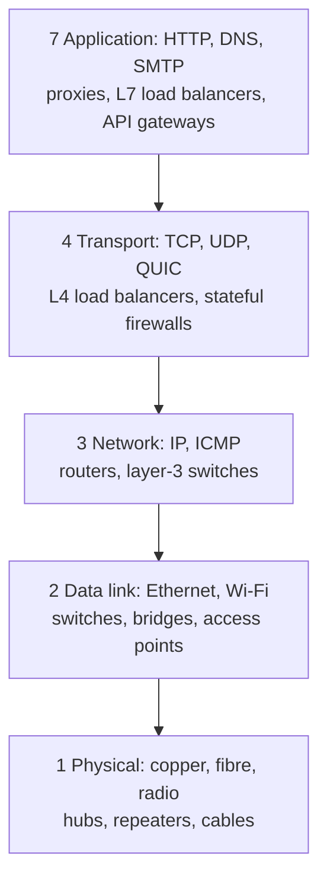

## Mental Model

Layering is **division of labor with strict contracts**. Each layer solves one problem and offers a service to the layer above, while using the service of the layer below — without caring how it works.

- The **application** says: "deliver these bytes to that service" — it doesn't care about routes.
- **Transport** says: "I'll get the bytes to the right program, reliably and in order if you want" — it doesn't care about cables.
- **Network (IP)** says: "I'll get a packet to that host, hop by hop, best effort" — it doesn't care what's inside.
- **Link** says: "I'll get a frame to the next device on this wire or radio."
- **Physical** says: "I'll turn bits into signals and back."

Because each layer depends only on the contract below, you can swap Wi-Fi for fiber, IPv4 for IPv6, or HTTP/1.1 for HTTP/2 without rewriting everything else.

## Definition

- **OSI model**: a 7-layer reference model (ISO, 1984): Physical, Data Link, Network, Transport, Session, Presentation, Application.
- **TCP/IP model** (Internet model): the architecture the internet actually runs on, usually drawn as 4 layers (Link, Internet, Transport, Application) or 5 (splitting Link into Physical + Data Link).

## Why It Exists

**The problem.** A network stack must handle electrical signaling, local delivery, global routing, reliable streams, encryption and application semantics.

**Without it.** One monolithic design would be impossible to evolve. Every web browser would need to know about Wi-Fi radio timing; replacing copper with fiber would mean rewriting every application.

**The idea.** Split the job into pieces where each piece only *uses* the one below and only *serves* the one above, through a fixed contract. Then anyone can replace a piece as long as they honour its contract. Layering lets thousands of independent teams build interoperable pieces.

:::callout[That's all it is]{type=insight}
Each layer solves one problem — signal, next hop, any host, right program, app meaning — and treats everything below it as a black box. The OSI and TCP/IP models are just two ways of drawing the same stack.
:::

## How It Works

### The two models side by side

| # | OSI layer | TCP/IP layer | Responsibility | PDU name | Addresses | Examples |
|---|---|---|---|---|---|---|
| 7 | Application | Application | App semantics: requests, names, mail, files | message | URLs, names | HTTP, DNS, SMTP, SSH, gRPC |
| 6 | Presentation | (in application) | Encoding, compression, encryption | | | TLS (arguably), JSON/Protobuf, gzip |
| 5 | Session | (in application) | Dialog/session management | | | TLS sessions, RPC sessions |
| 4 | Transport | Transport | Process-to-process delivery; reliability, ordering, flow/congestion control | segment / datagram | ports | TCP, UDP, QUIC |
| 3 | Network | Internet | Host-to-host delivery across networks; routing | packet | IP addresses | IPv4, IPv6, ICMP |
| 2 | Data Link | Link | Node-to-node delivery on one link; framing, error detection | frame | MAC addresses | Ethernet, Wi-Fi (802.11), ARP* |
| 1 | Physical | Link | Bits as signals | bits | — | Copper, fiber, radio |

\*ARP straddles layers 2 and 3 — a reminder that the model is a guide, not a law.

### Which device works at which layer

A device "works at layer N" when layer N's header is the highest one it reads to decide what to do. Everything above that is just payload to it.

- A **hub** or **repeater** regenerates bits and copies them out of every port. It understands no addresses at all.
- A **bridge** or **switch** reads MAC addresses and forwards each frame only where it needs to go ([Ethernet & Switching](lesson:cn-ethernet-switching)).
- A **router** reads IP addresses and moves packets between networks ([Routing](lesson:cn-routing)).
- A **gateway**, in the textbook sense, joins networks that speak different protocols and translates between them at any layer up to the application. A proxy or an email gateway is one; so, loosely, is your "default gateway" router.

### Connection-oriented and connectionless service

A layer can offer its users either kind of service:

| | Connection-oriented | Connectionless |
|---|---|---|
| Before data | Set up a connection (handshake) | Nothing: just send |
| State | Both ends keep per-connection state | Each unit is independent |
| Typical guarantees | Ordering, reliability, flow control | Best effort |
| Examples | TCP; a telephone call; virtual circuits | UDP, IP; posting a letter |

The internet's network layer (IP) is connectionless, and TCP builds a connection-oriented service on top of it, in the end hosts only.

### "L4" and "L7" in industry speech

Engineers use layer numbers as shorthand:

- **L4 load balancer**: balances TCP/UDP connections by IP and port, without parsing HTTP (fast, protocol-agnostic).
- **L7 load balancer / proxy**: understands HTTP — routes by path, header or cookie, terminates TLS, retries requests ([Proxies & Load Balancers](lesson:cn-proxies-load-balancers)).
- **L3/L4 DDoS** (SYN floods, UDP floods) vs **L7 DDoS** (expensive HTTP requests).

### Where do real protocols fit awkwardly?

- **TLS** sits between transport and application; OSI would call it presentation/session; in practice it's a library in the application process over TCP.
- **QUIC** is a transport protocol implemented in user space on top of UDP, with TLS 1.3 built in ([HTTP/3 & QUIC](lesson:cn-http3-quic)).
- **ICMP** is carried inside IP but is part of the network layer's control plane.
- **VXLAN/GRE** tunnels put L2 or L3 packets *inside* L4/L3 packets — layers nested inside layers ([Container Networking](lesson:cn-container-networking)).

## Internal Mechanism

### Service interfaces

Each layer boundary is a concrete interface:

- Application ↔ Transport: the **sockets API** (`connect`, `send`, `recv`) — [Sockets](lesson:cn-sockets).
- Transport ↔ Network: the kernel's IP output/input functions.
- Network ↔ Link: the device driver and NIC queues.

Headers added by each layer on the way down (and removed on the way up) are **encapsulation** — traced byte by byte in [Encapsulation](lesson:cn-encapsulation).

:::depth{level=advanced}
### Layering violations — useful and harmful

Real systems cross layers deliberately: NICs compute TCP checksums and segment large sends (TSO/GSO offloads); load balancers read HTTP headers to choose L4 backends; NAT rewrites transport ports; firewalls inspect application payloads. These optimizations and middleboxes make protocols hard to change ("ossification") — middleboxes that recognize TCP options drop packets with unknown ones. Encrypting transport headers (QUIC) is partly a defense against this.
:::

## Example

A single HTTPS request, by layer:

| Layer | What happens |
|---|---|
| Application | Browser builds `GET /index.html HTTP/1.1`, `Host: example.com` |
| (Presentation/Session) | TLS encrypts it into records using keys from the handshake |
| Transport | TCP segments the bytes, adds ports 51514 → 443, sequence numbers |
| Network | IP adds 192.168.1.20 → 93.184.215.14, TTL 64 |
| Link | Wi-Fi frame to the router's MAC |
| Physical | Radio waves |

## Complexity & Performance

Each layer adds header overhead: Ethernet 14 B (+4 FCS), IPv4 20 B (IPv6 40 B), TCP 20–60 B, TLS record ~5 B + MAC tag. On a 1,500-byte MTU, ~40 bytes of TCP/IP headers are ~2.7% overhead — negligible for bulk transfer, significant for tiny messages (a 1-byte payload rides in a ~66-byte frame).

## Trade-offs

- Strict layering: modularity and interoperability vs lost optimization opportunities.
- Cross-layer optimization (offloads, L7 load balancing): performance and features vs complexity and ossification.

## Failure Modes

- Debugging at the wrong layer: "the app is slow" when the problem is packet loss (L3) or DNS (L7).
- Middleboxes breaking protocol evolution (e.g., dropping TCP Fast Open cookies).
- MTU mismatches across tunnel layers causing black holes ([MTU](lesson:cn-mtu-congestion)).

## In Production

- Troubleshoot bottom-up: link up? IP reachable (`ping`)? route correct (`traceroute`)? port open (`nc -vz host 443`)? TLS OK (`openssl s_client`)? HTTP OK (`curl -v`)?
- Cloud load balancers are labeled by layer (AWS NLB = L4, ALB = L7).

## Deeper Connections

- Layering in networks mirrors layering in OS I/O stacks (VFS → filesystem → block layer → driver) and in database engines (SQL → planner → executor → storage → buffer pool).

## Common Misconceptions

- **"The internet uses the OSI model."** The internet uses TCP/IP; OSI is a reference vocabulary.
- **"Each protocol belongs to exactly one layer."** TLS, ARP, QUIC and tunnels straddle layers.
- **"Memorizing layer names is the point."** The point is knowing which layer is responsible for which problem — so you know where to look when it breaks.

## Interview Questions

### [L1 · compare] What are the layers of the TCP/IP model and what does each do?

Link (frames on a single network, MAC addressing), Internet/IP (routing packets between networks, IP addressing), Transport (process-to-process delivery via ports; TCP adds reliability, ordering, flow and congestion control; UDP is minimal), and Application (protocol semantics like HTTP, DNS, SMTP). A 5-layer version splits Link into Physical and Data Link.

### [L1 · compare] OSI vs TCP/IP model?

OSI has 7 layers including separate Session and Presentation layers; it's a reference model. TCP/IP has 4–5 layers and is what the internet actually implements; session and presentation concerns are handled inside applications or libraries like TLS.

### [L2 · compare] What's the difference between an L4 and an L7 load balancer?

An L4 load balancer routes connections based on IP addresses and ports without understanding the application protocol — fast and protocol-agnostic, but it can't route by URL or balance individual HTTP requests on a shared connection. An L7 load balancer parses the application protocol (usually HTTP): it can terminate TLS, route by host/path/header, balance per request, retry, and add headers, at higher CPU cost.

### [L2 · how] At which layer does TLS operate?

Between the transport and application layers: it runs over a reliable transport (TCP) and provides an encrypted, authenticated channel to the application. In OSI terms it's usually described as session/presentation; in practice it's a library linked into the application (or built into QUIC).

### [L3 · debugging] Users report "the website doesn't load". Walk through a layered troubleshooting approach.

Check bottom-up: Is the client online (link, Wi-Fi)? Does DNS resolve (`dig`)? Is the IP reachable (`ping`/`traceroute`, possibly blocked by ICMP filtering)? Is the port open (`nc -vz host 443`)? Does TLS succeed (`openssl s_client -connect host:443 -servername host` — certificate errors, protocol mismatch)? Does HTTP return a valid response (`curl -v`) — status codes, redirects, timeouts? Isolate the failing layer, then look at server/CDN logs for that layer.

### [L1 · conceptual] Which network devices work at which layer?

Hubs and repeaters work at layer 1: they regenerate and copy bits without reading any address. Switches and bridges work at layer 2: they forward frames by MAC address. Routers work at layer 3: they forward packets by IP address between networks. L4 load balancers and stateful firewalls track TCP/UDP connections, and proxies and L7 load balancers read the application protocol, such as HTTP. A device "works at" the highest layer whose header it reads to make its decision.

### [L2 · compare] What is the difference between connection-oriented and connectionless service? Give an example at each layer.

A connection-oriented service sets up state at both ends before data flows (a handshake) and can then offer ordering, reliability and flow control. TCP is the example at the transport layer. A connectionless service sends each unit independently with no setup: IP at the network layer, UDP at the transport layer, and Ethernet at the link layer. The internet deliberately builds TCP's connections only in the end hosts, on top of connectionless IP, so routers keep no per-connection state.

## Practice

### [mcq] At which TCP/IP layer are port numbers used?

- [ ] Link
- [ ] Internet
- [x] Transport
- [ ] Application

Ports identify processes on a host — a transport-layer concept.

### [mcq] Which protocol operates at the network (Internet) layer?

- [ ] TCP
- [ ] Ethernet
- [x] ICMP
- [ ] HTTP

ICMP is carried in IP and reports network-layer errors.

### [mcq] A device receives a frame, looks at the destination MAC address, and sends the frame out of only one port. What is it?

- [ ] A hub
- [x] A switch
- [ ] A router
- [ ] A repeater

A hub and a repeater work at layer 1 and copy bits out of every port. A router reads the IP header and rebuilds the frame for the next link. Forwarding a frame by MAC address to a single port is a layer-2 switch.

### [numeric 158 unit=bytes] An application sends 100 bytes over TCP, IPv4 and Ethernet. With 20-byte TCP and IP headers (no options), a 14-byte Ethernet header and a 4-byte FCS, how many bytes does the frame occupy on the wire, not counting the preamble?

:::answer
100 + 20 (TCP) + 20 (IP) + 14 (Ethernet header) + 4 (FCS) = **158** bytes. Only 100 of them, 63%, are the application's data. Small messages pay heavily for headers, which is one reason protocols batch small writes.
:::

### [numeric 9.09 ±0.05 unit=%] A 1,000-byte message passes down a stack of 5 layers, and each layer adds a 20-byte header. What percentage of the transmitted bytes are headers?

:::answer
Headers total 5 × 20 = 100 bytes, and the transmitted unit is 1,100 bytes. 100 ÷ 1,100 = **9.09**%. Halve the message to 500 bytes and the share rises to 16.7%.
:::

### [exercise] Users report "the website doesn't load". For each finding, name the layer where the problem lies and the next thing to check: (a) the laptop has the IP address 169.254.12.7; (b) `ping 8.8.8.8` works but `ping example.com` says "unknown host"; (c) `curl https://example.com` fails with "certificate has expired"; (d) `ping` to the server works but `curl` times out on port 443. Then open the [encapsulation visualization](viz:encapsulation) and name which header each failure is about.

:::solution
- **(a) Network layer address assignment.** 169.254.x.x is a self-assigned link-local address, so DHCP didn't answer. Check the Wi-Fi or cable link, then the DHCP server ([ARP & DHCP](lesson:cn-arp-dhcp)). Header: none yet; the host never got a usable IP header.
- **(b) Application layer, DNS.** IP routing works (the ping to an address succeeds), but names don't resolve. Check the configured resolver and try `dig example.com @1.1.1.1`. Header: the DNS query inside a UDP datagram.
- **(c) TLS, between transport and application.** The TCP connection works, but certificate validation fails. Renew the certificate on the server, or check the client's clock. Header: the TLS records above TCP.
- **(d) Transport layer.** The host is reachable at the IP layer, but nothing completes the TCP handshake on port 443: the service is down, or a firewall drops the SYN. Check with `nc -vz example.com 443` and the firewall rules. Header: the TCP header's destination port.

Working bottom-up separates "can't reach the machine" from "can reach it, but the service or protocol fails".
:::

### [mcq] Which statement about connection-oriented and connectionless service is correct?

- [ ] IP is connection-oriented, because routers track each TCP connection
- [x] TCP provides a connection-oriented service on top of connectionless IP
- [ ] UDP becomes connection-oriented once you call `connect()` on the socket
- [ ] Connectionless protocols can't carry more than one packet between two hosts

Routers forward each IP packet independently and keep no per-connection state. TCP's connection exists only in the two end hosts. Calling `connect()` on a UDP socket just fixes the default peer; no handshake or delivery guarantee is added.

## Quick Revision

- Layers = contracts: each uses the one below, serves the one above.
- TCP/IP: Link → Internet (IP) → Transport (TCP/UDP) → Application. OSI adds Session and Presentation.
- PDUs: frame (L2), packet (L3), segment/datagram (L4), message (L7).
- L4 LB = IP/port; L7 LB = understands HTTP.
- TLS, ARP, QUIC and tunnels straddle layers.
- Troubleshoot bottom-up.
- Devices: hub/repeater (L1, no addresses), switch/bridge (L2, MAC), router (L3, IP), L4 LB/firewall (ports, connections), proxy/L7 LB/gateway (application).
- Connection-oriented (TCP: handshake, state, ordering) vs connectionless (IP, UDP: independent units, best effort).
