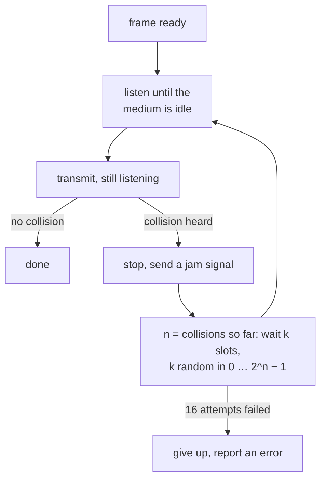
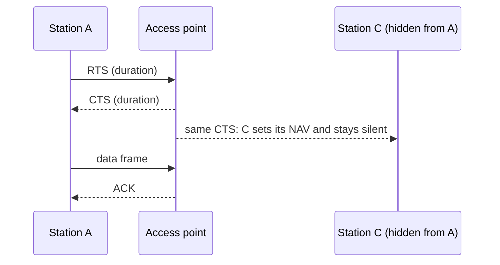

## Mental Model

A group conversation with no chairperson. If two people start talking at once, neither is understood and both must try again.

- **ALOHA**: talk whenever you like; if nobody understood you, wait a random moment and repeat.
- **CSMA/CD** (classic Ethernet): listen first and only start when the room is quiet. If you hear someone else start at the same moment, stop at once and wait a random, growing time.
- **CSMA/CA** (Wi-Fi): in a large hall you can't always hear everyone, and you can't hear anyone while you're talking. So listen, then also wait a random extra moment before starting, and ask the listener to confirm every sentence.
- **Taking turns** (token passing, time slots): a talking stick passes around the room. No collisions, but you wait for your turn even when the room is empty.

## Definition

- **Multiple access (MAC) protocol**: the rules that decide which device may transmit on a shared medium, and when.
- **Collision**: two transmissions overlapping at a receiver, so both are garbled.
- **Carrier sensing**: listening to the medium before transmitting.
- **CSMA/CD** (carrier sense multiple access with collision detection): sense, transmit, and abort when a collision is detected. Half-duplex Ethernet.
- **CSMA/CA** (with collision avoidance): sense, add a random backoff before sending, and confirm each frame with an ACK. Wi-Fi.
- **Binary exponential backoff**: after the n-th collision, wait a random number of slots between 0 and 2^n − 1.
- **Throughput S**: successful transmissions per frame time. **Offered load G**: attempted transmissions (new and retried) per frame time.

## Why It Exists

**The problem.** A shared cable or a radio channel can carry one transmission at a time. Many devices want to use it, at unpredictable moments, with no central controller. Without rules, transmissions collide and the channel carries nothing useful.

**The first answer.** Divide the channel up front: give each device a fixed frequency band (FDMA) or a fixed time slot (TDMA). It is fair and collision-free, but wasteful for bursty traffic: idle devices' slots go unused while busy ones wait.

**The idea.** Let devices **contend** for the whole channel when they need it, and recover from collisions with randomness, so that two colliding devices are unlikely to collide again. Each refinement (listen first, stop early, back off longer after repeated collisions) wastes less of the channel on collisions.

:::callout[That's all it is]{type=insight}
When several devices share one channel, collisions are unavoidable. Listen before sending, notice collisions (or avoid them), and wait a random time before trying again, doubling the range after each failure.
:::

## How It Works

### ALOHA: transmit and hope

**Pure ALOHA** (University of Hawaii, 1970): send whenever there's a frame; if no acknowledgement arrives, wait a random time and resend. A frame is safe only if no other frame starts within one frame time before or after it, a vulnerable period of **two** frame times. With attempts arriving randomly at rate G per frame time:

```text
pure ALOHA:     S = G · e^(−2G)   maximum 1/(2e) ≈ 18.4% at G = 0.5
slotted ALOHA:  S = G · e^(−G)    maximum 1/e   ≈ 36.8% at G = 1
```

**Slotted ALOHA** divides time into frame-sized slots and lets devices start only at a slot boundary. Two frames now either collide completely or not at all, the vulnerable period halves, and the best throughput doubles. Beyond the peak, adding load *lowers* throughput: more and more slots are wasted on collisions.

### CSMA/CD: listen, and stop as soon as you collide

Classic half-duplex Ethernet:



Two stations can still collide, because a signal takes time to cross the cable: B may start before A's signal reaches it. Detecting a collision quickly wastes far less than ALOHA's full lost frame.

**Minimum frame size.** A sender only notices a collision while it is still transmitting. In the worst case, A's frame reaches the far end just as station B starts; B's signal then needs another full propagation delay to get back to A. So A must still be sending after a round trip:

```text
transmission time ≥ 2 × propagation delay   →   L_min = 2 · T_p · R

10 Mb/s Ethernet: slot time 51.2 µs → L_min = 512 bits = 64 bytes
```

That is why Ethernet frames are at least 64 bytes and short payloads are padded. It is also why faster half-duplex Ethernet had to shrink the maximum cable length: at 10× the speed, a 64-byte frame lasts a tenth as long.

**Binary exponential backoff.** After the n-th collision on the same frame, wait k slot times, with k chosen at random from 0 to 2^min(n, 10) − 1. After 1 collision there are 2 choices, after 3 there are 8. Repeated collisions mean the network is busy, so the range grows and the stations spread out. After 16 failed attempts the frame is dropped.

### CSMA/CA: Wi-Fi avoids collisions it can't detect

A radio can't hear other transmissions while it is sending: its own signal is far stronger at its antenna. And stations may not hear each other at all. **Hidden terminals**: A and C can both reach the access point but not each other, so each senses the channel as idle and their frames collide at the AP.

So 802.11 replaces detection with avoidance and confirmation:

1. Sense the channel; when it has been idle for a fixed gap (DIFS), count down a **random backoff** from a contention window, pausing whenever the channel is busy.
2. Transmit the whole frame.
3. The receiver checks it and replies with an **ACK** after a short gap (SIFS). No ACK means a collision or damage: double the contention window and retry.
4. Optionally, reserve the channel first with **RTS/CTS**. The sender's RTS ("Request to Send", with the duration) is answered by the AP's CTS ("Clear to Send"). Every station that hears either one sets its **NAV**, a timer during which it stays silent.



C never heard A's RTS, but it hears the AP's CTS, so the hidden terminal stays quiet. RTS/CTS costs two extra short frames, so it's normally used only for large frames.

### Taking turns and dividing the channel

| Approach | How | Strength | Weakness |
|---|---|---|---|
| FDMA | Each device gets its own frequency band | No contention | Idle bands are wasted |
| TDMA | Each device gets fixed time slots | Predictable delay | Idle slots are wasted; needs time sync |
| CDMA | Devices share the band with different codes | Many simultaneous senders | Complex; power control matters |
| Polling | A master asks each device in turn | No collisions | The master is a single point of failure; polling overhead |
| Token passing | A token circulates; only its holder may send | No collisions, bounded wait | Lost tokens must be detected and regenerated |

Cellular networks combine these (OFDMA in LTE and 5G, also used by Wi-Fi 6). Token Ring and FDDI used token passing; they are history now.

## Internal Mechanism

### Why switched Ethernet doesn't need CSMA/CD

On a modern switched network, every cable joins exactly two devices, a host and a switch port, and runs **full duplex**: separate pairs of wires (or fibres) carry each direction. Nobody else shares the medium, so collisions can't happen and CSMA/CD is switched off. The 64-byte minimum frame survives for compatibility. The idea of randomized exponential backoff lives on in Wi-Fi, and in software, where retries back off exponentially with jitter.

:::depth{level=advanced}
### Exposed terminals and why Wi-Fi throughput drops with more users

The **exposed terminal** is the hidden terminal's mirror image: B hears A sending to a distant station and defers, although B's own transmission to another receiver would not have interfered. Carrier sensing is conservative in both directions. Every Wi-Fi frame also pays fixed overheads (gaps, backoff, preamble, ACK), so a busy cell with many stations spends more and more airtime on contention. Wi-Fi 6 adds OFDMA and scheduled access so that the access point can serve several stations in one transmission.
:::

## Example

How much channel does contention waste?

```text
Slotted ALOHA, 100 stations, each sends in a slot with probability 1%:
  G = 100 × 0.01 = 1 attempt per slot
  P(exactly one sender) = 100 × 0.01 × 0.99^99 ≈ 0.370     (close to 1/e)
  → about 63% of slots are idle or wasted on collisions

The same stations, 2% each (G = 2):
  P(exactly one) = 100 × 0.02 × 0.98^99 ≈ 0.271
  → twice the load, and throughput falls to 27%
```

## Complexity & Performance

- ALOHA: at most 18.4% (pure) or 36.8% (slotted) of the channel carries successful frames.
- CSMA/CD: efficiency approaches 100% when frames are long compared with the propagation delay; a widely used approximation is 1 / (1 + 5a), with a = T_p / T_t.
- CSMA/CA: fixed per-frame overheads make small frames expensive; real Wi-Fi throughput is often half the advertised rate or less.

## Trade-offs

- Contention (ALOHA, CSMA) suits bursty traffic but degrades under heavy load; division (TDMA, FDMA) suits steady traffic but wastes idle capacity.
- Larger minimum frames permit longer cables at a given speed, but waste bandwidth on padding.
- RTS/CTS solves hidden terminals at the cost of overhead per frame.

## Failure Modes

- **Congestion collapse** in contention protocols: past the peak, more offered load means less throughput.
- **Duplex mismatch**: one end of a link set to half duplex, the other to full. The half-duplex end sees "collisions" and late collisions, and throughput collapses while light traffic still works.
- **Hidden terminals** in Wi-Fi: frames collide at the access point although each sender saw an idle channel.

## In Production

- `ethtool eth0` shows the negotiated speed and duplex; a "half" there on a modern network is a red flag.
- Crowded Wi-Fi (conference halls, apartment blocks) is slow because of contention and overlapping channels, not because of bandwidth; more access points on non-overlapping channels with less transmit power help more than faster ones.
- Exponential backoff with jitter is the standard retry policy for clients of overloaded services, for the same reason it works on a shared cable.

## Deeper Connections

- Retrying with exponential backoff and jitter in distributed systems is CSMA/CD's backoff in software ([Proxies & Load Balancers](lesson:cn-proxies-load-balancers)).
- Throughput falling past a peak as load rises is the same shape as an overloaded server ([Performance Fundamentals](lesson:os-performance-method)).

## Common Misconceptions

- **"Modern Ethernet uses CSMA/CD."** Full-duplex switched links have no collisions; CSMA/CD is off.
- **"Wi-Fi detects collisions like Ethernet."** A radio can't hear others while sending; Wi-Fi infers loss from a missing ACK.
- **"Slotted ALOHA's 36.8% is a bandwidth number."** It is the fraction of slots carrying exactly one frame at the best possible load.

## Interview Questions

### [L1 · compare] CSMA/CD vs CSMA/CA?

Both listen before sending. CSMA/CD (half-duplex Ethernet) keeps listening while transmitting, stops as soon as it detects a collision, and backs off exponentially. CSMA/CA (Wi-Fi) can't detect collisions, because a radio can't hear others while sending and hidden stations can't hear each other at all. So it waits a random backoff before sending, confirms every frame with an ACK, and can reserve the channel with RTS/CTS.

### [L2 · numerical] What are the maximum throughputs of pure and slotted ALOHA, and why do they differ?

Pure ALOHA: S = G·e^(−2G), at most 1/(2e) ≈ 18.4% at G = 0.5. Slotted ALOHA: S = G·e^(−G), at most 1/e ≈ 36.8% at G = 1. In pure ALOHA a frame collides with any frame starting within one frame time before or after it, a vulnerable window of two frame times. Slots halve that window, so the best throughput doubles.

### [L2 · why] Why does Ethernet have a minimum frame size?

So that a sender is still transmitting when news of a collision can reach it. In the worst case that takes a full round trip across the network, so the transmission time must be at least 2 × the propagation delay: L_min = 2·T_p·R. For 10 Mb/s Ethernet's maximum network size that gives 512 bits, 64 bytes. Shorter payloads are padded.

### [L2 · how] How does binary exponential backoff work, and why exponential?

After the n-th collision of a frame, the station waits k slot times, with k random between 0 and 2^min(n, 10) − 1, and gives up after 16 attempts. Each collision is evidence that many stations are competing, so doubling the range spreads their retries out until they stop colliding, without any station knowing how many others there are.

### [L2 · what-if] What is the hidden terminal problem, and how does RTS/CTS solve it?

Stations A and C both reach the access point but can't hear each other, so each senses an idle channel and transmits, and the frames collide at the AP. With RTS/CTS, A first sends a short RTS; the AP answers with a CTS carrying the transmission's duration. C can't hear A, but it hears the CTS and stays silent for that long (its NAV), so A's frame goes through.

### [L3 · why] Why don't modern switched Ethernet networks use CSMA/CD at all?

Each cable connects just two devices and runs full duplex, with separate paths for each direction, so no one else shares the medium and collisions can't occur. The switch buffers frames instead of letting them collide. CSMA/CD only matters on half-duplex links: hubs, or a misconfigured duplex setting.

## Practice

### [numeric 18.4 ±0.1 unit=%] What is the maximum throughput of pure ALOHA, as a percentage of the channel?

:::answer
S = G·e^(−2G) peaks at G = 0.5: 0.5 × e^(−1) = 1/(2e) ≈ **18.4**%.
:::

### [numeric 36.8 ±0.1 unit=%] What is the maximum throughput of slotted ALOHA?

:::answer
S = G·e^(−G) peaks at G = 1: e^(−1) ≈ **36.8**%, twice pure ALOHA, because slots halve the vulnerable period.
:::

### [numeric 20000 unit=bits] A 1 Gb/s half-duplex network spans 2 km of cable, and signals travel at 2 × 10⁸ m/s. What is the minimum frame size for CSMA/CD to work, in bits?

:::answer
T_p = 2,000 m ÷ 2 × 10⁸ m/s = 10 µs. L_min = 2 × T_p × R = 2 × 10⁻⁵ s × 10⁹ bit/s = **20,000** bits, 2,500 bytes. Gigabit half-duplex Ethernet faced exactly this, and padded short frames with "carrier extension".
:::

### [numeric 512 unit=m] A CSMA/CD network runs at 100 Mb/s with a minimum frame of 512 bits, and signals travel at 2 × 10⁸ m/s. What is the longest distance between two stations?

:::answer
The frame lasts 512 ÷ 10⁸ = 5.12 µs, which must cover the round trip: T_p ≤ 2.56 µs. Distance ≤ 2.56 × 10⁻⁶ s × 2 × 10⁸ m/s = **512** m. Ten times the speed with the same frame size means a tenth of the distance.
:::

### [numeric 16] A frame has just collided for the fourth time. From how many different backoff values (in slots) does the station choose at random?

:::answer
k is drawn from 0 to 2⁴ − 1 = 15: **16** values. The range keeps doubling until the tenth collision (1,024 values), and the frame is dropped after 16 failed attempts.
:::

### [mcq] Why does Wi-Fi use collision avoidance instead of collision detection?

- [ ] Radio collisions are too rare to be worth detecting
- [x] A radio can't hear other transmissions while it is sending, and hidden stations can't hear each other at all
- [ ] Wi-Fi frames are too short for collisions to matter
- [ ] Collision detection would need a central controller

The station's own signal swamps any other at its antenna, and a collision happens at the receiver, which the sender may not be able to hear. So Wi-Fi spreads transmissions out with random backoff and learns of failures from missing ACKs.

### [exercise] Stations A and C sit on opposite sides of a Wi-Fi access point. Each reaches the AP, but not the other. Both have large frames to send. Describe what happens without RTS/CTS and then with it.

:::solution
**Without RTS/CTS.** A senses an idle channel (it can't hear C) and starts sending. C also senses an idle channel, because it can't hear A, and starts too. The two frames overlap at the AP and both are lost. Neither sender notices until no ACK arrives, so both back off and may collide again. Large frames make this expensive, because each collision wastes a long transmission.

**With RTS/CTS.**
1. A sends a short RTS announcing how long its transmission will take.
2. The AP replies with a CTS carrying the same duration.
3. C never heard the RTS, but it does hear the CTS, sets its NAV and stays silent for that time.
4. A sends its data frame, and the AP acknowledges it.

Collisions can now only hit the short RTS frames, which are cheap to lose.
:::

## Quick Revision

- Pure ALOHA S = G·e^(−2G), max 18.4% (G = 0.5); slotted S = G·e^(−G), max 36.8% (G = 1).
- CSMA/CD: sense, transmit while listening, jam and back off on collision; min frame L = 2·T_p·R (10 Mb/s: 512 bits = 64 bytes).
- Backoff after n collisions: k ∈ [0, 2^min(n,10) − 1] slots; give up after 16 attempts.
- CSMA/CA (Wi-Fi): sense + random backoff, ACK every frame, optional RTS/CTS with NAV; solves hidden terminals.
- Full-duplex switched Ethernet: no collisions, no CSMA/CD.
- Channel division: FDMA, TDMA, CDMA; taking turns: polling, token passing.
