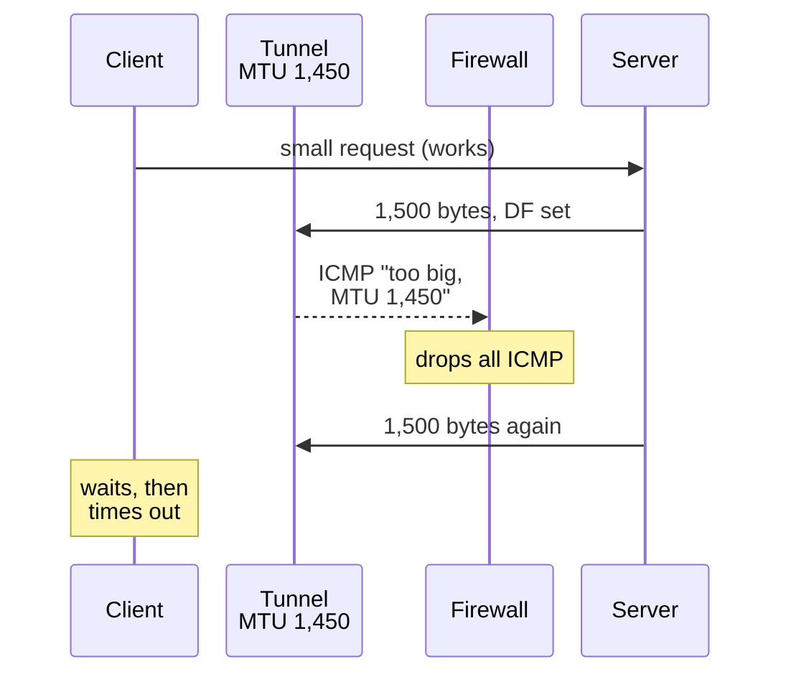

## Mental Model

Every link has a maximum packet size (**MTU**), like a tunnel with a height limit. A packet that's too tall must either be cut into pieces (**fragmentation**) or rejected with a note back to the sender ("max height 1,450"). If that note gets thrown away by an overzealous firewall, the sender keeps sending too-tall packets that silently vanish. Small packets (handshakes, small requests) pass, while large ones (big responses, file uploads) disappear, and the connection "hangs" mysteriously. That's a **PMTU black hole**, and it's one of the classic networking puzzles.

## Definition

- **MTU**: maximum IP packet size a link carries (Ethernet 1,500 bytes; jumbo frames ~9,000; IPv6 minimum 1,280).
- **Path MTU (PMTU)**: the smallest MTU along a path.
- **PMTUD**: Path MTU Discovery — send with DF set; routers that can't forward return ICMP "Fragmentation Needed" / "Packet Too Big"; the sender adapts ([IP & ICMP](lesson:cn-ip-packet-icmp)).
- **MSS clamping**: a router/firewall rewrites the TCP MSS option in SYN packets to a smaller value, so endpoints never send segments too large for the path.
- **PLPMTUD**: packetization-layer PMTUD (RFC 4821/8899) — probes with increasing sizes without relying on ICMP (used by QUIC and optionally TCP).

## Why It Exists

**The problem.** Networks are heterogeneous, and encapsulation (VPNs, VXLAN, GRE, IPsec, PPPoE) adds headers that shrink the space available for inner packets. Something must reconcile sizes end to end.

**Why it fails so confusingly.** The mechanism that reconciles sizes (PMTUD) relies on an error message (ICMP) coming *back* — and many firewalls drop ICMP. So the failure only hits *big* packets, and only silently: small things work, large things hang.

:::callout[That's all it is]{type=insight}
The biggest packet a path can carry is set by its smallest link, and tunnels make it smaller. If the "too big" notice can't get back to the sender, large packets vanish and connections hang — fix it by allowing that ICMP or by clamping MSS.
:::

## How It Works

### Encapsulation overhead eats MTU

| Encapsulation | Typical overhead | Inner MTU on a 1,500 link |
|---|---|---|
| PPPoE (DSL) | 8 B | 1,492 |
| GRE | 24 B | 1,476 |
| VXLAN (Kubernetes/cloud overlays) | 50 B | 1,450 |
| IPsec (ESP, tunnel mode) | ~50–73 B | ~1,400–1,438 |
| WireGuard | 60 (IPv4) / 80 (IPv6) B | 1,420 (default) |

If a pod's interface believes its MTU is 1,500 but the overlay path supports only 1,450, full-size packets must be fragmented or dropped.

### The black-hole failure pattern

1. TCP handshake completes (small packets).
2. Client sends a small HTTP request — works.
3. Server sends a large response in 1,500-byte packets with DF set.
4. A tunnel hop can't forward them and sends ICMP "fragmentation needed"… which a firewall drops.
5. Server retransmits the same big packets forever; the client waits; the request times out.



Symptoms: "SSH connects but hangs when listing large directories", "API works for small responses, times out for large ones", "HTTPS handshake hangs at the certificate" (certificate chains are big).

### Fixes

- Allow ICMP type 3 code 4 (IPv4) and ICMPv6 Packet Too Big through firewalls.
- **MSS clamping** at tunnel endpoints/routers (`iptables -t mangle -A FORWARD -p tcp --tcp-flags SYN,RST SYN -j TCPMSS --clamp-mss-to-pmtu`).
- Set correct interface MTUs on overlays (CNIs configure pod MTU below the node MTU).
- Enable PLPMTUD (`net.ipv4.tcp_mtu_probing`), which QUIC does by design.

## Internal Mechanism

### Bottlenecks and congestion

The same "smallest link wins" rule applies to speed as well as size. The throughput of a path is limited by its **bottleneck link** — the slowest or most loaded hop. Congestion appears when arrival rate exceeds that link's capacity:

- **Queue build-up** → rising RTT (bufferbloat if buffers are deep) → eventually drops → TCP backs off ([Congestion Control](lesson:cn-tcp-congestion-control)).
- **Microbursts**: sub-millisecond bursts overflow shallow switch buffers, causing drops even though average utilization looks low. They come from many flows or TSO bursts converging on one port, or from "incast" in data centres, when many servers respond to one aggregator at once. They show up in switch drop counters, not in 1-minute utilization graphs.

:::depth{level=advanced}
### Diagnosing bottlenecks

- RTT rising with load (ping under load vs idle) → queueing at a bottleneck.
- `iperf3` single stream vs `-P 8`: if parallel streams get much more, a per-flow limit (window, loss, policer) is in play rather than link capacity.
- Interface counters: `ip -s link`, `ethtool -S` (rx/tx drops, `rx_missed_errors` = NIC ring overflow → increase ring size or spread interrupts), `tc -s qdisc` (qdisc drops).
- Cloud instances have per-instance bandwidth and packets-per-second limits, and per-flow limits (often ~5 Gb/s per flow) — sometimes the "network problem" is an instance-type limit.
:::

## Example

```bash
# Find the path MTU: ping with DF set and decreasing sizes (payload + 28 bytes of headers)
$ ping -M do -s 1472 10.2.0.9      # 1472 + 28 = 1500
ping: local error: message too long, mtu=1450
$ ping -M do -s 1422 10.2.0.9      # 1422 + 28 = 1450 → works
$ tracepath 10.2.0.9               # reports pmtu per hop
 1:  10.1.0.1        0.4ms pmtu 1450
```

## Complexity & Performance

- Fragmentation multiplies packet counts and loss sensitivity; black holes turn into timeouts (seconds to minutes).
- Jumbo frames (9,000 B) reduce per-packet CPU overhead ~6× for bulk traffic inside data centers — but every hop must support them.

## Trade-offs

- Larger MTU: efficiency vs compatibility risks across mixed paths.
- MSS clamping: robust vs a middlebox rewriting headers (layer violation), only fixes TCP.

## Failure Modes

- PMTU black holes after introducing VPNs, overlays or cloud interconnects.
- Mismatched MTUs within a cluster (some nodes jumbo, some not).
- Microburst drops causing tail latency with "low" average utilization.
- NIC ring buffer overflow under packet-rate spikes.

## In Production

- Kubernetes CNIs (Calico, Cilium, Flannel) require MTU configuration aligned with the underlying network and encapsulation ([Container Networking](lesson:cn-container-networking)).
- Site-to-site VPNs and cloud interconnects document effective MTUs (often 1,400–1,450 or jumbo on private links).

## Deeper Connections

- ICMP and fragmentation basics: [IP & ICMP](lesson:cn-ip-packet-icmp). VPN overhead: [VPN & NAT Traversal](lesson:cn-vpn-nat-traversal). Tail effects of drops: [Tail Latency](lesson:cn-tail-latency).

## Common Misconceptions

- **"If ping works, MTU is fine."** Default pings are small; test with DF and large sizes.
- **"Fragmentation handles MTU problems automatically."** DF is set by TCP, IPv6 routers never fragment, and many networks drop fragments.
- **"Average link utilization of 30% means no congestion."** Microbursts can drop packets at millisecond timescales.

## Interview Questions

### [L2 · conceptual] What is MTU and what happens when a packet exceeds it?

The maximum IP packet size a link can carry (1,500 bytes on standard Ethernet). If a larger packet has DF clear (IPv4), a router fragments it; if DF is set (typical for TCP) or IPv6, the router drops it and sends ICMP "Fragmentation Needed"/"Packet Too Big" so the sender can reduce its packet size (Path MTU Discovery).

### [L3 · debugging] After deploying a new VPN, users can load small pages but large downloads hang. What's happening and how do you fix it?

A PMTU black hole: the VPN's encapsulation reduced the path MTU, full-size DF packets are dropped, and the ICMP messages that would tell senders to shrink are blocked. Fix by allowing the relevant ICMP types, clamping TCP MSS on the VPN gateway to the tunnel MTU, setting the correct tunnel interface MTU, and/or enabling packetization-layer MTU probing.

### [L3 · what-if] Why can a data-center network drop packets even at 30% average utilization?

Microbursts: many flows (e.g., responses from many servers to one aggregator — incast) converge on a single switch port within microseconds, exceeding its shallow buffer and dropping packets; averages over seconds or minutes hide these spikes. Mitigations: switches with deeper buffers or ECN marking (DCTCP), pacing, spreading fan-in over time, and monitoring drop counters.

### [L2 · how] What is MSS clamping, and why does it fix PMTU black holes for TCP?

A router or VPN endpoint rewrites the MSS option in TCP SYN packets passing through it, lowering it to fit the tunnel's smaller MTU (for example 1,410 instead of 1,460). Both ends then send segments small enough to cross the tunnel, so no packet ever needs fragmentation and no ICMP message is needed. It only helps TCP, and only for connections whose SYNs pass the clamping device; UDP traffic and QUIC need correct MTUs or packetization-layer probing.

### [L2 · compare] Path MTU Discovery vs packetization-layer PMTUD (PLPMTUD)?

Classic PMTUD sends packets with Don't Fragment set and relies on routers returning ICMP "fragmentation needed" with the next hop's MTU; if a firewall drops that ICMP, the path becomes a black hole. PLPMTUD (Linux `tcp_mtu_probing`, and built into QUIC) doesn't depend on ICMP: the transport probes with larger packets and treats losses of large packets specifically as a sign the MTU is too big, settling on a size that is actually delivered.

### [L3 · why] What is TCP incast, and why does it hit data-centre networks?

An aggregator asks many servers for data at once (a search query, a MapReduce shuffle), and they all reply at the same moment through one switch port to the aggregator. The burst exceeds the port's small buffer, packets are dropped, and several senders time out. With a minimum RTO of 200 ms in microsecond-RTT networks, a single loss multiplies the request time hundreds of times. Mitigations: lower minimum RTOs, ECN-based congestion control (DCTCP), jittered or paced responses, and limiting how many servers reply simultaneously.

## Practice

### [numeric 1450] A 1,500-byte MTU underlay carries VXLAN (50 bytes overhead). What should the inner (pod) interface MTU be?

:::answer
1,500 − 50 = **1,450** bytes.
:::

### [numeric 1410] With an inner MTU of 1,450 and IPv4 + TCP headers of 40 bytes total, what MSS should be used?

:::answer
1,450 − 40 = **1,410** bytes.
:::

### [numeric 1452 unit=bytes] A DSL line uses PPPoE, which adds 8 bytes to a 1,500-byte Ethernet MTU. What MSS should TCP use over IPv4 (no options)?

:::answer
The link MTU becomes 1,500 − 8 = 1,492; minus 20 bytes of IPv4 and 20 of TCP gives **1,452**. Routers on DSL lines clamp the MSS to this value.
:::

### [numeric 1422 unit=bytes] You want to test whether a 1,450-byte path MTU works with `ping -M do -s SIZE`. What SIZE do you use?

:::answer
`-s` sets the ICMP payload; the IPv4 header (20) and ICMP header (8) add 28 bytes: 1,450 − 28 = **1,422**. If it gets through and 1,423 doesn't, the path MTU is exactly 1,450.
:::

### [mcq] After a new VPN goes live, SSH logins work but `ls` in a large directory hangs, and small web pages load while big downloads stall. What is the most likely cause?

- [ ] DNS is misconfigured
- [ ] The VPN's encryption is too slow
- [x] Full-size packets are dropped inside the tunnel and the ICMP "fragmentation needed" replies are filtered, so path MTU discovery fails
- [ ] TCP window scaling is disabled

Everything that fits in small packets works; anything that needs full-size packets disappears. The fix is MSS clamping, a correct tunnel MTU, or allowing ICMP type 3 code 4 through.

### [exercise] Kubernetes pods run on a VXLAN overlay (50 bytes overhead) on nodes whose network has a 1,500-byte MTU, but the pods' interfaces are configured with MTU 1,500. Describe what happens to large transfers between pods on different nodes, and give two fixes.

:::solution
A pod sends full 1,500-byte packets, because its interface says it can. Wrapped in VXLAN, each becomes 1,550 bytes, too big for the node network. Depending on settings, the packets are fragmented after encapsulation (slower, and fragile through some network gear), or dropped. If the drop's ICMP message doesn't reach the pod, large transfers stall: the PMTU black hole. Small requests between pods still work, which makes the problem look intermittent.

Fixes:
1. **Set the pod MTU to 1,450** (1,500 − 50). CNIs have a setting for it, and most detect the overhead automatically.
2. **Raise the underlay MTU** to 9,000 (jumbo frames), if the whole node network supports it, so 1,500-byte pod packets fit with room to spare.

MSS clamping on the nodes would help TCP but not UDP, so the MTU fix is the real one.
:::

## Quick Revision

- MTU = max packet per link; PMTU = min along path; tunnels subtract overhead (VXLAN 50 B → 1,450).
- PMTUD relies on ICMP; blocked ICMP → black holes (small works, large hangs).
- Fixes: allow ICMP frag-needed/PTB, MSS clamping, correct overlay MTUs, PLPMTUD (QUIC).
- Bottleneck link limits throughput; queues → RTT rise → drops; microbursts drop packets at "low" utilization.
- Diagnose with `ping -M do -s`, `tracepath`, `iperf3 -P`, interface/qdisc drop counters, cloud per-flow limits.
- MSS = MTU − encapsulation − IP − TCP (PPPoE → 1,452; VXLAN inner 1,450 → 1,410). `ping -M do -s (MTU − 28)`. PLPMTUD doesn't need ICMP. Incast: many synchronized replies overflow one switch port.
