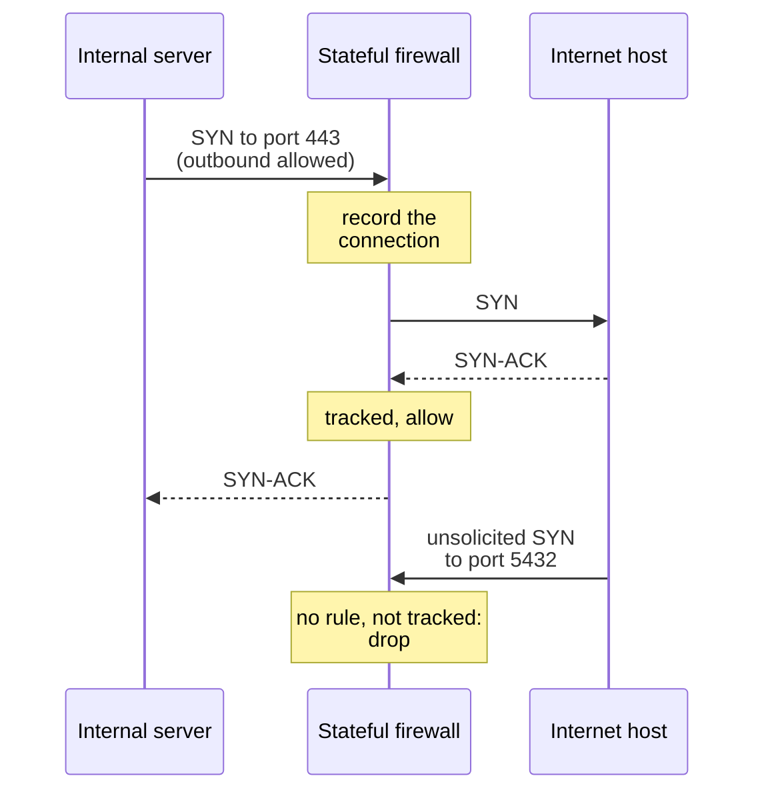
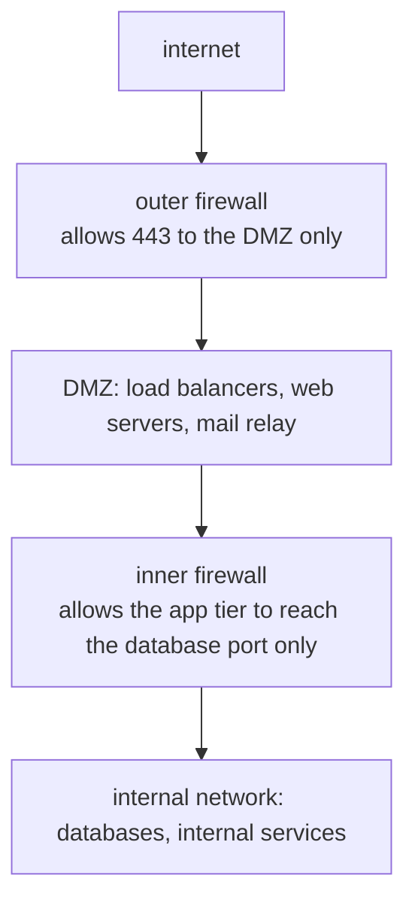

## Mental Model

An airport doesn't rely on one checkpoint. There is a fence around the airfield, a ticket check at the door, a security scan before the gates and staff watching cameras for unusual behaviour. And locked doors between areas mean that someone who gets past one point can't wander everywhere.

Network security works the same way:
- **Firewalls** are the checkpoints, deciding which traffic may pass.
- **IDS/IPS** are the camera watchers, looking inside allowed traffic for known attacks and odd behaviour.
- **DDoS defences** keep a crowd from blocking the entrance for everyone.
- **Segmentation** is the locked internal doors.

The modern lesson is that no single layer is enough. In particular, being "inside the network" must not by itself mean being trusted.

## Definition

- **Packet filter (stateless firewall)**: allows or drops each packet by its header fields (source and destination address, protocol, ports), with no memory of earlier packets.
- **Stateful firewall**: tracks connections (Linux conntrack) and automatically allows the return traffic of connections it allowed out.
- **DMZ**: a separate network zone for internet-facing servers, between the outside world and the internal network.
- **WAF (web application firewall)**: inspects HTTP requests for attacks such as SQL injection and cross-site scripting, and rate-limits abusive clients.
- **IDS / IPS**: an intrusion *detection* system watches traffic and raises alerts; an intrusion *prevention* system sits inline and blocks what it detects.
- **DDoS** (distributed denial of service): many sources overwhelming a target's bandwidth, connection state or application capacity.
- **Segmentation**: splitting a network into zones with controlled traffic between them; **microsegmentation** does it per workload.
- **Zero trust**: every request is authenticated and authorized on its own merits, regardless of where in the network it comes from.

## Why It Exists

**The problem.** Any machine reachable on the internet is scanned within minutes of appearing. Most services on most machines were never meant to be reachable from everywhere: databases, admin interfaces, internal APIs. Some traffic is outright hostile, and some floods arrive simply to exhaust resources.

**The idea.** Reduce what is reachable: deny by default and allow only what is needed. Inspect what is allowed for known attack patterns, and absorb or shed floods before they reach fragile systems. Divide the network so that one compromised machine doesn't expose everything. Each layer catches what the others miss: **defence in depth**.

:::callout[That's all it is]{type=insight}
Deny by default and allow only what's needed, and remember connections so replies get back in. Look inside allowed traffic for attacks and absorb floods at the edge. Wall off parts of the network from each other, so one breach stays small.
:::

## How It Works

### From packet filters to stateful firewalls

A stateless packet filter checks every packet against an ordered rule list; the first match decides:

| # | Source | Destination | Protocol / port | Action |
|---|---|---|---|---|
| 1 | any | 203.0.113.10 | TCP 443 | allow |
| 2 | 10.20.0.0/16 (admins) | 203.0.113.10 | TCP 22 | allow |
| 3 | any | any | any | **deny** (default) |

The trouble is return traffic. When the server itself makes an outgoing call, the reply arrives on a random ephemeral port, so a stateless filter must open thousands of high ports to let replies in.

A **stateful** firewall remembers each allowed connection and lets matching return packets through, while unsolicited inbound packets still hit the default deny:



Linux firewalls (iptables, nftables) do this with conntrack: one rule, "accept established and related traffic", replaces all the port ranges.

### Where firewalls sit: zones and the DMZ



Internet-facing machines are the most likely to be compromised, so they sit in their own zone. A compromised web server in the DMZ can still only reach what the inner firewall allows, such as one database port, never the whole internal network.

### Cloud firewalls: security groups vs network ACLs

| | Security group (AWS-style) | Network ACL |
|---|---|---|
| Attached to | Instances / network interfaces | Subnets |
| State | **Stateful**: replies are allowed automatically | **Stateless**: replies need their own rules |
| Rules | Allow only; all rules are evaluated | Allow and deny; evaluated in numbered order, first match wins |
| Typical use | The main per-service firewall: "app tier may reach the DB on 5432" | Coarse subnet-wide guard rails or explicit blocks |

Security groups can name other security groups as sources ("allow from the app tier's group"), which describes intent better than IP ranges that change as instances come and go.

### Looking inside allowed traffic: WAFs and IDS/IPS

Port-based rules can't tell a normal HTTPS request from one carrying SQL injection: both are TCP to port 443. Inspection goes further:
- A **WAF** terminates TLS (usually as part of a CDN or load balancer), parses HTTP, and blocks requests matching attack patterns or exceeding rate limits.
- An **IDS** compares traffic with **signatures** of known attacks, or flags **anomalies** against a learned baseline, and alerts. An **IPS** does the same inline and drops the traffic.

Signatures miss new attacks; anomaly detection raises false positives. An IPS that blocks wrongly takes down real traffic, which is why many deployments start in detect-only mode. Encryption limits all of this: inspection only works where TLS is terminated.

### DDoS: three kinds of flood

| Kind | What it exhausts | Examples | Defences |
|---|---|---|---|
| **Volumetric** | Link bandwidth | UDP floods, DNS/NTP/memcached amplification | Anycast networks and scrubbing centres with far more capacity than any one site; upstream filtering |
| **Protocol** | Connection-state tables in servers, firewalls, load balancers | SYN floods, fragment floods | SYN cookies, stateless edge proxies, larger state tables, rate limits per source |
| **Application (L7)** | CPU, database, threads | HTTP floods of expensive endpoints, login attempts | Caching, rate limiting, WAF rules, CAPTCHAs and bot detection, autoscaling, cheaper code paths |

Volumetric attacks now reach several terabits per second, more than any single company's uplinks, so they must be absorbed by a provider's network before reaching yours. As a last resort, a network can **blackhole** the attacked address upstream: the attack stops, and so does all legitimate traffic to that address.

### Rate limiting with a token bucket

A token bucket holds up to B tokens and refills at R per second; each request spends one. It allows bursts of up to B requests, then a sustained rate of R:

```java
final class TokenBucket {
    private final long capacity;
    private final double refillPerNano;
    private double tokens;
    private long last = System.nanoTime();

    TokenBucket(long capacity, double perSecond) {
        this.capacity = capacity;
        this.refillPerNano = perSecond / 1_000_000_000.0;
        this.tokens = capacity;
    }

    synchronized boolean tryAcquire() {
        long now = System.nanoTime();
        tokens = Math.min(capacity, tokens + (now - last) * refillPerNano);
        last = now;
        if (tokens < 1) return false;        // over the limit: answer 429 Too Many Requests
        tokens -= 1;
        return true;
    }
}
```

In production the bucket per client usually lives at the edge (API gateway, CDN, load balancer) or in a shared store such as Redis, so all instances enforce one limit.

## Internal Mechanism

### Segmentation and zero trust

A flat network lets a compromised laptop or web server reach every database and admin port: **lateral movement** is how ransomware spreads. Segmentation limits it:
- **Coarse**: separate zones, VLANs or VPCs with firewalls between them.
- **Microsegmentation**: per-workload rules, such as Kubernetes NetworkPolicies or security-group references ("only the orders service may reach the orders database") ([Container Networking](lesson:cn-container-networking)).
- **Zero trust**: drop "inside = trusted" altogether. Every request carries an identity (mTLS certificates for services, SSO for people), and access is decided per request ([Service Networking](lesson:cn-service-networking), [VPN & NAT Traversal](lesson:cn-vpn-nat-traversal)).

:::depth{level=advanced}
### State is a liability under attack

Stateful devices are powerful but finite: every tracked connection takes memory. A SYN flood or a burst of short connections can fill a firewall's or a Kubernetes node's conntrack table (`nf_conntrack: table full, dropping packet`), and then *legitimate* new connections are dropped too ([NAT](lesson:cn-nat)). Edge defences therefore stay as stateless as possible (SYN cookies, stateless filtering, anycast), and keep state deeper inside, where traffic has already been cleaned.
:::

## Example

A host firewall for a web server, in nftables:

```bash
table inet filter {
  chain input {
    type filter hook input priority 0; policy drop;     # default deny
    ct state established,related accept                 # replies to connections we allowed
    iif lo accept                                        # local traffic
    tcp dport 443 accept                                 # HTTPS from anywhere
    ip saddr 10.20.0.0/16 tcp dport 22 accept            # SSH only from the admin network
    icmp type { echo-request, destination-unreachable, time-exceeded } accept
  }
}
```

The ICMP line keeps ping, traceroute and Path MTU Discovery working; blocking all ICMP causes the MTU black holes described in [MTU & Congestion](lesson:cn-mtu-congestion).

## Complexity & Performance

- Stateless filtering is cheap per packet and doesn't degrade under floods; stateful tracking costs memory per connection.
- Deep inspection (WAF, IPS) costs CPU per request and requires TLS termination; it is usually done at the edge, in the CDN or load balancer.
- Rule sets grow over time; ordered first-match lists slow down and become hard to reason about, so audit and prune them.

## Trade-offs

- Strict rules reduce attack surface but break things when a needed flow is forgotten; loose rules are easy but leave doors open.
- Inline blocking (IPS, WAF) stops attacks but its false positives block real users; detection-only is safe but slow to act.
- Inspecting traffic needs decryption, which conflicts with end-to-end encryption and privacy.

## Failure Modes

- **"Allow any" rules** left from debugging, and forgotten exposures (databases, Redis, Elasticsearch on public addresses).
- **Blocking all ICMP**, breaking Path MTU Discovery.
- **Conntrack table exhaustion** dropping legitimate connections under load or attack.
- **Flat internal networks** where one compromised host reaches everything.
- **IPS false positives** blocking a payment provider's callbacks or a new client version.

## In Production

- Cloud: security groups per service, referencing each other; network ACLs only for broad rules; nothing listening on a public IP unless it must.
- Put internet-facing traffic behind a CDN or provider with DDoS protection and a WAF; make origins accept traffic only from that provider.
- Rate limit at the edge per client, return 429 with Retry-After, and keep login and other expensive endpoints on tighter limits.
- Log denied connections and review rule sets regularly; unused rules are risk with no benefit.

## Deeper Connections

- SYN cookies are the handshake-level defence against protocol floods ([TCP Handshake](lesson:cn-tcp-handshake)); amplification attacks abuse UDP's lack of a handshake ([UDP](lesson:cn-udp)).
- Least privilege applies to networks exactly as to processes and files ([Protection & Security](lesson:os-protection-security)).

## Common Misconceptions

- **"A firewall makes a service secure."** It only limits who can reach the service; bugs in what is reachable remain exploitable.
- **"Traffic from inside the network is safe."** Attackers move laterally from whatever they compromised first; zero trust exists because of it.
- **"NAT is a firewall."** NAT happens to drop unsolicited inbound traffic, but it isn't a security policy: no logging, no rules for outbound traffic, and port forwards punch holes silently.

## Interview Questions

### [L1 · compare] Stateless vs stateful firewall?

A stateless firewall (packet filter) judges each packet on its own by addresses, protocol and ports. To let replies in, it must allow whole ranges of ports. A stateful firewall tracks connections: once an outgoing connection is allowed, its return packets are recognized and admitted, while unsolicited inbound packets are dropped. Stateful is safer and simpler to configure but keeps per-connection state, which costs memory and can be exhausted by floods.

### [L2 · compare] IDS vs IPS?

Both inspect traffic for attacks, using signatures of known attacks or deviations from normal behaviour. An IDS watches a copy of the traffic and raises alerts; it can't stop anything, but it can't break anything either. An IPS sits inline and blocks what it detects, so it stops attacks immediately, but its false positives drop legitimate traffic and it adds a point of failure and latency. Many teams run new rules in detection mode before letting them block.

### [L2 · conceptual] What is a DMZ and why use one?

A separate network zone for servers that must accept connections from the internet (web servers, load balancers, mail relays), with firewalls on both sides. The outer firewall lets the internet reach only those services; the inner firewall lets DMZ servers reach only the specific internal services they need. Exposed servers are the likeliest to be compromised, and a DMZ keeps such a compromise from reaching the internal network freely.

### [L2 · compare] What are the three kinds of DDoS attacks, and how is each defended?

Volumetric attacks flood bandwidth (UDP floods, amplification through DNS or memcached); they are absorbed by large anycast networks and scrubbing centres upstream. Protocol attacks exhaust connection state (SYN floods); defences are SYN cookies, stateless edge proxies and per-source limits. Application attacks send expensive but valid-looking requests (HTTP floods); defences are caching, rate limiting, WAF and bot rules, and making expensive endpoints cheaper or better protected.

### [L2 · compare] Security groups vs network ACLs in a cloud VPC?

Security groups attach to instances or network interfaces, are stateful (return traffic is allowed automatically), contain only allow rules, and can reference other security groups as sources. Network ACLs attach to subnets, are stateless (return traffic needs explicit rules, including ephemeral port ranges), and have numbered allow and deny rules evaluated in order. Security groups are the primary per-service firewall; ACLs are coarse guard rails.

### [L2 · how] How does a token bucket rate limiter work?

A bucket holds up to B tokens and refills at R tokens per second. Each request takes a token if one is available, and is rejected (HTTP 429) otherwise. Short bursts of up to B requests pass at once, and the long-run rate is capped at R. For a fleet of servers, the buckets live in a shared store (or at the edge) so the limit applies across instances.

### [L3 · design] What does zero trust mean in practice for a company's internal services?

Network location stops granting access. Every service-to-service call is authenticated with workload identity (mTLS certificates from the mesh or platform CA) and authorized by policy ("orders may call payments POST /charge"). Every person reaches internal apps through an identity-aware proxy with SSO and device checks rather than through a VPN that opens the whole network. Microsegmentation still limits which workloads can connect at all. A stolen laptop or a compromised pod then gets only what its identity allows.

## Practice

### [numeric 50] A token bucket has capacity 100 and refills at 10 tokens per second. A client has just spent all 100 tokens in a burst. If it keeps sending as fast as it can, how many more requests are accepted over the next 5 seconds?

:::answer
The bucket is empty, so only refills count: 10 per second × 5 s = **50** requests. Everything beyond that is rejected with 429 until the client slows below 10 per second.
:::

### [numeric 100 unit=Gb/s] An attacker controls 2 Gb/s of sending capacity and uses a reflection service with an amplification factor of 50. How much traffic can arrive at the victim?

:::answer
2 × 50 = **100** Gb/s, coming from thousands of legitimate-looking servers. That is why volumetric attacks must be absorbed upstream: no ordinary uplink can take it.
:::

### [numeric 64512] A stateless network ACL must allow replies to a server's outgoing connections, which use ephemeral ports 1,024–65,535. How many ports must the inbound rule open?

:::answer
65,535 − 1,024 + 1 = **64,512** ports, almost all of them. This is the crudeness stateful firewalls avoid: they admit exactly the replies to connections they saw go out.
:::

### [mcq] An internal server opens an HTTPS connection to an external API through a stateful firewall whose inbound policy is "deny all". What happens to the API's responses?

- [ ] They are dropped, because inbound traffic is denied
- [x] They are allowed, because they match a connection the firewall tracked going out
- [ ] They are allowed only on port 443
- [ ] They need a separate inbound rule for the ephemeral port

The firewall's state table admits return traffic for connections it permitted; unsolicited inbound connections still hit the deny.

### [mcq] Which is a property of an IPS, but not of an IDS?

- [ ] It compares traffic with attack signatures
- [ ] It raises alerts
- [x] It sits inline and can drop the offending traffic
- [ ] It can detect anomalies

Both detect; only the IPS is in the path and acts. That is also why its false positives hurt.

### [exercise] Write the inbound firewall rules for a three-tier app in a cloud VPC: a public load balancer, app servers and a PostgreSQL database. Admins connect through a bastion host. State what each security group allows, and from where.

:::solution
- **Load balancer group:** TCP 443 from anywhere (0.0.0.0/0, and ::/0 for IPv6); optionally TCP 80 only to redirect to HTTPS.
- **App server group:** the app port (for example 8080) from the **load balancer's security group** only, not from any IP range; SSH 22 from the **bastion's group** only.
- **Database group:** TCP 5432 from the **app server group** only; nothing from the internet, the load balancer or the bastion, unless a specific admin path is needed.
- **Bastion group:** SSH 22 from the company's office or VPN address ranges only (or none at all, if a session manager is used instead).

All groups are stateful, so replies need no rules, and outbound traffic is restricted to what each tier needs. Referencing groups rather than IP ranges keeps the rules correct as instances scale up and down, and a compromised app server can reach the database port but nothing else in the data tier.
:::

### [exercise] A login endpoint is being hit by 20,000 requests per second from 50,000 different IP addresses, all with valid-looking requests, and the database behind it is collapsing. Network bandwidth is fine. What kind of attack is this, and what would you do, in order?

:::solution
It is an **application-layer (L7) DDoS** (or a large credential-stuffing run): the traffic is small and spread across many addresses, so bandwidth and per-IP limits barely notice it, but each request is expensive (a password hash and a database lookup).

In order:
1. **Protect the database**: shed load early. Put a global rate limit on the login endpoint at the edge or gateway, and return 429 quickly, before any database work.
2. **Filter at the edge**: turn on the CDN or WAF bot protection and challenge rules (JavaScript or CAPTCHA challenges for suspicious clients), and block request signatures the attack shares (user agent, missing headers, ASN reputation).
3. **Make each request cheaper**: check rate limits per account and per IP before hashing passwords; cache negative results briefly; make sure the expensive path can't be reached without passing the cheap checks.
4. **Limit the damage** if it is credential stuffing: lock or step-up-authenticate targeted accounts, and require MFA.
5. Afterwards: permanent per-endpoint limits, alerts on login error rates, and load tests of the login path.
:::

### [exercise] In the [TCP connection lab](lab:tcp-handshake), set "Next action: lose" to the reply, then press "Client connect()". What state is the server in, what is it holding, and what will it do next? Use this to explain a SYN flood and how SYN cookies defeat it.

:::solution
The client's SYN arrived, so the server is in **SYN_RECV**: a half-open connection in its SYN queue, holding the client's sequence number and its own. Its SYN-ACK was lost, so when its retransmission timer fires it sends the SYN-ACK again. It keeps the entry the whole time.

A SYN flood sends huge numbers of SYNs from spoofed addresses that never answer. Each one parks an entry like this, the SYN queue (or a firewall's state table) fills up, and real clients' SYNs are dropped. SYN cookies remove the state: the server encodes what it needs into its own initial sequence number and forgets the SYN. Only a client that really received the SYN-ACK can return the matching ACK, and the server rebuilds the connection from it.
:::

## Quick Revision

- Stateless filter: per packet, ordered rules, must open ephemeral ranges for replies. Stateful: tracks connections (conntrack), admits replies, denies unsolicited inbound.
- DMZ: exposed servers in their own zone between two firewalls. Cloud: security groups (stateful, allow-only, per instance, reference other groups) vs NACLs (stateless, ordered allow/deny, per subnet).
- WAF inspects HTTP; IDS alerts, IPS blocks inline (false positives!). Inspection needs TLS termination.
- DDoS: volumetric (bandwidth → anycast, scrubbing), protocol (state → SYN cookies, stateless edges), application (CPU/DB → caching, rate limits, WAF/bot rules).
- Token bucket: capacity B for bursts, refill R for the sustained rate; 429 when empty.
- Segmentation and zero trust stop lateral movement; never block all ICMP.
