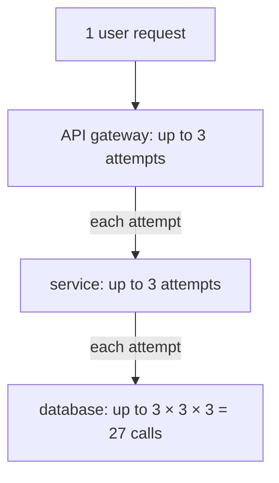

## Mental Model

- A **forward proxy** stands in front of **clients**: it makes requests on their behalf ("the company's outbound gateway"). Servers see the proxy, not the clients.
- A **reverse proxy** stands in front of **servers**: clients think it *is* the service; it decides which backend handles each request ("the receptionist who routes callers to available staff").

A **load balancer** is a reverse proxy whose main job is spreading traffic across many backends and routing around failures. The key design question is **how much of the conversation it understands**: only IPs and ports (**L4**), or the actual HTTP requests (**L7**).

## Definition

- **Forward proxy**: client-side intermediary for outbound traffic (corporate egress, content filtering, caching, anonymity).
- **Reverse proxy**: server-side intermediary (Nginx, HAProxy, Envoy, cloud LBs): TLS termination, routing, load balancing, caching, compression, rate limiting, auth.
- **L4 load balancer**: balances TCP/UDP connections by 5-tuple; doesn't parse application data (AWS NLB, IPVS, Maglev).
- **L7 load balancer**: parses HTTP (or gRPC): routes per request by host/path/headers, retries, rewrites (AWS ALB, Envoy, Nginx).
- **API gateway**: an L7 reverse proxy specialized for APIs — auth, rate limits, request transformation, versioning.

## Why It Exists

**The problem.** One server eventually can't take all the traffic, and any server can fail or be redeployed. But clients only know one address.

**The idea.** Put something in front that *owns* the public address and decides, per connection or per request, which real server should answer. Clients see a stable endpoint; behind it, servers come and go freely. Once that middle box exists, it's also the natural place for everything that should happen once for all servers:

- **Scale**: no single server handles all traffic.
- **Availability**: route around failed or deploying instances.
- **Security and policy**: one place for TLS, WAF rules, authentication, rate limiting; backends aren't exposed directly.
- **Flexibility**: blue/green and canary deploys, path-based routing to different services.

:::callout[That's all it is]{type=insight}
A load balancer is a stable front door that forwards each connection (L4) or each request (L7) to one of many healthy backends. The algorithm picks which one; health checks decide who's eligible.
:::

## How It Works

### L4 vs L7

| | L4 | L7 |
|---|---|---|
| Sees | IPs, ports, TCP/UDP | HTTP method, host, path, headers, cookies |
| Unit of balancing | Connection | Request |
| TLS | Passes through (or terminates in some products) | Usually terminates |
| Performance | Very high (can be in-kernel / hardware / DSR) | Lower (parsing, TLS, buffering) |
| Features | Simple, protocol-agnostic | Routing rules, retries, header injection, auth, compression, caching |
| Long-lived HTTP/2/gRPC | Uneven (one connection = many requests) | Balances each request |

### Balancing algorithms

All of these answer "which backend next?" — they differ in how much they know about the backends' current load, and how much bookkeeping they're willing to do to know it.

| Algorithm | How | Good for | Weakness |
|---|---|---|---|
| Round robin | Rotate through backends | Uniform requests & servers | Ignores load differences |
| Weighted round robin | Proportional to weights | Heterogeneous servers, canaries | Static |
| Least connections / least outstanding requests | Pick backend with fewest active | Variable request durations | Needs state; herding on new servers |
| **Power of two choices** | Pick 2 at random, choose the less loaded | Large fleets, distributed LBs | Probabilistic |
| Random | Uniform random | Simple, stateless | Variance |
| IP hash / consistent hashing | Hash client or key to backend | Cache affinity, sessions | Hot keys; rebalancing ([Consistent Hashing](lesson:db-consistent-hashing)) |
| Latency-aware (EWMA) | Prefer fastest backends | Heterogeneous latency | Oscillation if naive |

### Health checks

Spreading traffic is pointless if some of it goes to a dead server. The balancer needs to know who can actually answer.

- **Active**: the LB probes `GET /healthz` every few seconds; N failures → remove, M successes → re-add.
- **Passive / outlier detection**: eject backends returning errors or timeouts on real traffic.
- **Readiness vs liveness**: readiness = "can take traffic now" (dependencies warmed, not draining); liveness = "process is alive" (restart if not). Health endpoints that check **downstream dependencies** can cause cascading failure: a database blip marks *all* instances unhealthy and the LB has nothing left to route to.

### Connection draining

During deploys or scale-in, the LB stops sending **new** requests to an instance but lets in-flight ones finish (deregistration delay, e.g., 30–300 s), while the instance handles SIGTERM gracefully ([Signals](lesson:os-signals)).

### TLS termination and client identity

The LB terminates TLS, then opens a (possibly re-encrypted) connection to the backend. Backends see the **LB's** IP as the source, so the original client information travels in headers:

```http
X-Forwarded-For: 203.0.113.7, 10.0.0.12
X-Forwarded-Proto: https
X-Forwarded-Host: shop.example.com
Forwarded: for=203.0.113.7;proto=https;host=shop.example.com
```

Trust these headers **only from your own proxies** — clients can send forged `X-Forwarded-For`. L4 balancers may use the **PROXY protocol** to pass client addresses, or preserve them via DSR (direct server return).

## Internal Mechanism

:::depth{level=advanced}
### How big L4 balancers scale

Large L4 systems (Google Maglev, Facebook Katran) run on commodity servers that all announce the same virtual IP via **anycast/ECMP** ([BGP & Anycast](lesson:cn-bgp-anycast)). Routers spread packets across the LB servers. Each LB server uses **consistent hashing** on the 5-tuple, so every packet of a connection reaches the same backend even as LB servers are added or removed. Responses may bypass the LB entirely (**direct server return**). They're effectively stateless and scale horizontally.

### Retries and overload

Retries multiply at each layer that has them:



L7 proxies retry failed idempotent requests — helpful for transient errors, dangerous under overload: each layer retrying 3× turns one user request into 27 backend attempts (**retry amplification**). Use retry budgets (e.g., retries ≤ 10% of requests), only retry idempotent requests, and propagate deadlines ([Overloaded Servers](lesson:x-overloaded-server)).
:::

## Example

Typical web architecture:

```text
Client ──TLS──▶ CDN edge ──TLS──▶ Cloud L7 LB (ALB) ──HTTP/1.1 keep-alive──▶ Nginx sidecar ──▶ App pods
                                        │ path /api/*  → api service
                                        │ path /static → object storage
```

Nginx reverse-proxy snippet with upstream keep-alive and a health-aware pool:

```nginx
upstream api {
    least_conn;
    server 10.0.1.10:8080 max_fails=3 fail_timeout=10s;
    server 10.0.1.11:8080 max_fails=3 fail_timeout=10s;
    keepalive 64;
}
server {
    listen 443 ssl http2;
    location /api/ {
        proxy_pass http://api;
        proxy_http_version 1.1;
        proxy_set_header Connection "";
        proxy_set_header X-Forwarded-For $proxy_add_x_forwarded_for;
        proxy_read_timeout 30s;
    }
}
```

## Complexity & Performance

- L4 LBs forward millions of packets per second per server; L7 proxies handle tens of thousands of requests per second per core, dominated by TLS and parsing.
- Each proxy hop adds latency (sub-millisecond in-region) and a failure point.

## Trade-offs

- L4: speed and protocol-agnosticism vs coarse (per-connection) balancing.
- L7: rich routing and per-request balancing vs CPU cost and complexity.
- Centralized LB vs client-side balancing (service discovery in the client, no extra hop — [Service Networking](lesson:cn-service-networking)).
- Sticky sessions: simple for stateful apps vs uneven load and fragility; prefer externalized state.

## Failure Modes

- Health checks that depend on shared downstreams → all backends marked down at once.
- Uneven load with L4 + long-lived HTTP/2/gRPC connections.
- Idle-timeout mismatches between client, LB and backend → resets.
- Retry storms amplifying overload.
- Trusting spoofed `X-Forwarded-For` for security decisions (rate limiting, allow-lists).
- 502/504s during deploys without draining.

## In Production

- Cloud: NLB (L4), ALB/GCLB (L7); Kubernetes Ingress controllers and Gateway API; service meshes add per-service L7 proxies.
- Watch per-backend request rates, error rates and latency; 502/504 counts at the LB separate "backend crashed" from "backend slow".

## Deeper Connections

- CDNs are globally distributed reverse proxies ([CDN](lesson:cn-cdn)); east-west balancing inside clusters ([Service Networking](lesson:cn-service-networking)); consistent hashing for affinity ([Consistent Hashing](lesson:db-consistent-hashing)).

## Common Misconceptions

- **"A load balancer makes a service highly available."** Only if backends are redundant, health checks are meaningful, and the LB itself is redundant.
- **"L7 is always better."** It costs CPU and adds complexity; L4 is right for raw TCP/UDP and extreme throughput.
- **"Round robin spreads load evenly."** Only if requests cost the same.

## Interview Questions

### [L1 · compare] Forward proxy vs reverse proxy?

A forward proxy acts on behalf of clients, sending their requests to arbitrary servers (egress control, caching, anonymity); servers see the proxy. A reverse proxy acts on behalf of servers, receiving client requests and forwarding them to backends (load balancing, TLS termination, caching, routing); clients see the proxy as the server.

### [L2 · compare] L4 vs L7 load balancing?

L4 balances transport connections using IPs and ports without parsing application data — fast and protocol-agnostic, but one long-lived connection always goes to one backend. L7 parses HTTP, balancing individual requests and routing by host/path/headers, with features like retries, TLS termination and header manipulation, at higher CPU cost.

### [L2 · compare] Round robin vs least connections?

Round robin cycles through backends regardless of load — fine when requests are uniform. Least connections sends new requests to the backend with the fewest active connections/requests, adapting to variable request durations and slower servers, at the cost of tracking state.

### [L3 · why] Why can health checks that verify database connectivity cause outages?

If the database has a brief problem, every instance's health check fails simultaneously and the LB removes all backends — turning a partial degradation (maybe some requests could still be served, or fail fast with good errors) into a total outage, and causing thundering-herd reconnects on recovery. Health checks should reflect the instance's own ability to serve; dependency failures are better handled with degraded responses and circuit breakers.

### [L3 · debugging] Users see 502 errors spike for a minute during every deploy. What's happening?

The LB sends requests to instances that are shutting down (killed before in-flight requests finish, or still registered after the process exits) or to new instances not yet ready. Fix: readiness probes gating traffic, deregistration/draining delays longer than request timeouts, graceful SIGTERM handling (stop accepting, finish in-flight), preStop delay so the LB notices removal first, and keep-alive timeouts on backends longer than the LB's idle timeout.

### [L2 · how] How do you keep retries from making an outage worse?

Retry in one layer only (usually the one closest to the user, or the client library), never in every layer. Retry only idempotent requests, and only for errors that may be transient. Use exponential backoff with jitter, and cap retries with a **retry budget** (for example, retries may add at most 10% to the request rate), so that when a dependency is failing, retries stop instead of tripling its load. Pair this with circuit breakers and deadlines, so retries never outlive the caller's interest in the answer.

## Practice

### [mcq] A gRPC service with long-lived HTTP/2 connections is balanced by an L4 load balancer. What problem is likely?

- [ ] Requests are rejected
- [x] Load concentrates on a few backends because balancing is per connection, not per request
- [ ] TLS can't be used
- [ ] Health checks stop working

Use L7 or client-side balancing.

### [mcq] Which header conventionally carries the original client IP through HTTP proxies?

- [ ] Via
- [x] X-Forwarded-For (or Forwarded)
- [ ] Origin
- [ ] Referer

Only trust it when set by your own proxies.

### [numeric 27] A request passes through a gateway, a service and a client library to a database, and each of the three layers retries a failed call up to 3 times in total. In the worst case, how many database calls can one user request cause?

:::answer
3 × 3 × 3 = **27**. When the database slows down, the retries arrive exactly when it can least handle them, which is why retries belong in one layer, with a budget.
:::

### [numeric 3] Four backends have 3, 7, 2 and 5 active connections, in that order. Least-connections balancing sends the next request to which backend (number them 1 to 4)?

:::answer
Backend **3**, which has the fewest active connections (2); the others have 3, 7 and 5. Round robin would have ignored the difference and could have picked backend 2, the busiest.
:::

### [mcq] With "power of two choices", what does a load balancer do for each request?

- [ ] Sends it to two backends and uses the faster reply
- [x] Picks two backends at random and sends it to the less loaded of the two
- [ ] Alternates between the two least-loaded backends
- [ ] Doubles the weight of healthy backends

Comparing just two random choices avoids both the herd behaviour of always picking the global minimum (every balancer piles onto the same new server) and the variance of pure random choice.

### [exercise] Users see a burst of 502 errors for about a minute during every deploy. Explain what is happening between the load balancer and the instances, and describe a deploy sequence that removes the errors.

:::solution
**What happens.** The deploy stops old instances while the load balancer still sends them requests: in-flight requests are cut off, and connections the balancer had pooled to those instances are reset. Meanwhile new instances may be registered before they are ready (still starting, caches cold), and fail their first requests. The balancer turns both into 502s.

**A clean sequence:**
1. Start the new instance and add it only when its **readiness** check passes.
2. **Deregister** an old instance from the balancer, so it receives no new requests.
3. Let it **drain**: in-flight requests finish during the deregistration delay (longer than the slowest normal request), and it closes idle keep-alive connections, or sends GOAWAY for HTTP/2.
4. Only then send it SIGTERM. The application stops accepting connections, finishes its work and exits.
5. Make the balancer's idle timeout towards backends shorter than the backends' own keep-alive timeout, so it never reuses a connection the backend is about to close.
:::

### [mcq] A backend reads the client's IP from `X-Forwarded-For: 203.0.113.7, 10.0.0.12`. Which value can it trust, and when?

- [ ] The leftmost, always
- [ ] The rightmost, always
- [x] It should trust only the entries added by its own proxies, reading from the right, and take the first address added by a proxy it trusts
- [ ] Neither: the header is always forged

Clients can send any `X-Forwarded-For` they like, and each proxy appends the address it received from. Only the entries appended by your own infrastructure are reliable.

### [numeric 17.5 ±0.2 unit=ms] Four backends each take 10 ms per request on average, and 320 requests per second arrive. A random balancer gives each backend its own queue of 80 requests per second: four M/M/1 queues, each with a mean response of 50 ms. If requests instead wait in one shared queue and go to whichever backend is free (M/M/4), what is the mean response time?

:::answer
Both setups keep the backends 80% busy, but the shared queue answers in **17.5** ms on average (17.46), against 50 ms.

With separate queues, a request can wait behind a slow one while another backend sits idle. A shared queue never leaves a backend idle while anyone is waiting. Least-outstanding-requests balancing and the power of two choices get most of this benefit without a central queue. Compute both cases in the [Speedup & Queueing lab](lab:speedup-queueing): Queueing delay with 4 servers at 320 per second, then 1 server at 80 per second.
:::

## Quick Revision

- Forward proxy = for clients; reverse proxy = for servers; LB = reverse proxy spreading load.
- L4 (connections, fast) vs L7 (requests, HTTP-aware, TLS termination, routing, retries).
- Algorithms: RR, weighted, least connections/outstanding, power of two choices, hashing, latency-aware.
- Health checks (active/passive; readiness vs liveness; don't depend on shared downstreams), draining on deploy.
- Client identity via X-Forwarded-For/Forwarded/PROXY protocol (trust only your proxies).
- Beware retry amplification and idle-timeout mismatches.
- Retries multiply across layers (3 × 3 × 3 = 27): retry in one layer, idempotent only, backoff + jitter + budget. Deploy without 502s: readiness → deregister → drain → SIGTERM.
