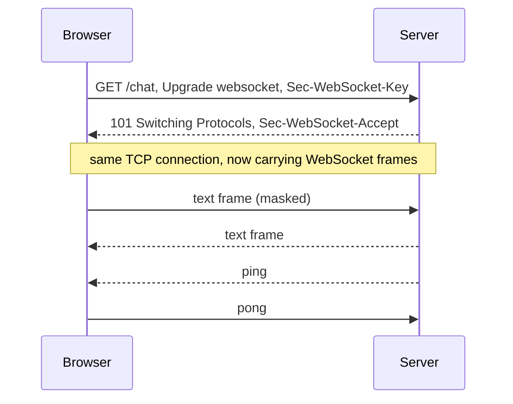

## Mental Model

A client wants to know when something happens on the server (a chat message, a price change, a job finishing). HTTP is request/response — the server can't speak first. Four workarounds, like four ways to learn if your package arrived:

- **Polling**: check the porch every 10 seconds. Simple, wasteful, and up to 10 s late.
- **Long polling**: stand at the door; the courier answers when a package arrives (or after a timeout), then you immediately stand at the door again.
- **Server-Sent Events (SSE)**: a subscription line — the courier keeps talking to you over one open line, announcing each package. One-way.
- **WebSockets**: a two-way radio — either side can talk anytime.

## Definition

- **Short polling**: periodic requests (`GET /messages?since=…` every N seconds).
- **Long polling**: the server holds each request open until data is available or a timeout, then the client immediately re-requests.
- **SSE (Server-Sent Events)**: an HTTP response with `Content-Type: text/event-stream` that the server keeps open, streaming `data:` lines; the browser's `EventSource` handles reconnection with `Last-Event-ID`.
- **WebSocket (RFC 6455)**: a full-duplex, message-oriented protocol started by an HTTP `Upgrade` handshake, then framing binary/text messages over the same TCP connection.

## Why It Exists

**The problem.** Chat, notifications, collaborative editing, dashboards, trading screens, multiplayer games and live feeds need low-latency server-initiated updates that request/response HTTP doesn't naturally support. In HTTP the server can only answer — it can never speak first.

**The progression of ideas.** Each technique is a smarter way around that rule:

1. Ask repeatedly (polling) — works, but wasteful and late.
2. Ask once and let the server *delay its answer* until it has news (long polling) — timely, but one request per event.
3. Never finish the answer — keep the response open and keep writing to it (SSE) — cheap, but one-way.
4. Leave HTTP behind after the first request and switch to a two-way channel (WebSocket).

:::callout[That's all it is]{type=insight}
All four techniques solve "the server can't speak first". Polling and long polling fake it with requests; SSE keeps one response open forever; WebSocket turns the connection into a two-way pipe.
:::

## How It Works

### Comparison

| | Short polling | Long polling | SSE | WebSocket |
|---|---|---|---|---|
| Direction | Client pull | Server push (emulated) | Server → client | **Bidirectional** |
| Latency | Up to the interval | ~Immediate (+ re-request RTT between events) | Immediate | Immediate |
| Overhead per event | Full HTTP request/response, even when empty | Full request/response per event | A few bytes per event | 2–14 byte frame header |
| Connections | Short-lived | Held open, reopened per event | One long-lived HTTP response | One long-lived upgraded connection |
| Protocol | Plain HTTP | Plain HTTP | Plain HTTP (works with HTTP/2) | Separate protocol after upgrade |
| Reconnect / resume | N/A | Manual | **Built in** (`Last-Event-ID`) | Manual (heartbeats, resume logic) |
| Binary data | Yes | Yes | Text only | Yes |
| Proxies/CDNs | Easy | Timeouts need tuning | Buffering must be disabled | Must support Upgrade; long-lived |
| Best for | Infrequent updates, simplicity | Legacy fallback | Feeds, notifications, LLM token streaming, dashboards | Chat, collaboration, games, bidirectional low-latency |

::viz{id=realtime-transports}

### The WebSocket handshake

```http
GET /chat HTTP/1.1
Host: chat.example.com
Upgrade: websocket
Connection: Upgrade
Sec-WebSocket-Key: dGhlIHNhbXBsZSBub25jZQ==
Sec-WebSocket-Version: 13
Origin: https://app.example.com

HTTP/1.1 101 Switching Protocols
Upgrade: websocket
Connection: Upgrade
Sec-WebSocket-Accept: s3pPLMBiTxaQ9kYGzzhZRbK+xOo=
```



After `101`, the TCP connection carries WebSocket **frames** (text, binary, ping, pong, close). Client-to-server frames are masked (to prevent cache-poisoning attacks on naive proxies). Browsers send `Origin`; servers must check it — WebSockets aren't covered by CORS, so **cross-site WebSocket hijacking** is a real risk with cookie auth.

### SSE on the wire

```http
HTTP/1.1 200 OK
Content-Type: text/event-stream
Cache-Control: no-cache

id: 41
event: price
data: {"sym":"ACME","px":101.3}

id: 42
data: {"sym":"ACME","px":101.4}
```

If the connection drops, `EventSource` reconnects (respecting a server-suggested `retry:`) and sends `Last-Event-ID: 42` so the server can resume.

### A WebSocket client in Java

The JDK's `HttpClient` can open WebSockets directly:

```java
HttpClient client = HttpClient.newHttpClient();
WebSocket ws = client.newWebSocketBuilder()
        .connectTimeout(Duration.ofSeconds(5))
        .buildAsync(URI.create("wss://chat.example.com/ws"), new WebSocket.Listener() {
            @Override
            public CompletionStage<?> onText(WebSocket webSocket, CharSequence data, boolean last) {
                System.out.println("received: " + data);
                webSocket.request(1);            // ask for the next message: built-in backpressure
                return null;
            }
        })
        .join();
ws.sendText("{\"type\":\"join\",\"room\":\"42\"}", true);
```

The listener receives a message only after `request(1)`, so a slow consumer can't be flooded. Production clients also send pings, reconnect with jittered backoff, and resume from the last message they processed.

## Internal Mechanism

### Running millions of persistent connections

Push changes the server's cost model: instead of short requests, you hold one connection per online user, all the time. Each open connection costs a socket, kernel buffers, TLS state and application state — but, with an event-loop or lightweight-thread server, **no thread** ([epoll & Event Loops](lesson:os-epoll-event-loops)). Engineering concerns:

- **File-descriptor and memory limits** (tune `ulimit -n`, socket buffers).
- **Load balancers**: must support long-lived connections and upgrades; idle timeouts must exceed heartbeat intervals; L4 balancing distributes connections, not messages ([Proxies & Load Balancers](lesson:cn-proxies-load-balancers)).
- **Heartbeats** (ping/pong every 20–30 s) detect dead peers and keep NAT/LB mappings alive ([TCP Termination](lesson:cn-tcp-termination)).
- **Fan-out**: a message for a room/user must reach whichever server holds the recipient's connection → a pub/sub backbone (Redis pub/sub, Kafka, NATS) between gateway servers.
- **Backpressure**: slow clients must not accumulate unbounded buffers — drop, coalesce (send only the latest price), or disconnect.
- **Reconnect storms**: after a deploy or outage, all clients reconnect at once — clients need jittered exponential backoff; servers drain connections gradually (close with a "reconnect later" hint).

:::depth{level=advanced}
### Deploying stateful connection servers

Rolling deploys must migrate or drop connections: send close frames, let clients reconnect with backoff to other instances, and use connection draining periods. Resumable protocols (message IDs, resume tokens) avoid data loss across reconnects. Autoscaling is sluggish because existing connections don't move to new instances by themselves — rebalance by periodically recycling connections.
:::

## Example

Stock ticker to 100,000 browser clients, 1 update/s each:

- **Polling every 1 s**: 100,000 requests/s with ~800 B of headers each → ~80 MB/s of mostly-empty responses; up to 1 s stale.
- **SSE**: 100,000 open responses; each update ~60 bytes → ~6 MB/s, instant. Clients only listen, so SSE fits perfectly — and works over HTTP/2 without extra infrastructure.
- **WebSocket**: similar bandwidth; worth it only if clients also send frequent messages (e.g., order entry).

## Complexity & Performance

- Polling cost scales with clients × frequency regardless of events; push scales with events.
- Persistent connections shift cost from CPU/bandwidth to memory and connection management.

## Trade-offs

Choose the simplest mechanism that meets latency and direction needs: polling for rare updates, SSE for server→client streams, WebSockets for true bidirectional interaction.

## Failure Modes

- **Reconnect storms** after deploys/outages overwhelming servers and auth backends. Case study: [WebSocket Disconnect Storms](case:websocket-storm).
- Proxy/LB idle timeouts silently killing connections (missing heartbeats).
- SSE buffered by proxies (e.g., Nginx `proxy_buffering on`) → events delayed.
- Unbounded per-connection buffers for slow consumers → memory blowup.
- HTTP/1.1 browsers limit ~6 connections per origin — multiple SSE tabs can starve other requests (HTTP/2 fixes it).

## In Production

- Chat/collaboration: WebSocket gateways + pub/sub backbone + presence service.
- Notifications/feeds and LLM streaming responses: SSE.
- Mobile apps often prefer platform push notifications for background delivery.

## Deeper Connections

- Event loops handling many idle connections ([epoll & Event Loops](lesson:os-epoll-event-loops)); keep-alive and NAT timeouts ([TCP Termination](lesson:cn-tcp-termination)); the overload dynamics of reconnect storms ([Overloaded Servers](lesson:x-overloaded-server)).

## Common Misconceptions

- **"WebSockets are always better than polling."** They add operational complexity; SSE or polling are often enough.
- **"SSE is obsolete."** It's simple, uses plain HTTP, reconnects automatically and is widely used for streaming responses.
- **"WebSockets are protected by CORS."** Servers must validate `Origin` themselves.

## Interview Questions

### [L1 · compare] Compare polling, long polling, SSE and WebSockets.

Polling repeatedly asks the server (simple, wasteful, latency up to the interval). Long polling holds each request until data arrives (near-real-time, but one request per event). SSE keeps one HTTP response open for a server-to-client event stream (lightweight, auto-reconnect, text-only, one direction). WebSockets upgrade an HTTP connection to a persistent full-duplex channel (lowest latency both ways, binary support, more operational complexity).

### [L2 · how] How does a WebSocket connection get established?

The client sends an HTTP GET with `Upgrade: websocket`, `Connection: Upgrade` and a random `Sec-WebSocket-Key`. The server replies `101 Switching Protocols` with `Sec-WebSocket-Accept` (a hash of the key with a fixed GUID). From then on, the same TCP connection carries WebSocket frames in both directions.

### [L3 · design] Design the backend for a chat app with 5 million concurrent WebSocket users.

Stateless-ish gateway servers running event loops, each holding ~100k–500k connections, behind L4 load balancers with long idle timeouts; authentication at connect; a connection registry (user → gateway) and a pub/sub layer (Redis/NATS/Kafka) for routing messages to the right gateways; persistent message storage with IDs for history and resume; heartbeats; per-connection bounded send buffers with backpressure policies; jittered reconnect backoff and gradual draining during deploys; metrics on connections, fan-out latency and buffer drops.

### [L3 · incident] After deploying a new version of the WebSocket gateway, the auth service falls over. Why?

Rolling the gateways disconnected clients, which all reconnected at nearly the same time, each triggering token validation/auth lookups — a thundering herd. Mitigations: drain connections gradually, send reconnect hints with randomized delays, clients use exponential backoff with jitter, cache auth decisions or use self-validating tokens at connect, and rate-limit reconnect admission.

### [L2 · compare] When would you choose SSE over WebSockets?

When data flows only from server to client: notifications, dashboards, feeds, LLM tokens streamed to a browser. SSE is plain HTTP, so it works through proxies, CDNs and HTTP/2 multiplexing without special support, and `EventSource` reconnects and resumes with `Last-Event-ID` automatically. WebSockets earn their extra machinery (an upgraded connection, custom framing, your own reconnect logic) when the client also sends frequent messages: chat, collaborative editing, games.

### [L3 · how] How do you avoid a reconnect storm after a WebSocket gateway restarts?

Clients reconnect with exponential backoff plus random jitter, so 100,000 clients spread their attempts over tens of seconds instead of arriving in the same second. Servers drain gradually during deploys (close connections over a period, with a "reconnect elsewhere" close code), cap the rate of new handshakes and authentication calls, and make reconnection cheap with resumable sessions (a resume token or last-event ID) instead of a full login.

## Practice

### [mcq] Which mechanism provides built-in automatic reconnection with resume via Last-Event-ID?

- [ ] WebSocket
- [x] Server-Sent Events
- [ ] Long polling
- [ ] Short polling

EventSource handles it natively.

### [mcq] Which HTTP status code completes a WebSocket upgrade?

- [ ] 200
- [x] 101
- [ ] 204
- [ ] 426

101 Switching Protocols.

### [numeric 2000 unit=requests/s] 10,000 browsers poll an endpoint every 5 seconds. How many requests per second does the server handle, even when nothing has changed?

:::answer
10,000 ÷ 5 = **2,000** requests per second, each with a full set of headers, mostly answered "nothing new". With SSE the same clients would hold 10,000 idle connections and generate traffic only when there is news.
:::

### [numeric 5 unit=s] With polling every 10 seconds, what is the average delay between an event happening and the client seeing it?

:::answer
An event lands at a random moment between polls, so on average it waits half the interval: **5** s (up to 10 s). Halving the delay doubles the polling load, the core trade-off push transports remove.
:::

### [numeric 3333 unit=connections/s] After a gateway restart, 100,000 clients reconnect with random jitter spread evenly over 30 seconds. About how many new connections per second does the fleet see?

:::answer
100,000 ÷ 30 ≈ **3,333** per second, instead of 100,000 in the first second without jitter. Each reconnect also costs a TLS handshake and an authentication check, which is usually the real bottleneck.
:::

### [exercise] In the [real-time transports visualization](viz:realtime-transports), compare the request count, header overhead and delivery latency of the four transports for the same events. For a stock ticker pushed to 100,000 browsers once a second, which would you choose and why?

:::solution
- **Short polling** sends a full request and response per interval, even with no news, and delivers events up to one interval late.
- **Long polling** delivers promptly but still costs a full request and response per event, and the gap between a response and the next request can miss events.
- **SSE** keeps one HTTP response open and sends a few bytes of framing per event.
- **WebSocket** keeps one upgraded connection with 2–14 bytes of framing per message, in both directions.

For the ticker, **SSE**: data flows only to the client, SSE runs over plain HTTP (and HTTP/2), and EventSource reconnects and resumes automatically. Polling would mean 100,000 requests per second of mostly empty responses. WebSockets would also work, but add a separate protocol and hand-written reconnect logic without any benefit, since the clients don't send anything.
:::

### [mcq] In the Java `WebSocket.Listener`, what is the purpose of calling `webSocket.request(1)` in `onText`?

- [ ] It sends a ping to keep the connection alive
- [x] It asks for one more incoming message, so the listener controls how fast messages are delivered to it
- [ ] It acknowledges the message to the server
- [ ] It closes the connection after one message

The JDK WebSocket client applies backpressure: messages are delivered only as the listener requests them. Forgetting to call `request` stops delivery after the first message.

## Quick Revision

- Polling (interval latency, waste) → long polling (request per event) → SSE (one-way stream, auto-reconnect, text) → WebSocket (full duplex, binary, upgrade via 101).
- WebSocket: check `Origin` (not covered by CORS); ping/pong heartbeats.
- At scale: event loops, fd limits, LB idle timeouts, pub/sub fan-out, backpressure, jittered reconnects, draining.
- Pick the simplest transport that meets direction + latency needs.
- Polling load = clients ÷ interval; average staleness = interval / 2. SSE for server→client streams; WebSocket for bidirectional. Reconnect with jittered backoff.
- Java: `HttpClient.newWebSocketBuilder().buildAsync(uri, listener)`; `request(n)` = backpressure.
