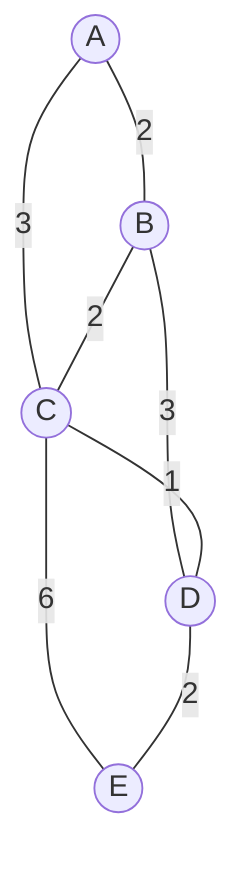

## Mental Model

There are two ways to find your way across a country without a central planner.

- **Everyone gets the same map.** Each town publishes a list of its roads and their lengths, and every town collects all the lists into one map. Then each town works out its own shortest routes. This is **link-state** routing: share facts about links, compute locally.
- **Trust the signposts.** Each town only asks its neighbours "how far are you from London?" and adds the distance to that neighbour. Nobody has a map, just a table of distances that improves with every exchange. This is **distance-vector** routing: share conclusions, never the map.

The map-based approach costs more memory and messages but reacts to change quickly and correctly. The signpost approach is simple and cheap, but a wrong signpost can mislead everyone for a while.

## Definition

- **Link cost (metric)**: a number per link that routing tries to minimize, such as 1 per hop (RIP) or a value derived from bandwidth (OSPF).
- **Shortest-path tree**: from one router, the cheapest path to every destination. A router's forwarding table only needs the **first hop** on each path.
- **Link-state routing**: every router floods a description of its own links (a link-state advertisement, **LSA**), every router builds the same map (the link-state database), and each runs **Dijkstra's algorithm** on it. Examples: OSPF, IS-IS.
- **Distance-vector routing**: each router sends its whole distance table to its neighbours and updates its own with the **Bellman-Ford** equation. Example: RIP.
- **Convergence**: the time after a change until every router again has consistent, correct routes.

## Why It Exists

**The problem.** A router knows only its own links. Yet its forwarding table must list, for every destination network, the next hop on the best path, and that path depends on links far away that can fail at any moment. Configuring thousands of routes by hand can't keep up with failures.

**The idea.** Let routers tell each other what they know and compute the routes automatically. The two families differ in *what* they tell each other: a description of their links (link state) or their current distances to everything (distance vector). Everything else, including their failure modes, follows from that choice.

:::callout[That's all it is]{type=insight}
Link state: share your links with everyone, then each router runs shortest path on the shared map. Distance vector: tell your neighbours your distances, and take the best neighbour's distance plus the cost to reach it.
:::

## How It Works

All examples use this network of five routers. The numbers are link costs.



### Dijkstra's algorithm (link state)

Every router has this whole map, because each router flooded its links. Router A computes its shortest paths:

1. Start with A at distance 0 and every other router at infinity.
2. Repeatedly **settle** the unsettled router with the smallest distance. Its distance can't improve any more, because every other path to it would start from a router that is already farther away.
3. For each neighbour of the router just settled, check whether going through it is cheaper, and if so update the neighbour's distance and remember the path.

```text
step  settle    B         C         D         E
init  A (0)     2 via A   3 via A   ∞         ∞
1     B (2)     —         3 via A   5 via B   ∞          (A–C direct 3 beats A–B–C 4)
2     C (3)     —         —         4 via C   9 via C    (A–C–D 4 beats A–B–D 5)
3     D (4)     —         —         —         6 via D    (A–C–D–E 6 beats A–C–E 9)
4     E (6)     done
```

A keeps only the first hop of each path:

| Destination | Cost | Path | Next hop |
|---|---|---|---|
| B | 2 | A → B | B |
| C | 3 | A → C | C |
| D | 4 | A → C → D | C |
| E | 6 | A → C → D → E | C |

Every router runs the same computation from its own position, on the same map, so their tables agree and no loops form once the map is consistent.

### Bellman-Ford (distance vector)

No router has the map. Each one keeps a distance and next hop per destination and sends its distance list (the "vector") to its neighbours. When a vector arrives, a router applies the **Bellman-Ford equation**:

```text
D_A(x) = min over neighbours N of ( cost(A, N) + D_N(x) )
```

Once B and C have converged, they send A their vectors:

```text
from B (link cost 2):  C 2, D 3, E 5
from C (link cost 3):  B 2, D 1, E 3

A to D = min(2 + 3, 3 + 1) = 4   via C
A to E = min(2 + 5, 3 + 3) = 6   via C
```

The answers match Dijkstra's. The difference is *how* they are reached: a few rounds of neighbour-to-neighbour exchanges, with no router ever seeing the whole network.

### The count-to-infinity problem

Distance vectors carry conclusions without explanations, so a router can't tell whether a neighbour's distance depends on a path through itself. Take three routers in a line, A — B — C, with cost 1 on each link. The link from B to C fails:

| Exchange | B's distance to C | A's distance to C |
|---|---|---|
| Before the failure | 1 (direct) | 2 (via B) |
| B notices the failure, then hears A's vector | 3 (via A: 1 + 2) | 2 |
| A hears B's new vector | 3 | 4 (via B: 1 + 3) |
| B hears A again | 5 | 4 |
| … each exchange adds 2 … | … | … |
| RIP stops at 16, meaning "unreachable" | 16 | 16 |

B believed A's "2", although A's route to C went through B. Until the count reaches infinity, packets for C bounce between A and B in a routing loop.

The fixes:
- **Split horizon**: never advertise a route back out of the interface it was learned on. A learned C from B, so A tells B nothing about C, and B sees at once that it has no route.
- **Poison reverse**: advertise it back, but with distance infinity, which is more explicit.
- **Triggered updates** send changes at once instead of waiting for the next periodic update, and **hold-down timers** ignore suspicious "good news" for a while after a route fails.
- A small **infinity** (RIP uses 16) bounds how long counting can last.

Split horizon cures loops between two routers but not every loop through three or more, which is one reason large networks use link-state protocols.

The lab runs all of this on the lesson's network: Dijkstra step by step, distance vectors spreading one exchange at a time, and count to infinity with each fix. Fail a link and run them again.

::lab{id=routing-algorithms}

### RIP, OSPF and their relatives

| Protocol | Family | Metric | Notes |
|---|---|---|---|
| RIP | Distance vector | Hop count; 16 = unreachable, so at most 15 hops | Full table every 30 s over UDP port 520; slow convergence; small networks |
| OSPF | Link state | Cost per link, by default 100 Mb/s ÷ link bandwidth | Areas around a backbone (area 0); Hellos every 10 s; IP protocol 89; fast convergence |
| IS-IS | Link state | Configurable cost | Runs directly over the link layer; common inside large ISPs |
| BGP | Path vector | Policy first, then AS-path length | Between autonomous systems ([BGP & Anycast](lesson:cn-bgp-anycast)) |

OSPF's default reference bandwidth of 100 Mb/s gives a 10 Mb/s link cost 10 and a 100 Mb/s link cost 1, but it also gives 1 Gb/s and 10 Gb/s links cost 1. Modern networks raise the reference bandwidth so that faster links look cheaper.

## Internal Mechanism

### How OSPF keeps everyone's map the same

1. **Hellos** on each link discover neighbours and detect when one disappears.
2. Neighbours exchange database summaries and fetch whatever they are missing (forming an **adjacency**).
3. When a link changes, the router floods a new **LSA** with a higher sequence number. Every router passes it on reliably and acknowledges it, so all copies of the database converge.
4. Each router reruns Dijkstra (the **SPF** calculation) on its database and updates its forwarding table.

**Areas** limit how far LSAs travel. Routers inside an area know the area's full map; area border routers summarize the rest. A flapping link then disturbs only its own area's SPF runs.

:::depth{level=advanced}
### Path vector: how BGP avoids counting to infinity

BGP is distance-vector-like, but each route carries the full list of autonomous systems it passed through. A router that sees its own AS number in the path rejects the route, so the A–B–C bounce above can't happen. The cost is larger messages, and BGP chooses routes by policy (who pays whom) before distance ([BGP & Anycast](lesson:cn-bgp-anycast)).

### Microloops during convergence

Even link-state routers don't all finish SPF at the same instant. For a few milliseconds one router may already use a new path while its neighbour still uses the old one, and packets loop between them until both update. Fast-reroute techniques precompute backup next hops (loop-free alternates) so that a failure is bypassed in milliseconds, before SPF even runs.
:::

## Example

A router running several protocols shows where each route came from. The two numbers in brackets are the administrative distance and the metric ([Routing](lesson:cn-routing)):

```text
router# show ip route
O    10.2.0.0/16  [110/20] via 10.0.12.2, eth1     OSPF: distance 110, cost 20
R    10.9.0.0/16  [120/3]  via 10.0.13.3, eth2     RIP: distance 120, 3 hops
S    0.0.0.0/0    [1/0]    via 203.0.113.1         static default route
C    10.0.12.0/30 is directly connected, eth1
```

Dijkstra in Java, returning the next hop for each destination, exactly the column a forwarding table needs:

```java
record Edge(String to, int cost) {}

static Map<String, String> nextHops(Map<String, List<Edge>> graph, String src) {
    Map<String, Integer> dist = new HashMap<>(Map.of(src, 0));
    Map<String, String> firstHop = new HashMap<>();
    PriorityQueue<Map.Entry<String, Integer>> queue = new PriorityQueue<>(Map.Entry.comparingByValue());
    queue.add(Map.entry(src, 0));
    while (!queue.isEmpty()) {
        var current = queue.poll();
        String u = current.getKey();
        if (current.getValue() > dist.get(u)) continue;           // an outdated queue entry
        for (Edge e : graph.getOrDefault(u, List.of())) {
            int d = dist.get(u) + e.cost();
            if (d < dist.getOrDefault(e.to(), Integer.MAX_VALUE)) {
                dist.put(e.to(), d);
                firstHop.put(e.to(), u.equals(src) ? e.to() : firstHop.get(u));
                queue.add(Map.entry(e.to(), d));
            }
        }
    }
    return firstHop;   // destination → the neighbour of src to send through
}
```

Run on the network above from A, it returns B → B, C → C, D → C and E → C.

## Complexity & Performance

- **Dijkstra** with a binary heap: O(E log V) per run, for V routers and E links. Thousands of routers take milliseconds.
- **Link-state flooding**: each change sends an LSA over every link once, O(E) messages, and every router stores the whole map.
- **Distance vector**: each router sends a table the size of the number of destinations to each neighbour, every period. Little memory, but convergence after a failure can take many periods (RIP: minutes).

## Trade-offs

- **Link state**: fast, loop-free convergence and a full view for troubleshooting, at the cost of memory, CPU for SPF, and flooding.
- **Distance vector**: simple and light, but slow to converge and prone to loops after failures.
- **Path vector**: loop-free and policy-aware across organizations, but larger messages and slow global convergence.

## Failure Modes

- **Count to infinity** and routing loops in distance-vector protocols after a failure.
- **Microloops** while link-state routers converge at slightly different times.
- **Flapping links** causing repeated floods and SPF runs (mitigated by SPF throttling and dampening).
- **Mismatched metrics**: with the default reference bandwidth, OSPF can't tell a 1 Gb/s link from a 100 Gb/s one.

## In Production

- Enterprise and campus networks run OSPF (sometimes IS-IS); RIP survives mostly in labs and small legacy networks.
- Many large data centres run **BGP** inside the fabric as well (RFC 7938), because it scales well and gives fine control.
- **BFD** (Bidirectional Forwarding Detection) detects a dead neighbour in milliseconds instead of waiting for missed Hellos, so convergence starts sooner.

## Deeper Connections

- Dijkstra and Bellman-Ford are the same algorithms taught in graph theory; routing adds distribution (Bellman-Ford in pieces, over the network) and failures.
- BGP's path vector solves count-to-infinity the same way some distributed protocols detect cycles: by carrying the history with the message.

## Common Misconceptions

- **"Link-state routers exchange routing tables."** They exchange descriptions of their links; each router computes its own table.
- **"RIP picks the fastest path."** RIP counts hops only: it prefers 2 slow hops over 3 fast ones.
- **"Split horizon prevents all routing loops."** It prevents loops between two neighbours, not every loop through three or more routers.

## Interview Questions

### [L1 · compare] Link-state vs distance-vector routing?

In link-state routing (OSPF, IS-IS) every router floods a description of its own links, so all routers build the same map and each runs Dijkstra's algorithm on it. In distance-vector routing (RIP) each router shares only its distance table with its neighbours and updates it with the Bellman-Ford equation. Link state converges faster and without loops, at the cost of memory, CPU and flooding. Distance vector is simpler and lighter but converges slowly and can count to infinity.

### [L2 · trace] Walk through Dijkstra's algorithm on a small network.

Start with the source at 0 and all others at infinity. Repeatedly settle the closest unsettled router; for each of its neighbours, if the path through it is cheaper, update the neighbour's distance and remember the path. In the lesson's network, A settles B (2), then C (3), then D (4, via C, beating 5 via B), then E (6, via C and D, beating 9 directly from C). The forwarding table keeps each path's first hop: D and E both via C.

### [L2 · why] What is count to infinity, and how do split horizon and poison reverse help?

When a link fails, a distance-vector router may believe a neighbour's old distance even though that distance was routed through itself. The two routers then raise each other's distance step by step, with packets looping, until the value reaches "infinity" (16 in RIP). Split horizon stops a router from advertising a route back to the neighbour it learned it from, so the stale distance is never offered. Poison reverse advertises it back explicitly as infinity. Both fix loops between two routers, not all longer loops.

### [L2 · compare] RIP vs OSPF?

RIP is distance-vector: its metric is the hop count, limited to 15 (16 means unreachable). It sends its whole table every 30 s and converges slowly. OSPF is link-state: its metric is a cost per link derived from bandwidth, it floods changes immediately, runs Dijkstra and converges in seconds. OSPF also scales with areas. RIP is simple to configure but suited only to small networks.

### [L3 · why] Why does BGP use a path vector rather than a plain distance vector?

Because each BGP route carries the list of autonomous systems it has crossed, a router that finds its own AS number in the list rejects the route. That detects loops immediately, without counting to infinity. The path also lets each network apply policy, such as preferring routes through paying customers, which a single distance number can't express.

### [L3 · why] Why does OSPF divide a network into areas?

Every router in an area must store the area's full map and rerun Dijkstra when anything in it changes. Without areas, a link flapping anywhere would cause floods and SPF runs everywhere. Area border routers summarize each area's routes into the backbone (area 0), so changes stay local and databases stay small.

## Practice

### [numeric 4] In the lesson's network (A–B 2, A–C 3, B–C 2, B–D 3, C–D 1, C–E 6, D–E 2), what is the cost of A's shortest path to D?

:::answer
**4**, via A → C → D (3 + 1). The other route, A → B → D, costs 2 + 3 = 5.
:::

### [numeric 7] In the same network, the link C–D fails. What is A's new shortest-path cost to E?

:::answer
The candidates are A → B → D → E = 2 + 3 + 2 = 7, A → C → E = 3 + 6 = 9, and A → C → B → D → E = 3 + 2 + 3 + 2 = 10. The best is **7**, now via B.
:::

### [numeric 6] Router A has two neighbours: X at link cost 4 and Y at link cost 2. X reports that its distance to network Z is 3; Y reports 4. Using the Bellman-Ford equation, what is A's distance to Z?

:::answer
min(4 + 3, 2 + 4) = min(7, 6) = **6**, with Y as the next hop.
:::

### [numeric 15] What is the longest path, in hops, that RIP can use?

:::answer
**15**. RIP's metric is the hop count and 16 means "unreachable", which caps how long count to infinity can last but also limits RIP to small networks.
:::

### [numeric 10] With OSPF's default reference bandwidth of 100 Mb/s, what cost does a 10 Mb/s link get?

:::answer
Cost = reference bandwidth ÷ link bandwidth = 100 ÷ 10 = **10**. A 1 Gb/s link would get 0.1, rounded up to the minimum of 1, the same as a 100 Mb/s link, which is why networks raise the reference bandwidth.
:::

### [mcq] What does split horizon do?

- [ ] Splits a network into OSPF areas
- [x] Stops a router advertising a route back out of the interface it learned it from
- [ ] Sends half of the routing table in each update
- [ ] Divides traffic between two equal-cost paths

Split horizon keeps a router from offering its neighbour a route that goes through that same neighbour, which removes the two-router count-to-infinity loop.

### [exercise] Three routers form a line, A — B — C, each link with cost 1, running a distance-vector protocol. The B–C link fails. Show B's and A's distances to C over the next exchanges (a) without any fix and (b) with poison reverse.

:::solution
**(a) Without a fix.** Before the failure, B is at 1 (direct) and A at 2 (via B).
1. B loses its direct route. It then hears A's vector, "C at 2", and sets B = 1 + 2 = 3 via A.
2. A hears B's "3" and sets A = 1 + 3 = 4 via B.
3. B hears A's "4": B = 5. A hears "5": A = 6.

Each exchange adds 2, and packets for C bounce between A and B until both reach 16, "unreachable" in RIP.

**(b) With poison reverse.** Because A's route to C goes through B, A advertises "C at infinity" to B. When B loses its link, it has no alternative: B = ∞ at once. B's triggered update, "C at infinity", then makes A set A = ∞. Both agree that C is unreachable within one exchange, and nothing loops.
:::

### [numeric 2] In the lesson's network, distance-vector routing starts from round 0, where each router knows only its own links. After how many exchanges does A first hold its final distance to E (6)?

:::answer
A's best route to E is A–C–D–E, three links. Round 0 already holds D's link to E. After the first exchange, C hears D's "E at 2" and sets its distance to E to 3. After the second, A hears C's "E at 3" and sets its own to 3 + 3 = 6.

So it takes **2** exchanges: news crosses one link per exchange. After the first exchange A holds 9, through C's direct link C–E. Step through it in the [routing algorithms lab](lab:routing-algorithms).
:::

### [exercise] In the [routing algorithms lab](lab:routing-algorithms), run Dijkstra from A on the lesson's network and write down the order in which the nodes are settled, with their distances. Then fail the C–D link and run it again. Which entries of A's forwarding table change?

:::solution
On the full network the order is A 0, B 2, C 3, D 4, E 6. A sends traffic for B via B, and traffic for C, D and E via C.

Without C–D: A 0, B 2, C 3, D 5, E 7. Settling B now sets D to 2 + 3 = 5. Settling C offers E at 3 + 6 = 9, and settling D improves E to 5 + 2 = 7.

The entries for **D and E change from "via C" to "via B"**; B and C stay the same. Only the routes that used the failed link move, and a link-state router finds that out by rerunning Dijkstra on its updated map.
:::

## Quick Revision

- Link state (OSPF, IS-IS): flood LSAs → same map everywhere → each router runs Dijkstra (SPF) → first hops into the forwarding table.
- Distance vector (RIP): send your distance table to neighbours; D(x) = min over neighbours (link cost + their distance).
- Dijkstra: settle the closest unsettled node, relax its neighbours; O(E log V).
- Count to infinity: stale distances bounce between routers; fixes: split horizon, poison reverse, triggered updates, hold-down, small infinity (RIP 16).
- RIP: hops, max 15, every 30 s, UDP 520. OSPF: cost = 100 Mb/s ÷ bandwidth by default, areas around area 0, IP protocol 89.
- BGP: path vector; the AS path detects loops and carries policy.
