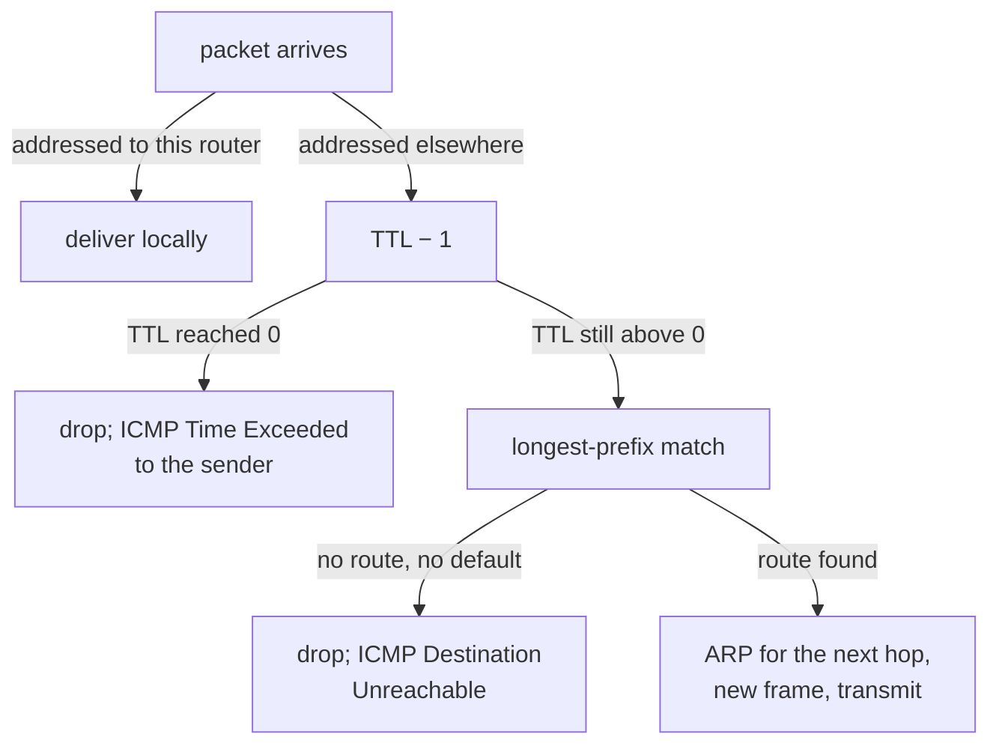

## Mental Model

Routing is **asking for directions at every intersection** — no one gives you the whole route. At each router, the question is only: *"for this destination, which of my neighbors gets it closer?"* Each router answers from its own table of prefixes. If several entries match, the **most specific** one wins (a street address beats a city beats a country). If nothing matches, use the **default route** ("when in doubt, go to the highway").

## Definition

- **Routing table / forwarding table (FIB)**: a list of `destination prefix → next hop (and outgoing interface)` entries, plus metrics.
- **Longest-prefix match (LPM)**: among all entries matching the destination, choose the one with the longest prefix.
- **Default route** `0.0.0.0/0`: matches everything; used when nothing more specific matches. The **default gateway** is its next hop on a host.
- **Static routing**: routes configured manually. **Dynamic routing**: routers exchange information with protocols (OSPF, IS-IS, BGP) and compute routes automatically.
- **Control plane** (building the table) vs **data plane** (forwarding each packet using it).

## Why It Exists

**The problem.** A packet must cross dozens of independently owned networks to reach its destination. No single entity knows the whole internet topology, and it changes constantly (links fail, networks appear).

**Without it.** A central planner computing every route would be a single point of failure and could never keep up with millions of changes.

**The idea.** Nobody needs the whole route. Each router only needs to answer "which neighbor is one step closer?" for each destination prefix. If every router answers that locally, packets reach their destinations anyway. Distributed, hop-by-hop forwarding with independently maintained tables lets the network scale and route around failures.

**Two separate jobs.** Using the table (look up each packet — must be nanoseconds fast) is different from *building* it (talk to neighbors, compute paths — can take seconds). That's the data plane / control plane split.

:::callout[That's all it is]{type=insight}
Each router looks up the destination in its table, picks the most specific matching prefix, and sends the packet to that next hop. Routing protocols are just the way routers fill in those tables by talking to each other.
:::

## How It Works

### A host's routing table

```bash
$ ip route
default via 192.168.1.1 dev wlan0            # 0.0.0.0/0 → gateway
192.168.1.0/24 dev wlan0 proto kernel scope link src 192.168.1.23   # directly connected
172.17.0.0/16 dev docker0 proto kernel scope link src 172.17.0.1    # Docker bridge
$ ip route get 93.184.215.14
93.184.215.14 via 192.168.1.1 dev wlan0 src 192.168.1.23
```

- Destinations in `192.168.1.0/24` are **on-link**: ARP for them directly.
- Everything else goes to the default gateway.

### Longest-prefix match on a router

Because prefixes can overlap (a /8 contains a /16 which contains a /24), one address can match several entries. The rule is "most specific wins" — it lets a general route and an exception to it coexist.

| Prefix | Next hop | Interface |
|---|---|---|
| 0.0.0.0/0 | 203.0.113.1 (ISP) | eth0 |
| 10.0.0.0/8 | 10.255.0.2 | eth1 |
| 10.1.0.0/16 | 10.255.0.6 | eth2 |
| 10.1.7.0/24 | 10.255.0.10 | eth3 |

- `10.1.7.42` matches `/0`, `/8`, `/16` and `/24` → **/24 wins** → eth3.
- `10.1.9.5` → matches `/0`, `/8`, `/16` → **/16** → eth2.
- `10.200.0.1` → `/0`, `/8` → **/8** → eth1.
- `8.8.8.8` → only `/0` → default route → ISP.

### Forwarding a packet (data plane)

1. Receive the frame, strip it, validate the IP header.
2. If the destination is one of the router's own addresses, deliver locally.
3. Decrement TTL; if it reaches 0, drop and send **ICMP Time Exceeded** ([IP & ICMP](lesson:cn-ip-packet-icmp)).
4. LPM lookup → next hop + interface. No match and no default → drop, send **ICMP Destination Unreachable**.
5. Resolve the next hop's MAC (ARP), re-frame, transmit.



::viz{id=routing}

### Where routes come from (control plane)

Typing every route by hand works for 5 routers, not 5,000 — and hand-typed routes don't react when a link breaks. So routers tell each other what they can reach, and compute routes automatically.

| Source | How | Used where |
|---|---|---|
| Connected | Interfaces' own subnets | Every router/host |
| Static | Manually configured | Small networks, default routes, cloud route tables |
| **Interior gateway protocols (IGP)** | **OSPF/IS-IS** (link-state: every router learns the full topology map and runs Dijkstra's shortest path); **RIP** (distance-vector: routers share distance tables with neighbors, Bellman-Ford) | Inside one organization / autonomous system |
| **Exterior gateway protocol** | **BGP** (path-vector: networks announce reachable prefixes with the AS path; policy-driven) | Between autonomous systems — the internet ([BGP & Anycast](lesson:cn-bgp-anycast)) |

**Distance-vector vs link-state:**

| | Distance vector (RIP) | Link state (OSPF, IS-IS) |
|---|---|---|
| Knowledge | Neighbors' distances only | Full topology map |
| Algorithm | Bellman-Ford, iterative | Dijkstra |
| Convergence | Slow; "count to infinity" loops | Fast |
| Overhead | Low memory, periodic updates | More memory/CPU, flooding of link-state updates |

Both algorithms are worked through step by step in [Routing Algorithms](lesson:cn-routing-algorithms).

### When several routes match: prefix, then preference, then metric

A router can learn the same destination from several sources. It decides in a fixed order:

1. **Longest prefix wins**, whatever its source. A /24 learned from RIP beats a /16 configured by hand.
2. Among routes for the **same prefix** from different sources, the most trusted source wins. Cisco calls this the **administrative distance**: connected 0, static 1, eBGP 20, OSPF 110, RIP 120 (lower is better). Linux expresses the same preference with route metrics.
3. Among routes from the **same protocol**, the lowest metric wins: OSPF's summed link costs, or RIP's hop count. Equal metrics can be used together (ECMP).

## Internal Mechanism

:::depth{level=advanced}
### ECMP and hardware forwarding

When several equal-cost paths exist, routers use **ECMP** (equal-cost multipath), hashing each packet's 5-tuple to pick a path so that one flow stays on one path (avoiding reordering) while different flows spread across links. Data-center leaf-spine fabrics rely on it. Hardware routers implement LPM in **TCAM** (ternary content-addressable memory) or specialized tries, doing hundreds of millions of lookups per second. The control plane (routing protocol daemons on a CPU) computes the RIB and installs the best routes into the hardware FIB.

### Policy routing

Linux supports multiple routing tables selected by rules (`ip rule`): route by source address, firewall mark, or interface — used by VPNs, multi-homed hosts and Kubernetes CNIs.
:::

## Example

Traceroute across networks shows hop-by-hop forwarding, and cloud route tables show the same concept:

```text
AWS VPC route table
Destination        Target
10.20.0.0/16       local              ← within the VPC
0.0.0.0/0          igw-0abc (internet gateway)     ← public subnets
0.0.0.0/0          nat-0def (NAT gateway)          ← private subnets (a different table)
10.50.0.0/16       pcx-0123 (VPC peering)
```

A "private subnet" is simply one whose route table sends `0.0.0.0/0` to a NAT gateway instead of an internet gateway.

## Complexity & Performance

- LPM in hardware: constant-time per packet; software routers use tries (O(prefix length)).
- Dijkstra over n routers: O(E log V) per recomputation — OSPF areas limit the scope.
- BGP tables: ~1M IPv4 prefixes on full-table routers; convergence after failures can take seconds to minutes.

## Trade-offs

- **Static routes**: simple, predictable, no protocol overhead vs no automatic failover.
- **Dynamic routing**: self-healing and scalable vs complexity and potential instability (route flapping).
- **Default routes**: tiny tables vs less control and potential black-holing.

## Failure Modes

- **Routing loops**: misconfigured routes send packets in circles until TTL expires (traceroute shows repeating hops).
- **Black holes**: a route points to a next hop that can't deliver; packets silently vanish.
- **Asymmetric routing**: forward and return paths differ — normal on the internet, but breaks stateful firewalls/NATs that see only one direction.
- **Missing return route**: A can reach B, but B has no route back to A (common with VPNs and peered networks).

## In Production

- Hosts almost always have a single default route; complexity lives in routers, cloud route tables, VPNs and Kubernetes CNIs.
- Kubernetes: each node gets routes for other nodes' pod CIDRs (via BGP with Calico, or cloud route tables), or pod traffic is encapsulated in an overlay ([Container Networking](lesson:cn-container-networking)).

## Deeper Connections

- The destination's reachability is announced across the internet by BGP ([BGP & Anycast](lesson:cn-bgp-anycast)).
- TTL and ICMP errors: [IP & ICMP](lesson:cn-ip-packet-icmp). Private-to-public translation at the edge: [NAT](lesson:cn-nat).

## Common Misconceptions

- **"Routers pick the shortest path to the destination."** They pick the next hop from their table; "shortest" depends on the protocol's metric and, between networks, BGP policy (business relationships) often beats distance.
- **"The route is fixed for a connection."** Each packet is forwarded independently; routes can change mid-connection.
- **"The default gateway is the internet."** It's just the next hop for unmatched destinations.

## Interview Questions

### [L1 · conceptual] What is a default gateway?

The next-hop router a host sends packets to when the destination isn't on its local subnet (the next hop of its default route 0.0.0.0/0). The host ARPs for the gateway's MAC and hands it the packet; the gateway routes it onward.

### [L2 · how] Explain longest-prefix match with an example.

A router may have multiple table entries matching a destination; it chooses the most specific (longest prefix). With entries 10.0.0.0/8 → A, 10.1.0.0/16 → B, and 0.0.0.0/0 → C, a packet to 10.1.5.5 matches all three and goes to B (/16); a packet to 10.9.9.9 goes to A; 8.8.8.8 goes to C.

### [L2 · compare] Distance-vector vs link-state routing?

Distance-vector routers share their distance tables with neighbors and use Bellman-Ford; they know only neighbors' views, converge slowly and can suffer count-to-infinity loops (RIP). Link-state routers flood information about their links so every router builds the full topology and runs Dijkstra; they converge quickly at the cost of more memory and CPU (OSPF, IS-IS).

### [L3 · debugging] Host A (10.1.0.5) can ping host B (10.2.0.9) across a VPN, but B can't initiate connections to A. What would you check?

Routing symmetry and filtering: B's network must have a route for 10.1.0.0/16 via the VPN (the return route may exist only for replies via stateful NAT/firewall tracking). Check B-side route tables, security groups/firewalls allowing inbound from A's range, NAT rules (if A's traffic is NATed, B sees a different source and can't reach A's real address), and overlapping ranges. Use traceroute from B and packet captures on both sides.

### [L3 · trace] What happens to a packet whose destination has no matching route and no default route?

The router drops it and typically sends an ICMP Destination Unreachable (network unreachable) back to the source, which may surface as an immediate "No route to host"/"Network unreachable" error instead of a timeout.

### [L2 · how] A router learns 10.5.0.0/16 from OSPF and has a static route for 10.5.0.0/16 too. Which one does it use, and what changes if OSPF instead learns 10.5.7.0/24?

For the same prefix, it prefers the more trusted source: on Cisco, static routes have administrative distance 1 and OSPF 110, so the static route wins. If OSPF learns the more specific 10.5.7.0/24, longest-prefix match comes first: packets to 10.5.7.x follow the OSPF /24, while the rest of 10.5.0.0/16 still follows the static route. Preference between sources only breaks ties between routes of equal length.

## Practice

### [mcq] A router has routes 172.16.0.0/12, 172.16.5.0/24 and 0.0.0.0/0. Where does a packet to 172.16.5.9 go?

- [ ] Via 172.16.0.0/12
- [x] Via 172.16.5.0/24
- [ ] Via the default route
- [ ] It is dropped

Longest prefix wins.

### [mcq] Which protocol exchanges routes between autonomous systems on the internet?

- [ ] OSPF
- [ ] RIP
- [x] BGP
- [ ] ARP

BGP is the inter-domain (exterior) routing protocol.

### [numeric 2] A router's table has 10.0.0.0/8 → A, 10.1.0.0/16 → B, 10.1.2.0/24 → C and 0.0.0.0/0 → D. Of the destinations 10.1.2.9, 10.1.3.9, 10.2.0.1, 10.1.200.5 and 8.8.8.8, how many leave via B?

:::answer
**2**: 10.1.3.9 and 10.1.200.5. Their longest match is the /16. 10.1.2.9 matches the /24 (C), 10.2.0.1 only the /8 (A), and 8.8.8.8 only the default route (D).
:::

### [numeric 55] A host sends a packet with TTL 64. It crosses 9 routers before reaching the destination host. What TTL does the destination see?

:::answer
Each router decrements the TTL once: 64 − 9 = **55**. The destination host doesn't decrement it. This is how `ping` output's TTL hints at the hop count.
:::

### [mcq] A router has a static route and an OSPF route for exactly the same prefix, 172.16.0.0/16. Which does it install (Cisco defaults)?

- [x] The static route, because its administrative distance (1) is lower than OSPF's (110)
- [ ] The OSPF route, because dynamic routes are always newer
- [ ] Both, balancing traffic between them
- [ ] Whichever was learned first

Administrative distance ranks sources for the same prefix. A longer prefix from any source would still beat both.

### [exercise] In the [routing simulator](lab:routing), send a packet to the remote server with TTL 64, then again with TTL 2. Explain each hop's decision in the second run, and say how traceroute uses exactly this behaviour.

:::solution
With TTL 64 the packet reaches the server: each router strips the frame, decrements the TTL, does a longest-prefix match and re-frames the packet for its next hop, and the edge router also applies NAT.

With TTL 2:
1. The first router decrements the TTL to 1 and forwards the packet.
2. The second router decrements it to 0, so it drops the packet. It sends an **ICMP Time Exceeded** back to the sender (through NAT, so it reaches the original host).

Traceroute sends probes with TTL 1, 2, 3 and so on. The router where each probe's TTL runs out identifies itself in its Time Exceeded message, so the probes reveal the path one hop at a time.
:::

### [mcq] What does a router do with a packet whose destination matches no route, when it has no default route?

- [ ] Floods it out of all interfaces
- [ ] Sends it back to the previous hop
- [x] Drops it and sends ICMP Destination Unreachable to the source
- [ ] Holds it until a route is learned

Routers never flood IP packets. With no matching route the packet is dropped, and an ICMP "network unreachable" tells the sender why.

## Quick Revision

- Hop-by-hop: each router picks the next hop from its own table.
- **Longest-prefix match**; default route 0.0.0.0/0 as fallback.
- Forwarding: validate → TTL−1 (0 → ICMP time exceeded) → LPM → ARP next hop → re-frame.
- Routes: connected, static, IGP (OSPF/IS-IS link-state, RIP distance-vector), BGP between ASes.
- ECMP spreads flows over equal paths by hashing the 5-tuple.
- Failures: loops, black holes, asymmetric paths, missing return routes.
- Route choice order: longest prefix → most trusted source (administrative distance: connected 0, static 1, eBGP 20, OSPF 110, RIP 120) → lowest metric (ties → ECMP).
