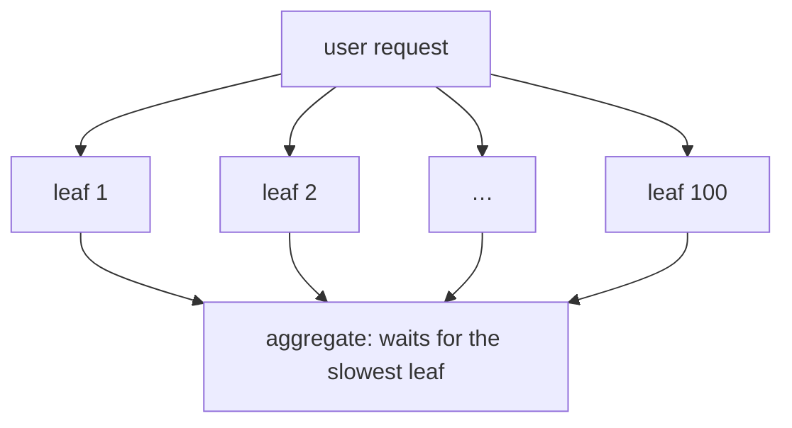

## Mental Model

Averages describe a **typical** request; users experience **distributions**. If 1 in 100 requests takes 1 second, then:

- a user loading a page that makes 50 backend requests hits at least one slow request **~40% of the time**;
- a service that fans out each request to 100 shards is slow **~63%** of the time.

At scale, the **tail becomes the common case**. That's why engineers talk in percentiles (p50, p99, p99.9) and why tail latency, not average latency, drives architecture decisions.

## Definition

- **Percentile pN**: the value below which N% of observations fall. p50 = median; p99 = 99% of requests were faster than this.
- **Tail latency**: the high percentiles (p99, p99.9, max).
- **Fan-out**: one request depending on many parallel sub-requests; overall latency = the **slowest** sub-request.
- **SLO**: a service-level objective, e.g., "p99 < 300 ms over 30 days".

## Why It Exists

**The problem.** Latency distributions in real systems are long-tailed: most requests are fast, but queueing, garbage collection, retransmissions, cache misses, lock contention and noisy neighbors produce occasional very slow ones.

**Why it gets worse at scale.** In distributed systems, those occasional delays compound. A page that waits on 100 backend calls is as slow as the *slowest* of them — so a 1-in-100 slow event happens on most page loads.

**The idea.** Stop describing latency with one number. Measure the whole distribution (percentiles), and treat the slow tail as a design target in its own right — attacking both its causes (variability) and its effect (fan-out).

:::callout[That's all it is]{type=insight}
p99 is "how slow the slowest 1% are". When one request waits on many others, those rare slow cases stop being rare — so at scale, the tail is what users actually feel.
:::

## How It Works

### Why averages mislead

Latencies for 10 requests (ms): 10, 11, 10, 12, 10, 11, 10, 12, 11, **900**.

- Mean = 99.7 ms (describes no actual request).
- p50 = 11 ms, p90 ≈ 12 ms, max = 900 ms.

The mean is dragged by one outlier yet hides how bad that outlier is. Percentiles describe both halves honestly.

### Fan-out amplification

If each sub-request independently exceeds threshold T with probability q, the chance at least one of n does is:

```text
P(slow) = 1 − (1 − q)^n
```

| Per-request slow probability q | n = 1 | n = 10 | n = 100 |
|---|---|---|---|
| 1% (p99 exceeded) | 1% | 9.6% | **63.4%** |
| 0.1% (p99.9 exceeded) | 0.1% | 1% | 9.5% |



So a service fanning out to 100 leaves needs each leaf's **p99.9** to be good for the overall **p90** to be good. ("The Tail at Scale", Dean & Barroso, 2013.)

### Where the tail comes from

| Source | Mechanism |
|---|---|
| Queueing | Bursty arrivals near saturation → waiting time explodes ([Performance Fundamentals](lesson:os-performance-method)) |
| TCP retransmission timeouts | A lost packet costing ≥ 200 ms RTO ([TCP Reliability](lesson:cn-tcp-reliability)) |
| Garbage collection / JIT / page faults | Pauses stop the whole process |
| Lock contention | Occasional long waits behind a holder |
| Cache misses | Cold cache → DB/disk path is 10–100× slower |
| Background work | Compaction, log rotation, backups, checkpoints |
| Noisy neighbors | Shared CPU, disk, network on multi-tenant hosts; CPU throttling in containers |
| Head-of-line blocking | One slow request blocking others on a connection or queue |
| Retries | Timeout + retry adds the full timeout to a request's latency |

## Internal Mechanism

### Techniques to tame the tail

You can't remove every source of slowness, so the techniques split into two groups: make individual slow events rarer, and stop one slow event from deciding the whole request's latency.

- **Hedged requests**: send the request to one replica; if no response within, say, the p95 latency, send a second copy to another replica and use whichever answers first. Adds ~5% load, cuts p99.9 dramatically. Only for idempotent reads.
- **Tied requests**: send to two replicas at once with cross-cancellation when one starts executing.
- **Timeouts with budgets**: deadlines that shrink as a request travels, so no layer waits longer than the caller.
- **Reduce variability at the source**: tune GC (or use low-pause collectors), avoid lock hot spots, pre-warm caches, pace background work, isolate noisy neighbors, keep utilization below the knee.
- **Micro-partitioning and load balancing** by least-outstanding-requests or power-of-two choices to avoid slow nodes.
- **Degraded responses**: return partial results when some shards are slow (search engines do this).
- **Admission control / load shedding**: reject early instead of queueing when overloaded ([Overloaded Servers](lesson:x-overloaded-server)).

:::depth{level=advanced}
### Measuring correctly

- **Don't average percentiles** across hosts or time windows — p99 of the union isn't the average of p99s. Aggregate **histograms** (HDR histograms, Prometheus histogram buckets) and compute percentiles from merged distributions.
- **Coordinated omission**: closed-loop load generators stop sending while the server stalls, hiding the stall's true impact on users. Use constant-arrival-rate load generation and correct for intended send times ([Performance Fundamentals](lesson:os-performance-method)).
- Percentiles need enough samples: a p99.9 from 1,000 requests is one data point.
:::

## Example

An API's latency dashboard:

| Percentile | Before | After deploy |
|---|---|---|
| p50 | 18 ms | 17 ms |
| p95 | 45 ms | 48 ms |
| p99 | 90 ms | 310 ms |
| p99.9 | 180 ms | 1,250 ms |

Median unchanged, tail exploded. Typical causes: a new synchronous dependency with occasional slow responses, a larger heap causing longer GC pauses, or a code path that sometimes misses cache. Break it down with traces of slow requests (tail-based sampling) rather than averages.

## Visualization

Use the calculator to see how loss and RTT feed into transfer time — the raw material of network-driven tail latency:

::lab{id=network-calculator}

## Complexity & Performance

- Fan-out raises the effective percentile you must control: with n sub-calls, control each at roughly p(1 − 1/(100n)) for the aggregate p99.
- Hedging costs extra load (bounded by the hedge threshold) for large tail reductions.

## Trade-offs

- Hedging/replication: lower tail vs extra load and complexity (only idempotent operations).
- Tight timeouts: bounded latency vs more errors/retries.
- Running at low utilization: short tails vs cost.

## Failure Modes

- Alerting on averages → tail regressions ship unnoticed.
- Retry storms: timeouts + retries during slowdowns multiply load and lengthen the tail.
- Hidden serialization: a synchronized logger or connection pool making occasional requests wait.
- Averaging percentiles across instances in dashboards.

## In Production

- SLOs on p95/p99 per endpoint; histograms in metrics; exemplars linking slow buckets to traces.
- Case study: [Packet Loss and P99](case:packet-loss).

## Deeper Connections

- Queueing theory behind the tail ([Performance Fundamentals](lesson:os-performance-method)); overload behavior ([Overloaded Servers](lesson:x-overloaded-server)); read replicas enabling hedged reads ([Replication](lesson:db-replication)).

## Common Misconceptions

- **"If average latency is good, users are happy."** Many users hit the tail, especially on multi-request pages.
- **"p99 means 1% of users are affected."** With multiple requests per user session, far more users see p99-level delays.
- **"You can average p99s across servers."** Percentiles don't average; merge histograms.

## Interview Questions

### [L1 · conceptual] What does p99 latency mean and why is it more useful than average latency?

99% of requests complete faster than the p99 value; 1% are slower. Latency distributions are skewed, so averages hide outliers and describe no real request. Percentiles show both typical (p50) and worst-case-ish (p99, p99.9) experience, which matter because users make many requests and fan-out systems depend on the slowest component.

### [L2 · numerical] A request fans out to 50 shards in parallel; each shard exceeds 100 ms 1% of the time independently. What fraction of requests exceed 100 ms?

1 − 0.99⁵⁰ ≈ 1 − 0.605 = **~39.5%**.

### [L3 · how] What are hedged requests and when should you use them?

After waiting for a short delay (e.g., the p95 latency), send a duplicate request to another replica and use the first response, cancelling the other. It dramatically reduces tail latency at a small cost in extra load. Use only for idempotent, side-effect-free operations (reads), and bound the hedge rate to avoid amplifying overload.

### [L4 · incident] Your service's p99 latency increased while p50, CPU and error rate are unchanged, and network packet loss increased slightly. How would you investigate?

Suspect TCP retransmission timeouts: a small loss rate barely affects medians but adds ≥ 200 ms RTO stalls (plus backoff) to affected requests. Check retransmission and timeout counters per host and path (nstat, ss -ti, tcpretrans), correlate slow traces with retransmits, localize the loss (mtr per hop, specific AZ/rack/NIC, LB), check MTU/fragmentation issues and NIC errors (ethtool -S), and confirm by packet capture on slow requests. Mitigate by fixing the lossy component, enabling tail-loss probing/RACK, hedging idempotent calls, and avoiding cross-zone paths.

### [L3 · why] What is coordinated omission, and how does it make load tests lie?

A closed-loop load generator sends the next request only after the previous one returns. When the server stalls for 2 seconds, the generator also stops sending, so instead of recording thousands of requests that would each have waited up to 2 s, it records one slow request. The measured p99 looks fine while real users, who don't stop arriving, suffer. Fixes: generate load at a constant arrival rate (open-loop tools such as wrk2, k6's constant-arrival-rate executor or Gatling's open models), or correct latencies for the intended send time.

### [L3 · numerical] A request fans out to 50 leaves. What per-leaf percentile must stay under the latency target for the whole request to meet it 99% of the time?

The request is slow if any leaf is slow: 1 − (1 − q)⁵⁰ ≤ 0.01. Solving, q ≤ 1 − 0.99^(1/50) ≈ 0.0002: each leaf must meet the target at its **p99.98**. Fan-out turns a deep percentile of each component into the one users see, which is why hedging and partial results exist.

## Practice

### [numeric 63.4 ±0.5 unit=%] Each of 100 parallel sub-requests exceeds its latency target with probability 1%. What is the probability (in %) that the overall request exceeds the target?

:::answer
1 − 0.99¹⁰⁰ ≈ 1 − 0.366 = **63.4%**.
:::

### [mcq] Which is the correct way to compute a fleet-wide p99 from 20 servers?

- [ ] Average the 20 servers' p99 values
- [ ] Take the maximum p99
- [x] Merge the latency histograms, then compute the percentile
- [ ] Take the median of the p99 values

Percentiles aren't additive.

### [numeric 64.2 ±0.3 unit=%] A page needs 20 independent backend calls, and each is slow 5% of the time. What percentage of page loads hit at least one slow call?

:::answer
1 − 0.95²⁰ = 1 − 0.358 = **64.2**%. A "rare" 5% event becomes the common case once a request depends on 20 of them.
:::

### [numeric 99.98 ±0.01 unit=%] A request fans out to 50 leaves in parallel. To keep the whole request under its target 99% of the time, what percentile must each leaf meet the target at?

:::answer
1 − (1 − q)⁵⁰ = 0.01 gives q = 1 − 0.99^(1/50) ≈ 0.0002, so each leaf must meet it **99.98**% of the time: its p99.98.
:::

### [numeric 5 unit=%] A client sends a hedged request to a second replica whenever the first hasn't answered by its p95 latency. Roughly how much extra load does hedging add?

:::answer
Only requests slower than the p95 trigger a second copy: about **5**% extra load, in exchange for cutting the tail that the slowest 5% used to set. (Cancelling the loser when the winner answers keeps even that down.)
:::

### [exercise] A team's load test reports p99 = 40 ms, yet users see multi-second stalls. The tool runs 50 virtual users, each sending a request and waiting for the response before sending the next. Explain the discrepancy and how to fix the test.

:::solution
This is **coordinated omission**. When the server stalls for, say, 3 s, each of the 50 virtual users is stuck waiting for its one request. During those 3 s the tool sends nothing new, so it records only 50 slow requests, instead of the hundreds that real users, who keep arriving, would have sent and suffered. The slow period is mostly missing from the data, and the p99 looks healthy.

Fixes:
- Generate load at a **constant arrival rate** (open model): new requests start on schedule whether or not earlier ones finished.
- Or record latency from each request's **intended** start time, not from when the busy virtual user finally got round to sending it.
- Keep the full latency histogram (HdrHistogram) and look at the maximum, not just percentiles.
:::

### [numeric 100 ±1 unit=ms] A server's mean service time is 10 ms, and requests arrive at random (an M/M/1 queue). What is the mean response time when the server is 90% busy?

:::answer
For M/M/1, response time = S / (1 − ρ) = 10 / (1 − 0.9) = **100** ms. That is ten times the service time, although no request needs more than 10 ms of work on average. At 50% busy it is 20 ms, and at 95% it is 200 ms.

The tail grows the same way. In M/M/1 the response time is exponentially distributed, so p99 is about 4.6 times the mean: roughly 460 ms here. Try it in the [Speedup & Queueing lab](lab:speedup-queueing): Queueing delay, 1 server, S = 10 ms, λ = 90 per second.
:::

## Quick Revision

- Use percentiles (p50/p95/p99/p99.9), not averages; percentiles don't average — merge histograms.
- Fan-out: P(slow) = 1 − (1 − q)^n → at scale the tail is the common case.
- Sources: queueing, RTOs, GC, locks, cache misses, background work, noisy neighbors, retries.
- Fixes: hedged/tied requests (idempotent), deadlines, reduce variability, low utilization, load shedding, partial results.
- Beware coordinated omission.
- Fan-out: P(slow) = 1 − (1 − q)ⁿ (20 calls at 5% → 64%); 50 leaves need p99.98 for an overall p99. Hedging at p95 costs ~5% load. Beware coordinated omission: use open-model load tests.
