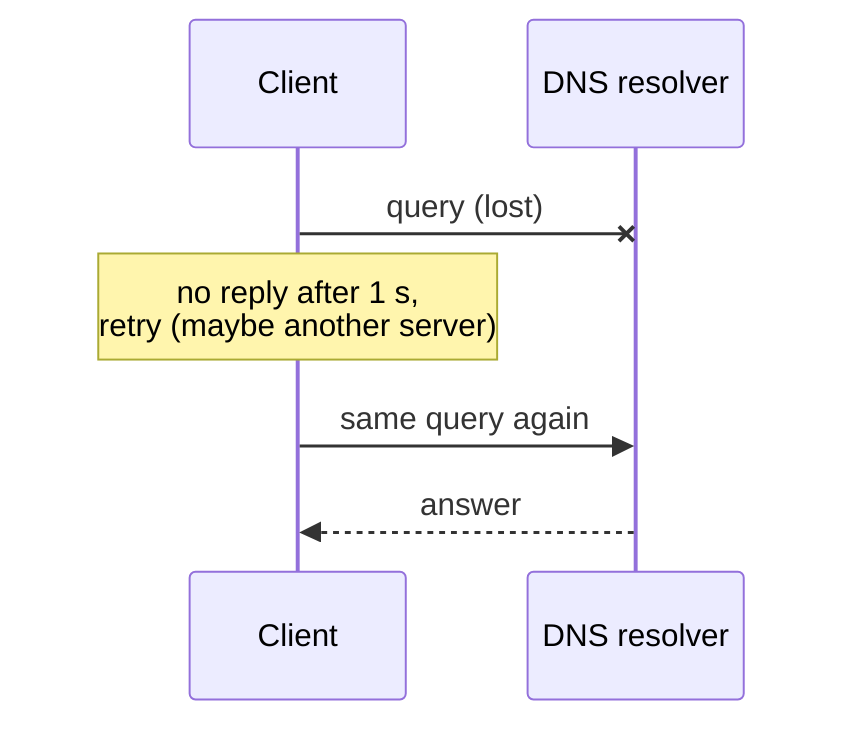

## Mental Model

TCP is a phone call: set it up, then talk in a reliable, ordered stream. **UDP is mailing postcards**: no setup, each message stands alone, some may get lost or arrive out of order, and nobody tells you. What you get in exchange is **control and immediacy**: nothing waits for a handshake, nothing waits behind a lost packet, and your application decides what (if anything) to retransmit.

## Definition

**UDP (User Datagram Protocol, RFC 768)** is a connectionless transport protocol that adds only **ports**, a **length** and a **checksum** to IP. Each `sendto()` produces one datagram; each `recvfrom()` returns one whole datagram (message boundaries are preserved).

```text
| Source port (16) | Destination port (16) |
| Length (16)      | Checksum (16)         |    8-byte header
| Payload …                                |
```

## Why It Exists

**The problem.** TCP bundles many features — handshake, retransmission, ordering, congestion control — into one fixed package. That's perfect for most apps, but for some, part of the package actively hurts. Some applications are **better served by speed than by reliability**, or need a **different kind** of reliability than TCP's strict in-order byte stream:

- A lost 20 ms audio frame is better skipped than delivered late.
- A game's latest position update makes the previous one obsolete — retransmitting it is pointless.
- A DNS query is one small request and one small response — a 3-way handshake would triple the cost.
- Protocols like QUIC want reliability **per stream** with modern congestion control, implemented in user space — they need a thin substrate, and UDP passes through middleboxes.

**The idea.** Offer the thinnest possible layer over IP — just ports (so packets reach the right program) and a checksum — and let the application add only the reliability it wants.

:::callout[That's all it is]{type=insight}
UDP is IP plus port numbers. Each send is one packet; nothing is retransmitted, ordered or throttled unless the application does it itself.
:::

## How It Works

### TCP vs UDP

| | TCP | UDP |
|---|---|---|
| Connection | Handshake, connection state | None |
| Delivery | Reliable, retransmits | Best effort; may be lost |
| Ordering | In order | No ordering |
| Duplicates | Removed | Possible |
| Message boundaries | No (byte stream) | **Yes** (datagrams) |
| Flow/congestion control | Yes | **None** (application's responsibility) |
| Header | 20–60 bytes | 8 bytes |
| Head-of-line blocking | Yes | No |
| Multicast/broadcast | No | Yes |
| Typical uses | Web, APIs, databases, file transfer, email | DNS, VoIP/video (RTP), games, QUIC/HTTP/3, DHCP, NTP, telemetry (StatsD), VPNs (WireGuard) |

### Building what you need on top

Applications using UDP choose which TCP features to rebuild:

- **Sequence numbers** to detect loss and reorder (RTP, game protocols).
- **Selective acknowledgment and retransmission** only for data that still matters (QUIC retransmits frames, not packets).
- **Forward error correction** — send redundancy so receivers reconstruct lost packets without waiting (video conferencing).
- **Jitter buffers** to smooth variable arrival times for audio/video.
- **Congestion control** — mandatory for anything sending significant traffic, or the application will harm the network and itself (QUIC implements CUBIC/BBR-like algorithms; WebRTC uses GCC).
- **Timeouts and retries** (DNS clients retry after ~1–5 s, switching to other servers).

### Datagram size limits

A UDP datagram larger than the path MTU gets **IP-fragmented** — and losing any fragment loses the datagram; many networks drop fragments. So UDP protocols keep datagrams small: classic DNS used ≤ 512 bytes (EDNS allows larger, with a recommended ~1,232-byte limit to avoid fragmentation); QUIC uses ~1,200–1,500-byte packets and discovers the path MTU.

## Internal Mechanism

### Connected UDP sockets

A UDP socket can call `connect()` to fix its peer: the kernel then filters incoming datagrams to that peer, `send()` needs no address, and ICMP errors (like port unreachable) are reported to the application. There's still no handshake — "connect" here is local bookkeeping.

:::depth{level=advanced}
### Security: spoofing and amplification

UDP has no handshake, so the source address isn't verified. Attackers send small requests carrying the **victim's** address as the source to services that return large responses. The responses flood the victim: **reflection and amplification** DDoS. DNS, NTP's `monlist`, memcached and SSDP have all been abused this way, with amplification factors from tens to tens of thousands.

Defenses:
- source-address validation by networks (BCP 38), so spoofed packets never leave their origin;
- response rate limiting on DNS and other UDP servers;
- not exposing UDP services to the internet unless needed;
- protocols that make clients prove their address before sending large responses: a QUIC server sends at most 3× what it has received until the client's address is validated.
:::

## Example

A UDP request and reply in Java:

```java
try (DatagramSocket socket = new DatagramSocket()) {
    socket.setSoTimeout(2_000);                                  // receive() gives up after 2 s
    byte[] msg = "ping".getBytes(StandardCharsets.US_ASCII);
    socket.send(new DatagramPacket(msg, msg.length,
            InetAddress.getByName("192.0.2.10"), 9999));         // no handshake; may be lost silently
    DatagramPacket reply = new DatagramPacket(new byte[2048], 2048);
    try {
        socket.receive(reply);                                   // exactly one whole datagram
        System.out.println(reply.getLength() + " bytes from " + reply.getSocketAddress());
    } catch (SocketTimeoutException e) {
        // lost request, lost reply, or nobody listening: retrying is our job
    }
}
```

Each `receive()` returns one complete datagram, never part of one or two at once. A datagram larger than the buffer is silently cut to fit, so size the buffer for the largest message. `DatagramChannel` offers the same with NIO and selectors.



With UDP, a lost datagram is the application's problem: here the DNS client retries after its own timeout. That timeout is why one lost DNS packet costs a whole second.

## Complexity & Performance

- Zero setup latency; no per-connection kernel state for unconnected sockets.
- No head-of-line blocking — but also no built-in pacing; high-rate UDP senders need batching (`sendmmsg`, GSO) to be CPU-efficient, historically making UDP *more* CPU-expensive per byte than TCP with offloads.

## Trade-offs

- Freedom and latency vs building reliability, ordering, congestion control and security yourself.
- Middlebox compatibility: some corporate networks block or throttle UDP (HTTP/3 falls back to TCP).

## Failure Modes

- Silent loss mistaken for success when the application doesn't implement acknowledgments/retries.
- No congestion control → the application floods a bottleneck, hurting itself and others.
- Fragmentation-related drops for large datagrams.
- NAT timeouts: UDP mappings expire quickly (often 30–120 s) → keepalive packets needed for long-lived flows ([NAT](lesson:cn-nat)).
- Amplification abuse of exposed UDP services.

## In Production

- DNS resolvers, NTP, syslog/StatsD metrics, video calls (WebRTC over UDP), online games, WireGuard VPN, and HTTP/3 (QUIC) all use UDP.
- Metrics pipelines choose UDP (StatsD) to never block the app on the metrics server — accepting some loss.

## Deeper Connections

- QUIC: TCP's guarantees rebuilt on UDP with independent streams and integrated TLS ([HTTP/3 & QUIC](lesson:cn-http3-quic)).
- DNS's reliance on UDP and fallback to TCP ([DNS](lesson:cn-dns-fundamentals)).
- NAT traversal works mostly with UDP ([VPN & NAT Traversal](lesson:cn-vpn-nat-traversal)).

## Common Misconceptions

- **"UDP is unreliable, so it's for unimportant data."** DNS and QUIC (hence much of the web) run on it; reliability is simply implemented above.
- **"UDP is always faster than TCP."** It avoids handshakes and HOL blocking, but raw throughput depends on the application's congestion control and CPU efficiency.
- **"UDP has no connections, so there's no state anywhere."** NATs and firewalls keep per-flow state for UDP too.

## Interview Questions

### [L1 · compare] Compare TCP and UDP.

TCP is connection-oriented, reliable, ordered and flow/congestion-controlled, presenting a byte stream; it adds handshake latency and head-of-line blocking. UDP is connectionless with an 8-byte header, preserving message boundaries but providing no reliability, ordering, or congestion control; it's lower latency and gives applications full control. Use TCP when you need complete, ordered data; UDP when timeliness matters more or you implement custom reliability.

### [L1 · scenario] Why does DNS primarily use UDP?

A typical query and response each fit in one small datagram, so UDP avoids TCP's handshake round trip and connection state on busy resolvers. Clients handle loss with timeouts and retries. DNS falls back to TCP for large responses (truncation), zone transfers, and increasingly for encrypted DNS.

### [L2 · why] Why do video calls use UDP instead of TCP?

Real-time media values timeliness over completeness: a late frame is useless. TCP would retransmit lost packets and block all following data behind them (head-of-line blocking), causing stalls. Over UDP (RTP), the app can skip lost frames, conceal errors, use forward error correction and adapt its bitrate with its own congestion control.

### [L3 · design] If you built a reliable protocol on top of UDP, what would you have to implement?

Sequence numbers and acknowledgments (ideally selective), retransmission with RTT estimation and timeouts, reordering/duplicate handling, flow control, congestion control (to be fair and avoid collapse), connection setup/teardown or session identification, security (encryption, authentication, anti-spoofing/amplification limits), and path MTU handling. That's essentially what QUIC does.

### [L3 · what-if] What happens if you send a 20 KB UDP datagram across a path with a 1,500-byte MTU?

IP fragments it into ~14 fragments. If any fragment is lost, the whole datagram is lost (loss amplification), reassembly consumes receiver resources, and many firewalls drop fragments entirely. Better: keep datagrams under the path MTU and segment at the application level.

### [L2 · how] How do you send and receive UDP in Java, and what does one receive() call return?

Create a `DatagramSocket`, wrap each message in a `DatagramPacket` with the destination address and port, and call `send()`. `receive()` blocks until a datagram arrives (or `setSoTimeout` expires) and fills the packet with exactly one whole datagram, preserving message boundaries, unlike a TCP stream. If the buffer is smaller than the datagram, the excess is silently discarded. Nothing tells you whether a sent datagram arrived; timeouts and retries are the application's job. `DatagramChannel` provides the same over NIO.

## Practice

### [mcq] Which of these does UDP preserve that TCP does not?

- [ ] Ordering
- [x] Message boundaries
- [ ] Reliability
- [ ] Congestion control

Each datagram is received whole.

### [mcq] What is the size of the UDP header?

- [ ] 4 bytes
- [x] 8 bytes
- [ ] 20 bytes
- [ ] 40 bytes

Ports, length and checksum: 2 bytes each.

### [numeric 65507 unit=bytes] What is the largest payload a single UDP datagram can carry over IPv4?

:::answer
The IPv4 total-length field allows 65,535 bytes. Subtract the 20-byte IPv4 header and the 8-byte UDP header: **65,507** bytes. Anything over the path MTU (around 1,472 bytes of payload on Ethernet) is IP-fragmented, so real protocols stay far below this.
:::

### [numeric 1472 unit=bytes] On a path with a 1,500-byte MTU and no IP options, what is the largest UDP payload that avoids IPv4 fragmentation?

:::answer
1,500 − 20 (IPv4 header) − 8 (UDP header) = **1,472** bytes. This is the payload size `ping -M do -s 1472` uses to test a full-size path.
:::

### [numeric 50] An attacker sends 60-byte DNS queries with the victim's spoofed address, and each provokes a 3,000-byte response to the victim. What is the amplification factor?

:::answer
3,000 ÷ 60 = **50**. Each megabit per second the attacker sends becomes 50 Mb/s at the victim, and the victim sees traffic from DNS servers, not from the attacker.
:::

### [mcq] A Java `DatagramSocket` receives into a 512-byte buffer, and a 1,200-byte datagram arrives. What happens?

- [ ] `receive()` returns the first 512 bytes and the next call returns the rest
- [x] The first 512 bytes are delivered and the rest is discarded
- [ ] `receive()` throws an exception
- [ ] The datagram waits until a larger buffer is offered

UDP delivers datagrams whole or not at all, one per receive call; data that doesn't fit the buffer is lost. Size buffers for the largest message the protocol allows.

### [exercise] A multiplayer game sends player positions 30 times a second over UDP. Which of TCP's features should it rebuild on top of UDP, and which should it deliberately leave out?

:::solution
**Rebuild:**
- **Sequence numbers**, so the client can discard out-of-order and duplicate updates. An update older than the newest one received is simply ignored.
- **Congestion control or rate limiting**, so the game backs off on a congested link instead of flooding it.
- **Reliable delivery only for the messages that need it**: chat lines, item pickups and "player joined", resent until acknowledged.

**Leave out:**
- **Retransmission of position updates.** A lost update is replaced by the next one 33 ms later. Resending an old position would only deliver stale data late.
- **In-order delivery with blocking.** Waiting for a missing old update would delay newer ones: exactly TCP's head-of-line blocking.

The result is how most games, and protocols like QUIC and RTP, use UDP: choose per message what matters.
:::

### [exercise] In the [TCP connection simulator](lab:tcp-handshake), press "Client connect()", "Client sends 100 B" and "Server sends 300 B", then close both sides. How many segments carried no application data, and how long did the client wait before it could send its request? Compare a DNS lookup over UDP, and say when DNS still falls back to TCP.

:::solution
In the lab, 9 of the 11 segments carry no application data: the handshake (SYN, SYN-ACK, ACK), one ACK for each data segment, and the close (FIN and ACK in each direction). The client waits one full round trip, for the SYN-ACK, before its request can go.

Over UDP, a DNS lookup is 2 datagrams: the query and the response. Nothing is set up before or torn down after, and the server keeps no state per client, which matters for a resolver answering millions of them. DNS falls back to TCP when a response doesn't fit (the server sets the TC "truncated" bit and the client retries over TCP), for zone transfers, and for DNS over TLS.
:::

## Quick Revision

- UDP = IP + ports + length + checksum (8 B). Connectionless, unreliable, unordered, message boundaries kept.
- No handshake, no HOL blocking, no flow/congestion control → app builds what it needs (seq numbers, selective retransmit, FEC, jitter buffer, congestion control).
- Uses: DNS, RTP media, games, QUIC/HTTP/3, DHCP, NTP, WireGuard, StatsD.
- Keep datagrams < MTU; NAT mappings expire fast; beware amplification.
- Java: `DatagramSocket` + `DatagramPacket`; `receive()` = one whole datagram (truncated if the buffer is too small); `setSoTimeout` + retries are your job.
- Max IPv4 UDP payload 65,507; no fragmentation at MTU 1,500 → ≤ 1,472.
