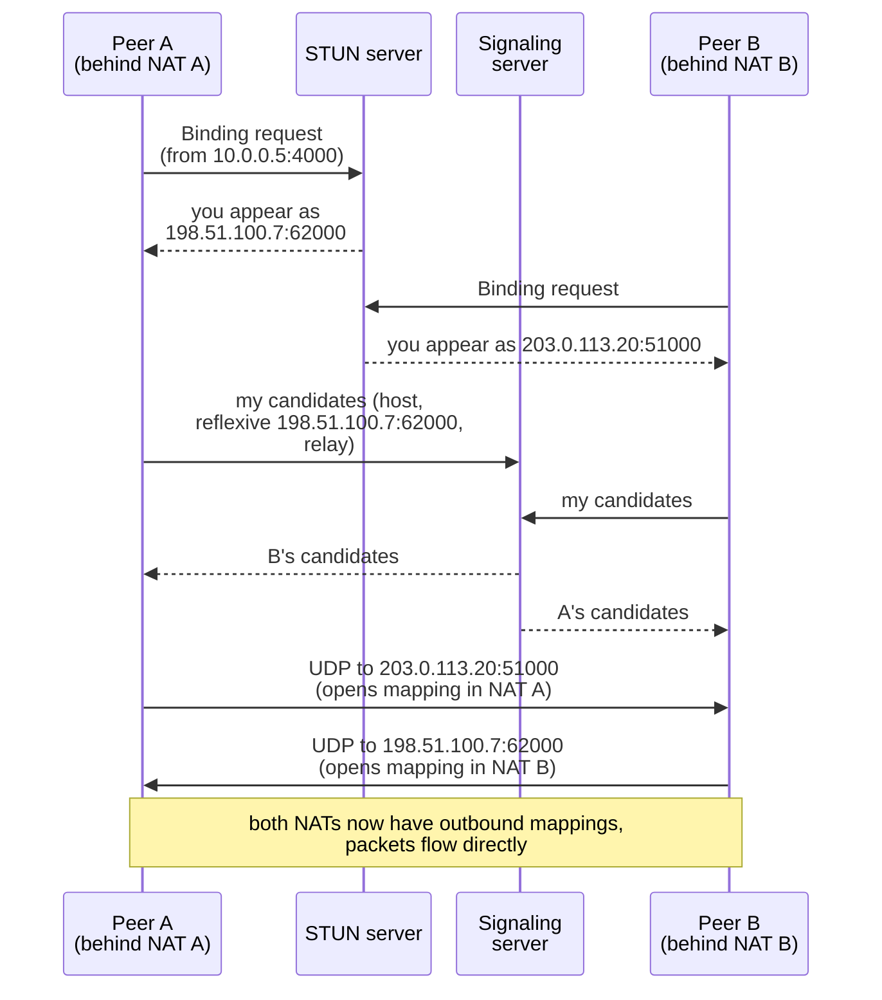

## Mental Model

- A **VPN** is a **sealed pipe through a public building**: packets for a private network are encrypted and wrapped inside ordinary packets addressed to a VPN gateway, which unwraps them on the other side. To the private network, your laptop looks locally attached.
- **NAT traversal** solves a different problem: two people each behind a receptionist (NAT) who blocks unexpected calls. They both call a **mutual friend** (a STUN server) to learn their public phone numbers, then **call each other simultaneously**, so each receptionist sees an "outgoing call" and lets the other's call through (**hole punching**). If the receptionists are too strict, they talk through the friend instead (a **TURN relay**).

## Definition

- **VPN (virtual private network)**: an encrypted tunnel carrying private traffic over a shared network. **Site-to-site** (connect networks) or **remote access** (connect devices).
- **IPsec**: IP-layer encryption/authentication suite (IKEv2 key exchange, ESP data), common for site-to-site and cloud VPNs.
- **WireGuard**: a modern, minimal UDP-based VPN using fixed modern cryptography (Noise protocol framework, Curve25519, ChaCha20-Poly1305), in the Linux kernel since 5.6.
- **TLS VPNs** (OpenVPN, many corporate SSL VPNs): tunnels built on TLS, over UDP or TCP.
- **STUN**: a protocol for a client to discover its public (NAT-mapped) address and port.
- **TURN**: a relay server forwarding traffic when direct connectivity fails.
- **ICE**: the framework (used by WebRTC) that gathers candidate addresses (local, STUN-reflexive, TURN-relayed), exchanges them via signaling, and tests pairs to pick the best working path.

## Why It Exists

Two different problems, both caused by the public internet not being shaped the way we want:

- Organizations need private connectivity between offices, clouds and remote workers without leased lines.
- Peer-to-peer apps (video calls, games, file sharing, mesh VPNs like Tailscale) want direct low-latency paths between devices, but NAT blocks unsolicited inbound traffic ([NAT](lesson:cn-nat)).

**The ideas.** For VPNs: if you can't have a private cable, make a private *envelope* — encrypt private packets and send them inside ordinary public packets. For NAT traversal: since NATs only let in replies to outbound traffic, have both sides send outbound packets to each other at the same moment, so each NAT thinks the other's packets are replies.

:::callout[That's all it is]{type=insight}
A VPN wraps private packets in encrypted public packets. Hole punching gets two devices behind NATs talking by having both "call out" at once; when that fails, a relay in the middle forwards their traffic.
:::

## How It Works

### A tunnel packet

```text
Original:  [IP 10.0.1.5 → 10.8.2.9][TCP][data]                      (private addresses)
Tunnelled: [IP 198.51.100.7 → 203.0.113.20][UDP 51820][WireGuard hdr][ encrypted original packet ][tag]
```

Encapsulation adds overhead → a smaller effective MTU (WireGuard default 1,420) → MSS clamping or correct MTUs required ([MTU](lesson:cn-mtu-congestion)).

### VPN designs compared

| | IPsec (IKEv2) | WireGuard | TLS VPN (OpenVPN) |
|---|---|---|---|
| Layer | IP | IP over UDP | Over TLS (UDP or TCP) |
| Complexity | High (many options, negotiation) | Minimal (~4K lines kernel code) | Moderate |
| Performance | High (kernel, hardware offload) | High (kernel) | Lower (user space, TCP-over-TCP issues) |
| NAT friendliness | Needs NAT-T (UDP 4500) | Native (UDP), keepalives | Good (TCP 443 passes firewalls) |
| Typical use | Cloud/site-to-site, enterprise | Modern remote access, mesh VPNs | Legacy remote access |

**TCP-over-TCP meltdown**: tunneling TCP inside a TCP-based VPN stacks two retransmission/congestion loops; under loss, inner and outer TCP both back off and retransmit, collapsing throughput — why UDP transports are preferred for tunnels.

### IPsec in one table

| | Transport mode | Tunnel mode |
|---|---|---|
| What is protected | The payload of the original IP packet | The entire original packet, wrapped in a new IP header |
| Original IP header | Kept (visible) | Hidden inside the encrypted packet |
| Typical use | Host-to-host encryption | Site-to-site VPNs, gateways |

Two protocols do the work. **ESP** (Encapsulating Security Payload) encrypts and authenticates, and is what almost everyone uses. **AH** (Authentication Header) only authenticates, including the outer IP addresses, which breaks through NAT, so it is rarely used. **IKEv2** negotiates the keys, and NAT traversal wraps ESP in UDP port 4500.

### Zero trust vs VPN

Traditional VPNs grant network-level access ("once inside, you can reach everything"). **Zero-trust** access (identity-aware proxies, BeyondCorp-style) authenticates and authorizes each request to each application, reducing lateral movement. Mesh VPNs with per-device ACLs sit in between.

### NAT traversal step by step

The two obstacles: neither peer knows its own public address, and neither NAT will accept an unexpected packet. STUN solves the first; simultaneous sending solves the second.



- Works when NATs use **endpoint-independent mapping** (the same public port for all destinations).
- With **address/port-dependent ("symmetric") NATs**, the port seen by STUN differs from the one used toward the peer → hole punching fails → **TURN relay** (more latency and relay bandwidth cost). Roughly, most connections succeed directly and a minority need relays, depending on networks.
- TCP hole punching exists (simultaneous open) but is less reliable; UDP (and QUIC over UDP) is the norm.

## Internal Mechanism

:::depth{level=advanced}
### Keepalives and mapping lifetimes

NAT UDP mappings expire quickly (often 30–120 s idle). Both VPNs (WireGuard's `PersistentKeepalive = 25`) and WebRTC send periodic keepalives to keep mappings open. Mobile networks with CGNAT may rebind mappings; protocols that identify sessions by cryptographic keys (WireGuard) or connection IDs (QUIC) survive address changes gracefully ([HTTP/3 & QUIC](lesson:cn-http3-quic)).

### Split tunneling and DNS

Full-tunnel VPNs send all traffic through the gateway (control, inspection) at the cost of latency and bandwidth; split tunneling sends only private prefixes through the tunnel. DNS must be split too (private names to internal resolvers) — misconfiguration leaks internal queries or breaks internal names.
:::

## Example

A minimal WireGuard peer configuration:

```ini
[Interface]
PrivateKey = <client private key>
Address = 10.8.0.2/32
DNS = 10.8.0.1
MTU = 1420

[Peer]
PublicKey = <server public key>
Endpoint = vpn.example.com:51820
AllowedIPs = 10.0.0.0/8          # split tunnel: only private ranges via VPN
PersistentKeepalive = 25
```

## Complexity & Performance

- Encryption overhead is small with modern ciphers; the bigger costs are extra hops (hairpinning through a gateway), MTU reduction and TURN relays.
- Direct P2P paths give the lowest latency; relays add a detour.

## Trade-offs

- Site-to-site VPNs: cheap and flexible vs internet-path variability (dedicated interconnects for predictable performance).
- Full vs split tunnel: control vs performance.
- P2P direct vs relayed: latency and cost vs guaranteed connectivity.

## Failure Modes

- MTU black holes over tunnels.
- Overlapping private address ranges between connected networks ([IPv4 Addressing](lesson:cn-ipv4-addressing)).
- NAT mapping timeouts dropping idle tunnels without keepalives.
- Symmetric NATs forcing expensive relays; TURN capacity shortfalls.
- DNS leaks or broken internal resolution with split tunnels.

## In Production

- Cloud: managed site-to-site IPsec VPNs with redundant tunnels (often BGP over the tunnels for failover); private interconnects for bandwidth.
- WebRTC apps run STUN/TURN infrastructure (coturn) sized for relay traffic.
- Mesh VPNs (Tailscale, Netbird) automate WireGuard keys, NAT traversal and relays (DERP).

## Deeper Connections

- NAT behaviors: [NAT](lesson:cn-nat). UDP as the substrate: [UDP](lesson:cn-udp). Tunnel MTU: [MTU & Bottlenecks](lesson:cn-mtu-congestion). Keys and ciphers: [Crypto Foundations](lesson:cn-crypto-foundations).

## Common Misconceptions

- **"A VPN makes you anonymous and secure."** It shifts trust to the VPN provider/gateway and protects the path to it; end-to-end TLS still matters.
- **"Peer-to-peer means no servers are involved."** Signaling, STUN and often TURN servers are required.
- **"Any two NATed devices can connect directly."** Symmetric NATs often require relays.

## Interview Questions

### [L2 · conceptual] What is a VPN and how does it work?

A virtual private network creates an encrypted tunnel over a public network: packets destined for the private network are encrypted and encapsulated inside packets addressed to a VPN gateway, which decrypts and forwards them. It provides confidentiality and integrity over untrusted networks and makes remote devices or sites appear directly connected to the private network.

### [L3 · how] How do two devices behind NATs establish a direct connection?

Each learns its public address/port mapping from a STUN server, they exchange candidate addresses through a signaling server, and then both send UDP packets to each other's public mappings at about the same time. Each outgoing packet creates a NAT mapping that allows the peer's packets through (hole punching). ICE tests candidate pairs and falls back to a TURN relay when NATs (e.g., symmetric) prevent a direct path.

### [L3 · why] Why do VPNs prefer UDP transports over TCP?

Tunneling TCP inside TCP stacks two reliability and congestion-control loops: under loss, both layers retransmit and back off, causing severe throughput collapse and latency spikes ("TCP meltdown"). A UDP-based tunnel lets the inner transport handle reliability alone, and UDP traverses NATs well.

### [L2 · compare] IPsec transport mode vs tunnel mode, and ESP vs AH?

Transport mode protects only the payload of the original packet and keeps the original IP header, so it suits host-to-host encryption. Tunnel mode encrypts the whole original packet and puts it inside a new IP header between two gateways, hiding the internal addresses: the site-to-site VPN case. ESP provides encryption and integrity and is the normal choice. AH provides integrity only, and covers the outer IP header too, which makes it incompatible with NAT.

### [L2 · compare] STUN vs TURN vs ICE?

STUN tells a peer its public address and port as seen from outside its NAT (a "reflexive candidate"). TURN is a relay server that forwards traffic between peers when no direct path works, typically behind symmetric NATs or strict firewalls; it always works, but costs server bandwidth and latency. ICE is the procedure that gathers all candidates (local, reflexive, relayed), exchanges them through signaling, tests pairs, and picks the best working path.

### [L2 · compare] Full tunnel vs split tunnel?

A full-tunnel VPN sends all of a device's traffic through the VPN gateway: central inspection and control, but every video call and download takes the detour, adding latency and gateway load. A split tunnel sends only traffic for private ranges (and internal DNS names) through the VPN, and everything else directly. It performs better, but internet traffic bypasses corporate controls, and DNS must be configured so internal names go to internal resolvers.

## Practice

### [mcq] Which server type relays media between peers when direct NAT traversal fails?

- [ ] STUN
- [x] TURN
- [ ] DNS
- [ ] DHCP

TURN relays traffic; STUN only discovers addresses.

### [numeric 1420] WireGuard's default interface MTU on a 1,500-byte IPv4 path (reserving 80 bytes for IPv6 underlay compatibility)?

:::answer
WireGuard's default is **1,420** bytes (1,500 − 80), which fits both IPv4 (60 B overhead) and IPv6 (80 B) underlays.
:::

### [numeric 25 unit=s] WireGuard's documentation suggests a PersistentKeepalive value that keeps NAT mappings alive on most networks, whose UDP timeouts are often around 30 s. What value, in seconds, does it suggest?

:::answer
**25** s: each keepalive must arrive before the NAT forgets the mapping, and 25 s stays safely under the common 30 s timeouts. With no keepalive, the peer would become unreachable from outside after 30 s of silence.
:::

### [numeric 4500] On which UDP port does IPsec NAT traversal encapsulate ESP packets?

:::answer
**4500**. Plain ESP is IP protocol 50 and has no ports, so NAT devices can't track it; wrapping it in UDP lets it cross NATs like any other UDP flow. IKE itself starts on UDP 500.
:::

### [mcq] Which IPsec setting is used by almost every site-to-site VPN?

- [ ] AH in transport mode
- [ ] AH in tunnel mode
- [ ] ESP in transport mode
- [x] ESP in tunnel mode

Site-to-site VPNs encrypt whole packets between two gateways (tunnel mode) and need encryption, not just authentication (ESP).

### [exercise] Two laptops in different homes try to start a video call. Laptop A's NAT keeps the same public port for every destination; laptop B's NAT uses a new public port for each destination. Walk through what ICE tries and which path the call ends up using.

:::solution
1. **Gather candidates.** Each laptop collects its local address, its **reflexive** address from a STUN server (its public address and port as the STUN server saw them), and a **relayed** address on a TURN server.
2. **Exchange candidates** through the signaling server.
3. **Check pairs.** Each side sends UDP probes to the other's candidates.
   - A's NAT is endpoint-independent, so the port STUN saw is the port B's probes need. A is reachable at its reflexive address once A has sent a packet towards B.
   - B's NAT is symmetric: the port it used towards the STUN server differs from the port it opens towards A. A's probes to B's reflexive address arrive at a port with no mapping and are dropped. But B's probes to A do arrive, from B's new port, and A can reply to that observed address ("peer-reflexive candidate").
4. **Result.** Because one side is endpoint-independent, a direct path usually still works. If *both* were symmetric, no direct pair would succeed, and the call would use the **TURN relay**.
:::

### [exercise] In the [routing lab](lab:routing), send a packet from host A to the web server and read R1's NAT step. What entry does R1 create, and what must a packet from the internet match to get through to host A? Use that to explain why two peers behind different NATs can't simply connect, and how hole punching gets around it.

:::solution
R1 maps 192.168.1.20:51514 to 198.51.100.7:40001 and records the mapping in its connection-tracking table. A packet from outside reaches host A only if it is addressed to 198.51.100.7:40001, and, with most NATs' filtering, comes from the address host A contacted. Anything else is dropped, because no entry tells R1 where it should go.

Two peers behind NATs each have such a gate, and it opens only from the inside, so neither can start the conversation. In hole punching, both peers learn each other's public address and port from a rendezvous (STUN) server. Then they send to each other at the same time: each outgoing packet creates the entry that lets the other's packets in. If a NAT picks a new port for every destination (a symmetric NAT), the learned port is wrong, and traffic has to be relayed through TURN.
:::

## Quick Revision

- VPN = encrypted encapsulation to a gateway; site-to-site vs remote access; IPsec, WireGuard (UDP, minimal), TLS VPNs; avoid TCP-over-TCP.
- Overhead → smaller MTU → MSS clamping; keepalives for NAT mappings; split vs full tunnel (+ split DNS).
- Zero trust = per-request, per-app authorization vs network-level VPN access.
- NAT traversal: STUN (discover mapping) + signaling + simultaneous UDP (hole punching); ICE picks paths; TURN relays when symmetric NATs block.
- IPsec: ESP (encrypt + integrity) vs AH (integrity only, NAT-hostile); transport (payload) vs tunnel (whole packet, site-to-site); IKE on UDP 500, NAT-T on 4500.
- STUN (learn your public address), TURN (relay), ICE (try all candidate pairs). Full vs split tunnel.
