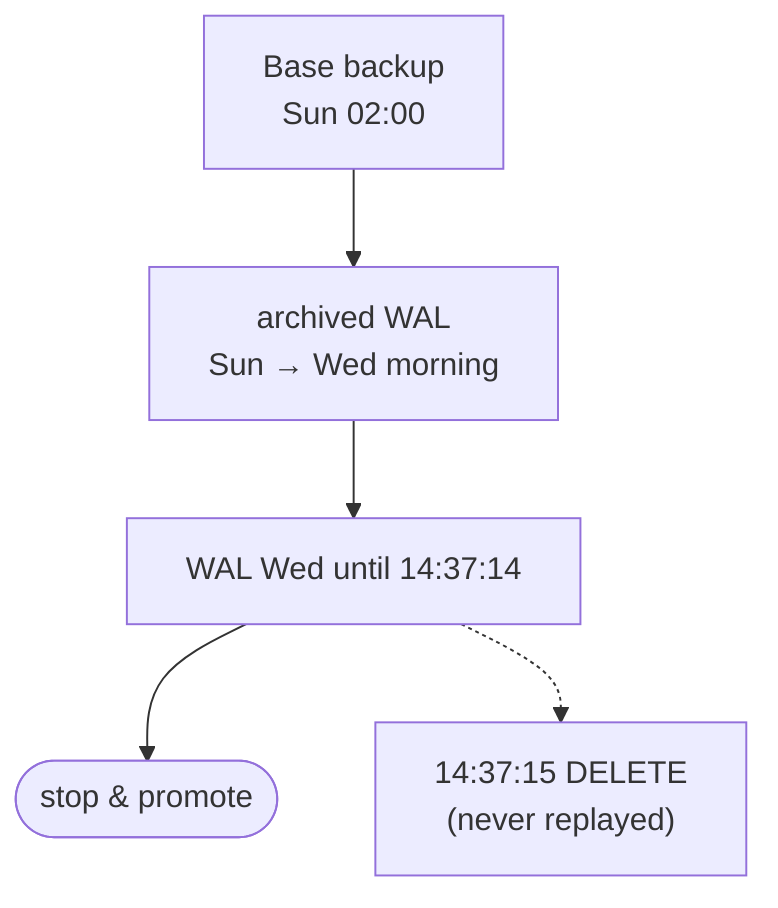

## Mental Model

There are three different disasters, and three different tools:

| What happened | Tool | Why the others don't help |
|---|---|---|
| The server process or machine **stopped** | Crash recovery (WAL redo/undo) | — |
| The machine or disk **died** | Replication + failover | crash recovery needs the disk |
| The **data is wrong** — a bad deploy, `DELETE` without `WHERE`, ransomware, corruption | **Backups** + point-in-time recovery | a replica copies the mistake within milliseconds |

A backup is a way to travel back in time. **RPO** (recovery point objective) is how far back you might land — the data you can afford to lose. **RTO** (recovery time objective) is how long the trip takes — the downtime you can afford. Every design choice below trades storage, money and complexity against those two numbers.

## Why It Exists

**The problem.** Durability (the D in ACID) promises that a committed write survives crashes. It says nothing about writes that *should never have been made*. The most common data-loss events are human: a migration that drops the wrong column, a script run against production instead of staging, a bug that overwrote prices for a day.

**Without it.** Replicas, RAID and multi-zone storage all faithfully preserve the damage. Without an independent copy from *before* the mistake, the only options are reconstructing data from logs and emails — or telling customers it's gone.

**The idea.** Keep copies that are **independent** of the live system: a different account, different storage, ideally immutable. And make them **continuous**, so you can stop the replay one second before the mistake instead of going back to last night's copy.

**From idea to mechanism.**
- *A copy of everything* → a full backup: a dump of the logical contents, or a copy of the data files (base backup).
- *Copies are big and slow* → incremental/differential backups copy only what changed.
- *Nightly copies lose up to a day* → archive the write-ahead log continuously; a base backup plus every WAL segment since it can rebuild the database at **any** moment in between (PITR).
- *Untested copies fail when needed* → restore drills that measure the real RTO.

:::callout[That's all it is]{type=insight}
A backup is an old copy; WAL archiving is the diary of every change since. Point-in-time recovery is "restore the old copy, then replay the diary and stop just before the bad entry". RPO is how much of the diary you might lose; RTO is how long the replay takes.
:::

## Definition

- **RPO (recovery point objective)**: the maximum acceptable data loss, measured in time ("at most 1 minute of writes").
- **RTO (recovery time objective)**: the maximum acceptable time to restore service.
- **Logical backup**: the database's contents as SQL statements or an archive of objects and rows (`pg_dump`, `mysqldump`). Portable across versions and platforms; restoring rebuilds tables and indexes.
- **Physical backup**: a copy of the data files (`pg_basebackup`, filesystem or cloud snapshots, Percona XtraBackup for MySQL). Fast to restore; tied to the same major version and platform.
- **Full / differential / incremental**: everything; changes since the last full; changes since the last backup of any kind.
- **Continuous archiving**: copying each completed WAL segment (PostgreSQL) or binary log (MySQL) to backup storage as it is produced.
- **Point-in-time recovery (PITR)**: restore a physical base backup, then replay archived WAL up to a chosen target (time, LSN, transaction id or named restore point).
- **3-2-1 rule**: three copies of the data, on two different kinds of storage, one of them off-site — often extended to 3-2-1-1-0: one offline/immutable copy and zero errors in restore tests.

## How It Works

### Logical backups: dump the contents

`pg_dump` connects like a client and reads every table inside one transaction, so the dump is a consistent snapshot even while writes continue (MVCC lets it read the old versions). `mysqldump --single-transaction` does the same for InnoDB tables.

```bash
pg_dump -Fc -d shop -f shop.dump            # custom format: compressed, selective restore
pg_restore -j 8 -d shop_restored shop.dump  # parallel restore with 8 jobs
pg_dumpall --globals-only > globals.sql     # roles and tablespaces aren't in per-database dumps
```

Strengths: portable (restore into a newer major version, another OS, another cluster), selective (one table), human-readable if plain SQL. Weaknesses: restore re-inserts every row and **rebuilds every index**, so a multi-terabyte database takes hours to days; and a dump is a single point in time — no PITR.

### Physical backups: copy the files

A base backup copies the data directory while the server runs. The files change during the copy, so the copy alone is inconsistent — exactly like the data files after a crash. The fix is the same as crash recovery: also keep the WAL generated during the copy, and replay it on restore until the files are consistent ([Crash Recovery](lesson:db-crash-recovery)).

```bash
pg_basebackup -D /backups/base_2024-06-09 -Ft -z -X stream -c fast
```

`-X stream` includes the WAL needed to make the copy consistent. Cloud volume snapshots work the same way: crash-consistent files plus WAL. Restoring a physical backup is a file copy plus a short WAL replay — far faster than rebuilding from SQL — but it only works on the same major version.

PostgreSQL 17 added **incremental** base backups (`pg_basebackup --incremental=<previous manifest>` with `summarize_wal = on`, reassembled by `pg_combinebackup`), which copy only blocks changed since the previous backup. MySQL's XtraBackup has had incremental backups for years.

### Continuous archiving and PITR

The WAL already records every change in order ([WAL & Durability](lesson:db-wal-durability)). Archiving it turns it into a time machine:

```ini
# postgresql.conf on the primary
archive_mode = on
archive_command = 'test ! -f /mnt/archive/%f && cp %p /mnt/archive/%f'   # or a tool like pgBackRest / WAL-G
archive_timeout = 60          # switch to a new segment at least every 60 s, so quiet periods are archived too
```

Each 16 MB WAL segment is copied when it fills (or when `archive_timeout` forces a switch). To recover to just before a mistake at 14:37:15:

```ini
# on a fresh server, after restoring the base backup into the data directory
restore_command = 'cp /mnt/archive/%f "%p"'
recovery_target_time = '2024-06-12 14:37:14+05:30'
recovery_target_action = 'promote'
```

Create an empty `recovery.signal` file in the data directory and start the server. It replays archived WAL from the base backup's start point and stops at the target. Then it starts a new **timeline**: a new history branch with its own WAL file names. That way the abandoned future after 14:37:14 can never be confused with the new one.



MySQL works the same way with different names: restore a full backup, then `mysqlbinlog --stop-datetime=… binlog.000123 … | mysql` replays the binary logs up to the target.

**RPO with archiving** is the WAL that wasn't archived yet when the primary was lost: at most `archive_timeout` (or one partly filled segment) in normal operation. Streaming WAL continuously to the backup system (`pg_receivewal`, pgBackRest/WAL-G async archiving) brings it close to zero. Note what PITR doesn't need: a replica. It only needs the base backup and the archive.

### Choosing a backup strategy

| | Restore speed | PITR | Portability | Typical use |
|---|---|---|---|---|
| Logical dump | slow (rebuilds indexes) | no | high | small databases, migrations, per-table copies |
| Physical full + WAL archive | fast | **yes** | same major version | production default |
| Physical incremental + WAL | fast, assembles chain | yes | same version | large databases, shorter backup windows |
| Storage snapshots + WAL | very fast | with WAL | same platform | cloud volumes, huge databases |
| Delayed replica | instant (it's running) | to within its delay | — | fast undo for human error, not a backup |

Most teams combine a physical strategy managed by a tool (pgBackRest, Barman, WAL-G, or the cloud provider's automated backups) with occasional logical dumps for portability.

### Making backups trustworthy

- **Independence**: backups in a different account or project, with credentials the database servers don't hold; object lock / immutability so ransomware or an attacker with production access can't delete them.
- **Encryption** with keys stored separately — a backup is a complete copy of your data ([Database Security](lesson:db-security)).
- **Retention**: enough history to notice slow corruption (weeks, not days), with older backups thinned out.
- **Monitoring**: alert on backup age, failed archive commands and growing WAL directories — a failing `archive_command` makes the primary keep every segment until the disk fills ([The Disk That Filled With WAL](case:wal-disk-full)).
- **Verification**: checksums (`pg_verifybackup` validates a base backup against its manifest), data checksums enabled on the cluster, and above all **regular restore drills**.

### Restore drills

A backup you have never restored is a hope, not a backup. Automate a periodic job that:

1. restores the latest backup (and a PITR to a random point) onto a scratch server;
2. runs sanity queries: row counts, the latest order timestamp, application smoke tests;
3. records how long each step took;
4. alerts if anything fails.

The measured time *is* your real RTO; the age of the newest replayable WAL *is* your real RPO.

## Example

Wednesday 14:37:15, someone runs `DELETE FROM orders;` on production. Backups: nightly base backups at 02:00 and continuous WAL archiving.

1. **Stop the bleeding**: put the app in maintenance or read-only mode so new writes don't pile up on top of the damage.
2. **Find the target**: the statement's time from the audit log or `pg_waldump` on the archived WAL — the transaction committed at 14:37:15.4. Target 14:37:15 (or `recovery_target_xid` of the bad transaction with `recovery_target_inclusive = false`).
3. **Restore elsewhere**: restore Wednesday 02:00's base backup to a new server, configure `restore_command` and the target, start it. It replays ~12.5 hours of WAL and promotes.
4. **Choose how to recover**:
   - *Repair in place*: copy just the deleted rows from the recovered server back into production (`COPY` / `INSERT … SELECT` over `postgres_fdw`). The writes after 14:37:15 to other tables are kept.
   - *Switch over*: point the app at the recovered server. Simpler, but every write made after 14:37:15 is lost.
5. **Postmortem**: why could a person run an unbounded `DELETE` on production? (Least-privilege accounts, `sql_safe_updates` in MySQL clients, reviewed scripts in transactions.)

## Complexity & Performance

- **Backup time** ≈ data size ÷ throughput (disk, network, compression). **Restore time** = transfer + (for logical) index rebuilds + (for PITR) WAL replay. Replay speed is roughly how fast the server can apply the WAL, often slower than the original write rate on a busy primary.
- A worked estimate: a 2 TB base backup restored at 500 MB/s takes 4,000 s ≈ 67 minutes; replaying 300 GB of WAL at 100 MB/s takes another 3,000 s = 50 minutes. RTO ≈ 2 hours before any verification — if that is too long, take base backups more often (less WAL to replay) or use snapshots.
- WAL archive size grows with write volume, not data size: a small but busy database can produce more WAL per day than its total size.
- Logical dumps load the primary (a long transaction holding back vacuum) — dump from a replica where possible.

## Trade-offs

- **More frequent base backups** → shorter replay and faster RTO, more storage and I/O.
- **Incremental chains** → smaller backups, but a restore needs every link, and one corrupt link breaks everything after it.
- **Synchronous WAL streaming to the backup system** → near-zero RPO, but the backup system becomes part of the write path.
- **Long retention** → protection against slowly discovered corruption, at a storage cost (and possibly legal obligations to delete).
- **Delayed replica** → a fast way back from human error within its delay window, but it's still online and deletable — not a backup.

## Failure Modes

- **"Replication is our backup"** — until a `DROP TABLE` replicates.
- **Silent archive failure**: `archive_command` returns errors for days; WAL piles up on the primary (disk full) and the archive has a gap, so PITR past the gap is impossible.
- **Backups in the same blast radius**: same account, same credentials, same region; deleted by the same attacker or the same mistake.
- **Never restored**: missing roles (no `globals.sql`), missing extensions, wrong major version, lost encryption key — all discovered during the incident.
- **Corrupted data backed up faithfully** for longer than the retention window.
- **RTO surprise**: a logical restore of a large database that takes 30 hours because every index is rebuilt.

## In Production

- Write down RPO and RTO per system with the business; design to them, then *measure* them in drills.
- Use a dedicated tool (pgBackRest, Barman, WAL-G, Percona XtraBackup) or your cloud provider's PITR; don't hand-roll `cp` scripts for anything important.
- Alerts: last successful backup age, archive failures (`pg_stat_archiver.failed_count`), WAL directory size, backup storage reachable.
- Keep a runbook with exact commands; rehearse it.
- Protect against humans: separate admin accounts, no casual production shells, transactions around manual changes, a delayed replica if the RTO for "oops" must be minutes.

## Deeper Connections

- PITR is crash recovery with a longer log: restore old pages, redo forward from a checkpoint ([Crash Recovery](lesson:db-crash-recovery)).
- Physical replication and WAL archiving ship the same WAL; a replica is a PITR that never stops ([Replication](lesson:db-replication)).
- Failover protects against hardware loss and is measured with the same RPO/RTO vocabulary ([Failover](lesson:db-failover)).
- Every layer in the durability chain — fsync, replicas, backups — guards against a different failure ([The Durability Chain](lesson:x-durability-chain)).

## Common Misconceptions

- **"We have replicas, so we're covered."** Replicas protect against hardware failure, not against bad writes.
- **"A snapshot of a running database is useless."** It's crash-consistent; with the WAL from that moment it restores cleanly, exactly like a crash.
- **"The backup job succeeded, so we can restore."** Success means files were written. Only a restore proves they're usable.
- **"Logical and physical backups are interchangeable."** Physical restores fast but only to the same major version; logical is portable but slow and has no PITR.

## Interview Questions

### [L1 · compare] Why isn't replication a backup?

Replication copies every change to the replicas almost immediately — including mistakes. A `DELETE` without a `WHERE`, a buggy migration or ransomware encryption reaches every replica within seconds. A backup is an independent copy from an earlier point in time, ideally in a separate account and immutable, so you can go back to before the mistake. Replication protects against losing a machine; backups protect against losing correct data.

### [L1 · conceptual] What are RPO and RTO?

RPO, the recovery point objective, is how much data you can afford to lose, measured in time: with nightly backups and nothing else, RPO is up to 24 hours. RTO, the recovery time objective, is how long recovery may take before service is back. They're business requirements that drive the design: a low RPO needs continuous WAL archiving or synchronous replication; a low RTO needs fast restores (physical backups, snapshots, standby systems) and practised runbooks.

### [L2 · compare] Logical vs physical backups?

A logical backup (`pg_dump`, `mysqldump`) exports schema and rows; it's portable across versions and platforms and allows restoring a single table, but restoring means re-inserting all data and rebuilding all indexes, which is slow for big databases, and it captures only one point in time. A physical backup copies the data files (plus the WAL needed to make them consistent); it restores quickly and supports point-in-time recovery with archived WAL, but only into the same major version and platform.

### [L2 · how] How does point-in-time recovery work in PostgreSQL?

Continuously archive every WAL segment (`archive_mode`, `archive_command`), and take periodic base backups. To recover, restore a base backup taken before the target, set `restore_command` to fetch archived segments and a `recovery_target_time` (or LSN, xid, restore point), add `recovery.signal`, and start the server. It replays WAL from the backup's checkpoint up to the target, then promotes onto a new timeline so the old and new histories can't mix.

### [L2 · scenario] Someone ran `DELETE FROM orders` on production 10 minutes ago. Walk through the recovery.

Stop further damage (maintenance mode or block writes to the table), find the exact time or transaction id of the delete from logs or the WAL, and restore the latest base backup before it onto a separate server with PITR targeting just before that transaction. Then either copy the missing rows back into production (keeping everything written since) or switch the application to the recovered server and accept losing later writes — usually the former. Afterwards fix the access path that allowed it and check how long it actually took against the RTO.

### [L2 · numerical] Base backup every night at 02:00, WAL archived with `archive_timeout = 60`. The primary's disk and its only replica are destroyed at 15:00. What's the worst-case data loss, and what limits the restore time?

Data loss is bounded by the WAL not yet archived: at most about 60 seconds of writes (the current partly filled segment). Restore time is copying the 02:00 base backup plus replaying 13 hours of WAL; replay often dominates on busy systems. Shorten it with more frequent (or incremental) base backups or snapshots.

### [L3 · design] Design backups for a 5 TB PostgreSQL database with RPO 1 minute and RTO 1 hour.

RPO 1 minute: continuous WAL archiving (or streaming with `pg_receivewal`/async archive push) to separate, immutable object storage, with `archive_timeout` well under a minute and alerting on archive lag. RTO 1 hour: a full restore of 5 TB at ~500 MB/s is close to 3 hours, so a cold restore alone can't meet it — use a hot standby (failover for hardware loss) plus storage snapshots or frequent incremental backups to keep the restore + replay short for logical errors, and possibly a delayed replica for quick human-error recovery. Add weekly automated PITR drills that measure the real numbers, backup encryption with separate keys, and retention long enough to catch slow corruption.

### [L3 · failure] The WAL directory on the primary is growing by 50 GB a day and the disk will be full in two days. Backups "look fine". What's going on?

Something is preventing WAL segments from being recycled. The common causes: a failing `archive_command` (PostgreSQL keeps every segment until it's archived — check `pg_stat_archiver` for failures), an inactive replication slot holding WAL for a consumer that's gone (`pg_replication_slots`), or `wal_keep_size` set too high. If archiving has been failing, the archive also has a gap, so point-in-time recovery past that gap is impossible — take a new base backup once archiving is fixed.

## Practice

### [mcq] Which event can a streaming replica protect you from?

- [x] The primary's disk failing
- [ ] An accidental `DROP TABLE`
- [ ] A bug that writes wrong prices for a day
- [ ] Ransomware encrypting the data through the application

A replica faithfully replays every change, including bad ones; it only helps when the primary's hardware is lost.

### [mcq] What does a PostgreSQL point-in-time recovery need?

- [ ] A logical dump and the binary logs
- [x] A physical base backup and every archived WAL segment from that backup up to the target time
- [ ] Only the archived WAL segments
- [ ] A replica with a delay

PITR replays WAL on top of a physical copy of the data files; a logical dump can't be rolled forward.

### [numeric 24 unit=hours] A system takes a full backup every night at 01:00 and nothing else. What is its worst-case RPO?

:::answer
If the database is lost just before the next backup, everything since the previous one is gone: **24** hours of data.
:::

### [numeric 117 ±2 unit=minutes] A 2 TB base backup restores at 500 MB/s, and 300 GB of WAL then replays at 100 MB/s. How many minutes does the restore take, ignoring verification? (Use 1 TB = 1,000,000 MB.)

:::answer
Base backup: 2,000,000 MB ÷ 500 MB/s = 4,000 s ≈ 66.7 min. WAL replay: 300,000 MB ÷ 100 MB/s = 3,000 s = 50 min. Total ≈ **117** minutes — so an RTO of one hour needs a different design (snapshots, more frequent base backups, a standby).
:::

### [numeric 620 unit=GB] Option A: a 500 GB full backup every day, kept for 7 days. Option B: one 500 GB full backup per week plus daily incrementals of 20 GB. How much storage does option B use per week?

:::answer
500 + 6 × 20 = **620** GB, versus 7 × 500 = 3,500 GB for option A. The price: restoring Saturday's state under B needs the full backup plus every incremental up to Saturday, and all of them must be intact.
:::

### [exercise] Write the PostgreSQL configuration (and the extra file) to restore a base backup and replay archived WAL from `/mnt/archive` up to 2024-06-12 14:37:14 IST, then open for writes.

:::solution
In `postgresql.conf` (or `postgresql.auto.conf`) of the restored data directory:

```ini
restore_command = 'cp /mnt/archive/%f "%p"'
recovery_target_time = '2024-06-12 14:37:14+05:30'
recovery_target_action = 'promote'
```

Then create an empty `recovery.signal` file in the data directory and start the server. It replays WAL until the target, promotes, and switches to a new timeline. (Before PostgreSQL 12 these settings lived in `recovery.conf`.) Without `recovery_target_action = 'promote'` the default is `pause`, which lets you inspect the data before deciding.
:::

## Quick Revision

- Crash recovery → process stopped. Replication → machine died. Backups/PITR → data is wrong.
- RPO = data you may lose; RTO = time to recover. Measure both in drills.
- Logical (`pg_dump`, `mysqldump`): portable, slow restore, one point in time. Physical (`pg_basebackup`, snapshots, XtraBackup): fast, same major version, PITR with WAL.
- PITR = base backup + archived WAL + `restore_command` + `recovery_target_*` + `recovery.signal` → new timeline. MySQL: full backup + `mysqlbinlog --stop-datetime`.
- 3-2-1(-1-0): copies, media, off-site, immutable, zero restore errors. Separate account, encrypted, monitored (`pg_stat_archiver`), retention > time to notice corruption.
