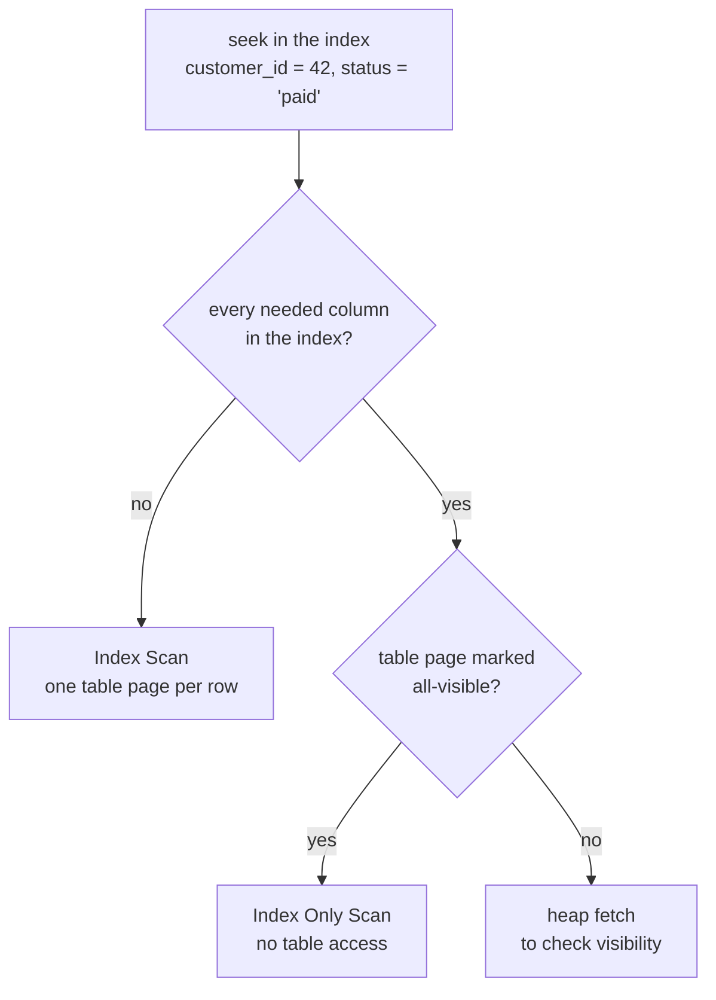

## Mental Model

A composite index on `(last_name, first_name)` is a **phone book**: sorted by last name, and within each last name by first name.

- Find everyone named "Sharma" → easy (contiguous block).
- Find "Sharma, Priya" → easy (a smaller block inside it).
- Find everyone named "Priya" (any last name) → the phone book is useless; Priyas are scattered across every last name.

That's the **leftmost-prefix rule**, and nearly every composite-index question reduces to it.

## Definition

- **Composite (multi-column) index**: index on an ordered list of columns `(a, b, c)`; entries sorted by a, then b, then c.
- **Leftmost prefix**: the index can be used to seek on `a`, `(a, b)` or `(a, b, c)` — not on `b` or `c` alone.
- **Covering index**: contains every column a query needs, so the query can be answered from the index alone.
- **Index-only scan**: a plan that reads only index pages (plus visibility checks) and never fetches table rows.
- **INCLUDE columns** (PostgreSQL 11+, SQL Server): non-key payload columns stored in leaf entries only — for covering without affecting sort order.

## Why It Exists

**The problem.** Real queries filter and sort on several columns: "orders of customer 42 with status 'paid', newest first". Separate single-column indexes can each narrow one condition; a composite index matching the query can jump **directly to the exact contiguous range, already in the requested order**, and stop after `LIMIT` rows.

**The idea.** Sort the index by several columns at once, in the order the query narrows things down. Then the rows a query wants sit next to each other, already in the order it wants them. Put the remaining columns it needs in the index too, and it never has to visit the table at all.

:::callout[That's all it is]{type=insight}
A composite index is sorted by its first column, then the second within that, and so on — so it can only jump using a leftmost prefix. Put equality columns first and the range or sort column after. Add the other needed columns and the table is never touched.
:::

## How It Works

### What `(customer_id, status, order_date)` can serve

Entries are sorted like this:

```text
(41, paid,    2024-05-01)
(42, cancelled, 2024-01-09)
(42, paid,    2024-02-11)
(42, paid,    2024-03-02)   ← customer 42, paid: contiguous and ordered by date
(42, paid,    2024-06-30)
(42, pending, 2024-07-01)
(43, paid,    2023-12-24)
```

| Query | Index use |
|---|---|
| `WHERE customer_id = 42` | ✔ seek on prefix `a` |
| `WHERE customer_id = 42 AND status = 'paid'` | ✔ seek on `(a, b)` |
| `WHERE customer_id = 42 AND status = 'paid' AND order_date >= '2024-03-01'` | ✔ seek on all three |
| `WHERE customer_id = 42 AND status = 'paid' ORDER BY order_date DESC LIMIT 5` | ✔ seek + read backwards, stop after 5 — **no sort** |
| `WHERE status = 'paid'` | ✘ not a leftmost prefix (full index scan at best) |
| `WHERE customer_id = 42 AND order_date >= '2024-03-01'` | partial: seek on `a`; `order_date` checked while scanning all of 42's entries (status is skipped) |
| `WHERE customer_id > 40 AND status = 'paid'` | partial: range on `a`, then `status` only filters within the range |

### Equality first, range last

Why the order matters: within one value of the first column, the second column is sorted; across a *range* of the first column, it isn't. Look at the entries above for `customer_id > 40 AND status = 'paid'`:

```text
(41, paid, …)       ← paid
(42, cancelled, …)
(42, paid, …)       ← paid
(42, paid, …)       ← paid
(42, pending, …)
(43, paid, …)       ← paid
```

The paid entries are scattered through the range, because status is only sorted *within* each customer. So the database must read the whole `customer_id > 40` range and check status on every entry. Once a column is used with a **range** (`>`, `<`, `BETWEEN`, `LIKE 'x%'`), later columns can't narrow the seek. So order columns:

1. Columns tested with **equality** (most selective first is a common tiebreaker, but equality-vs-range matters far more),
2. then the **range** or **sort** column,
3. then any columns only needed for covering (or put them in `INCLUDE`).

For `WHERE tenant_id = ? AND created_at >= ? ORDER BY created_at` → `(tenant_id, created_at)`. Reversing it to `(created_at, tenant_id)` would scan every tenant's rows in the time range.

### Sorting for free

An index returns rows in key order, so `ORDER BY` matching the index (after equality-bound prefix columns) needs no Sort node. Direction matters for mixed orders: `ORDER BY a ASC, b DESC` needs an index on `(a ASC, b DESC)` (or the reverse of both), not `(a, b)`.

### Covering and index-only scans

The remaining cost after a perfect seek is fetching each row from the table — one random read per row. If the index already holds every column the query asks for, that step disappears.

```sql
-- Query needs customer_id, order_date, total
SELECT order_date, total FROM orders
WHERE customer_id = 42 ORDER BY order_date DESC LIMIT 20;

CREATE INDEX orders_cust_date_cov ON orders (customer_id, order_date DESC) INCLUDE (total);
```

All required columns are in the index → **Index Only Scan**: no table page fetches at all. For a customer with 20 rows spread over 20 table pages, that's 20 fewer random reads.

What happens after the seek, in one picture:



## Internal Mechanism

:::depth{level=advanced}
### Index-only scans and the visibility map (PostgreSQL)

Index entries carry no MVCC visibility info. To return a row from the index alone, PostgreSQL checks the **visibility map**. If the row's heap page is marked all-visible (every tuple on it is visible to all transactions), the heap fetch is skipped. Otherwise it must visit the heap anyway. `EXPLAIN ANALYZE` reports `Heap Fetches: N`. Tables with heavy churn and lagging VACUUM get little benefit from covering indexes until vacuum sets the bits ([MVCC](lesson:db-mvcc)).

InnoDB secondary indexes contain the primary key, so any index is automatically "covering" for queries needing only indexed columns plus the PK.

### Skip scan

Some engines (Oracle, MySQL 8.0.13+, PostgreSQL 18) can use `(a, b)` for `WHERE b = ?` when `a` has few distinct values, by jumping to each distinct `a` and seeking `b` within it — effectively many small seeks. Useful, but not a reason to ignore the leftmost-prefix rule in design.

### Composite vs multiple single-column indexes

With separate indexes on `a` and `b`, a query `WHERE a = ? AND b = ?` can combine them with a **BitmapAnd** — reading two index ranges and intersecting row locations. Better than one index alone, clearly worse than one composite index that seeks the exact entries (and it can't provide order).
:::

## Example

Keyset pagination for "my orders, newest first":

```sql
CREATE INDEX ON orders (customer_id, order_date DESC, id DESC);

-- page 1
SELECT id, order_date, total FROM orders
WHERE customer_id = $1
ORDER BY order_date DESC, id DESC
LIMIT 20;

-- next page: continue after the last row seen
SELECT id, order_date, total FROM orders
WHERE customer_id = $1
  AND (order_date, id) < ($last_date, $last_id)
ORDER BY order_date DESC, id DESC
LIMIT 20;
```

Each page is an index seek plus 20 entries — constant cost at any depth, unlike `OFFSET` ([SELECT Basics](lesson:sql-select-basics)). Compare the plans in the [Query Plan lab](lab:query-plan).

## Complexity & Performance

- Seek on a full prefix + read k entries: O(log n + k).
- Range on a leading column followed by filters on later columns: reads the whole range, filtering — cost proportional to the range, not the result.
- Wider composite indexes = larger index, lower fanout, more to maintain on writes.

## Trade-offs

- One well-ordered composite index can serve several queries (all its leftmost prefixes) — but only those.
- Covering indexes save table reads but duplicate data and increase write cost; use `INCLUDE` for payload columns and cover only hot queries.
- Column order serving one query's range may hurt another's; sometimes two indexes are justified.

## Failure Modes

- **Wrong column order** (range column first) → index used, but scanning far more entries than needed; looks "indexed" yet slow.
- **Redundant indexes**: `(a)` alongside `(a, b)` — the composite already serves `a` alone (unless `(a)` is unique or much smaller and hot).
- **Mixed sort directions** not matching the index → extra Sort node.
- **Covering index with lots of heap fetches** on a table vacuum can't keep all-visible.

## In Production

- Design composite indexes from the actual query patterns (e.g., from `pg_stat_statements`), not from the table's columns.
- In multi-tenant schemas, `tenant_id` leads nearly every composite index ([Schema Design](lesson:db-schema-design)).

## Deeper Connections

- Keyset pagination and top-N queries depend on sort-providing indexes ([Window Functions](lesson:sql-window-functions) top-N).
- Merge joins and GroupAggregate also benefit when an index provides order ([Scans & Joins](lesson:db-scans-joins)).

## Common Misconceptions

- **"An index on (a, b) works for any query mentioning a or b."** Only for queries constraining a leading prefix.
- **"Put the most selective column first, always."** Equality vs range and sort requirements matter more than raw selectivity.
- **"Index-only scans never touch the table."** In PostgreSQL they do for pages not marked all-visible.

## Interview Questions

### [L2 · how] What is the leftmost-prefix rule?

A composite index on (a, b, c) is sorted by a, then b, then c, so it can locate rows by a, by (a, b) or by (a, b, c) — any leftmost prefix. It can't seek on b or c alone, because those values are scattered across all values of a. Once a column is used with a range, columns after it can only filter, not narrow the seek.

### [L2 · design] Queries: `WHERE user_id = ? AND created_at > ? ORDER BY created_at` and `WHERE user_id = ?`. What index?

`(user_id, created_at)`. The first query seeks on user_id, range-scans created_at in order (no sort); the second uses the leftmost prefix user_id. The reverse order `(created_at, user_id)` would scan all users' rows in the time range.

### [L2 · conceptual] What is a covering index and why is it faster?

An index containing every column a query reads (in the key or as INCLUDE columns), so the database answers it from the index without fetching table rows — an index-only scan. It saves one random table read per result row. In PostgreSQL the benefit depends on the visibility map (pages must be all-visible).

### [L3 · debugging] EXPLAIN shows `Index Scan using idx_orders_date_status` for `WHERE status = 'pending' AND order_date >= now() - interval '7 days'`, yet it reads 2 million index entries to return 300 rows. Why, and what's the fix?

The index is `(order_date, status)`: the range on the leading column means every entry from the last 7 days is scanned and status is only a filter. Reorder to `(status, order_date)` so the seek goes straight to pending orders in the date range — or, if 'pending' is a small subset, a partial index `ON orders (order_date) WHERE status = 'pending'`.

### [L2 · compare] One composite index on (a, b) or two single-column indexes on a and b?

For `WHERE a = ? AND b = ?` the composite index seeks straight to the matching entries, can return them in b order and can cover the query. Two separate indexes force the planner to pick one and filter, or to combine both with a BitmapAnd — reading two index ranges and intersecting row locations, with no ordering. Keep separate indexes only when queries genuinely filter on a or b alone, and remember `(a, b)` already serves queries on `a` alone.

### [L2 · how] What does `INCLUDE` add over putting the column in the key?

`CREATE INDEX … (customer_id, created_at) INCLUDE (total)` stores `total` only in leaf entries: the index can answer queries needing `total` without visiting the table (index-only scan), but `total` isn't part of the sort order, doesn't widen internal pages, and isn't counted for uniqueness — so a `UNIQUE (email) INCLUDE (name)` index enforces uniqueness on email alone. Use it for payload columns you return but never filter or sort by.

### [L2 · design] For `WHERE status = ? AND created_at >= ? ORDER BY created_at` would you index (status, created_at) or (created_at, status)?

`(status, created_at)`: the equality column first narrows the index to one contiguous block for that status, already sorted by `created_at`, so the range and the ORDER BY are both served and the scan can stop at the LIMIT. `(created_at, status)` must scan every status within the date range and check `status` on each entry — reading far more entries.

## Practice

### [mcq] Index on (country, city, zip). Which query can seek on all indexed columns it filters?

- [ ] `WHERE city = 'Pune' AND zip = '411001'`
- [x] `WHERE country = 'IN' AND city = 'Pune'`
- [ ] `WHERE zip = '411001'`
- [ ] `WHERE country > 'A' AND city = 'Pune'`

Only (country, city) is a leftmost prefix with equality on both; the last option has a range on the leading column.

### [mcq] Best index for `SELECT id FROM tickets WHERE assignee_id = ? AND status = 'open' ORDER BY priority DESC LIMIT 10`?

- [ ] (priority, assignee_id, status)
- [x] (assignee_id, status, priority DESC)
- [ ] (status) and (assignee_id) separately
- [ ] (assignee_id, priority, status)

Equality columns first, then the sort column: the scan reads exactly the first 10 matching entries in order. (id is in every index in InnoDB; in PostgreSQL add INCLUDE (id) for an index-only scan.)

### [numeric 1 unit=columns] With an index on (a, b, c), a query has `WHERE a = 1 AND c = 3`. How many of its conditions can narrow the index seek (the range of leaf entries visited)?

:::answer
Only the leading column: **1**. Without a condition on b, the entries with a = 1 are ordered by b first, so c = 3 is scattered across that whole range; it can still be checked inside the index while scanning a = 1 (avoiding heap visits), but it doesn't shrink the range. An index on (a, c) — or (a, c, b) — would seek on both.
:::

### [exercise] Design one index for `SELECT order_date, total FROM orders WHERE customer_id = $1 AND status = 'paid' ORDER BY order_date DESC LIMIT 20` that avoids a sort and, ideally, heap visits.

:::solution
```sql
CREATE INDEX ON orders (customer_id, status, order_date DESC) INCLUDE (total);
```

Equality columns first (customer_id, status), then the ORDER BY column: within one (customer, status) the entries are already in order_date order, so the database reads the first 20 and stops — no sort, no full fetch. `INCLUDE (total)` stores the remaining selected column in the leaves so the query can be an index-only scan. (A plain B+ tree can also be read backwards, so `order_date` without DESC works for this query too.)
:::

### [mcq] EXPLAIN shows `Index Only Scan … Heap Fetches: 48000` for a query returning 50,000 rows. What is the most likely reason?

- [ ] The index is corrupted
- [x] Most of the table's pages aren't marked all-visible in the visibility map, so PostgreSQL must check the heap for row visibility
- [ ] Index-only scans always visit the heap
- [ ] The query selects a column that isn't in the index

An index-only scan skips the heap only for pages the visibility map marks all-visible; VACUUM sets those bits. On a recently bulk-loaded or heavily updated table, run VACUUM (or tune autovacuum) and the heap fetches drop.

### [mcq] Which index best serves `WHERE status = 'open' AND created_at > now() - interval '1 day'`?

- [ ] (created_at, status)
- [x] (status, created_at)
- [ ] Two separate indexes, (status) and (created_at), always
- [ ] (created_at) only

Equality first, range last: with status leading, all 'open' entries are contiguous and sorted by created_at, so the seek covers exactly the matching rows. With created_at first, the scan covers every status in the last day and filters.

## Quick Revision

- Composite index = phone book sorted by (a, b, c). Seeks only on leftmost prefixes.
- Order columns: equality → range/sort → covering (or INCLUDE).
- Matching ORDER BY (and direction) avoids sorts; LIMIT stops early.
- Covering → index-only scan (PostgreSQL checks the visibility map; heap fetches when not all-visible).
- (a) is redundant next to (a, b) in most cases; a range on a leading column turns later columns into filters.
- One composite (a, b) beats two single-column indexes for `a = ? AND b = ?`; `INCLUDE` adds payload for index-only scans without changing order or uniqueness.
