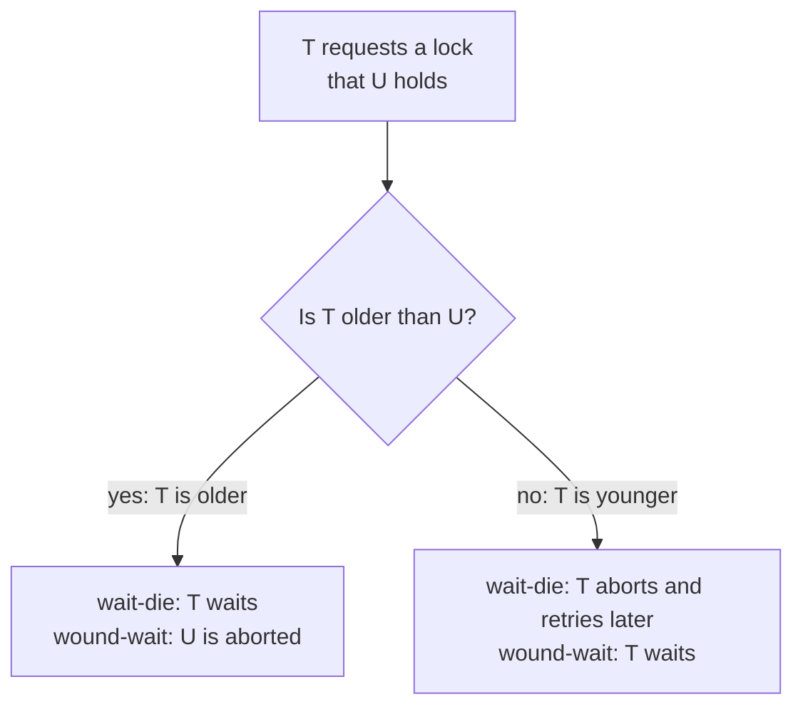

## Mental Model

The previous lesson says a schedule is safe if its precedence graph has no cycle. A protocol has to keep it that way **while operations arrive**, without knowing what each transaction will do next. There are only three basic strategies:

1. **Make conflicting transactions wait** (locking). Edges point from lock holder to waiter, and holding locks long enough prevents them from ever closing a loop.
2. **Order transactions by birth time and reject latecomers** (timestamp ordering). Edges may only point from older to younger; an operation that would point the other way is refused and its transaction restarted.
3. **Let everyone run, check at the end** (validation / optimistic). A transaction commits only if nothing it read was changed underneath it.

Waiting risks deadlock; refusing and checking risk wasted work. Every protocol below is one of these three, tuned.

## Why It Exists

**The problem.** Serializability theory tells you which schedules are correct after the fact. The database has to produce only correct ones *online*, one operation at a time, at high concurrency.

**Without it.** You'd either run transactions serially (correct, slow) or interleave them freely and hope (fast, wrong — lost updates, write skew).

**The idea.** Choose a simple local rule that can be checked on every operation: "you need the lock", "you're too old for this item", or "your read set was overwritten". Prove that obeying the rule makes cycles impossible. Then handle the side effect each rule creates: deadlocks for waiting, restarts and starvation for refusing.

:::callout[That's all it is]{type=insight}
2PL: take locks as you go, release none until you've taken them all — and in practice hold them until commit. Timestamp ordering: older transactions win; a younger one that arrives "too late" restarts. Validation: run freely, and at commit check whether anyone changed what you read.
:::

## Definition

- **Two-phase locking (2PL)**: a transaction acquires locks in a **growing phase** and releases them in a **shrinking phase**; once it releases any lock, it acquires no more. Guarantees conflict serializability.
- **Conservative (static) 2PL**: acquire **all** needed locks before the transaction starts (or none and retry). Deadlock-free, but requires knowing the read/write set in advance.
- **Strict 2PL**: hold all **exclusive** locks until commit/abort. Produces strict (cascadeless, recoverable) schedules — what databases use.
- **Rigorous 2PL**: hold **all** locks (shared too) until commit. Transactions serialize in commit order.
- **Lock conversion**: upgrade S → X (only in the growing phase); downgrade X → S (only in the shrinking phase).
- **Multiple granularity locking**: lock a hierarchy (database → table → page → row) with **intention** modes IS, IX and SIX on ancestors.
- **Timestamp ordering (TO)**: each transaction gets a timestamp TS(T) at start, and each item X keeps read_TS(X) and write_TS(X). Conflicting operations must occur in timestamp order, or the transaction is aborted and restarted.
- **Thomas's write rule**: a modification of TO that **ignores** an obsolete write instead of aborting.
- **Validation-based protocol** (optimistic concurrency control): read phase → validation phase → write phase.
- **Wait-die / wound-wait**: timestamp-based deadlock *prevention* rules for lock waits.

## How It Works

### The 2PL family

A transaction's **lock point** is the moment it holds its last new lock. Basic 2PL may start releasing right after it; the practical variants move the releases to commit:

| Variant | Rule | Serializable | Deadlock-free | Cascadeless | Used by |
|---|---|---|---|---|---|
| Basic 2PL | no lock after the first unlock | ✓ | ✗ | ✗ (others may read X after early unlock, then T aborts) | theory |
| Conservative 2PL | lock everything up front | ✓ | ✓ | depends on release | batch systems with known sets |
| **Strict 2PL** | X locks held to commit | ✓ | ✗ | ✓ | most lock-based databases |
| Rigorous 2PL | all locks held to commit | ✓ (in commit order) | ✗ | ✓ | lock-based Serializable levels |

Why basic 2PL serializes: every transaction has a **lock point**, the moment it holds its final lock. If T1 → T2 is an edge, T2 had to wait until T1 released a lock, and T1 releases only after its lock point. So every edge goes from an earlier lock point to a later one. A cycle would need a transaction whose lock point comes before its own, which is impossible.

**Lock conversion and the upgrade deadlock.** Two transactions read the same row with S locks, then both try to upgrade to X to update it. Each waits for the other's S lock: a deadlock that has nothing to do with lock order. Remedies: take the write lock up front (`SELECT … FOR UPDATE`), or use an **update (U) lock** mode that is compatible with S but not with other U locks (SQL Server).

### Multiple granularity and intention locks

Locking a whole table is cheap but blocks everyone; locking a million rows is precise but expensive. A hierarchy allows both, if a table lock can see that someone holds row locks inside it — that's what **intention** locks announce.

| Requested ↓ / Held → | IS | IX | S | SIX | X |
|---|---|---|---|---|---|
| **IS** | ✓ | ✓ | ✓ | ✓ | ✗ |
| **IX** | ✓ | ✓ | ✗ | ✗ | ✗ |
| **S** | ✓ | ✗ | ✓ | ✗ | ✗ |
| **SIX** | ✓ | ✗ | ✗ | ✗ | ✗ |
| **X** | ✗ | ✗ | ✗ | ✗ | ✗ |

- **IS**: "I'll take S locks somewhere below." **IX**: "I'll take X locks below."
- **SIX**: S on this whole node, plus IX. It means "read everything, update a few", as in a full scan that modifies some rows.
- Rules: to lock a node in S or IS, hold IS or IX on its parent. To lock it in X, IX or SIX, hold IX or SIX on its parent. Acquire root-to-leaf, release leaf-to-root.
- So a transaction updating row 42 holds IX on the table and X on the row. Another transaction wanting S on the whole table sees the IX and waits, with no row scan needed. InnoDB uses exactly this (table IS/IX plus row locks); SQL Server additionally escalates many row locks to one table lock ([Locking](lesson:db-locking)).

### Timestamp ordering

Each transaction T gets TS(T) when it starts (older = smaller). Each item X remembers the largest timestamps that read and wrote it.

| T wants to | Check | Outcome |
|---|---|---|
| **read X** | TS(T) < write_TS(X)? — a younger transaction already overwrote X | **abort and restart T** (with a new timestamp) |
| | otherwise | read; read_TS(X) = max(read_TS(X), TS(T)) |
| **write X** | TS(T) < read_TS(X)? — a younger transaction already read the old value | **abort and restart T** |
| | TS(T) < write_TS(X)? — a younger transaction already wrote X | basic TO: **abort**; Thomas's write rule: **skip the write** |
| | otherwise | write; write_TS(X) = TS(T) |

Every edge in the precedence graph now goes from an older to a younger timestamp, so cycles are impossible: the schedule is conflict serializable in timestamp order. Nobody waits, so there are **no deadlocks**. The costs show up elsewhere:

- transactions restart instead of waiting, and a long transaction can be restarted again and again (**starvation**);
- basic TO allows reading uncommitted values, so practical versions add commit bits or delay reads until the writer commits (strict TO).

**Thomas's write rule.** Suppose T1 (older) wants to write X after T2 (younger) already wrote it, and nobody younger has read X since. In timestamp order T1 comes first, so T2's write would have overwritten T1's anyway: T1's write is obsolete. So skip it instead of aborting T1. The resulting schedules are **view** serializable but not always conflict serializable (blind writes, as in the previous lesson).

Step through both rules on your own schedules in the analyzer's **Timestamp ordering** tab: it shows R-TS and W-TS for every item after each operation, and says which check failed.

::lab{id=schedules}

### Validation-based (optimistic) concurrency control

Each transaction runs in three phases:

1. **Read phase**: execute, reading from the database and writing only to a private workspace; record the read set and write set.
2. **Validation phase**: check that committing won't break serializability.
3. **Write phase**: if validation passes, apply the private writes; otherwise discard them and restart.

Transactions are ordered by their validation time. For Tj to validate against every earlier-validated Ti, one of these must hold:

- Ti finished its write phase before Tj started its read phase (no overlap at all); or
- Ti finished its write phase before Tj starts validating, and Ti's write set doesn't intersect Tj's **read** set; or
- Ti finished its read phase before Tj finished its read phase, and Ti's write set intersects neither Tj's read set nor Tj's write set.

Cheap when conflicts are rare (no locks, no waits); wasteful under contention because whole transactions are redone. Version-column updates in applications and SSI-style commit checks are this idea in practice ([Optimistic vs Pessimistic](lesson:db-optimistic-pessimistic)).

### Deadlock prevention with timestamps

Lock-based protocols can deadlock. Besides detection (find a cycle in the wait-for graph and abort a victim), two classic **prevention** schemes use transaction age. Suppose T requests a lock held by U:

| Scheme | T older than U | T younger than U |
|---|---|---|
| **Wait-die** (non-preemptive) | T **waits** | T **dies** (aborts, restarts later with its **original** timestamp) |
| **Wound-wait** (preemptive) | T **wounds** U (U aborts) | T **waits** |

In both, waits only ever go in one age direction, so the wait-for graph can't have a cycle. Keeping the original timestamp on restart means a transaction eventually becomes the oldest and can't starve. Wound-wait tends to restart fewer transactions (an old transaction is rarely blocked for long); Google Spanner uses it.

Both prevention rules in one picture. Waits only ever point one way by age, so no cycle can form:



## Internal Mechanism

:::depth{level=advanced}
### What production databases actually use

- **PostgreSQL**: MVCC for reads; row locks (stored in tuple headers) for writers; table-level lock modes with a conflict matrix; deadlock *detection*; SSI for Serializable. No timestamp ordering.
- **MySQL InnoDB**: MVCC consistent reads; strict 2PL with record, gap and next-key locks for writes and locking reads; intention locks at table level; immediate deadlock detection.
- **SQL Server**: lock-based by default (rigorous 2PL at Serializable with key-range locks), optional row versioning (READ_COMMITTED_SNAPSHOT, SNAPSHOT); lock escalation; U locks.
- **Distributed SQL**: timestamp-ordered MVCC with commit-time validation (CockroachDB) or 2PL with wound-wait (Spanner) ([Distributed SQL](lesson:db-distributed-sql)).

The textbook protocols survive as building blocks: MVCC plus timestamp ordering is "multiversion timestamp ordering"; SSI is validation over rw-dependencies.

### The same protocols in Java's locks

Java's standard locks are these protocols on a single object, and they have the same failure modes:

- `ReentrantReadWriteLock` gives shared and exclusive locks. A thread may downgrade (take the read lock while holding the write lock) but never upgrade. A thread that holds the read lock and asks for the write lock waits for all readers to leave, including itself, so it waits forever. That is the S→X conversion deadlock with a single participant.
- `StampedLock.tryOptimisticRead()` and `validate(stamp)` are validation-based control: read without locking, then check that no writer got in meanwhile, and fall back to a real lock if one did. `tryConvertToWriteLock(stamp)` is lock conversion that fails instead of deadlocking.

```java
final class Account {
    private final StampedLock lock = new StampedLock();
    private long balance;

    long balance() {
        long stamp = lock.tryOptimisticRead();     // read phase: no lock taken
        long seen = balance;
        if (!lock.validate(stamp)) {               // validation: did a writer get in?
            stamp = lock.readLock();               // conflict: fall back to a shared lock
            try { seen = balance; } finally { lock.unlockRead(stamp); }
        }
        return seen;
    }

    void deposit(long amount) {
        long stamp = lock.writeLock();             // exclusive, like an X lock
        try { balance += amount; } finally { lock.unlockWrite(stamp); }
    }
}
```

Optimistic reads win when writes are rare, exactly as for transactions: under frequent writes, validation keeps failing and every read pays twice.

### Multiversion timestamp ordering

Keep several versions of X, each with the writer's timestamp. A read by T returns the version with the largest write timestamp ≤ TS(T) — reads never abort. A write by T is rejected only if some younger transaction already read a version older than T's write would be. This is how snapshot-based systems avoid TO's read aborts.
:::

## Example

Timestamp ordering with TS(T1) = 5, TS(T2) = 10, item X initially read_TS = write_TS = 0:

```text
1. T2 reads X      → TS 10 ≥ write_TS 0 → OK, read_TS(X) = 10
2. T1 writes X     → TS 5 < read_TS 10  → a younger transaction read the old X → ABORT T1, restart as T1' (TS 11)
3. T2 writes X     → TS 10 ≥ read_TS 10 and ≥ write_TS 0 → OK, write_TS(X) = 10
4. T1' writes X    → TS 11 ≥ read_TS 10 and ≥ write_TS 10 → OK, write_TS(X) = 11
```

Under strict 2PL the same operations would make T1 **wait** for T2's lock instead of restarting. Same goal — no cycle — different cost.

## Complexity & Performance

| | Strict 2PL | Timestamp ordering | Validation (OCC) |
|---|---|---|---|
| Conflict handling | wait | abort & restart | abort & restart at commit |
| Deadlocks | possible (detect or prevent) | none | none |
| Starvation | possible with unfair queues | possible (restarts) | possible under contention |
| Overhead | lock table / lock bits | read_TS/write_TS per item | read and write sets |
| Best when | contention is moderate to high | conflicts rare, short transactions | conflicts rare, read-mostly |

## Trade-offs

- Waiting (locks) wastes time; restarting (TO, OCC) wastes work. Under high contention restarts snowball, so locking wins; under low contention locking's bookkeeping is wasted, so optimistic wins.
- Conservative 2PL removes deadlocks at the price of knowing your lock set in advance and holding locks longer.
- Coarse locks are cheap but block more; intention locks let you mix coarse and fine.

## Failure Modes

- **Upgrade deadlocks** from read-then-write on the same rows with shared locks.
- **Starvation** of long transactions under TO or OCC, restarted again and again by short ones.
- **Lock escalation** turning many row locks into a table lock and blocking unrelated work (SQL Server).
- **Retry storms** when an optimistic scheme meets a hot row.

## In Production

- Prefer patterns that avoid conflicts altogether: atomic single-statement updates, consistent lock order, short transactions.
- Use `SELECT … FOR UPDATE` (or `FOR NO KEY UPDATE`) when you will update what you read, to skip the S→X upgrade.
- Always wrap serializable or optimistic transactions in a retry loop ([Isolation Levels](lesson:db-isolation-levels)).

## Deeper Connections

- Wait-die and wound-wait are the database version of breaking the circular-wait condition ([Deadlock Handling](lesson:os-deadlock-handling)).
- Optimistic validation is compare-and-swap at transaction scale ([Atomic Instructions](lesson:os-atomic-instructions)).
- MVCC replaces read locks with versions; multiversion TO is its timestamp-ordering form ([MVCC](lesson:db-mvcc)).

## Common Misconceptions

- **"2PL means locking in two steps."** It means two *phases*: acquire-only, then release-only.
- **"2PL prevents deadlocks."** Basic and strict 2PL can deadlock; only conservative 2PL (or a prevention scheme) avoids them.
- **"Timestamp ordering makes transactions wait for older ones."** It never waits — it aborts the transaction that arrived too late.

## Interview Questions

### [L1 · conceptual] What is two-phase locking, and why does it guarantee serializability?

A transaction acquires locks during a growing phase and releases them during a shrinking phase, never acquiring a lock after releasing one. Each transaction then has a lock point (when it holds all its locks), and any conflict edge Ti → Tj means Tj waited for a lock Ti released after its lock point — so edges follow lock-point order and can't form a cycle. That makes every 2PL schedule conflict serializable.

### [L2 · compare] Basic vs conservative vs strict vs rigorous 2PL?

Basic 2PL only forbids acquiring after releasing; it can deadlock and allows cascading aborts if locks are released before commit. Conservative 2PL takes every lock before starting — deadlock-free but requires knowing the access set in advance. Strict 2PL holds exclusive locks until commit, producing strict, cascadeless schedules — the common choice. Rigorous 2PL holds all locks until commit, so the serialization order equals the commit order.

### [L2 · how] What are intention locks (IS, IX, SIX) and why are they needed?

In a lock hierarchy (database → table → page → row), a transaction that wants a table-level lock must know whether anyone holds locks on rows inside it. Intention locks on the ancestors announce that: IS = "S locks below", IX = "X locks below", SIX = "S on the whole node plus X on some descendants". A table S request conflicts with IX, so it waits without scanning row locks. Locks are acquired root-to-leaf and released leaf-to-root.

### [L2 · how] Explain the timestamp ordering protocol's read and write rules.

Each transaction has a start timestamp; each item stores read_TS and write_TS. A read by T is rejected (T restarts) if TS(T) < write_TS(X) — a younger transaction already overwrote X; otherwise it proceeds and raises read_TS. A write is rejected if TS(T) < read_TS(X) (a younger transaction read the old value) or TS(T) < write_TS(X) (a younger one already wrote it); otherwise it sets write_TS. Conflicts always follow timestamp order, so schedules are serializable and nobody waits — no deadlocks, but restarts and possible starvation.

### [L2 · conceptual] What is Thomas's write rule?

In timestamp ordering, when an older transaction tries to write X after a younger one already wrote it (and no younger transaction read X in between), the older write would be overwritten in the serial timestamp order anyway — so it's ignored instead of aborting the transaction. It reduces aborts and produces schedules that are view serializable but not necessarily conflict serializable.

### [L2 · compare] Wait-die vs wound-wait?

Both use transaction timestamps to prevent deadlock. Wait-die is non-preemptive: an older requester waits for a younger holder; a younger requester dies (aborts and retries with its original timestamp). Wound-wait is preemptive: an older requester wounds (aborts) the younger holder; a younger requester waits. Waits go only one way by age, so there are no cycles, and keeping original timestamps prevents starvation.

### [L2 · how] Describe the validation-based (optimistic) protocol.

Three phases: a read phase that executes the transaction against private copies while recording read and write sets; a validation phase that checks it against transactions that validated earlier (no overlap, or no earlier write set intersecting its read set); and a write phase that installs the changes if validation succeeds. It avoids locks and waiting, but a failed validation discards the whole transaction — good for low-conflict, read-mostly workloads.

### [L3 · scenario] Two transactions each read a row with a shared lock and then try to update it. They deadlock. Why, and how do you avoid it?

Both hold S on the row; each upgrade to X must wait for the other's S lock to be released, which never happens — a conversion deadlock, independent of lock ordering. Avoid it by taking the exclusive lock at read time (`SELECT … FOR UPDATE`), by using an update-lock mode where available (SQL Server's U lock is compatible with S but not with another U), or by replacing read-then-write with a single atomic UPDATE.

### [L2 · compare] Where do these protocols show up in Java's own concurrency tools?

`ReentrantReadWriteLock` is shared/exclusive locking on one object, and it shows the upgrade problem directly: it allows downgrading a write lock to a read lock but not upgrading, because a reader asking for the write lock would wait for itself. `StampedLock`'s optimistic read is a validation protocol: read without a lock, `validate` the stamp, and fall back to a read lock if a writer interfered. `tryConvertToWriteLock` is conversion that fails instead of deadlocking. A version field checked with `compareAndSet` (or JPA's `@Version`) is optimistic validation at the level of one object or row.

## Practice

### [mcq] TS(T1) = 5, TS(T2) = 10. T2 reads X, then T1 tries to write X. Under basic timestamp ordering…

- [ ] T1's write succeeds and write_TS(X) becomes 5
- [x] T1 is aborted and restarted with a new timestamp
- [ ] T1 waits for T2 to commit
- [ ] T2 is aborted

A younger transaction (TS 10) already read X, so T1's older write would invalidate that read: TS(T1) < read_TS(X) → abort T1.

### [mcq] Under wound-wait, a younger transaction requests a lock held by an older one. What happens?

- [ ] The older transaction is aborted
- [x] The younger transaction waits
- [ ] The younger transaction is aborted
- [ ] Both are aborted

Wound-wait: older wounds younger; younger waits for older.

### [mcq] A transaction holds IX on a table. Which request by another transaction on the same table is granted?

- [x] IS
- [ ] S
- [ ] SIX
- [ ] X

IX is compatible only with IS and IX.

### [mcq] Which 2PL variant is free of deadlocks?

- [ ] Basic 2PL
- [ ] Strict 2PL
- [ ] Rigorous 2PL
- [x] Conservative 2PL

Acquiring every lock before starting (or none) means a transaction never waits while holding locks.

### [exercise] Apply basic timestamp ordering with TS(T1) = 1, TS(T2) = 2 to: `R1(X) R2(X) W2(X) W1(X)`. Which operation fails, and what happens? Would Thomas's write rule change the outcome? Check both answers in the [Schedule Analyzer](lab:schedules)'s timestamp-ordering tab, with TS(Ti) = i.

:::solution
1. R1(X): TS 1 ≥ write_TS 0 → OK, read_TS(X) = 1.
2. R2(X): OK, read_TS(X) = 2.
3. W2(X): TS 2 ≥ read_TS 2 and ≥ write_TS 0 → OK, write_TS(X) = 2.
4. W1(X): TS 1 < read_TS(X) = 2 → a younger transaction already read X → **T1 aborts** and restarts.

Thomas's write rule doesn't help: it only skips writes that are obsolete because of a younger **write** with no younger read in between (TS(T) < write_TS but ≥ read_TS). Here the failing check is the read timestamp, so T1 still aborts.
:::

### [exercise] TS(T1) = 5 (older) and TS(T2) = 10. For each scheme — wait–die and wound–wait — say what happens when (a) T1 requests a lock held by T2, and (b) T2 requests a lock held by T1.

:::solution
| | (a) older T1 asks, younger T2 holds | (b) younger T2 asks, older T1 holds |
|---|---|---|
| **wait–die** | T1 waits | T2 dies (aborts, restarts later with timestamp 10) |
| **wound–wait** | T1 wounds T2: T2 aborts and releases the lock | T2 waits |

In both schemes waits only go one way by age (wait–die: older waits for younger; wound–wait: younger waits for older), so no cycle can form. Restarting with the original timestamp lets an aborted transaction eventually become the oldest, so it can't starve.
:::

### [exercise] Validation-based protocol: T1 validated first and finished its write phase after T2 started reading but before T2 validates. T1's write set is {A}. T2's read set is {A, B} and its write set is {C}. Does T2 pass validation? What if T1's write set were {D}?

:::solution
The phases overlap, so the first condition (T1 finished writing before T2 started reading) doesn't apply. The second condition requires T1's write set to be disjoint from T2's **read** set: {A} ∩ {A, B} = {A}, so it fails — T2 may have read A before T1 wrote it, so T2 **fails validation** and restarts.

With T1's write set {D}: {D} ∩ {A, B} = ∅, and T1 finished writing before T2 validates, so T2 **passes** and enters its write phase.
:::

### [mcq] A thread holds a `ReentrantReadWriteLock`'s read lock and calls `writeLock().lock()`. Which protocol problem is this, and what happens?

- [ ] Nothing: the lock upgrades automatically, as S→X conversion allows
- [x] A conversion deadlock: the write lock waits for every reader to leave, including this thread, so it blocks forever
- [ ] The read lock is released and the write lock granted
- [ ] An `IllegalMonitorStateException` is thrown at once

`ReentrantReadWriteLock` supports downgrading only. Release the read lock first and re-check the state after taking the write lock, or use `StampedLock.tryConvertToWriteLock`, which returns 0 instead of blocking when it can't convert.

## Quick Revision

- Three strategies: wait (locking), order by timestamp and restart latecomers (TO), run then validate (OCC).
- 2PL = growing then shrinking → serializable. Conservative = all locks first (no deadlock). Strict = X locks to commit (cascadeless). Rigorous = all locks to commit.
- Intention locks: IS, IX, SIX on ancestors; IX compatible only with IS/IX; lock root→leaf, release leaf→root. Use FOR UPDATE / U locks to avoid S→X upgrade deadlocks.
- TO: read fails if TS < write_TS; write fails if TS < read_TS or TS < write_TS (Thomas: skip the latter). No deadlocks; restarts and starvation.
- OCC: read → validate → write. Wait-die (old waits, young dies) / wound-wait (old wounds, young waits); restart with the original timestamp.
- Java: `ReentrantReadWriteLock` can't upgrade (a reader asking for the write lock waits for itself); `StampedLock` optimistic read + `validate` = validation protocol; `tryConvertToWriteLock` = conversion that can fail.
