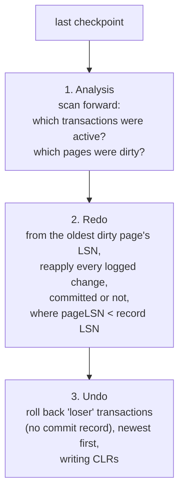

## Mental Model

After a crash, the data files are a **mixture**. Some committed changes never reached disk, because they were only in the buffer pool. And some uncommitted changes did, because a dirty page was evicted early. The WAL has the full story. Recovery reads the log and makes the files match exactly one rule:

> **Every committed transaction's effects are present; no uncommitted transaction's effects are visible.**

Redo brings back what committed work lost; undo (or invisibility) removes what uncommitted work left behind.

## Definition

- **Steal**: the buffer manager may write a page containing uncommitted changes to disk (to free a frame). ⇒ recovery needs **undo** information.
- **No-force**: commit doesn't force the transaction's pages to disk (only the log). ⇒ recovery needs **redo**.
- Steal + no-force is what fast databases use — and it's why the log must support both.
- **Checkpoint**: a log record + flushed state that bounds how far back redo must start.
- **LSN**: log sequence number; each page stores the LSN of the last applied change (`pageLSN`).
- **CLR (compensation log record)**: a log record describing an undo action, so undo itself is crash-safe.
- **RPO / RTO**: recovery point objective (how much data you can lose) / recovery time objective (how long recovery may take).

## Why It Exists

**The problem.** For speed, the buffer pool writes pages whenever it likes. So at the moment of a crash, the disk holds some changes that never committed, and lacks some that did.

**The simple alternative, and why it's rejected.** Forcing pages at commit and never stealing would make recovery trivial. But performance would be terrible: random writes at every commit, and a buffer pool stuck holding every uncommitted page.

**The idea.** Accept the messy disk, because the log knows exactly what happened. Logging lets databases write pages whenever convenient and still recover exactly: replay the log to put back everything (redo), then remove what belonged to transactions that never committed (undo).

:::callout[That's all it is]{type=insight}
After a crash: find where to start (analysis), replay every logged change so the disk matches the moment of the crash (redo), then roll back transactions that hadn't committed (undo). Page LSNs make replay safe to repeat.
:::

## How It Works

### ARIES: three passes

ARIES (IBM, 1992) is the classic algorithm, used in spirit by DB2, SQL Server and InnoDB.



1. **Analysis**: from the last checkpoint, rebuild the table of active transactions and dirty pages at crash time. Transactions without a commit/abort record are **losers**.
2. **Redo ("repeating history")**: reapply *all* logged changes — even losers' — to bring the database to its exact state at the crash. A change is applied only if the page's LSN is older than the record's LSN, so redo is **idempotent** (safe if we crash during recovery and start again).
3. **Undo**: roll back losers' changes in reverse order, logging each undo step as a CLR. If recovery crashes mid-undo, the CLRs record what has already been undone, so it isn't undone twice.

One crash, worked through. T1 commits; T2 doesn't; the buffer pool had stolen T2's page to disk but never wrote T1's:

```text
log:    LSN 10  T1  A: 100 → 50
        LSN 20  T2  B:   7 → 9
        LSN 30  T1  COMMIT
        ── crash ──
disk:   A = 100   (T1's committed change never reached the data file: no-force)
        B = 9     (T2's uncommitted change did: steal)

analysis:  T1 committed; T2 has no commit record → T2 is a loser
redo:      LSN 10 → A's page is older than 10 → set A = 50
           LSN 20 → B's page already has LSN 20 → skip (redo is idempotent)
undo:      T2 → set B back to 7, write a CLR, then T2's end record
result:    A = 50, B = 7 — exactly the committed state
```

### PostgreSQL: redo-only

PostgreSQL never needs a physical undo pass. Uncommitted changes are new tuple versions stamped with the loser's xid. Since that xid never committed, the versions are simply **invisible**, and are vacuumed later ([MVCC](lesson:db-mvcc)). Recovery = replay WAL from the last checkpoint's redo point to the end. InnoDB performs redo from its redo log, then rolls back uncommitted transactions using undo logs (in the background, so the server opens sooner).

### Where does the log end?

A crash can interrupt the write of the last log record, leaving a header without its payload, or a record half old bytes and half new. Recovery has to tell a complete record from a torn one. So every record carries its length and a checksum of its contents; PostgreSQL's WAL records carry a CRC-32C. Replay stops at the first record whose length or checksum doesn't check out, and that point *is* the end of the log. Nothing after it was acknowledged, because COMMIT returns only after its record is fully flushed. A reader for such a log, in Java:

```java
/** Reads [length][crc32c][payload] records, stopping at the first one a crash cut off or corrupted. */
static List<byte[]> readValidRecords(Path log) throws IOException {
    List<byte[]> records = new ArrayList<>();
    try (DataInputStream in = new DataInputStream(new BufferedInputStream(Files.newInputStream(log)))) {
        while (true) {
            int length;
            long crc;
            try {
                length = in.readInt();
                crc = in.readInt() & 0xFFFFFFFFL;
            } catch (EOFException end) {
                break;                                      // the end of the log, or a torn header
            }
            if (length < 0 || length > (16 << 20)) break;   // a garbage length: torn or corrupt
            byte[] payload = new byte[length];
            try {
                in.readFully(payload);
            } catch (EOFException torn) {
                break;                                      // the crash cut this record short
            }
            CRC32C check = new CRC32C();
            check.update(payload);
            if (check.getValue() != crc) break;             // half-written or damaged: the log ends here
            records.add(payload);
        }
    }
    return records;
}
```

PostgreSQL's own crash recovery reports the same steps in its log:

```text
LOG:  database system was interrupted; last known up at 2026-10-21 14:02:11 IST
LOG:  database system was not properly shut down; automatic recovery in progress
LOG:  redo starts at 0/4E2C6F0
LOG:  invalid record length at 0/5A1F2C8: expected at least 24, got 0
LOG:  redo done at 0/5A1F290 system usage: CPU: user: 1.21 s, system: 0.40 s, elapsed: 3.87 s
LOG:  checkpoint starting: end-of-recovery immediate wait
LOG:  database system is ready to accept connections
```

Redo starts at the last checkpoint's redo pointer and runs until the first invalid record, the expected end of the log. A checkpoint then makes the recovered state durable before connections are accepted. The elapsed time is the RTO of a crash, which is why it grows with the WAL written since the last checkpoint.

### Backups and point-in-time recovery

Recovery from a log needs the data files to still exist. Crash recovery handles "the process died"; it doesn't handle "the disk died" or "someone ran `DELETE FROM orders` without a WHERE". For that:

- **Base backup**: a physical copy of the data files (taken online; consistent when combined with the WAL generated during the copy).
- **WAL archive**: every WAL segment copied to durable storage (object storage).
- **PITR**: restore the base backup, replay archived WAL up to a target time/LSN/transaction — e.g., one second before the bad DELETE. On PostgreSQL 12+, the restored copy gets an empty `recovery.signal` file and settings like these:

  ```text
  restore_command = 'cp /mnt/wal_archive/%f %p'
  recovery_target_time = '2026-10-21 14:31:59+05:30'
  recovery_target_action = 'promote'
  ```
- **Logical backups** (`pg_dump`): portable SQL/data snapshots; slower to restore for big databases, no PITR.

### Shadow paging: recovery without a log

An older alternative: keep two page tables. The **current** page table points to pages the transaction modifies, which are written to **new** locations (copy-on-write); the **shadow** page table still points to the old versions. Commit = atomically switch a single pointer from the shadow table to the current one. Crash before the switch → the shadow table is still the truth; nothing to undo or redo.

Why it isn't used for general-purpose databases:

- data scatters across the disk (no clustering);
- every commit must write all modified pages plus the page table;
- old pages need garbage collection;
- concurrent transactions are hard to support.

The idea survives where those costs fit: LMDB's copy-on-write B+ tree, and copy-on-write filesystems such as ZFS and Btrfs ([Journaling](lesson:os-journaling)).

### Checkpoints in textbook recovery

With a simple log, a checkpoint record `<checkpoint L>` (L = transactions active at that moment) is written after flushing all modified buffers. On recovery, scan back to the last checkpoint:

- transactions that committed before it need nothing;
- transactions that committed after it are **redone**;
- transactions still active (in L or started later) with no commit record are **undone**.

ARIES refines this with fuzzy checkpoints and LSNs so the system doesn't stop to flush.

## Internal Mechanism

:::depth{level=advanced}
### Fuzzy checkpoints

Stopping all activity to flush everything would freeze the database. ARIES-style **fuzzy checkpoints** instead record the dirty page table and the active transaction table while activity continues. Redo then starts from the smallest recLSN among dirty pages (the oldest change not yet on disk), which may be earlier than the checkpoint record. PostgreSQL's checkpoint spreads page writes over time and records a redo pointer taken at its start.

### Why "repeat history" then undo?

Redoing losers' changes before undoing them seems wasteful. But it restores the exact state at the moment of the crash, which has three benefits:

- page-level (physiological) undo records stay valid;
- fine-grained locking and logical undo work;
- redo stays simple, because it doesn't need to know which transactions committed.

### Recovery time

RTO ≈ time to replay WAL since the redo point: proportional to WAL volume between checkpoints. `checkpoint_timeout`/`max_wal_size` bound it; heavy write workloads with rare checkpoints can take many minutes to recover. HA setups avoid waiting for crash recovery by failing over to a replica that's already caught up ([Failover](lesson:db-failover)).
:::

## Example

Log after the last checkpoint (P = page, values in brackets):

```text
LSN 10  T1 update P1  [a: 1 → 2]
LSN 20  T2 update P2  [b: 5 → 6]
LSN 30  T1 COMMIT
LSN 40  T2 update P1  [c: 7 → 8]
LSN 50  T3 update P3  [d: 0 → 9]
LSN 60  T3 COMMIT
-- crash. On disk: P1 has pageLSN 10, P2 has pageLSN 20, P3 has pageLSN 0.
```

- Analysis: T1 and T3 committed; **T2 is a loser**.
- Redo: LSN 10 on P1 → skip (pageLSN 10 ≥ 10). LSN 20 on P2 → skip. LSN 40 on P1 → apply (10 < 40). LSN 50 on P3 → apply (0 < 50).
- Undo T2 (newest first): undo LSN 40 (c back to 7) → CLR; undo LSN 20 (b back to 5) → CLR.
- Result: a = 2, b = 5, c = 7, d = 9 — exactly T1 and T3's effects.

Step through variations (crash during undo, different flush states) in the [WAL & Recovery lab](lab:wal-recovery).

## Complexity & Performance

- Analysis and redo are sequential log reads plus random page reads for pages needing redo.
- Undo cost ∝ losers' work — a huge uncommitted batch update takes long to roll back in InnoDB (and not at all in PostgreSQL).

## Trade-offs

- Checkpoint frequency trades recovery time against steady-state I/O.
- Undo-log designs (InnoDB) keep tables compact but make rollbacks and recovery of large transactions slow; version-in-heap designs (PostgreSQL) make rollback instant but need vacuum.
- Backups: physical + WAL for fast restore and PITR; logical dumps for portability and selective restore.

## Failure Modes

- **Untested backups**: archives silently failing, restores never rehearsed — discovered during a disaster.
- **Long recovery** after crashes on write-heavy systems with rare checkpoints.
- **Giant transactions** whose rollback takes hours (InnoDB), during which the table is effectively unusable.
- **Storage lying about flushes** → recovery can't repair what the log never durably recorded.

## In Production

- Define RPO/RTO per system; design backups and replication to meet them (e.g., continuous WAL archiving → RPO of seconds; replicas → RTO of seconds to minutes).
- Rehearse PITR restores regularly and measure how long they take; tools like pgBackRest, Barman, WAL-G automate base backups and archiving.

## Deeper Connections

- Journaling filesystems perform a simpler redo-only recovery for metadata ([Journaling](lesson:os-journaling)).
- Replicas are recovery that never stops: continuous redo of the primary's WAL ([Replication](lesson:db-replication)).

## Common Misconceptions

- **"Recovery restores the last backup."** Crash recovery uses the WAL on local disk; backups are for media failure and human error.
- **"Redo only replays committed transactions."** ARIES repeats all history, then undoes losers.
- **"Replication replaces backups."** A `DROP TABLE` replicates instantly; only backups + PITR recover from it.

## Interview Questions

### [L2 · how] What happens when a database restarts after a crash?

It reads the WAL from the last checkpoint: determines which transactions were in progress (analysis), reapplies logged changes that may not have reached the data files, using page LSNs to skip already-applied ones (redo), and removes the effects of transactions that never committed — by undo records (ARIES/InnoDB) or by treating their row versions as invisible (PostgreSQL). Afterwards the database contains exactly the committed transactions.

### [L2 · why] Why do steal and no-force policies require both undo and redo?

Steal lets dirty pages with uncommitted changes reach disk, so after a crash those changes must be undone. No-force lets transactions commit without their pages on disk, so committed changes may be missing and must be redone. Both policies are needed for performance, hence logs with redo and undo information.

### [L3 · scenario] At 14:32 someone runs `DELETE FROM orders;` in production. Replicas deleted everything too. How do you recover?

Replication propagated the delete, so recover from backups: restore the latest base backup to a new instance and replay archived WAL up to just before the DELETE (recovery_target_time 14:31:59 or the xid/LSN before it). Then either promote that instance or copy the missing orders back into production, reconciling with orders created after 14:32. Afterwards: restrict direct production write access, require transactions and row-count checks for manual changes, and consider delayed replicas as an extra safety net.

### [L2 · compare] Log-based recovery vs shadow paging?

Log-based recovery writes changes in place (or lazily) and records them in a sequential log; recovery redoes and undoes from the log. Shadow paging writes modified pages to new locations and commits by atomically switching a page-table pointer; recovery is trivial (the old table is still valid). Shadow paging fragments data, makes every commit write all changed pages and the page table, needs garbage collection, and handles concurrency poorly — so general-purpose databases use logging, while copy-on-write designs (LMDB, ZFS, Btrfs) use the shadow idea.

### [L2 · trace] The log holds: T1 start, T1 write, T1 commit, checkpoint, T2 start, T2 write, T3 start, T3 write, T2 commit — then a crash. What does recovery do with T1, T2 and T3?

T1 committed before the checkpoint, so its changes were flushed: nothing to do. T2 committed after the checkpoint: **redo** its changes. T3 has no commit record: **undo** its changes (or, in PostgreSQL, simply treat its versions as invisible). Redo before undo, so the database first returns to its exact pre-crash state.

### [L2 · why] Why do checkpoints exist?

Without them, recovery would replay the log from the very beginning, and the log could never be truncated. A checkpoint guarantees that changes before a certain point are on disk, so recovery starts from there and older log segments can be recycled (unless replicas or archiving still need them). The trade-off is I/O: frequent checkpoints shorten recovery but write more pages (and, in PostgreSQL, more full-page images).

### [L2 · how] After a crash in the middle of a log write, how does recovery know where the log ends?

Each log record carries its length and a checksum of its contents (PostgreSQL WAL records carry a CRC-32C). Recovery reads records in order and stops at the first one whose length is impossible, whose bytes run out early, or whose checksum doesn't match. That point is the end of the log: a torn record was never acknowledged, because COMMIT returns only after its record is completely flushed. The database then truncates or overwrites from there, so new records don't follow garbage. PostgreSQL logs it as "invalid record length at …", followed by "redo done at …".

### [L3 · design] Design backup and recovery for a PostgreSQL database that must lose at most 1 minute of data (RPO) and be back within 30 minutes (RTO), even if a region is lost.

For RPO: continuous WAL archiving to object storage in another region, with `archive_timeout = 60s` so a quiet server still ships a segment every minute, plus an asynchronous replica in that region, whose lag is usually seconds. For RTO: the replica is the fast path, promoted in minutes. Backups are the slow path: base backups frequent enough (daily full or incremental) that restore and WAL replay fit in 30 minutes. Measure that time; don't assume it. Then rehearse: scheduled restore drills that check the restored data and record how long they took, plus alerts on archive failures and replica lag. Replication alone doesn't meet the RPO for human error, because a `DELETE` replicates instantly; PITR from the archive does.

## Practice

### [mcq] During redo, a log record has LSN 500 and the page on disk has pageLSN 520. What happens?

- [ ] The change is applied
- [x] The change is skipped — the page already reflects it
- [ ] Recovery fails
- [ ] The transaction is undone

pageLSN ≥ record LSN means the page already contains this change; redo is idempotent.

### [mcq] Why does PostgreSQL not need an undo pass during crash recovery?

- [ ] It forces all pages to disk at commit
- [ ] It never writes uncommitted data to disk
- [x] Uncommitted transactions' row versions are simply invisible because their xid never committed
- [ ] It restores from the last backup

MVCC visibility makes rollback a status flag rather than a data change.

### [mcq] Which statement about shadow paging is true?

- [ ] It needs an undo pass after a crash
- [x] Commit is a single atomic switch of a page-table pointer
- [ ] It keeps data clustered on disk
- [ ] Every major relational database uses it today

The old (shadow) page table stays valid until the switch, so a crash before commit leaves the database unchanged.

### [numeric 60 unit=seconds] Checkpoints run every 5 minutes. The server generates 40 MB of WAL per second, and recovery replays WAL at 200 MB/s. What is the worst-case redo time after a crash?

:::answer
A crash just before the next checkpoint leaves 5 × 60 × 40 = 12,000 MB of WAL to replay: 12,000 ÷ 200 = **60** seconds. More frequent checkpoints shorten recovery but write dirty pages more often (and add full-page images to the WAL).
:::

### [mcq] Why does ARIES write a compensation log record (CLR) for each change it undoes?

- [ ] So replicas can replay the undo
- [x] So that if the system crashes during recovery, the next recovery knows which changes were already undone and doesn't undo them again
- [ ] CLRs replace the commit record of loser transactions
- [ ] To make redo faster

CLRs are redo-only records with a pointer to the next record to undo. Recovery after a crash during undo redoes the CLRs and continues undoing where it stopped.

### [exercise] ARIES with this log. LSN 10: T1 updates page P1. LSN 20: T2 updates P2. LSN 30: T1 commits. LSN 40: checkpoint — dirty page table {P2 (recLSN 20)}, active transactions {T2}. LSN 50: T2 updates P3. Crash. What do analysis, redo and undo do?

:::solution
- **Analysis** (from the checkpoint at 40): start with active {T2} and dirty pages {P2: 20}. LSN 50 adds P3 with recLSN 50. At the end T2 has no commit record → **loser**. T1 committed at 30.
- **Redo** starts at the smallest recLSN, 20: redo LSN 20 on P2 and LSN 50 on P3 if each page's pageLSN is older than the record. LSN 10 isn't redone: P1 wasn't in the dirty page table at the checkpoint, so its change was already on disk.
- **Undo** T2's changes newest first: undo LSN 50 (write a CLR), then LSN 20 (write a CLR), then write T2's end record.

Result: T1's update survives, T2's updates are gone — and if the system crashes again mid-undo, the CLRs prevent undoing anything twice.
:::

### [exercise] In the [WAL recovery lab](lab:wal-recovery), load "Checkpoint, then crash" and run recovery. Where does redo start, which records does it replay, and what are P1, P2 and P3 afterwards?

:::solution
T1 set P1 to 110 and committed, and a checkpoint at LSN 30 then flushed every dirty page, so redo starts at the checkpoint: nothing before it needs replaying. After it, T2 set P2 to 220 and committed, which flushed the log up to LSN 50. T1 then began another update, P3 to 330, but its log record (LSN 60) was still in the in-memory WAL buffer when the crash hit, so it was lost.

Analysis scans from LSN 30 and finds T2 committed and no losers: the unfinished update left nothing in the durable log. Redo applies LSN 40, because P2's page on disk is older (P2 = 220). Undo has nothing to do. The result is P1 = 110, P2 = 220 and P3 = 300. The lost update needed no undo, because the WAL rule also kept its page off the disk: a page can't be written before its log record is durable.
:::

### [numeric 60 unit=s] A database archives WAL to object storage with `archive_timeout = 60s` and has no replica. The server and its disks are destroyed. Roughly how many seconds of committed transactions can be lost, at worst?

:::answer
About **60** seconds: up to one segment's worth of WAL that was written but not yet archived, and `archive_timeout` forces a segment switch at least every 60 s. Streaming the WAL to another machine as it is written (a replica, or `pg_receivewal`) shrinks that to seconds.
:::

## Quick Revision

- Crash leaves files with missing committed changes (no-force) and present uncommitted ones (steal).
- ARIES: analysis (losers, dirty pages) → redo all history (pageLSN check = idempotent) → undo losers with CLRs.
- PostgreSQL: redo-only; uncommitted versions invisible. InnoDB: redo then background undo.
- Checkpoints bound recovery time. Backups + WAL archive = PITR for disk loss and human error.
- Replication is not a backup. Test restores.
- Shadow paging: copy-on-write pages + atomic page-table switch; no log, but fragmentation and costly commits (lives on in LMDB, ZFS).
- After a crash: committed-before-checkpoint → nothing; committed-after → redo; no commit record → undo.
- The log's end = the first record with a bad length or checksum (PostgreSQL: CRC-32C per WAL record). Torn records were never acknowledged.
- PostgreSQL's crash-recovery log: "redo starts at …", "invalid record length at …", "redo done at …". PITR: `recovery.signal` + `restore_command` + `recovery_target_time`.
