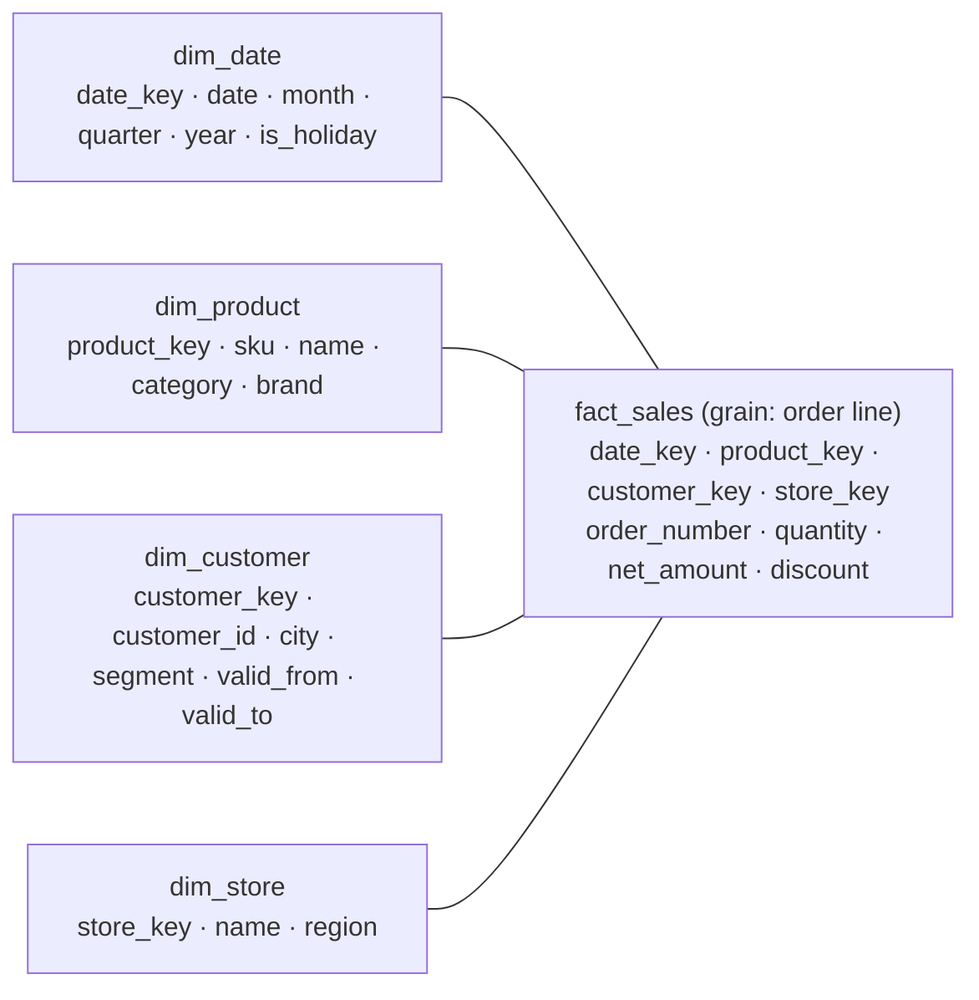

## Mental Model

Your production database answers **"what is true right now, for this one customer?"** thousands of times a second. The business also asks **"how did revenue per category change, month by month, for the last three years?"** That is one question touching hundreds of millions of rows, and the production database has already overwritten some of them.

Those are different jobs, so they get different databases:

| | OLTP (operational) | OLAP (analytical) |
|---|---|---|
| Typical query | fetch/update a few rows by key | scan and aggregate millions of rows |
| Users | the application, many concurrent | analysts, dashboards, a few heavy queries |
| Data | current state, normalized | history, denormalized for reading |
| Storage | row store, B+ tree indexes | column store, compression, partitions |
| Writes | small transactions, constantly | bulk loads, append mostly |

A **data warehouse** is the analytical database, fed from the operational ones by a pipeline, and modeled so that the questions above are easy to write and fast to run.

## Why It Exists

**The problem.** Analysts need history and integration: revenue by month needs last year's prices, not today's; a "customer" lives in the shop database, the CRM and the payments provider. And their queries are huge scans.

**Without it.** Running analytics on the production database causes four problems:

- it slows down checkout, because big scans fight the OLTP workload for I/O and buffer cache;
- the normalized schema needs ten-way joins for a simple report;
- history that was updated in place is simply gone;
- every team computes "revenue" slightly differently, from different sources.

**The idea.** Copy the data into a separate store built for reading. Keep history instead of overwriting it, merge sources into shared definitions, and reshape tables around *how questions are asked*: measurements in the middle, descriptive context around them.

**From idea to mechanism.**
- *Questions are "measure by context"* → **fact tables** of numeric measurements, joined to **dimension tables** of descriptive attributes: a **star schema**.
- *History must survive updates* → dimensions keep versions (**slowly changing dimensions**) and facts are append-only.
- *Scans of a few columns over many rows* → **columnar storage**, compression and partition pruning ([Column Stores](lesson:db-column-stores)).
- *Data must arrive from many systems* → **ETL/ELT** pipelines, increasingly fed by **change data capture** from the source databases' logs.

:::callout[That's all it is]{type=insight}
A warehouse is a read-optimized copy of your data that remembers history. The numbers you measure go in one long table (facts). The words you filter and group by go in small tables around it (dimensions). Everything is stored by column, so summing one column over a billion rows is cheap.
:::

## Definition

- **Data warehouse** (Inmon): a *subject-oriented, integrated, time-variant, non-volatile* collection of data for decision support. **Data mart**: a warehouse subset for one department or subject.
- **Dimensional modeling** (Kimball): organizing analytical data as facts and dimensions.
- **Fact table**: one row per measurement event at a declared **grain**, containing foreign keys to dimensions and numeric **measures**. Measures are *additive* (sum across every dimension: quantity, amount), *semi-additive* (sum across some dimensions but not time: account balance, inventory level) or *non-additive* (ratios, percentages — recompute them from additive parts).
- **Grain**: what exactly one fact row represents ("one row per order line").
- **Dimension table**: descriptive context (product, customer, date, store), wide and denormalized, with a **surrogate key** (a warehouse-assigned integer) separate from the source system's **natural key**.
- **Star schema**: a fact table joined directly to denormalized dimensions. **Snowflake schema**: dimensions normalized into sub-dimensions (product → category → department).
- **Conformed dimension**: one shared dimension (e.g. date, customer) used by many fact tables, so results can be compared across them.
- **Slowly changing dimension (SCD)**: a policy for dimension attributes that change over time — Type 1 overwrite, Type 2 add a new versioned row, Type 3 keep the previous value in an extra column.
- **ETL / ELT**: extract-transform-load (transform before loading) vs extract-load-transform (load raw, transform inside the warehouse with SQL).
- **Change data capture (CDC)**: streaming row changes out of a source database, usually by reading its write-ahead log or binlog.
- **Data lake**: raw files (Parquet, JSON, CSV) in object storage, schema applied when read. **Lakehouse**: a lake plus an open table format (Apache Iceberg, Delta Lake, Apache Hudi) that adds transactions, schema evolution and time travel.

## How It Works

### Declare the grain, then facts and dimensions

Kimball's four steps: pick the business process (sales), **declare the grain** (one row per order line), identify the dimensions (date, product, customer, store), identify the facts (quantity, net amount, discount). The grain comes first because it decides everything else: a fact table that mixes order-level and line-level rows double-counts.



`order_number` sits in the fact table without its own dimension — a **degenerate dimension**: useful for grouping lines into orders, with no attributes worth a table.

Why denormalize dimensions when [normalization](lesson:db-normalization) taught us not to? Normalization protects against update anomalies in data that's constantly edited. Dimensions are small and change rarely through a controlled load process, so the redundancy costs little — and queries get one join per dimension instead of a chain. That's the star vs snowflake trade-off: snowflaking saves a little space and makes hierarchies explicit, at the price of more joins.

### Slowly changing dimensions

A customer moves from Pune to Mumbai. Should last year's sales count under Pune or Mumbai?

| Type | What happens | History | Use when |
|---|---|---|---|
| 0 | never changes | — | birth date, original signup channel |
| 1 | overwrite the attribute | lost: all past facts now show Mumbai | corrections, attributes nobody analyzes historically |
| **2** | close the current row, insert a new row with a new surrogate key | kept: old facts point to the Pune row | the default for attributes analyzed over time |
| 3 | add a `previous_city` column | one step only | "before vs after a reorganization" |

Type 2 rows carry `valid_from`, `valid_to` and an `is_current` flag. The load process looks up the *current* surrogate key when inserting new facts, so each fact is permanently tied to the version of the customer that was true when it happened. This is why dimensions use surrogate keys: the natural key `customer_id` repeats across versions.

### Asking OLAP questions in SQL

The classic OLAP operations map directly onto SQL:

- **Roll-up**: aggregate to a coarser level (day → month → year). **Drill-down**: the reverse.
- **Slice**: fix one dimension (`WHERE year = 2024`). **Dice**: restrict several (`year = 2024 AND region IN (…)`).
- **Pivot**: turn values into columns (`sum(…) FILTER (WHERE quarter = 1) AS q1, …`).

Subtotals at several levels at once use grouping sets:

```sql
SELECT d.year, d.quarter, p.category, sum(f.net_amount) AS revenue
FROM fact_sales f
JOIN dim_date d    ON d.date_key = f.date_key
JOIN dim_product p ON p.product_key = f.product_key
GROUP BY ROLLUP (d.year, d.quarter), p.category;
```

`ROLLUP (a, b)` means the grouping sets (a, b), (a), () — a hierarchy of subtotals; `CUBE (a, b, c)` means all 2³ = 8 combinations; `GROUPING SETS (…)` lists exactly the ones you want. `GROUPING(col)` tells a subtotal row's NULL apart from a real NULL. Practise pivots and period-over-period growth in the [SQL Playground](lab:sql-playground#quarterly-pivot).

**Materialized views** and aggregate tables precompute common roll-ups; a refresh trades freshness for speed. Older terminology you may meet in exams: **MOLAP** stores precomputed cubes in a multidimensional engine, **ROLAP** computes on relational tables (what modern columnar warehouses do), **HOLAP** mixes them.

### Getting data in: ETL, ELT and CDC

- **ETL** (classic): extract from sources, transform in a separate engine, load the clean result. Made sense when warehouse compute was expensive.
- **ELT** (modern): load raw data into the warehouse first, then transform with SQL inside it (tools like dbt manage those SQL models). Cheap columnar compute and keeping the raw data for re-processing made this the default.
- **How to extract changes**:
  - *Full reload*: simple, fine for small tables, wasteful for big ones.
  - *Query-based incremental*: `WHERE updated_at > last_run` — misses hard deletes, depends on every writer maintaining `updated_at`, and adds load to the source.
  - *Log-based CDC*: read the source's own change log (PostgreSQL logical decoding, MySQL binlog) and stream every insert, update and delete in commit order — Debezium is the common tool. Captures deletes, adds little load, but a stalled consumer holds WAL on the source (a [replication slot](case:wal-disk-full) that nobody reads fills the disk).
- **Pipeline hygiene**: make loads idempotent (re-running a day doesn't double it), handle late-arriving facts and dimensions, and test data quality (row counts, null rates, referential integrity) on every load.

### Lakes and lakehouses

A **data lake** stores raw files cheaply in object storage — any format, schema decided when read. Great for keeping everything; bad for correctness when many writers change files without transactions ("data swamp"). **Open table formats** (Iceberg, Delta Lake, Hudi) add a metadata layer: atomic commits, snapshots and time travel, schema evolution and partition pruning over Parquet files. A **lakehouse** queries those tables directly with warehouse-style engines, so storage and compute are separate and several engines share one copy of the data.

### Time-series data

Metrics, sensor readings and events are a special case of append-mostly analytical data: rows arrive in time order, queries filter by recent time ranges, and old data is summarized or dropped. The standard tools:

- **Partition by time** (daily or monthly partitions) so retention is `DROP PARTITION` instead of a giant `DELETE` ([Partitioning](lesson:db-partitioning)).
- **BRIN indexes** in PostgreSQL: a tiny index of min/max per block range, effective because time-ordered appends keep physical order correlated with time ([Specialized Indexes](lesson:db-specialized-indexes)).
- **Downsampling / rollups**: keep raw points for days, per-minute aggregates for months, per-hour for years.
- **Columnar compression** of timestamps and slowly changing values (delta and run-length encoding).
- Dedicated systems package these ideas: TimescaleDB (PostgreSQL extension with automatic time partitions and continuous aggregates), InfluxDB, Prometheus' TSDB, ClickHouse.

## Example

A Type 2 change for customer 1017 moving to Mumbai on 2024-07-01, then loading a sale:

```sql
-- 1. close the current version
UPDATE dim_customer
SET valid_to = DATE '2024-06-30', is_current = false
WHERE customer_id = 1017 AND is_current;

-- 2. add the new version (new surrogate key from a sequence)
INSERT INTO dim_customer (customer_id, name, city, segment, valid_from, valid_to, is_current)
VALUES (1017, 'Asha Rao', 'Mumbai', 'retail', DATE '2024-07-01', DATE '9999-12-31', true);

-- 3. new facts look up the version current at the sale date
INSERT INTO fact_sales (date_key, product_key, customer_key, store_key, order_number, quantity, net_amount)
SELECT 20240702, 88, c.customer_key, 3, 'ORD-55120', 2, 2398.00
FROM dim_customer c
WHERE c.customer_id = 1017 AND DATE '2024-07-02' BETWEEN c.valid_from AND c.valid_to;
```

Revenue by city now attributes June's sales to Pune and July's to Mumbai — exactly what happened. A Type 1 overwrite would have silently moved all of Asha's history to Mumbai.

## Complexity & Performance

- Fact tables dominate size: rows = events × grain. 10 million orders a day × 3 lines × 365 days ≈ 11 billion rows a year; at 40 bytes per row that's about 438 GB before compression — columnar compression commonly shrinks this several-fold.
- Star joins are cheap: dimensions are small (often fit in memory as hash tables) and the engine filters dimensions first, then scans the fact table's few needed columns.
- Partition pruning (by date) and column pruning do most of the work; indexes matter far less than in OLTP.
- SCD Type 2 grows dimensions by one row per change; with millions of customers and frequent changes, consider splitting fast-changing attributes into a separate "mini-dimension".

## Trade-offs

- **Star vs snowflake**: fewer joins and simpler SQL vs less redundancy and explicit hierarchies. Star is the default.
- **SCD Type 1 vs 2**: simplicity and smaller tables vs correct history.
- **ETL vs ELT**: governed, cleaned loads vs flexibility and raw-data retention (and the risk of a warehouse full of half-modeled tables).
- **Batch vs streaming**: hourly/daily loads are simple and cheap; streaming CDC gives minutes-fresh data at higher operational cost.
- **Warehouse vs lakehouse**: managed convenience and performance vs open formats, cheap storage and multiple engines.

## Failure Modes

- **Mixed grain** in one fact table → double counting.
- **Averaging averages** or summing non-additive measures (ratios, distinct counts) across groups.
- **Summing a semi-additive measure over time** (adding up daily account balances).
- **Type 1 by accident**: overwriting attributes that analysts expected to be historical; last year's reports silently change.
- **Query-based extraction missing deletes**, so the warehouse keeps rows the source deleted.
- **Non-idempotent loads**: a retried job doubles a day's revenue.
- **Running BI dashboards against the OLTP primary** "just for now".

## In Production

- Feed the warehouse from a replica or via CDC, never by scanning the primary at business hours.
- Keep one definition of each metric (a semantic layer or a shared SQL model) and conformed dimensions.
- Partition facts by date; cluster/sort by commonly filtered columns; prune old raw data into aggregates.
- Monitor freshness (time since last successful load) and data-quality checks; treat a broken pipeline like a broken service.

## Deeper Connections

- Columnar layout, compression and vectorized execution are why OLAP scans are fast ([Column Stores](lesson:db-column-stores)).
- Dimensions are deliberately denormalized — know the rules before breaking them ([Normalization](lesson:db-normalization), [Schema Design](lesson:db-schema-design)).
- Log-based CDC reads the same WAL/binlog that replication ships ([Replication](lesson:db-replication)).
- The SQL of analytics — grouping, window functions, pivots — is the interview-patterns toolkit ([Window Functions](lesson:sql-window-functions), [SQL Interview Patterns](lesson:sql-interview-patterns)).

## Common Misconceptions

- **"A warehouse is just a big database."** Its modeling (facts, dimensions, history) and storage (columnar) are built for a different workload.
- **"Denormalization is always bad."** In read-mostly analytical models it's the point; integrity is enforced by the load process instead of constraints.
- **"A data lake replaces a warehouse."** Raw files without transactions and models are a starting point; lakehouse formats add back what warehouses provided.
- **"Read replicas are enough for analytics."** They isolate load from the primary, but keep only current state in an OLTP-shaped schema and row storage.

## Interview Questions

### [L1 · compare] OLTP vs OLAP?

OLTP systems run the business: many short transactions that read and write a few rows by key, need low latency and high concurrency, and store current state in normalized row-oriented tables. OLAP systems analyze the business: few, large queries that scan and aggregate millions of rows over history, usually on denormalized, column-oriented, bulk-loaded data. Mixing them on one database makes both worse, which is why warehouses exist.

### [L1 · compare] Fact table vs dimension table?

A fact table records measurement events at a fixed grain — one row per order line, say — with numeric measures (quantity, amount) and foreign keys to dimensions; it's long and narrow and grows continuously. A dimension table holds descriptive context used for filtering and grouping — product, customer, date — and is short, wide and denormalized, keyed by a surrogate key.

### [L2 · compare] Star schema vs snowflake schema?

In a star schema every dimension is a single denormalized table joined directly to the fact table: simple queries, one join per dimension. A snowflake schema normalizes dimensions into hierarchies (product → category → department): less redundancy and explicit hierarchies, but more joins and more complex SQL. Star is the usual default because dimensions are small and loaded in a controlled way, so redundancy costs little.

### [L2 · conceptual] What is the grain of a fact table, and why decide it first?

The grain is exactly what one row represents, such as "one product on one order" or "one account per day". It determines which dimensions apply, which measures make sense and how they can be summed. Mixing grains in one table — some rows per order, some per order line — causes double counting, so you declare the grain before choosing columns.

### [L2 · compare] Explain slowly changing dimensions types 1, 2 and 3.

Type 1 overwrites the attribute, losing history — fine for corrections. Type 2 keeps history by closing the current row (valid_to, is_current = false) and inserting a new row with a new surrogate key, so old facts keep pointing to the old version; it's the standard for attributes analyzed over time. Type 3 adds a column for the previous value, keeping exactly one step of history. (Type 0 never changes; hybrids like Type 6 combine 1, 2 and 3.)

### [L2 · compare] ETL vs ELT, and how do you capture changes from the source?

ETL transforms data in a separate engine before loading it; ELT loads raw data first and transforms it inside the warehouse with SQL, which modern columnar warehouses make cheap and which preserves raw data for reprocessing. Changes can be extracted by full reloads, by querying `updated_at` (misses hard deletes and depends on every writer), or by log-based change data capture — reading the source's WAL or binlog with a tool like Debezium — which captures inserts, updates and deletes in commit order with little load on the source.

### [L2 · numerical] How many grouping sets do `ROLLUP(year, quarter, month)` and `CUBE(year, quarter, month)` produce?

ROLLUP produces the hierarchy plus the grand total: (year, quarter, month), (year, quarter), (year), () — 4 sets, n + 1 in general. CUBE produces every subset: 2³ = 8 sets.

### [L3 · design] Design a warehouse model for an e-commerce company's sales analytics.

Choose the process (sales) and grain (one row per order line). Fact table: date_key, product_key, customer_key, store/channel_key, promotion_key, order_number (degenerate), quantity, gross and net amount, discount, cost. Dimensions: a conformed date dimension (calendar and fiscal attributes, holidays), product (SKU, name, category, brand — SCD Type 2 for category changes), customer (city, segment — Type 2), channel and promotion. Load via CDC or incremental extracts from a replica, idempotent daily partitions, and data-quality checks. Partition the fact by date, store it columnar, and add aggregate tables or materialized views for the dashboards' common roll-ups. Returns would be a separate fact table at their own grain sharing the conformed dimensions.

## Practice

### [mcq] A bank's fact table stores each account's balance at the end of each day. Which aggregation is meaningful?

- [ ] Sum of balances across all days for one account
- [x] Sum of balances across all accounts for one day
- [ ] Sum of balances across all accounts and all days
- [ ] None — balances can never be summed

Balance is semi-additive: it adds across accounts at one point in time, but adding the same money day after day is meaningless (use the last value or an average over time).

### [mcq] A product moves from category "Gadgets" to "Electronics". Analysts want last year's reports to stay unchanged. Which SCD type?

- [ ] Type 0
- [ ] Type 1
- [x] Type 2
- [ ] Type 3

Type 2 inserts a new version with a new surrogate key; last year's facts still point to the "Gadgets" version.

### [numeric 438 unit=GB] A shop records 10 million orders a day with 3 lines each, at a grain of one fact row per order line. Each row is 40 bytes uncompressed. How many GB does one year (365 days) of facts take? (1 GB = 10⁹ bytes.)

:::answer
10,000,000 × 3 = 30 million rows a day; × 365 = 10.95 billion rows; × 40 bytes = 438 × 10⁹ bytes = **438** GB before compression.
:::

### [numeric 1240000 unit=rows] A customer dimension starts with 1,000,000 rows. Every month 2% of customers change city, handled as SCD Type 2. How many rows does the dimension have after 12 months? (Assume each month's 2% are of the original 1,000,000.)

:::answer
Each change closes one row and adds one: 20,000 new rows per month × 12 = 240,000. Total = **1,240,000** rows, of which 1,000,000 are current.
:::

### [numeric 8 unit=sets] How many grouping sets does `GROUP BY CUBE (region, category, year)` produce?

:::answer
CUBE produces every subset of its columns: 2³ = **8** grouping sets, from (region, category, year) down to the grand total ().
:::

### [exercise] Write a query on `fact_sales(date_key, product_key, net_amount)`, `dim_date(date_key, year, month)` and `dim_product(product_key, category)` that returns revenue per year and category, with a subtotal per year and a grand total — and lets you tell subtotal rows apart.

:::solution
```sql
SELECT d.year, p.category, sum(f.net_amount) AS revenue,
       GROUPING(d.year) AS is_grand_total, GROUPING(p.category) AS is_year_total
FROM fact_sales f
JOIN dim_date d    ON d.date_key = f.date_key
JOIN dim_product p ON p.product_key = f.product_key
GROUP BY ROLLUP (d.year, p.category)
ORDER BY d.year NULLS LAST, p.category NULLS LAST;
```

`ROLLUP (year, category)` gives (year, category), (year) and (). `GROUPING(col)` is 1 when the column was rolled up in that row, which distinguishes a subtotal's NULL from a real NULL category.
:::

## Quick Revision

- OLTP = many small transactions on current state (rows, normalized). OLAP = big scans over history (columns, denormalized). Separate them.
- Kimball: process → **grain** → dimensions → facts. Facts: measures (additive / semi-additive / non-additive) + dimension keys. Dimensions: wide, denormalized, surrogate keys.
- Star (direct, denormalized dimensions) vs snowflake (normalized dimensions). Conformed dimensions make facts comparable.
- SCD: 1 overwrite, 2 new row with valid_from/valid_to (default), 3 previous-value column.
- ROLLUP (n + 1 sets), CUBE (2ⁿ), GROUPING SETS; GROUPING() marks subtotal rows.
- ELT + log-based CDC (Debezium on WAL/binlog) is the modern pipeline; loads must be idempotent.
- Lake = raw files; lakehouse = lake + Iceberg/Delta/Hudi transactions. Time series: time partitions, BRIN, downsampling, retention by dropping partitions.
