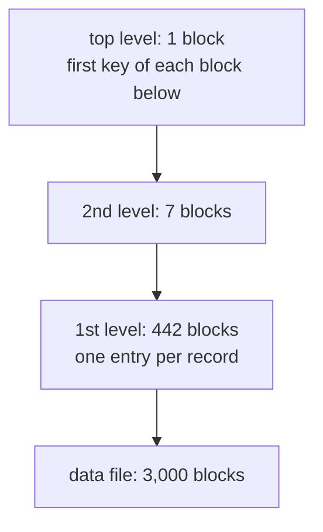

## Mental Model

An index is a smaller file you search first so you can read fewer blocks of the big one. Everything in this lesson is a variation on two questions:

1. **Does the index have an entry for every record, or only one per block?** If the data file is sorted by the search key, one entry per block is enough (**sparse**): the entry tells you which block to read, and the sorted order inside the block does the rest. If the file isn't sorted, every record needs its own entry (**dense**).
2. **Do you find the entry by searching in order, or by computing where it is?** Ordered indexes (and their multilevel / B+ tree form) narrow down by comparisons. **Hashing** computes the bucket directly from the key — one jump for equality, useless for ranges.

## Why It Exists

**The problem.** A data file of 3,000 blocks costs up to 3,000 block reads to search linearly, or ~12 with binary search *if* it's sorted. Disks charge per block read, so the goal is to touch as few blocks as possible.

**Without it.** Every lookup scans or binary-searches the whole data file, and only on the one field the file happens to be sorted by. Any other field means a full scan.

**The idea.** Build a much smaller file of (key, pointer) pairs: it fits in far fewer blocks, so searching it is cheap, and then one more read fetches the data. If that index is itself too big, index the index (**multilevel**) until the top fits in one block — which is exactly what a B+ tree is. For pure equality lookups, skip searching altogether: compute the location from the key (**hashing**), and grow the hash structure gracefully when it fills (**extendible / linear hashing**).

:::callout[That's all it is]{type=insight}
A sparse index has one entry per data block (only works on a file sorted by that key); a dense index has one per record. Index the index until it fits in one block and you have a multilevel index. Hashing replaces searching with arithmetic — great for "=", useless for ranges.
:::

## Definition

- **Dense index**: an entry for **every** search-key value (every record, or every distinct value with a pointer list).
- **Sparse (non-dense) index**: entries for only **some** values — typically the first key of each data block ("block anchor"). Requires the data file to be ordered by the search key.
- **Primary index** (textbook sense): an index on the **ordering key field** of a sorted file, where that field is unique; sparse, one entry per block. *Not the same thing as SQL's `PRIMARY KEY`.*
- **Clustering index**: an index on the ordering field of a sorted file where that field is **not unique**; one entry per distinct value, pointing to the first block containing it.
- **Secondary index**: an index on any **non-ordering** field; must be dense (the records are scattered). A file can have at most one primary *or* clustering index (it can be sorted only one way) but many secondary indexes.
- **Multilevel index**: an index on the index — repeat until the top level fits in one block (ISAM; dynamically maintained: B+ tree).
- **Static hashing**: a fixed number of buckets M; bucket = h(key) mod M; overflow chains when a bucket fills.
- **Extendible hashing**: a directory of 2^d bucket pointers (**global depth** d); each bucket has a **local depth** d′ ≤ d; full buckets split, and the directory doubles only when needed.
- **Linear hashing**: no directory; buckets split one at a time in a fixed round-robin order, so the table grows smoothly.

## How It Works

### Dense vs sparse

```text
Data file sorted by id (2 records per block)         Sparse index (one per block)   Dense index (one per record)
  block 0: 10, 20                                      10 → block 0                   10 → b0   20 → b0
  block 1: 30, 40                                      30 → block 1                   30 → b1   40 → b1
  block 2: 50, 60                                      50 → block 2                   50 → b2   60 → b2
```

To find 40 with the sparse index: find the largest entry ≤ 40 (30), read block 1, scan it. It works only because the file is sorted — 40 can't be anywhere else. For a field the file isn't sorted by, records with neighbouring values sit in unrelated blocks, so every value needs its own pointer: dense.

| | Dense | Sparse |
|---|---|---|
| Entries | one per record (or value) | one per block |
| Size | larger | much smaller |
| Requires sorted file? | no | **yes** |
| Answers "does key k exist?" from the index alone | yes | no — must read the block |

### Primary, clustering and secondary indexes

| Index | Indexed field | File sorted by it? | Field unique? | Dense or sparse | Per file |
|---|---|---|---|---|---|
| Primary | ordering key | yes | yes | sparse (block anchors) | at most one |
| Clustering | ordering non-key | yes | no | sparse (one per distinct value) | at most one (instead of primary) |
| Secondary | non-ordering | no | either | dense | many |

The textbook "primary index" is about **physical order**, which is why it's sparse. A SQL `PRIMARY KEY` in PostgreSQL is enforced with an ordinary dense B+ tree over a heap — in textbook terms, a secondary index on a unique field. InnoDB's primary key, which stores the rows in key order, is the closest real match to a clustering/primary index ([Clustered Indexes](lesson:db-clustered-indexes)).

### Counting block accesses: the classic numerical

Data file: 30,000 records, 100 bytes each, 1,024-byte blocks → blocking factor ⌊1024 / 100⌋ = 10, so **3,000 data blocks**. Index entry = 9-byte key + 6-byte pointer = 15 bytes → ⌊1024 / 15⌋ = **68 entries per index block**.

| Access path | Arithmetic | Block reads |
|---|---|---|
| Linear search (unsorted) | average b/2, worst b | 1,500 avg, 3,000 worst |
| Binary search on the sorted data file | ⌈log₂ 3,000⌉ | 12 |
| Sparse primary index, binary search | 3,000 entries → ⌈3,000 / 68⌉ = 45 blocks; ⌈log₂ 45⌉ + 1 | 6 + 1 = **7** |
| Same index, multilevel | level 1: 45 blocks; level 2: ⌈45 / 68⌉ = 1 block → 2 levels + 1 | **3** |
| Dense secondary index, binary search | 30,000 entries → 442 blocks; ⌈log₂ 442⌉ + 1 | 9 + 1 = 10 |
| Same, multilevel | 442 → 7 → 1: 3 levels + 1 | **4** |

The multilevel version's fan-out (68 here, hundreds in real 8 KB pages) is what makes a B+ tree only 3–4 levels deep for billions of rows ([B+ Trees](lesson:db-btree)).

The multilevel dense index from the table above, level by level. A lookup reads one block per level and then the data block: 3 + 1 = 4 reads.



### Static hashing

Choose M buckets; record goes to bucket h(key) mod M. Equality search: compute, read one bucket (plus its overflow chain). The trouble is that M is fixed: as the file grows, overflow chains lengthen and lookups degrade toward linear scans; if you over-provision M, space is wasted. Rehashing everything into a bigger table is a stop-the-world operation. Skewed keys (many records with the same hash) defeat it regardless of M.

### Extendible hashing

Keep a **directory** of 2^d pointers indexed by the first (or last) d bits of the hash. Several directory entries may point to the same bucket; each bucket records how many bits it actually uses (**local depth** d′).

::::steps[Inserting into a full bucket]
1. Hash the key, take d bits, follow the directory pointer to bucket B.
2. B has room → insert, done.
3. B is full and its local depth d′ **< global depth d** → split B into two buckets with local depth d′ + 1. Redistribute its records by the next bit, and repoint the directory entries that pointed to B. The directory doesn't grow.
4. B is full and **d′ = d** → **double the directory** (d + 1; each old entry is copied), then split B as in step 3.
::::

Only the overflowing bucket splits; the directory is small (pointers only) and doubles rarely. Lookups stay at one directory access plus one bucket read. Weakness: a pathological hash distribution can force repeated doubling for one hot region.

Try it: load the textbook example, insert 20 (the directory doubles), then 9 (a split without doubling), then load the skewed keys and watch splitting fail.

::lab{id=extendible-hashing}

### Linear hashing

No directory. Buckets are split in a fixed order using a pointer `next`, regardless of which bucket overflowed (overflows are chained temporarily). With N initial buckets in round `level`:

- h₀(k) = k mod (N · 2^level), h₁(k) = k mod (N · 2^(level+1)).
- Address: compute h₀(k); if it's below `next`, that bucket has already been split this round, so use h₁(k).
- A split (triggered by the load factor or by any overflow) moves bucket `next`'s records between it and its new image, then `next` advances. When every bucket of the round has split, `level` increases and `next` resets to 0.

Growth is smooth — one bucket at a time, no directory doubling — at the cost of temporary overflow chains on buckets that haven't had their turn yet.

## Internal Mechanism

:::depth{level=advanced}
### Where these ideas live in real systems

- **B+ trees replaced ISAM**: static multilevel indexes (IBM's ISAM) had to be rebuilt as data changed and relied on overflow areas; B+ trees keep themselves balanced with splits and merges.
- **PostgreSQL hash indexes** grow by splitting one bucket at a time (in the spirit of linear hashing), with overflow pages; they support only `=` and are rarely better than a B+ tree ([Specialized Indexes](lesson:db-specialized-indexes)).
- **InnoDB's adaptive hash index** is built automatically in memory over hot B+ tree pages, turning frequent equality lookups into hash probes.
- **Hash joins and hash aggregation** build in-memory hash tables and partition to disk when they overflow — the same "split into buckets by hash bits" idea ([Scans & Joins](lesson:db-scans-joins)).
- **Hash partitioning and consistent hashing** distribute keys across tables or machines and face the same resizing problem extendible hashing solves locally ([Consistent Hashing](lesson:db-consistent-hashing)).
:::

## Example

Extendible hashing with bucket capacity 2, h(k) = k, using the **last** d bits. Start with global depth d = 1:

```text
insert 4 (…100), 6 (…110)  → bit 0 → A
insert 1 (…001), 9 (…1001) → bit 1 → B
d = 1    dir[0] → A (d'=1): 4, 6        dir[1] → B (d'=1): 1, 9
```

**Insert 12 (…1100, last bit 0).** A is full, and its local depth equals the global depth (1 = 1). So the directory doubles to d = 2, then A splits on the last two bits: 4 → `00`, 12 → `00`, 6 → `10`.

```text
d = 2    dir[00] → A  (d'=2): 4, 12
         dir[10] → A2 (d'=2): 6
         dir[01] → B  (d'=1): 1, 9      ← B is still shared by 01 and 11
         dir[11] → B
```

**Insert 3 (…011, last two bits 11).** It lands in B, which is full. But B's local depth (1) is less than d (2), so B splits **without** changing the directory size: 1 and 9 end in `01`, and 3 ends in `11`.

```text
d = 2    dir[00] → A (4, 12)   dir[10] → A2 (6)   dir[01] → B (1, 9)   dir[11] → B2 (3)
```

Two inserts, two splits, one directory doubling — only the overflowing bucket's records ever moved. (If many keys shared all their low bits, splitting couldn't separate them and the directory would keep doubling — the skew case in Failure Modes.)

## Complexity & Performance

| Structure | Equality lookup | Range scan | Insert | Growth |
|---|---|---|---|---|
| Sparse primary index (multilevel) | levels + 1 block | levels + consecutive data blocks | expensive (file must stay sorted) | rebuild / overflow |
| Dense secondary index (B+ tree) | height + 1 | height + leaves + scattered data blocks | log n | splits |
| Static hashing | ~1 + overflow chain | full scan | ~1 | rehash all |
| Extendible hashing | directory + 1 bucket | full scan | ~1, occasional split/doubling | bucket splits, rare doubling |
| Linear hashing | ~1 + short overflow | full scan | ~1 | one bucket per split |

## Trade-offs

- Sparse indexes are tiny but need a sorted file — only one per table, and inserts must preserve order.
- Dense indexes work on any field but are larger; their data reads are scattered.
- Hashing gives the cheapest equality lookups and nothing else: no ranges, no ordering, no prefix search.
- Extendible hashing pays a directory and occasional doubling for exact splits; linear hashing pays temporary overflow chains for directory-free, smooth growth.

## Failure Modes

- **Hash skew**: many keys with the same hash (or a poor hash function) produce long overflow chains or runaway directory doubling.
- **Using a hash index for ranges**: `BETWEEN`, `<`, `ORDER BY` and prefix `LIKE` can't use it — the planner falls back to a scan.
- **Sorted-file maintenance**: keeping a physically ordered file under random inserts needs overflow areas that slowly destroy the order (why ISAM gave way to B+ trees, and why PostgreSQL's `CLUSTER` order decays).

## In Production

- In a real database you mostly choose between a B+ tree (the default — dense, ordered, multilevel) and specialized structures; textbook "primary/clustering" indexes appear as clustered tables (InnoDB, SQL Server clustered indexes) and BRIN-style block summaries.
- Hash structures show up inside the engine (hash joins, aggregates, adaptive hash indexes) more than as user-created indexes.

## Deeper Connections

- A multilevel index whose levels split and merge automatically *is* a B+ tree ([B+ Trees](lesson:db-btree)).
- BRIN indexes are sparse indexes over block ranges of a naturally ordered heap ([Specialized Indexes](lesson:db-specialized-indexes)).
- Consistent hashing solves the "resize without moving everything" problem across machines, as extendible and linear hashing do within one file ([Consistent Hashing](lesson:db-consistent-hashing)).

## Common Misconceptions

- **"Primary index = the index on the primary key."** In the textbook sense it's the sparse index on the field the file is *physically sorted by*; a PostgreSQL primary key index is a dense secondary-style B+ tree.
- **"Sparse indexes are always better because they're smaller."** They only work when the file is ordered by that key — at most one per table.
- **"Hash indexes are faster than B+ trees."** For equality on huge keys, slightly; for everything else, they can't help at all.

## Interview Questions

### [L1 · compare] Dense index vs sparse index?

A dense index has an entry for every search-key value (every record); a sparse index has entries for only some values, usually the first key of each data block. A sparse index is much smaller but works only when the data file is sorted by the search key — you find the right block from the index and scan inside it. Indexes on non-ordering fields must be dense, because matching records are scattered.

### [L1 · compare] Primary vs clustering vs secondary index (textbook definitions)?

A primary index is on the ordering **key** field of a sorted file — unique, sparse, one entry per block. A clustering index is on the ordering **non-key** field — one entry per distinct value pointing to its first block. A secondary index is on any non-ordering field and must be dense. A file can be physically sorted only one way, so it has at most one primary or clustering index, but any number of secondary indexes.

### [L2 · why] Why can a sparse index only be used on a file ordered by its search key?

The index stores just one key per block and relies on order to infer the rest: "40 is between anchors 30 and 50, so it must be in block 1." If the file isn't sorted by that field, a key could be in any block, so the index would need a pointer for every record — which is a dense index.

### [L2 · numerical] 30,000 records, 3,000 data blocks sorted on a unique key, and index blocks that hold 68 entries. How many block accesses does a lookup take with a single-level sparse index, and with a multilevel index?

Sparse primary index: one entry per data block = 3,000 entries → ⌈3,000 / 68⌉ = 45 index blocks. Binary search over them takes ⌈log₂ 45⌉ = 6 reads, plus 1 data block = **7**. Multilevel: the 45 first-level blocks need ⌈45 / 68⌉ = 1 second-level block, so the lookup reads 1 + 1 index blocks + 1 data block = **3**. Compare: binary search on the data file alone needs ⌈log₂ 3,000⌉ = 12.

### [L2 · how] Walk through an insert into a full bucket in extendible hashing.

Hash the key and use the first d bits (global depth) to pick a directory entry and its bucket. If the bucket is full and its local depth d′ is less than d, split it into two buckets of local depth d′ + 1, redistribute its records by the next hash bit, and repoint the directory entries; the directory size doesn't change. If d′ equals d, first double the directory (d + 1, each entry duplicated), then split. Only the full bucket's records move.

### [L2 · compare] Extendible vs linear hashing?

Both grow a hash file without rehashing everything. Extendible hashing keeps a directory of 2^d pointers and splits exactly the bucket that overflowed, occasionally doubling the directory. Linear hashing has no directory: buckets split one at a time in a fixed round-robin order (tracked by a `next` pointer and a level), so overflowing buckets may chain temporarily until their turn. Extendible: precise splits, directory overhead and possible doubling bursts. Linear: smooth growth, tiny metadata, short-lived overflow chains.

### [L2 · compare] Hash index vs B+ tree index?

A hash index finds an exact key in roughly one bucket read; it supports only equality, gives no order, and degrades under skew. A B+ tree takes a few page reads (the top levels are cached) and supports equality, ranges, prefix matches, ORDER BY and uniqueness, staying balanced automatically. That generality is why B+ trees are every database's default and hash indexes are niche.

### [L3 · scenario] An extendible hash file's directory keeps doubling while most buckets are nearly empty. What's going on?

A small set of keys share the same leading hash bits — skew from a poor hash function or genuinely duplicate keys. Splitting a bucket whose records all hash alike doesn't separate them, so the directory doubles again and again. Fixes: a better hash function, overflow pages for buckets whose records can't be separated (duplicates), or a different structure (a B+ tree) for heavily duplicated keys.

## Practice

### [numeric 45] 3,000 data blocks sorted on a unique key; a sparse primary index has one entry per data block and 68 entries fit in an index block. How many index blocks are there?

:::answer
3,000 entries ÷ 68 per block = 44.1…, rounded up to **45** index blocks.
:::

### [numeric 4] A dense secondary index has 442 first-level blocks and 68 entries per block. Using a multilevel index, how many block reads does an equality lookup take, including the data block?

:::answer
Level 2: ⌈442 / 68⌉ = 7 blocks. Level 3: ⌈7 / 68⌉ = 1 block — the top. Three index levels plus one data block = **4** reads.
:::

### [numeric 8] An extendible hash file has global depth 3. How many entries does its directory have?

:::answer
The directory has one entry per 3-bit pattern: 2³ = **8** entries (several may point to the same bucket).
:::

### [mcq] In extendible hashing, a bucket overflows and its local depth equals the global depth. What happens?

- [ ] Only the bucket splits; the directory is unchanged
- [x] The directory doubles, then the bucket splits
- [ ] The record goes to an overflow chain and nothing else changes
- [ ] All records are rehashed into a new table

When d′ = d there is no spare directory entry to point at a new bucket, so the directory must double first.

### [mcq] Which index must be dense?

- [ ] A primary index on the ordering key
- [ ] A clustering index on the ordering non-key field
- [x] A secondary index on a non-ordering field
- [ ] Any index on a sorted file

Records with neighbouring values of a non-ordering field are scattered, so every value needs its own pointer.

### [numeric 4 unit=pointers] In an extendible hash file with global depth 4, a bucket has local depth 2. How many directory entries point to it?

:::answer
2^(global − local) = 2^(4 − 2) = **4**. The bucket uses only the last 2 bits, so the 4 slots that agree on those 2 bits (and differ in the other 2) all share it. You can check this in the [Extendible Hashing lab](lab:extendible-hashing), which shows the pointer count on every bucket.
:::

### [exercise] Start from global depth 1 and bucket capacity 2, with h(k) = k and the last bits as the index. Insert 4, 6, 1, 3, 5, 8. When does the directory double, when does a bucket split without doubling, and what is the final directory?

:::solution
- 4 (…100) and 6 (…110) end in 0 → bucket B0 = [4, 6]. 1 (…1) and 3 (…11) → B1 = [1, 3].
- **5** (…101) → B1 is full and its local depth (1) equals the global depth (1): **double** the directory to 4 slots, split B1 on the second bit: 1 (…01) stays, 3 (…11) moves to a new bucket B2. Then 5 (…01) goes into B1 = [1, 5].
- **8** (…1000) → slot 00 → B0, which is full but has local depth 1 < global depth 2: **split without doubling** on the second bit: 4 (…00) stays, 6 (…10) moves to new bucket B3, and slot 10 is re-pointed to B3. Then 8 → B0 = [4, 8].

Final (global depth 2): 00 → [4, 8], 01 → [1, 5], 10 → [6], 11 → [3], all buckets with local depth 2. Load the "Split without doubling" preset in the [Extendible Hashing lab](lab:extendible-hashing) and insert 8 to watch it.
:::

## Quick Revision

- Dense = entry per record; sparse = entry per block (needs a file sorted by that key).
- Textbook primary (ordering key, sparse) · clustering (ordering non-key, sparse) · secondary (non-ordering, dense). ≤ 1 primary/clustering, many secondary. ≠ SQL `PRIMARY KEY`.
- Block math: bfr = ⌊B/R⌋; index entries/block = ⌊B/(V+P)⌋; single level ⌈log₂ index blocks⌉ + 1; multilevel = levels + 1.
- Static hashing: fixed M, overflow chains. Extendible: directory 2^d, local depth d′, split; double only when d′ = d. Linear: no directory, round-robin splits.
- Hash = equality only; B+ tree = equality + ranges + order.
