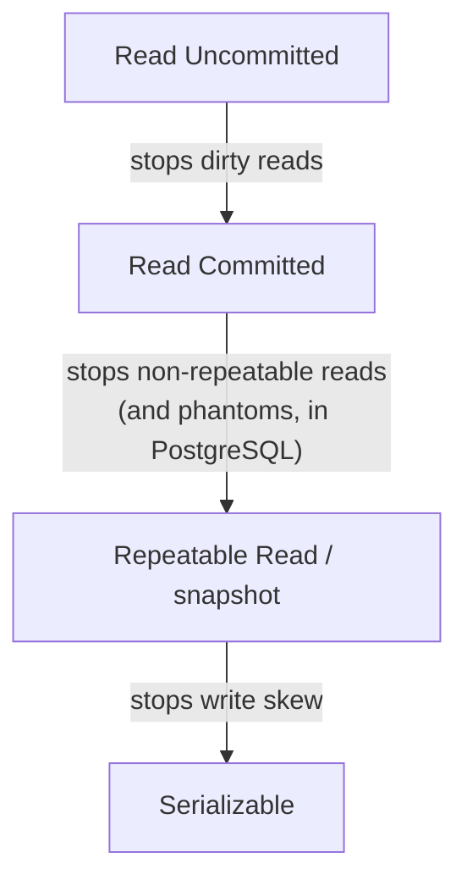

## Mental Model

An isolation level is **a contract about which anomalies you might observe**. Stronger levels forbid more anomalies but make transactions wait or abort more often under contention.

Two very different machines implement these contracts:

- **Locking**: readers and writers take locks; conflicting transactions **wait** ([Locking](lesson:db-locking)).
- **Snapshots (MVCC)**: each transaction reads from a consistent snapshot; writers don't block readers; conflicting writers **wait or abort** ([MVCC](lesson:db-mvcc)).

The level names come from the SQL standard, but their behavior comes from the machine — which is why "Repeatable Read" means different things in PostgreSQL and MySQL.

## Definition

The SQL standard's table (✗ = may occur, ✓ = prevented):

| Level | Dirty read | Non-repeatable read | Phantom |
|---|---|---|---|
| Read Uncommitted | ✗ | ✗ | ✗ |
| Read Committed | ✓ | ✗ | ✗ |
| Repeatable Read | ✓ | ✓ | ✗ |
| Serializable | ✓ | ✓ | ✓ |

What the major engines actually do:

| Level | PostgreSQL | MySQL InnoDB |
|---|---|---|
| Read Uncommitted | behaves as Read Committed | dirty reads possible |
| Read Committed | **default**. New snapshot per statement | new snapshot per statement (consistent reads) |
| Repeatable Read | **snapshot isolation**: one snapshot per transaction; no phantoms in reads; concurrent update of the same row → serialization error (no lost updates); write skew possible | **default**. One snapshot per transaction for plain SELECTs; locking reads/updates see the *latest* committed data and use next-key (gap) locks; lost updates possible with plain read-then-write |
| Serializable | **SSI**: snapshot isolation + detection of dangerous read-write dependency patterns → abort | plain SELECTs become locking reads (shared next-key locks): strict 2PL-style blocking |

Each step up the ladder removes anomalies, and adds waiting or retries:



## Why It Exists

**The problem.** Serializable everywhere is the easiest to reason about but historically costly (locking) or abort-prone under contention (optimistic).

**The idea.** Make isolation a dial instead of a switch. Weaker levels let most workloads run with little coordination, trusting the developer to handle the specific anomalies that matter. Each level is a promise: "these anomalies can't happen; those still can".

:::callout[That's all it is]{type=insight}
Read Committed: each statement sees committed data. Repeatable Read: the whole transaction sees one snapshot. Serializable: the result equals some one-at-a-time order. Stronger = fewer surprises, more waiting or retries.
:::

## How It Works

The difference between the two default levels in one trace. Account 1 holds 100:

```text
T1: BEGIN; SELECT balance FROM acc WHERE id = 1;    → 100
T2: UPDATE acc SET balance = 70 WHERE id = 1; COMMIT;
T1: SELECT balance FROM acc WHERE id = 1;
      Read Committed  → 70    each statement takes a fresh snapshot, so T1 sees T2's commit
      Repeatable Read → 100   the whole transaction keeps the snapshot from its first statement
```

Neither answer is "wrong". They're different promises, and a report adding up many rows usually wants the second one.

### Read Committed (PostgreSQL default)

Each **statement** sees data committed before *it* started. Two statements in one transaction can see different data (non-repeatable reads, phantoms, read skew).

Suppose an `UPDATE` finds that its target row was changed by a concurrent transaction. PostgreSQL waits for that transaction to finish. If it committed, PostgreSQL **re-evaluates the WHERE clause on the new version** and updates the row if it still matches. That's why `UPDATE accounts SET balance = balance - 100 WHERE id = 1` is safe at Read Committed: the arithmetic runs on the latest version. "Read the balance in the app, then write a computed value" is not safe.

### Repeatable Read / Snapshot Isolation (PostgreSQL)

One snapshot for the whole transaction: every read sees the database as of the transaction's first statement. If the transaction tries to update a row modified by a concurrent committed transaction, it fails with:

```text
ERROR: could not serialize access due to concurrent update   (SQLSTATE 40001)
```

The application must **retry the whole transaction**. This "first updater wins" rule prevents lost updates. Write skew remains possible (disjoint writes).

### Repeatable Read in MySQL InnoDB

Plain `SELECT`s read from a transaction-wide snapshot. But `UPDATE`, `DELETE` and locking reads (`SELECT … FOR UPDATE / FOR SHARE`) operate on the **latest committed** version and take row + **gap locks** (next-key locks) to prevent phantoms for those ranges. Consequences: a transaction can read a value from its snapshot, then update based on it while another transaction's newer committed value is overwritten — a lost update — unless it used a locking read.

### Serializable

Snapshots alone can't stop write skew, because the conflict is between what one transaction *read* and what another *wrote*. To get full serializability you must track reads too — either by locking them (blocking) or by watching for dangerous patterns (aborting).

- **PostgreSQL SSI**: runs on snapshots and also tracks what each transaction read, using lightweight predicate "SIREAD" locks that never block. It aborts a transaction when it sees a pattern of read-write dependencies that could form a cycle (two consecutive rw anti-dependencies with a particular commit order). There are some false positives: it sometimes aborts even when no anomaly would have occurred.
- **Lock-based (MySQL, SQL Server default Serializable)**: reads take shared locks on rows and ranges held to commit — writers block readers and vice versa; deadlocks are more common.

Either way: **serializable transactions must be retried** on serialization failure or deadlock.

::viz{id=isolation}

## Internal Mechanism

:::depth{level=advanced}
### Retry loops are part of the contract

```python
for attempt in range(5):
    try:
        with conn.transaction(isolation="serializable"):
            do_work(conn)          # all reads and writes of the unit of work
        break
    except SerializationFailure:   # SQLSTATE 40001 (and 40P01 deadlock)
        sleep(backoff(attempt))
else:
    raise
```

Retry the whole transaction, not just the failed statement — its earlier reads may be stale. Keep side effects (emails, API calls) outside the retried block.

### Read-only optimizations

PostgreSQL `SERIALIZABLE READ ONLY DEFERRABLE` waits for a "safe snapshot" and then runs without any risk of serialization failure — ideal for long reports that need a serializable view.

### Where isolation lives in replicas

Replicas serve reads from replayed WAL. Queries on a hot standby see snapshots of the replayed state: never data "ahead" of what's replayed, but possibly behind the primary (replication lag). That's a consistency issue separate from isolation ([Replication](lesson:db-replication)).
:::

## Example

Choosing levels for an e-commerce backend on PostgreSQL:

| Operation | Choice | Why |
|---|---|---|
| Browse catalog, order history | Read Committed | single-statement reads; no invariants |
| Decrement stock | Read Committed + `UPDATE … SET stock = stock - 1 WHERE stock > 0` | atomic statement handles the race |
| Month-end report over many tables | Repeatable Read (read-only) | one consistent snapshot across queries |
| Room/seat booking with overlap rules | Serializable + retry, or exclusion constraint | prevents write skew |
| Transfer between wallets | Read Committed with `SELECT … FOR UPDATE` on both rows in id order, or Serializable + retry | prevents lost updates/read skew; consistent lock order avoids deadlocks |

Step through the same schedule under each level in the [Isolation lab](lab:isolation).

## Complexity & Performance

- Read Committed: minimal overhead; snapshot per statement.
- Snapshot/Repeatable Read: same cost for reads; long transactions hold back cleanup of old versions (bloat) ([MVCC](lesson:db-mvcc)).
- Serializable (SSI): extra bookkeeping per read and a rate of aborts that grows with contention; lock-based: blocking and deadlocks.

## Trade-offs

- Default low + targeted fixes (atomic updates, row locks, constraints): fast, but correctness depends on every developer spotting every race.
- Serializable everywhere: correct by construction, needs universal retry handling and has throughput costs under hotspot contention.

## Failure Modes

- Assuming PostgreSQL and MySQL "Repeatable Read" behave alike when migrating.
- Using Repeatable Read/Serializable **without retry logic** → user-facing errors under load.
- Long-running snapshot transactions → table bloat, replication conflicts on standbys.
- Relying on isolation for invariants a constraint could enforce more simply.

## In Production

- Know your framework's default isolation and where transactions begin/end.
- Monitor serialization failures and deadlocks; spikes indicate hotspots (a single counter row, a popular inventory item).

## Deeper Connections

- The snapshot machinery is MVCC ([MVCC](lesson:db-mvcc)); the blocking machinery is locking ([Locking](lesson:db-locking)).
- Distributed databases describe similar guarantees as consistency models; "strict serializability" = serializable + linearizable ([Consistency Models](lesson:db-consistency-models)).

## Common Misconceptions

- **"Phantoms are only prevented at Serializable."** That's the standard's minimum. PostgreSQL's Repeatable Read (a snapshot) already prevents phantoms in reads; MySQL prevents them for locking reads via gap locks.
- **"Serializable means transactions run one at a time."** They run concurrently; the result is equivalent to some serial order.
- **"Higher isolation = no errors."** Higher isolation often means more errors (serialization failures) that you must retry.

## Interview Questions

### [L1 · compare] Name the four standard isolation levels and what each prevents.

Read Uncommitted (nothing), Read Committed (dirty reads), Repeatable Read (dirty and non-repeatable reads), Serializable (all three standard phenomena, and in general any non-serializable outcome). Real engines differ: PostgreSQL's Repeatable Read is snapshot isolation (no phantoms, but write skew possible); MySQL's default Repeatable Read combines snapshots for plain reads with gap locks for locking reads.

### [L2 · how] How does PostgreSQL implement Repeatable Read, and what error must applications handle?

Each transaction takes a single MVCC snapshot at its first statement and reads only row versions visible in it. If it tries to update or delete a row that a concurrent transaction modified and committed after the snapshot, it aborts with a serialization failure (SQLSTATE 40001). Applications must catch it and retry the entire transaction.

### [L2 · scenario] Which isolation level would you use for a bank transfer, and how would you implement it?

Either Read Committed with explicit row locks — `SELECT … FOR UPDATE` on both accounts in a consistent order (e.g., by id) to avoid deadlocks, check balance, update both, commit — or Serializable with a retry loop. Also enforce `CHECK (balance >= 0)` as a safety net and use an idempotency key for the transfer request.

### [L3 · compare] How does Serializable Snapshot Isolation differ from two-phase-locking serializability?

SSI lets transactions read from snapshots without blocking, tracks read/write dependencies, and aborts a transaction when a dangerous structure (a potential dependency cycle) appears — optimistic, no read locks, some false-positive aborts. Strict 2PL makes reads take shared locks and writes exclusive locks held to commit, so conflicts cause waiting (and deadlocks) instead of aborts; readers and writers block each other.

### [L2 · compare] How does MySQL's REPEATABLE READ differ from PostgreSQL's?

PostgreSQL Repeatable Read is snapshot isolation: every statement reads the transaction's snapshot, and updating a row changed by a concurrent committed transaction raises a serialization error (no lost updates). MySQL InnoDB's REPEATABLE READ uses the snapshot only for plain SELECTs; UPDATE, DELETE and locking reads act on the **latest** committed data with next-key locks. So a read-then-write in application code can silently overwrite a concurrent change (a lost update) unless the read was `SELECT … FOR UPDATE`.

### [L2 · design] Which isolation level would you use for (a) a dashboard, (b) a seat-booking flow, (c) a monthly financial report?

(a) Read Committed — each query sees committed data; slight inconsistency between widgets is acceptable. (b) Read Committed with targeted locking or a unique/exclusion constraint on the seat — or Serializable with a retry loop if the invariant spans rows. (c) Repeatable Read (or `SERIALIZABLE READ ONLY DEFERRABLE` in PostgreSQL) so every query in the report sees the same snapshot, ideally on a replica.

### [L1 · conceptual] What does SQLSTATE 40001 mean, and what should the application do?

`serialization_failure`: the database aborted the transaction to preserve the requested isolation (a concurrent update at Repeatable Read, or a dangerous dependency pattern at Serializable). The transaction did nothing durable; the application should retry the **whole** transaction from the beginning, with backoff and a retry limit, keeping external side effects outside the retried block. Deadlocks (40P01) are handled the same way.

## Practice

### [mcq] Which is PostgreSQL's default isolation level?

- [ ] Read Uncommitted
- [x] Read Committed
- [ ] Repeatable Read
- [ ] Serializable

MySQL InnoDB defaults to Repeatable Read.

### [mcq] At PostgreSQL Read Committed, T1 runs `UPDATE t SET v = v + 1 WHERE id = 1` while T2 has updated the same row and then commits. What happens to T1?

- [ ] It fails with a serialization error
- [ ] It overwrites T2's change with its old value + 1
- [x] It waits for T2, re-reads the new committed version, and increments that
- [ ] It reads a dirty value

Read Committed re-evaluates the updated row's latest version, so in-database arithmetic isn't lost.

### [mcq] Which anomaly does PostgreSQL's Repeatable Read prevent even though the SQL standard permits it at that level?

- [ ] Dirty reads
- [ ] Non-repeatable reads
- [x] Phantoms
- [ ] Write skew

PostgreSQL's Repeatable Read is snapshot isolation: the whole transaction reads one snapshot, so re-running a range query never shows new rows. Write skew remains possible; only Serializable stops it.

### [numeric 0.0125 ±0.0001 unit=%] Serializable transactions fail with a serialization error 5% of the time, independently per attempt. With up to 3 attempts, what percentage of transactions fail all three?

:::answer
0.05³ = 0.000125 = **0.0125**%. A retry loop turns a 5% error rate into roughly 1 in 8,000 — as long as retries don't make contention (and the failure rate) worse, which is why they use backoff.
:::

### [mcq] In PostgreSQL at Read Committed, a single long `SELECT` runs while other transactions commit changes to the rows it's reading. What does it see?

- [ ] A mix of old and new values, row by row
- [x] A consistent snapshot taken when that statement started
- [ ] Only rows that were not modified
- [ ] An error once any row changes

Read Committed takes a new snapshot per statement, so each statement is internally consistent; two statements in the same transaction can disagree.

### [exercise] Write application pseudocode for running a function inside a SERIALIZABLE transaction with correct retry behaviour.

:::solution
```text
for attempt in 1..5:
    begin transaction isolation level serializable
    try:
        result = work()               # all reads and writes of the transaction
        commit
        return result
    catch error:
        rollback
        if error.sqlstate in ("40001", "40P01"):   # serialization_failure, deadlock_detected
            sleep(random(0, 2^attempt * 10 ms))      # jittered exponential backoff
            continue
        raise                                        # anything else is a real error
raise "gave up after 5 attempts"
```

Retry the **whole** transaction (including its reads), not just the failed statement; keep side effects such as sending email outside it, or make them idempotent; and cap the attempts so a hot spot can't loop forever.
:::

## Quick Revision

- Standard: RU < RC (no dirty reads) < RR (no non-repeatable reads) < Serializable (no phantoms / any anomaly).
- PostgreSQL: RC default (snapshot per statement); RR = snapshot isolation (first-updater-wins, write skew possible); Serializable = SSI (aborts).
- MySQL: RR default — snapshot for plain reads, next-key locks for locking reads/writes; lost updates possible without FOR UPDATE.
- Strong levels → serialization failures/deadlocks → retry the whole transaction.
- Prefer atomic statements, row locks and constraints for specific invariants.
- MySQL REPEATABLE READ: snapshot for plain SELECTs, latest data + next-key locks for writes (lost updates possible without FOR UPDATE). 40001/40P01 → retry the whole transaction.
