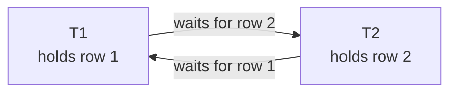

## Mental Model

A database lock is a **mutex on a piece of data held for the rest of the transaction** ([Synchronization Primitives](lesson:os-sync-primitives)). Readers can share (shared lock); writers need exclusivity (exclusive lock). Waiting transactions queue. If transactions wait on each other in a cycle, that's a **deadlock** — and the database, unlike most application code, detects it and kills one participant ([Deadlocks](lesson:os-deadlocks)).

In MVCC databases, **plain reads don't take row locks** — they read snapshots ([MVCC](lesson:db-mvcc)). Locks matter for writes, for explicit locking reads (`FOR UPDATE`), and for schema changes.

## Definition

- **Shared (S) lock**: many holders; blocks exclusive requests.
- **Exclusive (X) lock**: one holder; blocks both S and X.
- **Granularity**: row, page, table (and database). Coarse locks are cheap to manage but block more.
- **Intention locks** (IS, IX): taken on the table before locking rows, so a table-level lock request can see "someone holds row locks here" without scanning all rows.
- **Two-phase locking (2PL)**: a transaction acquires locks (growing phase) and releases them (shrinking phase); never acquires after releasing. Guarantees conflict-serializability. **Strict 2PL**: hold exclusive locks until commit/abort (prevents cascading aborts) — what databases do.
- **Deadlock**: a cycle in the waits-for graph.
- **Lock timeout**: give up after waiting too long.

Compatibility:

| requested ↓ / held → | S | X |
|---|---|---|
| **S** | ✓ | ✗ |
| **X** | ✗ | ✗ |

## Why It Exists

**The problem.** Isolation requires preventing conflicting operations from interleaving badly ([Anomalies](lesson:db-anomalies)).

**The idea.** Borrow the oldest tool in concurrency: a mutex. Before touching a piece of data, take its lock; anyone who wants a conflicting lock waits. Locks are the pessimistic way: make the second transaction **wait** until the first finishes, turning a potential anomaly into a delay.

**Why hold locks until commit.** Suppose a transaction released a row's lock mid-way. Another could change the row, and the first might then read or overwrite a different value than the one it decided on. Holding locks to the end (strict two-phase locking) is what makes the interleaving equivalent to a serial order.

:::callout[That's all it is]{type=insight}
Writers lock the rows they change until commit; readers can share, writers can't. Conflicts wait in a queue, and when two transactions wait on each other the database kills one. Everything else is about what exactly gets locked (rows, ranges, tables).
:::

## How It Works

### Row locks from writes

`UPDATE`/`DELETE` lock each affected row exclusively until commit. A second transaction updating the same row waits:

```text
T1: BEGIN; UPDATE accounts SET balance = balance - 100 WHERE id = 1;   -- X lock on row 1
T2: BEGIN; UPDATE accounts SET balance = balance + 50  WHERE id = 1;   -- waits…
T1: COMMIT;                                                           -- T2 proceeds
```

Writes never block plain reads in PostgreSQL/InnoDB (readers use snapshots).

### Explicit row locks: locking reads

```sql
BEGIN;
SELECT balance FROM accounts WHERE id = 1 FOR UPDATE;   -- X-like row lock: others' FOR UPDATE/UPDATE wait
-- decide in application code
UPDATE accounts SET balance = $new WHERE id = 1;
COMMIT;
```

Variants (PostgreSQL): `FOR UPDATE`, `FOR NO KEY UPDATE`, `FOR SHARE`, `FOR KEY SHARE` (weaker modes used by FK checks); modifiers **`NOWAIT`** (error instead of waiting) and **`SKIP LOCKED`** (skip rows others have locked).

`SKIP LOCKED` turns a table into a work queue:

```sql
-- Each worker grabs a different pending job without blocking the others
BEGIN;
SELECT id, payload FROM jobs
WHERE status = 'pending'
ORDER BY created_at
LIMIT 10
FOR UPDATE SKIP LOCKED;
-- process, then
UPDATE jobs SET status = 'done' WHERE id = ANY($ids);
COMMIT;
```

The same worker in Java, with plain JDBC:

```java
/** Claims up to `batch` pending jobs; other workers skip the rows this one has locked. */
static List<Long> claimAndRun(Connection c, int batch, LongConsumer job) throws SQLException {
    c.setAutoCommit(false);
    List<Long> ids = new ArrayList<>();
    try (PreparedStatement ps = c.prepareStatement(
            "SELECT id FROM jobs WHERE status = 'pending' ORDER BY created_at LIMIT ? FOR UPDATE SKIP LOCKED")) {
        ps.setInt(1, batch);
        try (ResultSet rs = ps.executeQuery()) {
            while (rs.next()) ids.add(rs.getLong(1));
        }
    }
    for (long id : ids) job.accept(id);              // keep this short: the rows stay locked until commit
    try (PreparedStatement done = c.prepareStatement("UPDATE jobs SET status = 'done' WHERE id = ANY (?)")) {
        done.setArray(1, c.createArrayOf("bigint", ids.toArray()));
        done.executeUpdate();
    }
    c.commit();
    return ids;
}
```

If the worker crashes, its transaction rolls back, the locks disappear, and the jobs become `pending` for someone else: the database is the queue's failure detector.

### Locks from JPA and Spring Data

JPA asks for the same row locks through lock modes:

| JPA | What PostgreSQL receives |
|---|---|
| `LockModeType.PESSIMISTIC_WRITE` | an exclusive row lock: `FOR UPDATE`, or a close variant the dialect chooses |
| `LockModeType.PESSIMISTIC_READ` | a shared row lock: `FOR SHARE` |
| lock timeout hint `jakarta.persistence.lock.timeout` = 0 | `NOWAIT` |
| Hibernate's timeout value −2 (`LockOptions.SKIP_LOCKED`) | `SKIP LOCKED` |

In Spring Data, put `@Lock(LockModeType.PESSIMISTIC_WRITE)` on a repository query method. The lock lasts until the surrounding transaction ends, not until the repository method returns. So the method must run inside a transaction, and that transaction should be short.

### Table locks and the DDL queue

Every statement takes a table-level lock of some mode: `SELECT` takes ACCESS SHARE, DML takes ROW EXCLUSIVE, most `ALTER TABLE` forms take **ACCESS EXCLUSIVE** (conflicts with everything). Locks are granted in **queue order**: an `ALTER TABLE` waiting behind a long `SELECT` blocks every later query on the table, even though those queries don't conflict with the `SELECT`. Result: a "harmless" migration stalls the site ([DML & DDL](lesson:sql-dml-ddl)). Use `lock_timeout` for DDL.

```text
09:00:00  report   SELECT … FROM orders          (runs 10 min)   holds ACCESS SHARE
09:00:05  deploy   ALTER TABLE orders ADD …                      wants ACCESS EXCLUSIVE → waits for the report
09:00:06  app      SELECT … FROM orders WHERE id = 7             wants ACCESS SHARE → queues behind the ALTER
09:00:07  app      … every query on orders queues the same way   → checkout is down until 09:10
```

### Gap and next-key locks (InnoDB)

Locking rows can't stop phantoms — the problem row doesn't exist yet, so there's nothing to lock. The fix is to lock the *space* where it would go. To prevent phantoms for locking reads and writes, InnoDB locks not only index records but the **gaps** between them. A next-key lock = record lock + the gap before it.

```text
index on age: 20, 30, 40
T1: SELECT * FROM users WHERE age BETWEEN 25 AND 35 FOR UPDATE;
    → locks record 30 and gaps (20,30), (30,40)
T2: INSERT INTO users (age) VALUES (27);   -- blocks: 27 falls in a locked gap
```

Side effect: inserts into ranges near a locked range block, and gap locks are a frequent source of surprising InnoDB deadlocks. Without a usable index, a locking statement may lock every row scanned — effectively the whole table.

### Deadlocks

```text
T1: UPDATE accounts … WHERE id = 1;   -- holds row 1
T2: UPDATE accounts … WHERE id = 2;   -- holds row 2
T1: UPDATE accounts … WHERE id = 2;   -- waits for T2
T2: UPDATE accounts … WHERE id = 1;   -- waits for T1 → cycle
```

Detection: PostgreSQL checks the waits-for graph after a transaction has waited `deadlock_timeout` (1 s by default); InnoDB checks immediately on each wait. One transaction is chosen as the victim and aborted (`ERROR: deadlock detected`, SQLSTATE 40P01); the other proceeds. The application must retry the victim.

The victim's error spells out the cycle:

```text
ERROR:  deadlock detected
DETAIL:  Process 4711 waits for ShareLock on transaction 9182; blocked by process 4802.
         Process 4802 waits for ShareLock on transaction 9181; blocked by process 4711.
HINT:  See server log for query details.
CONTEXT:  while updating tuple (0,2) in relation "accounts"
```

Each `DETAIL` line is one edge of the waits-for graph. A row wait shows up as a wait for the other *transaction*, because PostgreSQL keeps row locks in the tuple header and the waiter queues on the locker's transaction id. The server log adds both statements, which tells you which two code paths lock the same rows in opposite orders.

Prevention is the OS story again ([Deadlock Handling](lesson:os-deadlock-handling)). **Lock in a consistent global order** (e.g., ascending id), keep transactions short, lock everything needed up front, and make sure locking statements use indexes.

::lab{id=db-locks}

That deadlock as a waits-for graph. The detector looks for exactly this, a cycle, and aborts one transaction to break it:



### Beyond these mechanics

The theory behind these locks — the 2PL variants, intention locks for multiple granularity, timestamp ordering and wait-die / wound-wait — is in [Concurrency Control Protocols](lesson:db-concurrency-protocols).

## Internal Mechanism

:::depth{level=advanced}
### Where locks live

- PostgreSQL keeps heavyweight locks (tables, advisory locks, transaction ids) in a shared-memory lock table. **Row locks are stored in the tuple header** (`xmax` + infomask bits) instead, so locking a million rows doesn't exhaust memory. The catch: a waiter then waits on the locker's *transaction id*. Multiple sharers use a "MultiXact".
- InnoDB keeps lock structures per page in memory with bitmaps of locked records; very large locking statements can grow the lock memory significantly.
- SQL Server can **escalate** many row locks into a table lock to save memory — sudden table-wide blocking.

### Latches vs locks

Latches protect in-memory structures (buffer pages, B-tree nodes) for microseconds and have no deadlock detection (ordering discipline prevents cycles). Locks protect logical data for transaction lifetimes with deadlock detection ([Buffer Pool](lesson:db-buffer-pool)).

### Advisory locks

`pg_advisory_lock(key)` / `pg_try_advisory_xact_lock(key)`: application-defined mutexes managed by the database — e.g., "only one instance runs this cron job" or "serialize work per customer id". They follow the same wait/deadlock machinery but protect whatever the application says they protect.
:::

## Example

Diagnosing blocking in PostgreSQL:

```sql
SELECT a.pid, a.state, now() - a.xact_start AS xact_age,
       pg_blocking_pids(a.pid) AS blocked_by, left(a.query, 60) AS query
FROM pg_stat_activity a
WHERE cardinality(pg_blocking_pids(a.pid)) > 0;
```

Typical finding: dozens of sessions blocked by one pid that is "idle in transaction" — it updated a hot row and then the application stalled. Terminate it, then fix the code path ([Transactions](lesson:db-transactions-acid)). Experiment with lock queues and deadlocks in the [Locks lab](lab:db-locks).

## Complexity & Performance

- Lock acquisition is cheap; **waiting** is the cost. Throughput on a hot row is bounded by 1 / (lock hold time): a row locked for 5 ms per transaction supports at most ~200 updates/s.
- Deadlock detection costs little unless deadlocks are frequent.

## Trade-offs

- Pessimistic locking: no wasted work, but waiting and deadlocks; good under high contention.
- Optimistic (version checks/SSI): no waiting, but retries; good under low contention ([Optimistic vs Pessimistic](lesson:db-optimistic-pessimistic)).
- Fine granularity (rows): more concurrency, more lock bookkeeping; coarse (tables): simple, heavy blocking.

## Failure Modes

- **Hot rows**: a global counter, a popular product's stock, a tenant's settings row — every transaction serializes on it.
- **Lock queues behind DDL** freezing a table.
- **Deadlocks** from inconsistent lock ordering (updating rows in different orders in different code paths, or in the order a batch arrives).
- **Unindexed locking statements** (InnoDB) locking far more rows/gaps than intended.
- **Long transactions** holding locks while doing unrelated work.

## In Production

- Log lock waits (`log_lock_waits = on` logs waits longer than deadlock_timeout); alert on deadlock rates.
- Sort keys before batch updates; use `SKIP LOCKED` for queues; set `lock_timeout` for migrations and `statement_timeout` as a guard.

## Deeper Connections

- Database locks are the OS locking story with automatic deadlock detection ([Deadlocks](lesson:os-deadlocks)); hot rows are lock contention like a hot mutex ([Concurrency Everywhere](lesson:x-concurrency-everywhere)).
- Distributed databases need distributed locks or leases and must survive partial failure ([Distributed Transactions](lesson:db-distributed-transactions)).

## Common Misconceptions

- **"SELECT takes row locks."** Plain SELECTs in MVCC databases don't; only locking reads do.
- **"Deadlocks mean a database bug."** They're an expected outcome of concurrent transactions acquiring locks in different orders; handle them with ordering and retries.
- **"FOR UPDATE locks the whole table."** It locks the matching rows (plus gaps in InnoDB); the table gets only a weak lock.

## Interview Questions

### [L1 · compare] Shared vs exclusive locks?

A shared lock allows other shared locks but not exclusive ones — used for reading data you need to stay unchanged. An exclusive lock allows no other locks — taken for writes. Many readers can share; a writer needs exclusivity.

### [L2 · conceptual] What is two-phase locking and why does it guarantee serializability?

Each transaction acquires locks during a growing phase and releases them during a shrinking phase, never acquiring after releasing. At its lock point (when it holds all its locks), each transaction's conflicting operations are ordered consistently with others', so the precedence graph can't contain a cycle — the schedule is conflict-serializable. Strict 2PL holds write locks until commit to avoid cascading aborts.

### [L2 · scenario] Two services transfer money between accounts and occasionally hit "deadlock detected". Why, and how do you fix it?

Transfers lock two account rows; one transfer locks A then B while another locks B then A, forming a cycle. Fix by always locking accounts in a consistent order (e.g., by ascending id: `SELECT … WHERE id IN ($a, $b) ORDER BY id FOR UPDATE`), keep transactions short, and retry on deadlock errors since the database aborts one victim.

### [L2 · design] How would you build a job queue in PostgreSQL where many workers fetch jobs concurrently?

Workers run `SELECT … FROM jobs WHERE status = 'pending' ORDER BY created_at LIMIT n FOR UPDATE SKIP LOCKED` inside a transaction, process the rows, and mark them done before commit (or mark them 'running' with a lease timestamp and commit quickly for long jobs). SKIP LOCKED lets each worker take different rows without blocking; a partial index on pending jobs keeps the query fast.

### [L3 · incident] A 2-second `ALTER TABLE orders ADD COLUMN` caused a 3-minute outage. Explain the lock mechanics.

ALTER TABLE needs ACCESS EXCLUSIVE, which conflicts with every other lock. A long-running query held ACCESS SHARE on orders, so the ALTER waited. Because lock requests queue in order, every new query on orders (needing ACCESS SHARE or ROW EXCLUSIVE) queued behind the waiting ALTER, so the table was effectively unavailable until the long query finished and the ALTER ran. Use lock_timeout with retries, and check for long transactions before migrating.

### [L1 · compare] Row-level vs table-level locking?

Row locks allow concurrent transactions to change different rows of the same table — maximal concurrency, more lock-management overhead. Table locks are cheap to manage but serialize all writers (and, in exclusive mode, readers). Databases use row locks for DML and table-level lock modes for DDL and bulk operations, coordinated with intention locks; SQL Server can escalate many row locks into a table lock to save memory.

### [L2 · how] How does the database detect a deadlock, and how does it pick a victim?

It maintains a wait-for graph — an edge from each waiting transaction to the one holding the lock it needs — and looks for a cycle (PostgreSQL after `deadlock_timeout`, InnoDB immediately on each wait). When it finds one, it aborts one transaction in the cycle, typically the one that's cheapest to roll back (fewest changes) or the one that triggered detection; the error tells the application to retry. Logging deadlocks (`log_lock_waits`, `SHOW ENGINE INNODB STATUS`) reveals the lock order to fix.

### [L2 · design] How do you prevent deadlocks in application code?

Acquire locks in a consistent global order (e.g., update accounts in ascending id), keep transactions short and free of network calls, lock what you'll update at read time (`FOR UPDATE`) instead of upgrading later, make locking statements use indexes so they don't lock extra rows or gaps, and retry deadlock victims automatically. Use `lock_timeout` so a blocked request fails fast instead of piling up.

### [L2 · how] How do you take a row lock from JPA or Spring Data, and how long is it held?

Use a pessimistic lock mode: `em.find(Account.class, id, LockModeType.PESSIMISTIC_WRITE)`, a query with `setLockMode(...)`, or `@Lock(LockModeType.PESSIMISTIC_WRITE)` on a Spring Data repository method. Hibernate turns it into an exclusive row lock (`FOR UPDATE` or a close variant); `PESSIMISTIC_READ` becomes a shared lock. A lock timeout hint of 0 gives `NOWAIT`, and Hibernate's −2 gives `SKIP LOCKED`. The lock belongs to the database transaction, so it is held until that transaction commits or rolls back, not until the repository call returns. Pessimistic locks need an active transaction, so keep that transaction short and free of remote calls.

### [L2 · debugging] What does a PostgreSQL deadlock report tell you, and how do you get from it to a fix?

The `DETAIL` lines list the cycle: each process, the transaction it waits for, and the process blocking it. The server log adds each process's statement, and `CONTEXT` names the relation and tuple. From the two statements, find the two code paths and the order in which each locks rows: typically one updates A then B, the other B then A, or a batch updates rows in arrival order. The fix is to make every path lock in the same order (sort ids, or lock all rows up front with one ordered `SELECT ... FOR UPDATE`), keep the retry for 40P01, and watch `pg_stat_database.deadlocks` to confirm the rate drops.

## Practice

### [mcq] T1 holds a shared lock on row R. Which request is granted immediately?

- [x] T2 requests a shared lock on R
- [ ] T2 requests an exclusive lock on R
- [ ] T2 requests an exclusive lock on R with NOWAIT
- [ ] None

S is compatible only with S; NOWAIT makes the X request fail immediately instead of waiting.

### [numeric 200] Every transaction updating a hot counter row holds its row lock for 5 ms. What is the maximum number of such transactions per second on that row?

:::answer
Updates to one row are serialized: 1000 ms / 5 ms = **200** transactions per second, no matter how many cores or connections you add.
:::

### [numeric 140 unit=ms] Eight transactions queue for the same row lock, and each holds it for 20 ms once granted. How long does the eighth transaction wait before it gets the lock?

:::answer
The seven ahead of it run one after another: 7 × 20 ms = **140** ms of pure waiting before its own 20 ms. A hot row turns concurrency into a queue; shortening the time the lock is held (do slow work before taking it) helps more than adding servers.
:::

### [mcq] `ALTER TABLE orders ADD COLUMN note text` is waiting behind a 10-minute reporting query on `orders`. What happens to new, ordinary SELECTs on `orders` meanwhile?

- [ ] They run normally; SELECTs never wait
- [x] They queue behind the ALTER's pending ACCESS EXCLUSIVE request, so the table is effectively down until the report ends
- [ ] The ALTER is cancelled automatically after one second
- [ ] They read the table as it will be after the ALTER

Lock requests are granted in order, and the waiting exclusive request conflicts with everything. Run DDL with a short `lock_timeout` (and retry), so it gives up instead of blocking everyone.

### [mcq] Several workers take jobs from a `jobs` table. Which query lets each worker claim a different pending job without waiting on the others?

- [ ] `SELECT * FROM jobs WHERE status = 'pending' LIMIT 1 FOR UPDATE`
- [x] `SELECT * FROM jobs WHERE status = 'pending' ORDER BY id LIMIT 1 FOR UPDATE SKIP LOCKED`
- [ ] `SELECT * FROM jobs WHERE status = 'pending' LIMIT 1 FOR SHARE`
- [ ] `LOCK TABLE jobs IN EXCLUSIVE MODE` before each select

SKIP LOCKED skips rows other transactions have locked, so each worker gets the next free job immediately. Plain FOR UPDATE makes every worker queue for the same first row.

### [exercise] Two transfers run at the same time: T1 moves money from account 1 to 2 (updating 1, then 2) and T2 moves money from 2 to 1 (updating 2, then 1). Show how they deadlock, then fix the code. Try both versions in the [lock manager lab](lab:db-locks).

:::solution
T1 locks row 1; T2 locks row 2; T1 requests row 2 and waits for T2; T2 requests row 1 and waits for T1. The waits-for graph has the cycle T1 → T2 → T1, so the deadlock detector aborts one of them.

Fix: lock rows in one global order, whatever the direction of the transfer:

```sql
BEGIN;
SELECT id FROM accounts WHERE id IN ($from, $to) ORDER BY id FOR UPDATE;  -- lowest id first
UPDATE accounts SET balance = balance - $amount WHERE id = $from;
UPDATE accounts SET balance = balance + $amount WHERE id = $to;
COMMIT;
```

Now both transactions request row 1 first; the second simply waits for the first to commit — a queue, never a cycle. Keep a retry for deadlock errors anyway (SQLSTATE 40P01), since other code paths may lock differently.
:::

### [mcq] A Spring Data repository method annotated `@Lock(LockModeType.PESSIMISTIC_WRITE)` is called from a `@Transactional` service method, which then spends 2 seconds calling a payment API before returning. How long is the row locked?

- [ ] Only while the repository method runs
- [x] Until the service method's transaction ends, so for the whole 2-second API call as well
- [ ] Until Hibernate flushes the entity
- [ ] It isn't locked: Spring Data ignores `@Lock` on query methods

Row locks belong to the database transaction. Every other writer of that row waits behind the payment API, which is why remote calls don't belong inside a locking transaction.

### [exercise] The server log shows the deadlock report above, plus the two statements: process 4711 ran `UPDATE accounts SET balance = balance + 100 WHERE id = 2` and process 4802 ran `UPDATE accounts SET balance = balance + 100 WHERE id = 1`. Both come from a `transfer(from, to)` method that updates `from` and then `to`. Explain the deadlock and fix the method.

:::solution
Process 4711 was transferring from account 1 to account 2. It had already updated account 1, so it held that row, and it was waiting to update account 2. Process 4802 was transferring from 2 to 1: it held account 2 and was waiting for account 1. Each waited for the other's transaction, and the detector aborted one.

The method locks rows in the order of the transfer's *direction*, so opposite transfers take them in opposite orders. Lock both rows in id order first:

```sql
SELECT id FROM accounts WHERE id IN (:from, :to) ORDER BY id FOR UPDATE;
UPDATE accounts SET balance = balance - :amount WHERE id = :from;
UPDATE accounts SET balance = balance + :amount WHERE id = :to;
```

Now both transfers lock account 1 first; the second waits instead of deadlocking. Keep retrying on 40P01 anyway, for code paths you haven't fixed yet.
:::

## Quick Revision

- S shared with S; X exclusive. Intention locks connect row and table granularity.
- Strict 2PL: acquire as needed, release at commit → serializable.
- Writes lock rows; plain MVCC reads don't; FOR UPDATE/SHARE lock explicitly; NOWAIT and SKIP LOCKED (queues).
- InnoDB gap/next-key locks prevent phantoms — and cause surprising waits/deadlocks.
- Deadlock = waits-for cycle → victim aborted → retry. Prevent with consistent lock order and short transactions.
- DDL needs ACCESS EXCLUSIVE; lock queues make waiting DDL block everyone → lock_timeout.
- Deadlock detection = cycle in the wait-for graph → abort a victim → retry. Prevent with consistent lock order, short transactions, FOR UPDATE instead of upgrades, indexed locking statements.
- Java queue worker: `SELECT ... FOR UPDATE SKIP LOCKED` in a transaction; a crash rolls back and frees the jobs.
- JPA: `PESSIMISTIC_WRITE` → exclusive row lock, `PESSIMISTIC_READ` → `FOR SHARE`; timeout 0 → `NOWAIT`. Locks last until the transaction ends.
- A deadlock report's `DETAIL` lines are the waits-for cycle; the server log names the statements.
