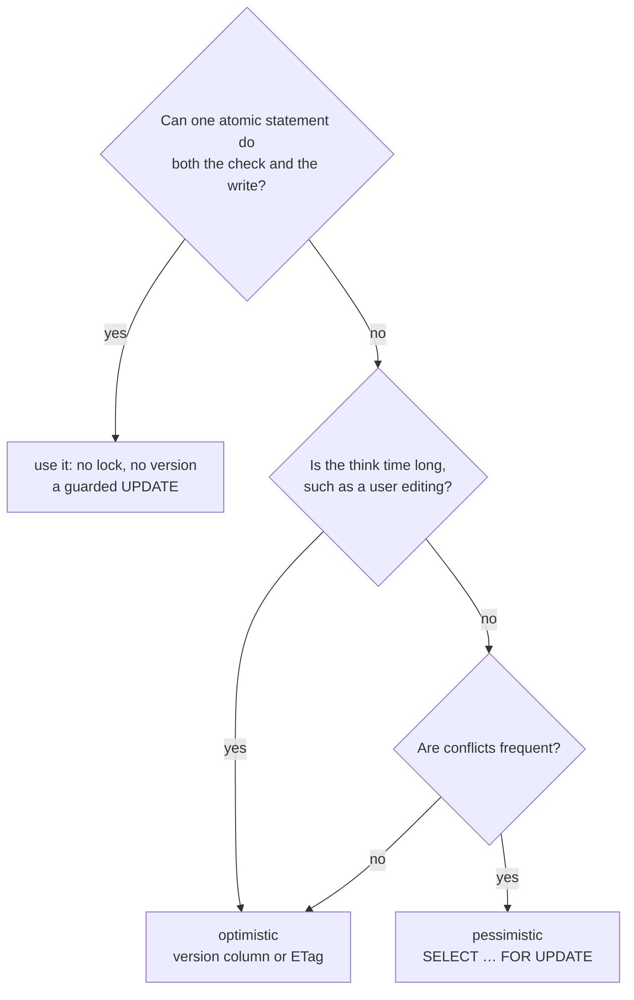

## Mental Model

Two strategies for preventing lost updates when several actors modify the same data:

- **Pessimistic**: "Someone will probably interfere — lock it before I touch it." Others **wait**.
- **Optimistic**: "Probably nobody will interfere — work freely, and at the end **check** nothing changed; if it did, retry." Nobody waits; losers **redo** their work.

It's the same choice as a mutex vs a compare-and-swap loop in concurrent programming ([Atomic Instructions](lesson:os-atomic-instructions)).

## Definition

- **Pessimistic concurrency control**: acquire locks (row locks via `SELECT … FOR UPDATE`, advisory locks) before reading-for-update; hold them until commit.
- **Optimistic concurrency control (OCC)**: read with a version marker; write conditionally (`WHERE version = <read version>`); detect conflict by the affected-row count; retry or report the conflict.
- **Version column**: an integer (or timestamp/hash) incremented on every update.
- **Compare-and-set (CAS) update**: `UPDATE … SET …, version = version + 1 WHERE id = ? AND version = ?`.

## Why It Exists

**The problem.** Many updates are **read → think → write**, where "think" happens in application code or even in a human's browser tab for minutes. Holding a database lock across a user's editing session is impossible; holding one across a fast in-request computation is fine. The two strategies fit those two situations.

**The underlying trade.** Locking pays a cost *every time* (bookkeeping and waiting) to avoid conflicts. Checking pays nothing up front and pays only when a conflict actually happens (redo the work). Which is cheaper depends on how often conflicts really happen.

:::callout[That's all it is]{type=insight}
Pessimistic: lock the row first, so others wait. Optimistic: remember the version you read and update only if it's unchanged; if it changed, retry. Pick by how often conflicts happen and how long the "think" step takes.
:::

## How It Works

### Pessimistic: lock, then compute

```sql
BEGIN;
SELECT quantity, reserved FROM inventory WHERE sku = 'A-17' FOR UPDATE;   -- others wait here
-- application computes the new reservation
UPDATE inventory SET reserved = reserved + 2 WHERE sku = 'A-17';
COMMIT;                                                                     -- lock released
```

Guarantees no one changes the row between your read and write. Keep the locked section short, lock multiple rows in a consistent order ([Locking](lesson:db-locking)), and use `NOWAIT`/`lock_timeout` where waiting is unacceptable.

### Optimistic: version check at write time

```sql
-- 1. read (no lock)
SELECT id, title, body, version FROM documents WHERE id = 42;     -- version = 7

-- 2. user edits for 3 minutes …

-- 3. conditional write
UPDATE documents
SET title = $1, body = $2, version = version + 1
WHERE id = 42 AND version = 7;
-- 1 row updated → success (now version 8)
-- 0 rows updated → someone else saved first: reload, merge or show a conflict
```

No locks held while the user edits. The single `UPDATE` is atomic, so two concurrent saves can't both match `version = 7`:

```text
Alice opens doc 42  → version 7          Bob opens doc 42 → version 7
Alice saves: … WHERE version = 7  → 1 row updated, now version 8
Bob saves:   … WHERE version = 7  → 0 rows updated (it's 8 now) → "Alice changed this; reload or merge"
```

Without the version check, Bob's save would silently overwrite Alice's edit.

ORMs support this directly (JPA `@Version`, Rails `lock_version`, Django via conditional updates).

### Optimistic locking in JPA, and its classic trap

A `@Version` field makes Hibernate add the version check to every update of the row:

```java
@Entity
class Document {
    @Id Long id;
    String body;
    @Version long version;            // every UPDATE gets "... AND version = ?" and bumps it
}

// PUT /documents/{id}, with If-Match carrying the version the client read
@Transactional
public Document save(long id, long clientVersion, String newBody) {
    Document d = em.find(Document.class, id);
    if (d.version != clientVersion)                   // compare with what the *user* saw
        throw new ConflictException(d.version);      // → 412 Precondition Failed
    d.body = newBody;                                 // commit: UPDATE ... WHERE id = ? AND version = ?
    return d;
}
```

The explicit comparison is the part teams forget. `em.find` loads the *latest* version, so without it the `@Version` check only covers the few milliseconds between this read and this commit, not the minutes the user spent editing. The second of two editors would silently overwrite the first. Hibernate's own check still matters: it catches a writer that sneaks in between `find` and commit, and reports it as `OptimisticLockException`, which Spring wraps as `ObjectOptimisticLockingFailureException`.

### Across HTTP: ETags and If-Match

The same pattern for REST APIs ([HTTP Caching](lesson:cn-http-caching)):

```http
GET /documents/42          → 200, ETag: "7"
PUT /documents/42
If-Match: "7"              → 200 (saved, ETag "8")   or   412 Precondition Failed
```

### Idempotency: the companion of retries

Optimistic schemes and network failures both lead to **retries**. Make operations safe to repeat: store a client-supplied idempotency key with a unique constraint, so a retried "charge ₹500" doesn't charge twice ([DML & DDL](lesson:sql-dml-ddl)).

Choosing between them, in order:



## Internal Mechanism

:::depth{level=advanced}
### Optimism inside the database

- PostgreSQL Repeatable Read's "first updater wins" is built-in optimistic control on rows: the second writer aborts with a serialization error instead of silently overwriting.
- Serializable Snapshot Isolation is optimistic concurrency for whole transactions: run without read locks, validate dependencies at commit, abort on dangerous patterns ([Isolation Levels](lesson:db-isolation-levels)).
- Classic OCC (Kung & Robinson) has read, validation and write phases; many in-memory and distributed databases use variants because they avoid lock management across nodes.

### Choosing by contention

Expected cost per operation:

- Pessimistic ≈ lock overhead + P(conflict) × wait time (+ deadlock risk).
- Optimistic ≈ P(conflict) × (wasted work + retry).

At low conflict probability optimistic wins (no waiting, no lock bookkeeping, works across long think times). At high contention on a hot item, optimistic retries snowball — each retry may conflict again (livelock-like behavior) — and pessimistic queueing is more efficient.

### Atomic statements beat both

Sometimes the update can be expressed as a single statement on current values: `SET stock = stock - 1 WHERE stock > 0`, `SET views = views + 1`, `INSERT … ON CONFLICT DO UPDATE`. Then the database does the read-modify-write atomically, under its own row lock, with neither application-level locking nor retries.
:::

## Example

Choosing per use case:

| Use case | Strategy | Why |
|---|---|---|
| Wiki/CMS page editing (minutes of think time) | Optimistic (version column / ETag) | can't hold locks across user sessions; conflicts rare |
| Seat reservation for a hot concert | Pessimistic (`FOR UPDATE`, or `SKIP LOCKED` on seat rows) or atomic conditional update | high contention; retries would thrash |
| Incrementing counters | Atomic `UPDATE … SET n = n + 1` | no read in application code |
| Wallet transfer | Pessimistic locks in id order, or Serializable + retry | invariants across two rows |
| Mobile app offline sync | Optimistic with per-record versions + conflict resolution | clients are disconnected for long periods |

## Complexity & Performance

- Pessimistic: throughput on a hot row ≤ 1 / lock hold time; waiting under contention; deadlocks possible.
- Optimistic: zero waiting; wasted work proportional to conflict rate × work per attempt; can degrade sharply under contention.

## Trade-offs

Pessimistic is predictable under contention but couples transactions (waits, deadlocks) and can't span user think time. Optimistic scales with low contention and long think times, spans service and HTTP boundaries, but needs retry/merge logic and degrades on hotspots.

## Failure Modes

- **Forgetting to check the affected-row count** in optimistic updates — conflicts silently ignored, the lost update returns.
- **Updating without bumping the version** in one code path (e.g., a batch job) — other writers never notice its changes.
- **Holding `FOR UPDATE` locks across slow operations** (API calls, user input).
- **Retry storms** on a hot row with optimistic control.
- **Retrying non-idempotent side effects** (emails, charges) along with the transaction.

## In Production

- Use a DB-generated version increment (`version = version + 1` in SQL, or a trigger) rather than trusting clients.
- Expose conflicts meaningfully to users ("This document was changed by Priya 2 minutes ago — review changes").
- Count conflicts: the rate of `OptimisticLockException`s or 412 responses per endpoint. A rising rate means contention has grown past what optimistic control handles well; move that path to a lock or an atomic statement.

## Deeper Connections

- CAS loops in lock-free programming, HTTP conditional requests, and database version columns are one idea at three layers ([Concurrency Everywhere](lesson:x-concurrency-everywhere)).
- Distributed systems lean optimistic (fencing tokens, conditional writes in object stores, version vectors) because distributed locks are fragile ([Distributed Transactions](lesson:db-distributed-transactions)).

## Common Misconceptions

- **"Optimistic locking uses locks."** It uses no locks — only a conditional write.
- **"Optimistic is always faster."** Only when conflicts are rare.
- **"Transactions alone prevent lost updates."** At Read Committed, read-modify-write in application code still loses updates without FOR UPDATE, a version check or an atomic statement.

## Interview Questions

### [L2 · compare] Optimistic vs pessimistic locking — how do they work and when do you use each?

Pessimistic locking acquires a lock (e.g., SELECT … FOR UPDATE) before reading data to modify, making other writers wait until commit — best under high contention and short critical sections. Optimistic locking reads a version, performs the update conditionally on that version (`WHERE version = ?`), and retries or reports a conflict if zero rows were updated — best with low contention, long think times, or across HTTP/service boundaries.

### [L2 · how] Implement optimistic locking for updating a user profile.

:::answer
Add `version int NOT NULL DEFAULT 0`. Read the profile with its version; on save run

```sql
UPDATE profiles SET display_name = $1, bio = $2, version = version + 1
WHERE user_id = $3 AND version = $4;
```

If the affected-row count is 1, success. If 0, someone else updated it: reload and merge or return a conflict (HTTP 409/412). Expose the version as an ETag and accept If-Match for API clients.
:::

### [L3 · scenario] A flash sale: 50,000 users try to buy 100 units within seconds, using optimistic version checks on the product row. What goes wrong and what would you do?

Nearly every attempt conflicts on the same row, so most transactions fail and retry, multiplying load (retry storms) while few succeed. Better: an atomic conditional decrement (`UPDATE … SET stock = stock - 1 WHERE id = ? AND stock > 0`), which serializes on the row lock without wasted work; or pre-split inventory into many rows (per-unit or bucketed) claimed with `FOR UPDATE SKIP LOCKED`; or queue purchase requests and process them sequentially; plus rate limiting at the edge.

### [L2 · how] How does an ETag/If-Match flow implement optimistic concurrency in a REST API?

`GET /docs/42` returns the representation with `ETag: "7"` (its version). The client edits and sends `PUT /docs/42` with `If-Match: "7"`. The server performs a conditional update (`… WHERE id = 42 AND version = 7`); if it updates a row, it returns 200 with `ETag: "8"`; if another client saved first, nothing matches and it returns **412 Precondition Failed**, so the client can reload and merge instead of silently overwriting.

### [L2 · compare] When does optimistic concurrency perform worse than pessimistic locking?

Under high contention on the same rows: every conflict discards a whole transaction's work, retries collide again, and throughput collapses into retry storms while users see errors. Pessimistic locking queues the same requests and processes them one by one, wasting nothing. Optimistic wins when conflicts are rare or "think time" is long (user edits); pessimistic wins for hot rows updated in short transactions.

### [L1 · compare] What is the difference between `SELECT … FOR UPDATE` and `FOR SHARE`, and what do `NOWAIT` and `SKIP LOCKED` change?

`FOR UPDATE` locks the selected rows exclusively against other writers and other `FOR UPDATE`/`FOR SHARE` lockers (plain MVCC reads still proceed); `FOR SHARE` lets several transactions hold the lock together but blocks updates and deletes. By default a conflicting request waits; `NOWAIT` fails immediately instead, and `SKIP LOCKED` returns only rows nobody else has locked — the standard way to let many workers pull from a job queue without blocking each other.

### [L2 · how] How does JPA's `@Version` work, and why doesn't it protect a REST edit on its own?

Hibernate reads the version with the entity and turns every update into `UPDATE ... SET ..., version = version + 1 WHERE id = ? AND version = ?`. If the row's version changed since it was read, no row matches, and Hibernate throws `OptimisticLockException`. In a REST edit, though, the read that matters happened minutes earlier, in the user's GET. A PUT handler that calls `find` loads the current version, so Hibernate's check passes and the user's stale edit overwrites someone else's. The client must send back the version it saw (an `If-Match` ETag or a field in the request body), and the handler must compare it before applying the change.

### [L2 · how] What should a Spring service do when an update fails with `ObjectOptimisticLockingFailureException`?

Decide whether the operation can be redone automatically. For machine-driven updates (incrementing a counter, recalculating a total), retry the whole transactional method, from outside the transaction, a few times with backoff: the retry reloads the entity and reapplies the change. For human edits, don't retry blindly. Return a conflict (409 or 412) with the current version, so the user can review the other change and merge. In both cases, log or count the conflicts: frequent ones mean the row is hot enough to deserve a lock or an atomic statement instead.

## Practice

### [mcq] An optimistic update `UPDATE t SET v = $1, version = version + 1 WHERE id = 5 AND version = 3` reports 0 rows updated. What does it mean?

- [ ] The row was locked
- [x] The row's version is no longer 3 — another writer updated it (or it was deleted)
- [ ] The update is waiting
- [ ] The transaction deadlocked

Zero affected rows is the conflict signal; the application must handle it.

### [mcq] Which strategy fits editing a long form in a web app where the user may take 10 minutes?

- [ ] SELECT … FOR UPDATE when the form opens
- [x] Optimistic concurrency with a version column / ETag
- [ ] Serializable transaction spanning the edit
- [ ] Table lock

Locks and transactions can't be held across user think time.

### [numeric 1.25 unit=attempts] An optimistic update fails its version check with probability 0.2 on each attempt, independently. How many attempts does it take on average?

:::answer
The number of attempts is geometric: 1 ÷ (1 − 0.2) = **1.25** on average. At a conflict probability of 0.8 it would be 5 attempts, each redoing all its work — the point where locking (waiting once) becomes cheaper than retrying.
:::

### [mcq] Which statement safely decrements stock without needing either an explicit lock or a version column?

- [ ] `SELECT stock FROM items WHERE id = 1`, then `UPDATE items SET stock = <value − 1> WHERE id = 1`
- [x] `UPDATE items SET stock = stock - 1 WHERE id = 1 AND stock > 0`
- [ ] `UPDATE items SET stock = 9 WHERE id = 1`
- [ ] `SELECT stock FROM items WHERE id = 1 FOR SHARE`, then update

The read, check and write happen inside one statement under the row lock the UPDATE takes, so concurrent decrements serialize correctly. Check the affected row count to detect "out of stock".

### [mcq] A payment request times out, and the client retries it. How do you guarantee the customer is charged once?

- [ ] Use SERIALIZABLE isolation
- [ ] Retry only on HTTP 500
- [x] The client sends an idempotency key; the server stores it with a unique constraint alongside the result and returns the stored result for repeats
- [ ] Add a version column to the payments table

The first attempt may have succeeded before the timeout. An idempotency key turns "do it again" into "tell me what happened", and the unique constraint makes concurrent duplicates collide instead of both executing.

### [exercise] Implement optimistic concurrency for `PUT /documents/42` with ETags: what the server sends, what the client sends back, the SQL, and the response when someone else saved first.

:::solution
1. `GET /documents/42` → `200 OK`, `ETag: "7"` (the row's version column).
2. The client edits and sends `PUT /documents/42` with `If-Match: "7"`.
3. The server runs:

```sql
UPDATE documents
SET body = $1, version = version + 1, updated_at = now()
WHERE id = 42 AND version = 7
RETURNING version;
```

4. One row updated → `200 OK` with `ETag: "8"`. Zero rows → someone changed it after version 7 → `412 Precondition Failed`; the client re-fetches, shows the conflict or merges, and retries.

No lock is held while the user edits for minutes; the check costs one extra predicate at write time. A request without `If-Match` can be rejected with `428 Precondition Required` so clients can't skip the check.
:::

### [exercise] In the [lock manager lab](lab:db-locks), load "Consistent lock order" and step through it. How long does T2 wait, and what is the cost? What would T2 experience under optimistic control instead?

:::solution
T2 asks for an exclusive lock on row A while T1 holds it, so T2 joins the queue and waits until T1 commits. Only then is T2 granted row A, and it continues. Nothing is wasted: T2 does its work once. The cost is latency, because T2's wait includes all of T1's transaction, and with many writers on one row, the waits add up into a queue.

Under optimistic control T2 wouldn't wait at all. It would read row A, do its work and, at write time, its version check would fail because T1 had changed the row. T2 would then redo its work. That is cheaper when conflicts are rare, and worse when they're frequent, because each conflict throws away a whole attempt.
:::

### [mcq] A PUT handler loads a document with `em.find`, copies the new body from the request onto it, and relies on the entity's `@Version`. Two users each edited the document for five minutes and save a second apart. What happens?

- [ ] The second save fails with `OptimisticLockException`
- [x] Both saves succeed: each loaded the current version just before saving, so the second silently overwrites the first
- [ ] The second save waits for the first user's lock
- [ ] Hibernate merges the two bodies

`@Version` only compares against the version this request loaded. The handler must compare the version the *client* read (sent as `If-Match` or in the body) and reject a stale one with 412.

## Quick Revision

- Pessimistic: lock first (FOR UPDATE), others wait; good for hot rows and short critical sections.
- Optimistic: read version, conditional write, 0 rows = conflict → retry/merge; good for low contention and long think times.
- HTTP analogue: ETag + If-Match → 412.
- Atomic single statements avoid both. Pair retries with idempotency keys.
- Optimistic degrades into retry storms on hotspots.
- HTTP optimistic concurrency: ETag + If-Match → 412 on conflict. Optimistic loses under high contention (retry storms); pessimistic loses when think time is long.
- JPA `@Version`: Hibernate adds `AND version = ?`; a miss throws `OptimisticLockException` (Spring: `ObjectOptimisticLockingFailureException`).
- Across HTTP, the client's version must come back (If-Match) and be compared explicitly; `find` alone always sees the latest version.
