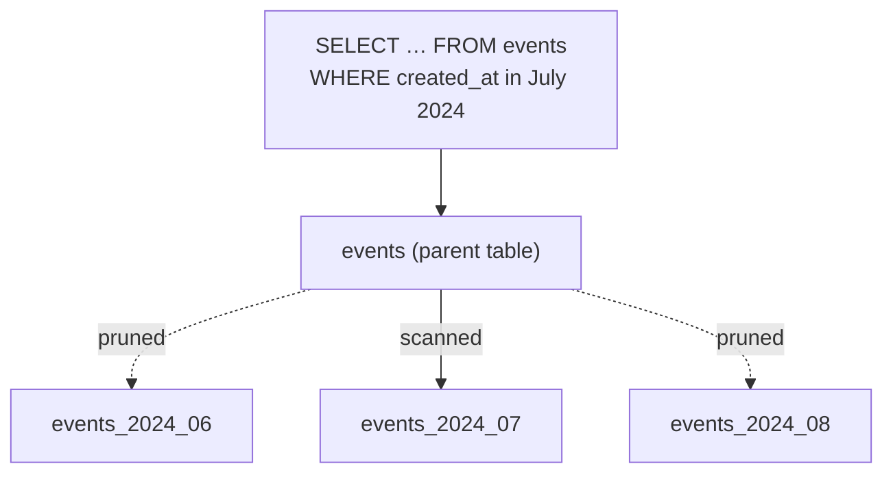

## Mental Model

Partitioning splits one logical table into many physical tables (**partitions**) by a rule on a column — e.g., one partition per month. Queries still address the parent table; the database routes rows on insert and, on read, **skips partitions that can't contain matching rows** (pruning).

It's the difference between one enormous filing cabinet and a cabinet per month. Finding March's papers means opening one drawer. Throwing away 2019 means discarding one cabinet instead of pulling out pages one by one.

Partitioning happens **inside one database server**. Spreading partitions across servers is sharding ([Sharding](lesson:db-sharding)).

## Definition

- **Partition key**: the column(s) the rule uses.
- **Range partitioning**: by value ranges (`created_at` per month). Most common, especially for time-series data.
- **List partitioning**: by discrete values (`region IN ('IN','SG')`, per tenant tier).
- **Hash partitioning**: by `hash(key) mod N` — spreads rows evenly when no natural range exists.
- **Partition pruning**: excluding partitions at plan time (constants) or execution time (parameters, join values).
- **Local index**: an index per partition (PostgreSQL's model); a **global index** spans all partitions (Oracle; not in PostgreSQL).

## Why It Exists

**The problem.** Very large tables (billions of rows) create operational problems more than query problems:

- Deleting old data with `DELETE` is slow, generates massive WAL and bloat; **dropping a partition** is instant.
- Vacuum, index rebuilds and backups operate on the whole table; per-partition maintenance is incremental.
- Recent data is hot and old data cold; partitions let the hot part (and its indexes) stay small and cached.
- Queries constrained by the partition key touch only relevant partitions.

**The idea.** If data naturally falls into chunks (months, regions), store each chunk as its own table behind one name. Operations on a chunk — drop, vacuum, cache — then cost the size of the chunk, not the size of the whole.

:::callout[That's all it is]{type=insight}
Partitioning is one table stored as many smaller tables chosen by a column's value. Queries that filter on that column skip the irrelevant pieces, and old data is removed by dropping a piece instead of deleting rows.
:::

## How It Works

```sql
CREATE TABLE events (
  id         bigint GENERATED ALWAYS AS IDENTITY,
  tenant_id  bigint NOT NULL,
  created_at timestamptz NOT NULL,
  payload    jsonb,
  PRIMARY KEY (id, created_at)          -- must include the partition key
) PARTITION BY RANGE (created_at);

CREATE TABLE events_2024_06 PARTITION OF events
  FOR VALUES FROM ('2024-06-01') TO ('2024-07-01');
CREATE TABLE events_2024_07 PARTITION OF events
  FOR VALUES FROM ('2024-07-01') TO ('2024-08-01');

CREATE INDEX ON events (tenant_id, created_at);   -- created on each partition
```

### Pruning

```sql
EXPLAIN SELECT count(*) FROM events
WHERE created_at >= '2024-07-10' AND created_at < '2024-07-11';
-- Aggregate → Seq Scan on events_2024_07   (only one partition appears)
```

A query **without** the partition key in its predicate scans every partition (an Append over all of them) — often slower than an unpartitioned table with one good index.

Pruning in one picture: the planner reads the partition bounds and touches only the partition that can match.



### Retention in milliseconds

```sql
ALTER TABLE events DETACH PARTITION events_2023_01 CONCURRENTLY;
DROP TABLE events_2023_01;          -- or archive it to cold storage first
```

No row-by-row deletes, no bloat, no vacuum debt.

### Constraints and indexes

- Unique/primary keys must **include the partition key** (each partition enforces uniqueness only locally).
- Indexes are per partition: a lookup by a non-partition column probes an index in *every* partition (N small index lookups instead of one).
- Foreign keys referencing a partitioned table are supported in modern PostgreSQL; still consider their cost.

## Internal Mechanism

:::depth{level=advanced}
### How many partitions?

Each partition is a table with its own files, statistics and catalog entries. Planning time and memory grow with the number of partitions a query *might* touch; PostgreSQL handles thousands, but hundreds of thousands (per-tenant partitions for a large SaaS) is too many. Rule of thumb: partitions sized in the GBs–tens of GBs, count in the tens to low thousands.

### Runtime pruning

With prepared statements (`created_at >= $1`) or join parameters, pruning happens at execution ("Subplans Removed: 23" in EXPLAIN ANALYZE). Partition-wise joins and aggregates let the planner join/aggregate matching partitions pairwise, reducing memory.

### Default partitions and routing

Rows that fit no partition fail, unless a DEFAULT partition exists (which then complicates adding new partitions, since the default must be scanned for conflicting rows). Automate partition creation ahead of time (pg_partman, cron) — a missing next-month partition at midnight is a classic outage.

### Partitioning vs BRIN

For append-only time series queried by time, a BRIN index on an unpartitioned table gives much of the pruning benefit with none of the management ([Specialized Indexes](lesson:db-specialized-indexes)); partitioning adds cheap retention and per-partition maintenance.
:::

## Example

A logging table grows 300 GB/month with 90-day retention:

| Without partitioning | With monthly range partitions |
|---|---|
| Daily `DELETE … WHERE created_at < now() - 90 days` removes ~10 GB of rows: hours of I/O, huge WAL, replica lag, bloat | Monthly `DETACH` + `DROP` of the oldest partition: milliseconds |
| Indexes cover 900 GB; hot recent pages compete with old ones | Current month's indexes are small and cached |
| VACUUM scans the whole table | Old partitions become static (frozen) and need no vacuum |
| Query for yesterday: index range scan | Same, pruned to one partition |

## Complexity & Performance

- Queries with the partition key: cost ∝ relevant partitions only.
- Queries without it: cost ∝ number of partitions × per-partition work.
- Inserts: routing overhead is small.
- Retention: O(1) drops vs O(rows) deletes.

## Trade-offs

- Choose the partition key from the dominant **filter and retention** pattern (almost always time for event data).
- More partitions: finer pruning and retention, more planning overhead and objects.
- Uniqueness across partitions requires the partition key in the key — or a separate mechanism.

## Failure Modes

- Queries that don't filter on the partition key becoming *slower* after partitioning.
- Missing future partitions → insert failures at a period boundary.
- Too many tiny partitions → planning overhead, catalog bloat.
- Expecting partitioning to increase write throughput — it's still one server's CPU, memory and WAL.

## In Production

- pg_partman (PostgreSQL) or scheduled jobs create future partitions and drop expired ones.
- Timescale-style hypertables automate time partitioning ("chunks") with compression for old chunks.

## Deeper Connections

- Pruning is partition-level zone mapping, the same idea as BRIN and column-store zone maps ([Column Stores](lesson:db-column-stores)).
- A partitioned table is executed as a `UNION ALL` (Append) over its partitions ([Set Operations](lesson:sql-set-operations)).
- Sharding applies the same split across machines, adding routing and distributed-query problems ([Sharding](lesson:db-sharding)).

## Common Misconceptions

- **"Partitioning makes every query faster."** Only queries that prune; others get slower.
- **"Partitioning is sharding."** Partitions live on one server; sharding distributes data across servers.
- **"Partitioning scales writes."** It improves maintenance and locality, not the single node's write capacity.

## Interview Questions

### [L2 · compare] Partitioning vs sharding?

Partitioning splits a table into multiple physical tables within one database instance; the database routes rows and prunes partitions transparently. Sharding distributes data across multiple database servers, each holding a subset; it scales storage and write throughput but requires routing, and makes cross-shard queries, transactions and rebalancing hard.

### [L2 · why] Why is partitioning by time so common for event/log tables?

Queries usually target recent time windows (pruning to few partitions), the hot working set is the newest partition (smaller indexes, better caching), old partitions become static, and retention becomes dropping a partition instead of deleting billions of rows — avoiding WAL volume, bloat and vacuum debt.

### [L3 · scenario] After partitioning `orders` by month, a customer's order-history query became 10× slower. Why?

The query filters by customer_id, not by date, so it can't prune: it probes the customer_id index in every monthly partition (e.g., 60 index lookups instead of one) and merges results. Fixes: add a date bound to the query when possible (e.g., last 12 months), partition by a key aligned with the dominant access pattern, or reconsider whether the table needs partitioning at all.

### [L1 · compare] Horizontal vs vertical partitioning?

Horizontal partitioning (fragmentation) splits **rows**: each partition has all columns for a subset of rows (orders by month). Vertical partitioning splits **columns**: each fragment has some columns for all rows, joined back by the primary key — e.g., moving large, rarely read `bio` and `preferences` columns out of a hot `users` table so scans and caches stay lean. Both are physical-design tools; sharding is horizontal partitioning across servers.

### [L2 · debugging] A query on a partitioned table scans every partition. Why might pruning not happen?

The WHERE clause doesn't constrain the partition key, or constrains it through an expression the planner can't match (`date(created_at) = …` instead of a range on `created_at`); the comparison involves a type mismatch or a non-immutable function; or the value is only known at run time and runtime pruning isn't applicable (check for "Subplans Removed" in EXPLAIN ANALYZE). Fix the predicate to a plain range on the partition key.

### [L2 · design] How would you choose the partition key and interval for an events table holding 2 years of data at 50 million rows per day?

Partition by the time column the queries and retention use (`created_at`), daily or weekly — daily gives ~730 partitions of ~50M rows (manageable, fast drops), monthly would give 1.5-billion-row partitions that are slow to vacuum and index. Create partitions ahead of time automatically, drop or archive whole partitions for retention, and keep a composite index like `(tenant_id, created_at)` per partition for the main access path.

## Practice

### [mcq] A table is range-partitioned by created_at (monthly). Which query benefits from pruning?

- [ ] `WHERE customer_id = 42`
- [x] `WHERE created_at >= '2024-03-01' AND created_at < '2024-04-01'`
- [ ] `WHERE date_part('month', payload_date) = 3`
- [ ] `ORDER BY id LIMIT 10`

Only a predicate on the partition key lets the planner exclude partitions.

### [mcq] In PostgreSQL, why must a partitioned table's primary key include the partition key?

- [ ] For faster inserts
- [x] Uniqueness is enforced per partition by local indexes, so global uniqueness is only guaranteed if the partition key is part of the key
- [ ] Because partitions can't have indexes otherwise
- [ ] It's required for pruning

Without global indexes, two partitions could each hold the same id.

### [numeric 2 unit=partitions] `orders` is range-partitioned by month over three years (36 partitions). How many partitions does `WHERE created_at >= '2024-03-25' AND created_at < '2024-04-05'` scan?

:::answer
The range touches March and April 2024: **2** partitions; the other 34 are pruned at planning time. Pruning only works because the predicate compares the partition key directly with constants.
:::

### [mcq] The same monthly-partitioned table is queried with `WHERE date_trunc('month', created_at) = DATE '2024-03-01'`. How many partitions are scanned?

- [ ] One: the planner understands date_trunc
- [x] All of them: the predicate is on an expression, not the partition key, so it can't be used for pruning
- [ ] Two: the current and the previous month
- [ ] None: the query fails

Rewrite as a range on the raw column, `created_at >= '2024-03-01' AND created_at < '2024-04-01'`, and pruning works again — the same rule that makes predicates index-friendly.

### [mcq] A multi-tenant table must keep EU and US customers' rows in separate storage for compliance. Which partitioning method fits best?

- [ ] Range on created_at
- [ ] Hash on customer_id
- [x] List on region
- [ ] No partitioning; use a view

List partitioning assigns each discrete value (or set of values) to its own partition, so `region = 'EU'` rows live in their own table, which can sit in its own tablespace and be managed separately.

### [exercise] `events` is partitioned by month and must keep 12 months of data. Write the monthly maintenance DDL for PostgreSQL: create next month's partition and remove the oldest without blocking queries.

:::solution
```sql
-- 1. Create the next partition ahead of time
CREATE TABLE events_2025_07 PARTITION OF events
  FOR VALUES FROM ('2025-07-01') TO ('2025-08-01');

-- 2. Detach the oldest one without a long exclusive lock (PostgreSQL 14+), then drop or archive it
ALTER TABLE events DETACH PARTITION events_2024_06 CONCURRENTLY;
DROP TABLE events_2024_06;   -- or dump it to cold storage first
```

Dropping a partition removes a month of rows in milliseconds and leaves no dead tuples, unlike `DELETE … WHERE created_at < …`, which rewrites nothing but creates millions of dead rows for VACUUM. Create partitions in advance (a scheduled job or `pg_partman`), and keep a DEFAULT partition only if you monitor it.
:::

## Quick Revision

- Partitioning = one logical table, many physical tables, one server. Range (time), list, hash.
- Pruning skips partitions only when queries filter on the partition key; otherwise every partition is probed.
- Retention via DETACH/DROP partition: instant, no bloat.
- Unique keys must include the partition key; indexes are local.
- Automate partition creation; don't expect write scaling.
- Horizontal = split rows (time partitions, shards); vertical = split columns (move wide/cold columns out). No pruning without a plain predicate on the partition key.
