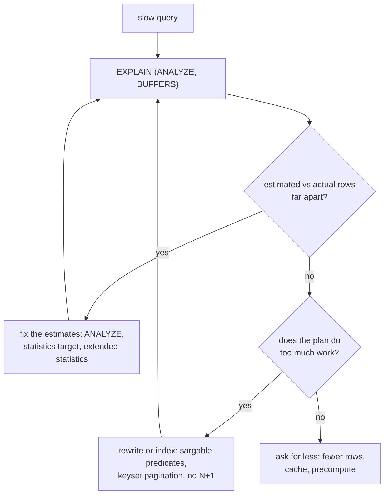

## Mental Model

A slow query is almost always doing **far more work than its result requires**. Two root causes cover most cases:

1. **The planner misjudged the data** — it estimated 10 rows where there are 10 million (or vice versa) and chose an algorithm fit for the wrong size.
2. **The query (or the application) asks for too much work** — non-sargable predicates, N+1 round trips, deep OFFSET pagination, fetching columns and rows it throws away.

Optimization is therefore two activities: **correct the planner's picture of the data** and **reshape the work** so an efficient plan exists.

## Definition

- **Cardinality estimate**: predicted rows produced by a plan node.
- **Selectivity**: fraction of rows satisfying a predicate.
- **Statistics**: per-column samples maintained by `ANALYZE` (auto-analyze in the background): null fraction, distinct count, most common values (MCVs) and their frequencies, histogram bounds, physical correlation.
- **Extended statistics**: multi-column statistics (dependencies, n-distinct, multi-column MCVs) for correlated columns.
- **Plan regression**: the same query switching to a slower plan.

## Why It Exists

**The problem.** Cost-based optimization is only as good as its inputs. Real data is skewed (a few customers own most orders) and correlated (city determines state), while the planner by default assumes uniformity and independence. Knowing where these assumptions break lets you fix plans instead of fighting them.

:::callout[That's all it is]{type=insight}
Slow query = too much work, for one of two reasons. Either the planner misjudged the row counts (fix the statistics so it picks the right algorithm), or the query asks for too much (fix the predicate, the round trips or the pagination so that a cheap plan exists).
:::

## How It Works

The loop most investigations follow:



### How estimates are made

The planner can't run every candidate plan to see which is fastest — it must *predict* row counts from a small summary of the data. Its simplifying assumptions (uniform values, independent columns) are what break.

- `col = const`: if const is an MCV → its stored frequency; else (1 − sum of MCV freqs) / (other distinct values).
- `col < const`: position of const within histogram buckets.
- `a = x AND b = y`: **sel(a) × sel(b)** — independence assumption.
- Join `A.x = B.y`: roughly |A| × |B| / max(distinct(A.x), distinct(B.y)).
- Unknown expressions (`f(col) = x`): hard-coded defaults (e.g., 0.5%).

### Where estimates break — and the fix

| Problem | Example | Fix |
|---|---|---|
| Stale stats | bulk load of 20M rows, then query before auto-analyze | `ANALYZE table` after bulk loads |
| Correlated columns | `city = 'Pune' AND state = 'MH'` underestimated ~30× | `CREATE STATISTICS … (dependencies) ON city, state FROM t; ANALYZE t;` |
| Skew beyond MCV list | long-tail tenant ids | raise `ALTER TABLE … ALTER COLUMN … SET STATISTICS 1000` |
| Function on column | `lower(email) = …` → default selectivity | expression index (gets its own statistics) |
| Generic plans for skewed params | `status = $1` | `plan_cache_mode = force_custom_plan` for that query, or separate queries |
| Multiple joins compounding errors | 5-way join estimates off by 10⁴ | break into steps (materialized CTE / temp table with ANALYZE), or denormalize the hot path |

### Rewrites that matter

**1. Make predicates sargable.**

```sql
-- ✗ WHERE date_trunc('day', created_at) = '2024-05-01'
-- ✓
WHERE created_at >= '2024-05-01' AND created_at < '2024-05-02'
```

**2. Kill N+1 queries.** An ORM loops over 100 orders and fetches each customer separately — 101 round trips, each paying network latency, parsing and planning:

```text
SELECT * FROM orders WHERE … LIMIT 100;
SELECT * FROM customers WHERE id = 17;
SELECT * FROM customers WHERE id = 23;
… ×100
```

Fix with a join or one batched query (`WHERE id = ANY($1)`) — ORMs call this eager loading (`include`, `select_related`, `JOIN FETCH`). 101 queries × 1 ms network = 101 ms → 2 queries ≈ 3 ms.

**3. Keyset pagination instead of deep OFFSET.** `OFFSET 100000 LIMIT 20` produces and discards 100,000 rows; keyset (`WHERE (created_at, id) < (…) ORDER BY … LIMIT 20`) seeks directly ([Composite Indexes](lesson:db-composite-covering-indexes)).

**4. Select only what you need.** `SELECT *` drags wide columns (TOASTed text, jsonb) through the network and prevents index-only scans.

**5. Split OR across columns** into `UNION ALL` branches that each use their own index ([Index Design](lesson:db-index-design-practice)).

**6. Aggregate before joining** to avoid fan-out and reduce rows early ([Joins](lesson:sql-joins)).

**7. Replace correlated subqueries per row** with joins or window functions when the planner doesn't decorrelate them ([Subqueries & CTEs](lesson:sql-subqueries-ctes)).

**8. Batch writes.** Multi-row INSERTs / `COPY` and fewer commits: each commit waits for a WAL flush ([WAL](lesson:db-wal-durability)).

**9. `EXISTS` instead of `COUNT(*) > 0`** — stop at the first match.

**10. Don't do in SQL what shouldn't be done at request time** — precompute heavy aggregates (materialized views, rollups), cache results ([Views](lesson:sql-views-programmability)).

## Internal Mechanism

:::depth{level=advanced}
### Statistics sampling

`ANALYZE` samples 300 × `default_statistics_target` rows (default target 100 → 30,000 rows) regardless of table size, keeps up to 100 MCVs and 100 histogram buckets per column. For a 1-billion-row table with millions of distinct, skewed values, that's a coarse picture — raising the target on specific columns improves it at the cost of planning time and ANALYZE time.

### Plan stability tools

- PostgreSQL has no built-in plan pinning; extensions (`pg_hint_plan`) allow hints, and settings like `enable_nestloop = off` can be applied per session/transaction as a last resort.
- MySQL: optimizer hints and index hints; SQL Server/Oracle: plan guides, Query Store forced plans, SQL plan baselines.
- Hints freeze today's best plan into tomorrow's worst when data changes — fix estimates first.

### Adaptive and runtime techniques

Some engines adapt during execution (adaptive joins in SQL Server and Oracle, which switch between nested loop and hash at runtime based on actual row counts). PostgreSQL mostly relies on estimates, with a few runtime features (e.g., partition pruning at execution, memoize nodes caching inner results in nested loops).
:::

## Example

A dashboard query slows down from 50 ms to 40 s after a data import:

```text
Nested Loop  (rows=12) (actual rows=2400000)
  ->  Seq Scan on events e  (rows=12) (actual rows=2400000)
        Filter: ((tenant_id = 7) AND (region = 'ap-south'))
  ->  Index Scan using users_pkey on users u  (loops=2400000)
```

Diagnosis: tenant 7 imported 2.4M events, all in 'ap-south'. Statistics (a) predate the import and (b) treat `tenant_id` and `region` as independent. Estimated 12 rows → nested loop with 2.4M index lookups.

Fix sequence: `ANALYZE events;` → estimates improve; `CREATE STATISTICS events_tenant_region (dependencies, mcv) ON tenant_id, region FROM events; ANALYZE events;` → planner now expects ~2.4M rows and picks a hash join: 40 s → 1.2 s. Then: index `(tenant_id, region, created_at)` for the dashboard's time filter → 60 ms.

## Complexity & Performance

The payoff distribution is extreme: fixing one misestimate or one N+1 pattern often yields 10–1000× on that path. Work from the top of `pg_stat_statements` (by total time), not from intuition.

## Trade-offs

- Higher statistics targets and extended statistics: better plans, slower ANALYZE and slightly slower planning.
- Hints: immediate fix, long-term fragility.
- Denormalization/precomputation: fast reads, consistency and write costs ([Normalization](lesson:db-normalization)).

## Failure Modes

- **Plan regressions after bulk changes** (imports, deletes, new tenants) before statistics catch up.
- **ORM-generated N+1** that looks fine in development with 10 rows and melts in production with 10,000.
- **Pagination endpoints** degrading linearly with page depth.
- **Over-hinting** so plans can't adapt to growth.

## In Production

- Standard loop: measure (`pg_stat_statements`, APM traces) → capture plan (`auto_explain`) → diagnose (estimate vs actual, rows examined vs returned) → fix (stats, index, rewrite) → verify → monitor.
- Put `ANALYZE` in data-import jobs; monitor `last_autoanalyze` for large churning tables.

## Deeper Connections

- The slow-query investigation is a full-stack story: connection pool waits, network, planning, execution, I/O ([Slow Query](lesson:x-slow-query)).
- N+1 is a round-trip latency problem — the same arithmetic as HTTP request waterfalls ([Latency & Bandwidth](lesson:cn-latency-bandwidth)).

## Common Misconceptions

- **"Adding an index fixes slow queries."** Only if the problem is a missing access path; misestimates and N+1 need different fixes.
- **"The optimizer knows the data."** It knows a sample and assumes independence.
- **"Query hints are the professional solution."** They're a last resort after statistics and query shape.

## Interview Questions

### [L2 · how] What is the N+1 query problem and how do you fix it?

Code fetches a list (1 query) and then issues one query per item to load related data (N queries), paying a round trip, parse and plan each time — latency grows linearly with N. Fix by fetching related rows in one query: a join, or `WHERE id IN (…)`/`= ANY($1)` batch loading (ORM eager loading), then assembling in memory.

### [L2 · why] Why does `OFFSET 100000 LIMIT 20` get slow, and what's the alternative?

The database must produce and skip the first 100,000 rows in order before returning 20, so cost grows with page depth. Keyset (seek) pagination remembers the last row's sort key and asks for rows after it (`WHERE (created_at, id) < ($1, $2) ORDER BY created_at DESC, id DESC LIMIT 20`), which is an index seek plus 20 rows at any depth.

### [L3 · debugging] After a large data import, a query that used a hash join now uses a nested loop and is 100× slower. What do you do?

Compare estimated vs actual rows in EXPLAIN ANALYZE: most likely the statistics predate the import, so the planner underestimates rows and picks a nested loop. Run ANALYZE on the affected tables (and make imports do so automatically). If estimates remain wrong because predicates are correlated, create extended statistics on those columns; for skew, raise the per-column statistics target. Verify the plan returns to a hash join; consider an index designed for the query afterwards.

### [L3 · conceptual] How does PostgreSQL estimate the selectivity of `city = 'Pune' AND state = 'MH'`, and why can that be badly wrong?

It multiplies the individual selectivities (from MCV lists/histograms) assuming the predicates are independent. Because city determines state, the true selectivity equals the selectivity of city alone; multiplying by P(state) underestimates by the inverse of that probability (e.g., 1/0.03 ≈ 33×). Extended statistics with functional dependencies or multi-column MCVs correct it.

### [L2 · how] A query is slow. Walk through how you'd optimize it.

Measure first: get the real query with its parameters and run `EXPLAIN (ANALYZE, BUFFERS)`. Find the node where time or page reads concentrate and compare estimated vs actual rows. Then fix the cause: a missing or mismatched index (add or reorder columns), a non-sargable predicate (rewrite), a misestimate (ANALYZE, extended statistics), too much work requested (select fewer columns, keyset pagination, aggregate earlier), or a design issue (N+1 from the application). Verify with the same EXPLAIN and with latency in production, not just one run.

### [L2 · why] Why is `SELECT *` a performance problem, not just a style issue?

It transfers columns you don't use — including large TOASTed text/jsonb values that must be fetched and decompressed — across the network and into application memory. It prevents index-only scans, because the index can't contain every column. And it couples code to the table shape, so adding a wide column silently slows every query that selects `*`.

### [L2 · optimization] `WHERE email = $1 OR phone = $2` is slow. How do you rewrite it?

With separate indexes on email and phone, PostgreSQL can use a BitmapOr — but many engines (and many plans) fall back to a scan for OR across columns. Rewrite as two index-friendly queries: `SELECT … WHERE email = $1 UNION SELECT … WHERE phone = $2` (UNION removes a row matching both; for speed use UNION ALL and add `AND email IS DISTINCT FROM $1` to the second branch — a plain `email <> $1` would drop rows whose email is NULL). Each branch is a simple index lookup.

## Practice

### [numeric 199] An endpoint runs one query to list 200 orders, then one query per order to fetch its customer. After switching to a single batched customer query, how many fewer queries does each request make?

:::answer
Before: 1 + 200 = 201 queries. After: 1 list query + 1 batched query = 2. Difference: 201 − 2 = **199**. At ~1 ms of round trip each, that's ~200 ms of latency removed per request.
:::

### [mcq] Which change fixes a misestimate caused by correlated columns in PostgreSQL?

- [ ] Adding a B-tree index on each column
- [x] CREATE STATISTICS … (dependencies) ON col_a, col_b, then ANALYZE
- [ ] Increasing work_mem
- [ ] Rewriting the predicate with OR

Extended statistics teach the planner that one column (largely) determines the other.

### [exercise] Rewrite `SELECT * FROM orders WHERE extract(year FROM created_at) = 2024 AND lower(status) = 'paid'` so a B+ tree index on `(status, created_at)` can be used, assuming status is stored in lower case.

:::solution
```sql
SELECT id, customer_id, total, created_at
FROM orders
WHERE status = 'paid'
  AND created_at >= '2024-01-01'
  AND created_at <  '2025-01-01';
```

Remove the functions from the indexed columns (store status normalized, or index `lower(status)` if it can't be), express the year as a half-open timestamp range, and select only the columns needed. The index now seeks to `status = 'paid'` and scans the date range.
:::

### [numeric 12000 unit=rows] A 1,000,000-row table: `city = 'Pune'` matches 10% of rows and `state = 'Maharashtra'` matches 12%. Assuming the columns are independent, how many rows does the planner estimate for `WHERE city = 'Pune' AND state = 'Maharashtra'`?

:::answer
Independence means multiplying selectivities: 0.10 × 0.12 = 0.012, and 0.012 × 1,000,000 = **12,000** rows. In reality every Pune row is in Maharashtra, so the true count is 100,000 — an 8× underestimate. `CREATE STATISTICS … (dependencies) ON city, state` teaches PostgreSQL the correlation.
:::

### [exercise] A paginated list uses `ORDER BY created_at DESC, id DESC LIMIT 50 OFFSET 100000` and page 2,001 takes seconds. Rewrite it with keyset pagination and give the supporting index.

:::solution
```sql
CREATE INDEX ON orders (created_at DESC, id DESC);

-- first page
SELECT id, created_at, total FROM orders
ORDER BY created_at DESC, id DESC
LIMIT 50;

-- next page: pass the last row's (created_at, id) from the previous page
SELECT id, created_at, total FROM orders
WHERE (created_at, id) < ($1, $2)
ORDER BY created_at DESC, id DESC
LIMIT 50;
```

OFFSET makes the database produce and discard 100,000 rows before returning 50. The row-value comparison seeks straight to the position after the last row seen, so every page costs the same. The `id` tie-breaker keeps the order total, so no row is skipped or repeated. The trade-off: you can go to "next" and "previous", not jump to page 2,001.
:::

### [mcq] `SELECT * FROM jobs WHERE status = 'failed'` takes 2 ms with a literal, but 3 seconds when the app sends it as a prepared statement with `status = $1`. What is the most likely cause?

- [ ] The prepared statement skips the index because parameters can't use indexes
- [x] After several executions PostgreSQL switched to a generic plan chosen for an average status value (a sequential scan), which is wrong for the rare 'failed'
- [ ] The network adds 3 seconds of latency for prepared statements
- [ ] Prepared statements always disable parallel query

Skewed values and generic plans don't mix. Options: `plan_cache_mode = force_custom_plan` for that statement or role, a partial index for the rare value, or not preparing that query.

## Quick Revision

- Slow = too much work: wrong estimates → wrong algorithm, or a query shape that forces extra work.
- Estimates: MCVs, histograms, distinct counts, independence assumption; stale after bulk changes.
- Fixes for estimates: ANALYZE, extended statistics, higher per-column targets, expression indexes, custom plans for skewed params.
- Rewrites: sargable predicates, no N+1, keyset pagination, no SELECT *, UNION ALL for cross-column OR, aggregate before join, batch writes, EXISTS.
- Hints are a last resort; measure → capture plan → diagnose → fix → verify.
- Optimization loop: EXPLAIN (ANALYZE, BUFFERS) → hot node + estimate error → fix index/predicate/statistics/work requested → re-measure. Avoid `SELECT *`; split cross-column OR into UNION branches.
