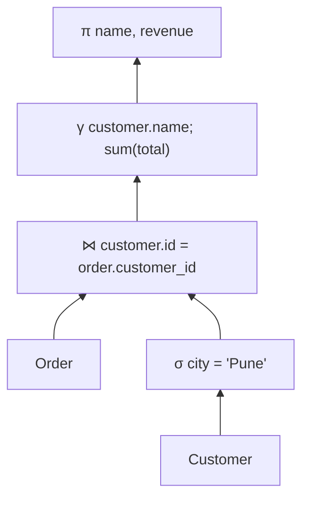

## Mental Model

A **relation** is a table whose rows are facts of the same shape: "customer 7 is named Asha and lives in Pune". The relational model says: store all data as such facts, and answer every question by **combining and filtering sets of facts** with a small set of operators — filter rows, pick columns, join tables, group.

Because queries are expressed as *what* result you want in terms of those operators, the database is free to choose *how* to compute it. That freedom is why a query written in 1995 can run a thousand times faster today on the same schema: new indexes, new join algorithms, new hardware — no query changes.

## Definition

| Relational term | Everyday term | Meaning |
|---|---|---|
| Relation | Table | A set of tuples with the same attributes |
| Tuple | Row | One fact |
| Attribute | Column | A named property with a domain |
| Domain | Type | The set of allowed values (integer, text, date…) |
| Relation schema | Table definition | Name + attributes + constraints: `Customer(id, name, city)` |
| Degree / cardinality | — | Number of attributes / number of tuples |

Two formal properties matter:

- **Tuples are unordered.** A relation is a set; row order has no meaning unless a query asks for `ORDER BY`.
- **Attribute values are atomic** (first normal form): one value per cell, not lists.

:::callout{type=insight}
SQL tables are **bags (multisets)**, not sets: they allow duplicate rows unless a key forbids it, and `SELECT` keeps duplicates unless you write `DISTINCT`. This small deviation from theory explains several SQL surprises (e.g., `UNION` vs `UNION ALL`).
:::

## Why It Exists

**The problem.** Before 1970, databases were **navigational**: hierarchical (IBM IMS) and network (CODASYL) models where programs followed physical pointers from record to record. Every query was a program that knew the storage layout; reorganize the storage and the programs broke.

E. F. Codd's relational model separated the **logical** view (relations) from the **physical** storage, and defined queries mathematically. That gave:

- **Data independence** — storage can change without breaking queries.
- **Ad-hoc queries** — ask new questions without writing new navigation code.
- **Optimizability** — algebraic rules let the system rewrite queries into cheaper equivalent forms.

**The idea in one line.** Describe *what* data you want, never *where it is stored*. Store everything as plain tables of values, so that "related" means "has a matching value", not "has a pointer".

:::callout[That's all it is]{type=insight}
Store everything as tables of facts. Answer questions by filtering, picking columns and matching rows across tables. Because a query only says *what*, the database is free to pick the fastest *how*.
:::

## How It Works

### Relational algebra: the operators under SQL

| Operator | Symbol | SQL | Example |
|---|---|---|---|
| Selection (filter rows) | σ | `WHERE` | `σ[city='Pune'](Customer)` |
| Projection (pick columns) | π | `SELECT col, …` | `π[name](Customer)` |
| Cartesian product | × | `CROSS JOIN` | `Customer × Order` |
| Join | ⋈ | `JOIN … ON` | `Customer ⋈[id=customer_id] Order` |
| Union / Difference / Intersection | ∪ − ∩ | `UNION`, `EXCEPT`, `INTERSECT` | |
| Rename | ρ | `AS` | |
| Grouping/aggregation | γ | `GROUP BY` + aggregates | `γ[city; count(*)](Customer)` |

The operators on two tiny tables:

```text
Customer                 Order
id  name   city          id  customer_id  total
1   Asha   Pune          10  1            900
2   Ravi   Delhi         11  1            7000
3   Meera  Pune          12  2            300

σ[city='Pune'](Customer)          → (1, Asha, Pune), (3, Meera, Pune)        keep matching rows
π[name](Customer)                 → Asha, Ravi, Meera                         keep chosen columns
Customer ⋈[id=customer_id] Order  → (Asha, 10, 900), (Asha, 11, 7000),
                                    (Ravi, 12, 300)                           pair rows with equal values
γ[customer_id; sum(total)](Order) → (1, 7900), (2, 300)                       one row per group
```

Meera has no orders, so she disappears from the join. That is an *inner* join: only matched pairs survive.

Every operator takes relations and returns a relation — so operators compose into trees. A SQL query is compiled into exactly such a tree:



### Equivalences enable optimization

This is the payoff of describing *what* instead of *how*. The operators follow algebraic rules, like `a × b = b × a` in arithmetic. So the optimizer can rewrite your request into a cheaper one that is **guaranteed to return the same rows**:

- Push selections down: filter `Customer` to Pune *before* joining, so the join processes fewer rows.
- Reorder joins: A ⋈ B ⋈ C can be computed as (A ⋈ B) ⋈ C or A ⋈ (B ⋈ C) — pick the order with the smallest intermediate results.
- Replace a join + filter with an index lookup.

This is exactly what the planner does ([Query Lifecycle](lesson:db-query-lifecycle)).

### Relationships are values, not pointers

A customer's orders are found by matching values: `orders.customer_id = customers.id`. There is no stored pointer from a customer to its orders. That's what makes relations flexible — you can join on any compatible attributes, including ones nobody planned for.

### Schema vs instance

The **relation schema** is the structure — `Customer(id, name, city)` — and changes rarely. The **relation instance** is the set of tuples present at one moment, and changes with every insert. Constraints are stated on the schema and must hold for **every** legal instance, which is why "the data happens to look unique right now" doesn't make a column a key ([Keys & Constraints](lesson:db-keys-constraints)).

### Division: the "for all" operator

Most questions are "find X that has *some* Y" (a join). Some are "find X related to **every** Y" — students who took all core courses, customers who bought every product in a category. Relational algebra has an operator for it, **division** (÷):

```text
Enrolled(student, course)            Core(course)
  Asha  DB                             DB
  Asha  OS                             OS
  Ravi  DB
Enrolled ÷ Core = { Asha }      — the only student paired with every course in Core
```

Division isn't a primitive operator. You can build it from the basic ones, in three steps, using the example above:

1. **Every pairing that *should* exist**: all students × all core courses = (Asha, DB), (Asha, OS), (Ravi, DB), (Ravi, OS).
2. **Subtract the pairings that *do* exist** (Enrolled): what's left is (Ravi, OS). Those are the students *missing* something: {Ravi}.
3. **Subtract them from all students**: {Asha, Ravi} − {Ravi} = {Asha}.

SQL has no `DIVIDE`. It's written with double `NOT EXISTS` ("there is no core course this student hasn't taken") or by comparing counts ([Semi & Anti Joins](lesson:sql-semi-anti-joins)).

### Codd's rules — the ones worth remembering

In 1985 Codd published 12 rules (plus rule 0) for what makes a DBMS truly relational. No mainstream product satisfies all of them; interviews usually probe the ideas behind a few:

| Rule | Idea |
|---|---|
| 1 · Information rule | all data is values in tables — nothing hidden in pointers or file positions |
| 2 · Guaranteed access | every value is reachable by table name + primary key + column name |
| 3 · Systematic NULLs | a uniform representation of missing information, distinct from 0 or '' ([NULL Logic](lesson:sql-null-logic)) |
| 4 · Active online catalog | the schema is itself stored in tables queryable with the same language (`information_schema`, `pg_catalog`) |
| 5 · Comprehensive sublanguage | one language for definition, manipulation, integrity, authorization and transactions (SQL) |
| 8–9 · Physical and logical data independence | storage and logical changes don't break applications ([Why Databases](lesson:db-why-databases)) |
| 10 · Integrity independence | constraints are declared in the catalog, not hard-coded in programs |
| 12 · Non-subversion | no low-level interface may bypass the integrity rules |

## Internal Mechanism

:::depth{level=advanced}
### Logical vs physical operators

Relational algebra describes *logical* operations. The executor implements each with *physical* operators chosen per query. A selection might become a sequential scan, an index scan or a bitmap scan; a join might become a nested-loop, hash or merge join ([Scans & Joins](lesson:db-scans-joins)). One logical plan has many physical implementations, and the cost model chooses among them.

### Relational calculus and SQL's declarative nature

Codd also defined a **relational calculus** — describing the result with logic ("all tuples t such that …") rather than operators. It has the same expressive power as the algebra (Codd's theorem). SQL is closer to calculus in style (describe the result) and compiles to algebra (compute it).
:::

## Example

Schema (used throughout the SQL track and in the [SQL Playground](lab:sql-playground)):

```sql
customers(id, name, email, city, created_at)
orders(id, customer_id, order_date, status, total)
products(id, name, category, price)
order_items(order_id, product_id, quantity, unit_price)
departments(id, name, location)
employees(id, name, department_id, manager_id, salary, hired_at)
```

"Names of customers in Pune who placed an order over ₹5,000" in algebra:

```text
π[name]( σ[city='Pune'](customers) ⋈[customers.id = orders.customer_id] σ[total>5000](orders) )
```

In SQL:

```sql
SELECT DISTINCT c.name
FROM customers c
JOIN orders o ON o.customer_id = c.id
WHERE c.city = 'Pune' AND o.total > 5000;
```

`DISTINCT` is needed because SQL keeps duplicates — a customer with three large orders would otherwise appear three times.

## Complexity & Performance

The model says nothing about performance — deliberately. Performance comes from the physical layer: indexes, join algorithms, statistics and caching. The cost of the same logical query can differ by 10,000× depending on the chosen physical plan, which is why the [Query Execution](lesson:db-explain) lessons matter.

## Trade-offs

- **Relational vs navigational/document models**: relations excel at ad-hoc queries and many-to-many relationships; document models make "load one aggregate in one read" simple but make cross-document queries harder ([NoSQL Landscape](lesson:db-nosql-landscape)).
- **Normalized relations vs duplication**: storing each fact once avoids inconsistencies but requires joins to reassemble data ([Normalization](lesson:db-normalization)).

## Failure Modes

- **Relying on row order** without `ORDER BY` — results come back in whatever order the plan produced, which can change after an index is added or a table is vacuumed.
- **Non-atomic values** (`tags = 'a,b,c'`) — cannot be indexed or joined properly; queries degrade into string parsing.
- **Forgetting bag semantics** — joins multiply rows, and aggregates over joined rows double-count ([Joins](lesson:sql-joins)).

## In Production

- Nearly every business system — payments, inventory, bookings, identity — is modeled relationally because the questions change faster than the data model.
- Modern relational databases also store JSON, arrays and full-text data, blurring the line with document stores; the relational core (keys, joins, transactions) remains.

## Deeper Connections

- The optimizer's freedom rests on the algebra's equivalence rules — the same idea as a compiler optimizing code while preserving semantics.
- Relations joined by values rather than pointers are why foreign keys need indexes: the database must *search* for matches ([Index Fundamentals](lesson:db-index-fundamentals)).

## Common Misconceptions

- **"Relational means the tables have relationships."** "Relation" is the mathematical term for a table; relationships between tables are modeled with keys.
- **"Rows come back in insertion order."** No order is guaranteed without `ORDER BY`.
- **"SQL tables are sets."** They are bags unless a key or `DISTINCT` removes duplicates.

## Interview Questions

### [L1 · conceptual] What is a relation, and how does it differ from a spreadsheet?

A relation is a set of tuples over a fixed set of typed attributes; each tuple is a fact, order is meaningless, and values are atomic. A spreadsheet has positional rows and columns, mixed types per column, formulas and meaningful ordering; it enforces none of the constraints or typing a relation does.

### [L2 · why] Why does the relational model make query optimization possible?

Queries are declarative and compile to relational-algebra expressions whose equivalences are mathematically proven (selection pushdown, join commutativity/associativity). The optimizer can therefore rewrite a query into any equivalent form and choose physical operators by estimated cost, while guaranteeing the same result.

### [L2 · compare] How is a relational "relationship" different from a pointer in a navigational or object model?

Relationships are represented by matching values (a foreign key equals a primary key), not stored physical pointers. Any attributes with compatible domains can be joined, even in ways not anticipated at design time, and storage can be reorganized without invalidating links. The cost is that the database must search for matches — hence indexes on join columns.

### [L2 · how] How would you express "students enrolled in every course" in relational algebra and in SQL?

In algebra it's division: `Enrolled(student, course) ÷ π_course(Course)`. Expanded with basic operators: take all students `S = π_student(Enrolled)`; compute the pairs that *should* exist, `S × π_course(Course)`; subtract the pairs that do exist to get missing pairs; project their students and subtract from S. In SQL: "students for whom no course exists that they are not enrolled in" — `SELECT s.id FROM students s WHERE NOT EXISTS (SELECT 1 FROM courses c WHERE NOT EXISTS (SELECT 1 FROM enrolled e WHERE e.student_id = s.id AND e.course_id = c.id))`, or group by student and compare `count(DISTINCT course_id)` with the total number of courses.

### [L2 · conceptual] Name a few of Codd's rules. Does any real database satisfy all of them?

Information rule (everything is a value in a table), guaranteed access (table + key + column reaches any value), systematic treatment of NULL, an online relational catalog, a comprehensive sublanguage, physical and logical data independence, integrity independence, and non-subversion. No mainstream product meets all twelve — SQL tables allow duplicate rows (bags), views aren't always updatable, and logical data independence is partial — but the rules describe what "relational" is meant to buy you.

### [L1 · compare] Schema vs instance? Degree vs cardinality?

The schema is the relation's structure (name, attributes, types, constraints); the instance is the set of rows present at a given time. Degree is the number of attributes (columns); cardinality is the number of tuples (rows). A `Customer(id, name, city)` table with 1,000 rows has degree 3 and cardinality 1,000.

### [L2 · trace] R(A, B) has 4 tuples and S(B, C) has 5 tuples. What are the minimum and maximum sizes of R ⋈ S (natural join on B)?

Minimum 0 — no B value in common. Maximum 20 — every tuple of R matches every tuple of S, which happens when all tuples share a single B value; a natural join can never produce more than |R| × |S| tuples. If B were a key of S, the maximum would drop to 4 (each R tuple matches at most one S tuple).

## Practice

### [mcq] Which relational-algebra operator corresponds to SQL's WHERE clause?

- [ ] Projection (π)
- [x] Selection (σ)
- [ ] Rename (ρ)
- [ ] Cartesian product (×)

Selection filters rows; projection picks columns — the naming is a classic trap.

### [numeric 12] Table A has 3 rows and table B has 4 rows. How many rows does A CROSS JOIN B produce?

:::answer
The Cartesian product pairs every row of A with every row of B: 3 × 4 = 12.
:::

### [numeric 20] R(A, B) has 4 tuples and S(B, C) has 5 tuples, and every tuple in both relations has B = 7. How many tuples does R ⋈ S (natural join) produce?

:::answer
Every R tuple matches every S tuple because they all share B = 7, so the join is the full product: 4 × 5 = **20** tuples.
:::

### [mcq] Which relational-algebra operation answers "suppliers who supply every part"?

- [ ] Union
- [ ] Natural join
- [x] Division
- [ ] Projection

"For all" questions are division; joins only express "for some".

### [numeric 3 unit=tuples] R(A, B) contains (1, a), (1, b), (2, a), (3, a), (3, b). How many tuples does the relational-algebra projection π_A(R) contain?

:::answer
A relation is a set, so projection removes duplicates: {1, 2, 3} → **3** tuples. SQL's `SELECT A FROM R` works on bags and returns 5 rows unless you write `SELECT DISTINCT A`.
:::

### [mcq] Which set of relational-algebra operators is enough to express all the others (join, intersection, division)?

- [ ] σ, π, ⋈, ∩
- [x] σ, π, ∪, −, ×, ρ
- [ ] π, ⋈, ÷
- [ ] σ, ∪, ∩

Selection, projection, union, set difference, Cartesian product and rename are the fundamental operators. Join is σ over ×, intersection is R − (R − S), and division can be written with π, × and −.

### [exercise] With `Employee(eid, name, did)` and `Dept(did, dname)`, write a relational-algebra expression for the names of employees in the Sales department, then rewrite it the way an optimizer would.

:::solution
Direct translation: **π_name(σ_dname='Sales'(Employee ⋈ Dept))**.

Optimized: push the selection down to the relation it mentions and project early — **π_name(Employee ⋈ σ_dname='Sales'(Dept))**. The join now sees one Dept tuple instead of every department, so it touches only Sales employees. Both are equivalent by the algebra's rules (selection commutes with join when it mentions only one side), which is exactly the freedom a query optimizer uses.
:::

## Quick Revision

- Relation = set of tuples with typed attributes; no row order; atomic values. SQL tables are bags.
- Algebra: σ (WHERE), π (SELECT list), × and ⋈ (joins), ∪ − ∩, γ (GROUP BY).
- Declarative queries + algebraic equivalences → the optimizer picks the physical plan.
- Relationships are value matches, not pointers → join columns need indexes.
- Schema = structure (stable); instance = rows right now. Degree = #columns, cardinality = #rows.
- Division (÷) answers "related to **every** Y"; SQL writes it as double `NOT EXISTS` or a count comparison.
- Codd's rules: info rule, guaranteed access, systematic NULLs, catalog in tables, data independence, non-subversion — no product meets all 12.
