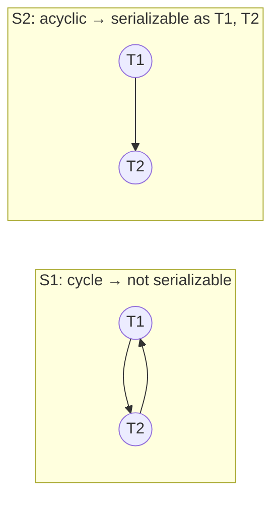

## Mental Model

A **schedule** is the order in which the database actually runs the reads and writes of concurrent transactions — one interleaving out of many possible ones. Two questions decide whether that interleaving is acceptable:

1. **Serializability** — is the outcome the same as running the transactions *one at a time* in some order? If yes, the interleaving bought speed without changing meaning.
2. **Recoverability** — if one transaction aborts, can the database clean up without breaking transactions that already committed?

Everything else in this lesson is a way to check those two questions mechanically.

## Why It Exists

**The problem.** Interleaving transactions is what makes databases fast, and interleaving is also what causes lost updates, dirty reads and write skew ([Anomalies](lesson:db-anomalies)). "Make it correct" needs a precise, checkable meaning.

**Without it.** You can't prove that a concurrency-control protocol (locking, timestamps, MVCC) is correct, and you can't say exactly which interleavings an isolation level forbids.

**The idea.** Define correctness relative to the obviously correct case, serial execution. Then turn "is this interleaving equivalent to a serial one?" into a graph question: only the order of *conflicting* operations matters, so draw an edge for each conflict and look for a cycle. Separately, require that nobody commits on top of data that might still be rolled back.

:::callout[That's all it is]{type=insight}
Two operations conflict if they touch the same item, come from different transactions, and at least one writes. Draw an arrow for every conflict in the order it happened; no cycle means the schedule acts like some serial order. And never let a transaction commit after reading data whose writer might still abort.
:::

## Definition

- **Schedule**: an ordering of the operations of a set of transactions that keeps each transaction's own operations in order.
- **Serial schedule**: transactions run one after another with no interleaving. n transactions have n! serial schedules — all considered correct.
- **Conflicting operations**: two operations from **different** transactions on the **same** data item where **at least one is a write**: read–write, write–read, write–write. Two reads never conflict.
- **Conflict equivalent**: two schedules that order every pair of conflicting operations the same way.
- **Conflict serializable**: conflict equivalent to some serial schedule.
- **View equivalent**: same initial reads, same "reads-from" relationships, same final writes for every item.
- **View serializable**: view equivalent to some serial schedule. Every conflict-serializable schedule is view serializable, but not the reverse (the difference involves **blind writes** — writes without a prior read).
- **Recoverable schedule**: if Tj reads a value written by Ti, then Ti commits before Tj commits.
- **Cascadeless (avoids cascading aborts)**: transactions read only values written by **committed** transactions.
- **Strict schedule**: no transaction reads **or overwrites** an item written by an uncommitted transaction.

Notation used below: R1(A) = T1 reads A, W2(B) = T2 writes B, C1 = T1 commits, A1 = T1 aborts.

## How It Works

### Which pairs conflict

| | T2 reads X | T2 writes X |
|---|---|---|
| **T1 reads X** | no conflict — order doesn't matter | **conflict** (RW) |
| **T1 writes X** | **conflict** (WR) | **conflict** (WW) |

Swapping two adjacent non-conflicting operations never changes the result. A schedule is conflict serializable if you can keep swapping such pairs until it becomes serial — or, equivalently, if its precedence graph has no cycle.

### The precedence-graph test

::::steps[Testing conflict serializability]
1. Draw a node per transaction.
2. For every pair of conflicting operations where Ti's operation comes first, draw an edge **Ti → Tj** ("Ti must come before Tj").
3. If the graph has a **cycle**, the schedule is **not** conflict serializable.
4. If it's acyclic, any **topological order** of the graph is an equivalent serial schedule.
::::

**Example 1 — not serializable (a lost update):**

```text
S1:  R1(A)  R2(A)  W1(A)  W2(A)
     R1(A) … W2(A)  → T1 → T2
     R2(A) … W1(A)  → T2 → T1      cycle → NOT conflict serializable
     W1(A) … W2(A)  → T1 → T2
```

Both transactions read the old A and both write — one update is lost, exactly as the cycle predicts.

**Example 2 — serializable:**

```text
S2:  R1(A) W1(A) R2(A) W2(A) R1(B) W1(B) R2(B) W2(B)
     every conflict on A and on B has T1's operation first → only edge T1 → T2
     acyclic → equivalent to the serial schedule T1, T2
```

The transactions interleave, but T1 "goes first" on every item, so the result matches running T1 then T2.



Type any schedule into the analyzer below — it draws the precedence graph, lists the conflicts behind every edge, and checks each property in this lesson. Hover an edge to see which pair of operations created it.

::lab{id=schedules}

### View serializability

Three conditions, for every data item X, between schedule S and a serial schedule S′:

1. **Initial reads**: if a transaction reads the initial value of X in S, it does so in S′.
2. **Reads-from**: if Tj reads the value of X written by Ti in S, it does so in S′.
3. **Final writes**: the transaction that writes X last in S also writes it last in S′.

It accepts some schedules conflict serializability rejects:

```text
S3:  R1(A)  W2(A)  W1(A)  W3(A)
precedence: R1(A)→W2(A): T1→T2;  W2(A)→W1(A): T2→T1   → cycle, NOT conflict serializable
view: compare with serial T1, T2, T3 — T1 reads the initial A ✓, nobody reads anyone's write ✓,
      T3 writes A last ✓  → VIEW serializable
```

T2's and T1's writes are **blind** (never read) and overwritten by T3, so their order doesn't affect what anyone sees. Testing view serializability is NP-complete, which is why real protocols aim for conflict serializability.

### The recoverability ladder

Serializability ignores aborts. Recoverability is about what happens when a transaction aborts after others have used its data.

| Schedule | Rule | Problem it prevents | Example of a violation |
|---|---|---|---|
| **Recoverable** | if Tj reads from Ti, Ti commits before Tj commits | committing on data that later disappears | `W1(A) R2(A) C2 A1` — T2 committed using a value that never existed |
| **Cascadeless** | read only committed values | cascading aborts | `W1(A) R2(A) W2(B) R3(B) A1` — T1's abort forces T2 and T3 to abort too |
| **Strict** | don't read or overwrite uncommitted writes | undo by restoring "before images" being wrong | `W1(A) W2(A) A1` — undoing T1 would restore A's old value over T2's write |

Each level contains the next: **strict ⊂ cascadeless ⊂ recoverable**. Strict schedules make undo trivial (restore the before-image), which is why strict two-phase locking — hold write locks until commit — is the standard ([Concurrency Protocols](lesson:db-concurrency-protocols)).

### Counting schedules

- n transactions have **n!** serial schedules (3 transactions → 6).
- Two transactions with m and n operations have C(m + n, m) = (m + n)! / (m! n!) interleavings: 2 and 3 operations → 10 schedules; 3 and 3 → 20. Most real interleavings are neither serial nor all serializable — the protocol's job is to allow only the safe ones.

## Internal Mechanism

:::depth{level=advanced}
### How real systems get serializability

- **Strict 2PL** produces conflict-serializable, strict schedules. Conflicting operations wait, so a precedence edge can only point from the lock holder to the waiter. A cycle would therefore require a deadlock, which the database detects and breaks ([Locking](lesson:db-locking)).
- **Timestamp ordering** forces precedence edges to follow timestamp order, so cycles are impossible by construction ([Concurrency Protocols](lesson:db-concurrency-protocols)).
- **Snapshot isolation** is *not* serializable: write skew is a precedence cycle made only of read–write anti-dependencies. **Serializable Snapshot Isolation** watches for exactly that "dangerous structure" (two consecutive rw edges) and aborts one transaction ([Isolation Levels](lesson:db-isolation-levels)).
- **MVCC never shows uncommitted data**, so MVCC schedules are cascadeless by construction; writers still lock rows against other writers, which keeps them strict for writes.

### Serializable vs strict serializable

Serializability promises *some* equivalent serial order — not necessarily the order transactions committed in real time. A read-only transaction may legally observe a slightly older state. **Strict serializability** adds the real-time requirement: if T1 committed before T2 started, T1 comes first in the equivalent order. Single-node databases at Serializable usually give it; distributed databases need extra machinery (Spanner's commit wait) ([Consistency Models](lesson:db-consistency-models)).
:::

## Example

A bank applies a transfer and monthly interest concurrently. T1: move ₹100 from A to B. T2: add 10% interest to both.

```text
S:  R1(A) W1(A) R2(A) W2(A) R2(B) W2(B) R1(B) W1(B)
edges on A: T1 → T2  (T1 wrote A before T2 read/wrote it)
edges on B: T2 → T1  (T2 wrote B before T1 read/wrote it)    → cycle
```

Not serializable. Interest is applied to A *after* the debit but to B *before* the credit, so the ₹100 in flight earns no interest anywhere: a result no serial order would produce. Under strict 2PL this interleaving can't happen. T2's read of A waits for T1's exclusive lock on A, which T1 holds until it commits, so T2 effectively runs after T1 (the serial order T1, T2). Had T2 touched B before A, the two would deadlock instead, and the database would abort and retry one of them.

## Complexity & Performance

| Test | Cost |
|---|---|
| Conflict serializability (precedence graph + cycle detection) | O(n + e) — polynomial |
| View serializability | NP-complete |
| Recoverable / cascadeless / strict | linear scan of the schedule |

Databases never test schedules after the fact; they use protocols that only *generate* serializable, strict schedules.

## Trade-offs

- Stricter classes (strict, serializable) mean more waiting or aborting; weaker isolation levels admit non-serializable schedules for throughput.
- View serializability accepts more schedules but can't be enforced efficiently; conflict serializability is the practical target.

## Failure Modes

- **Cascading aborts** when transactions can read uncommitted data (`READ UNCOMMITTED`, `NOLOCK` hints): one abort invalidates the readers' work.
- **Non-recoverable states** if a transaction could commit after reading uncommitted data — mainstream databases simply don't allow committing such reads to be exposed.
- **Retry storms** in serializable systems under contention: many cycles → many aborts.

## In Production

- You meet this theory as error codes: deadlock victims (SQLSTATE 40P01) and serialization failures (40001) are the database breaking precedence cycles. The application must retry the whole transaction.
- `READ UNCOMMITTED` / `NOLOCK` (SQL Server) produce non-cascadeless reads — avoid them for anything you'll act on.

## Deeper Connections

- The same "order of conflicting accesses" reasoning defines data races in memory models ([Race Conditions](lesson:os-race-conditions)).
- Precedence graphs are wait-for graphs' cousin: one detects non-serializable interleavings, the other deadlocks ([Deadlocks](lesson:os-deadlocks)).
- Strictness is what makes undo by before-images correct during recovery ([Crash Recovery](lesson:db-crash-recovery)).

## Common Misconceptions

- **"Serializable means the transactions ran one at a time."** They ran interleaved; the *result* equals some serial order.
- **"Conflict serializable and view serializable are the same."** View serializability also accepts some schedules with blind writes.
- **"Recoverable means no cascading aborts."** Recoverable only guarantees commit order; cascadeless is the stronger property that prevents cascades.

## Interview Questions

### [L1 · conceptual] What is a schedule, and what makes it serializable?

A schedule is the interleaved order in which the operations of concurrent transactions execute (each transaction's own operations stay in order). It's serializable if its effect equals that of some serial schedule — the transactions run one after another in some order. Conflict serializability is the practical test: it's equivalent to a serial schedule that orders every pair of conflicting operations the same way.

### [L1 · conceptual] Which operations conflict?

Two operations conflict if they belong to different transactions, access the same data item, and at least one is a write: read–write, write–read and write–write. Two reads never conflict, so their order can be swapped freely; the order of conflicting operations is what determines the outcome.

### [L2 · how] How do you test whether a schedule is conflict serializable?

Build a precedence graph: a node per transaction and an edge Ti → Tj whenever an operation of Ti conflicts with a later operation of Tj. If the graph has a cycle, the schedule isn't conflict serializable. If it's acyclic, a topological sort gives an equivalent serial order. For `R1(A) R2(A) W1(A) W2(A)` the edges T1 → T2 and T2 → T1 form a cycle — a lost update.

### [L2 · compare] Conflict serializability vs view serializability?

Conflict serializability requires the same order of every conflicting pair as some serial schedule; view serializability requires only the same initial reads, the same reads-from relationships and the same final writes. Every conflict-serializable schedule is view serializable; some view-serializable schedules are not conflict serializable, and they always contain blind writes (writes without a preceding read). Conflict serializability is testable in polynomial time; view serializability is NP-complete — so protocols target the former.

### [L2 · compare] Recoverable vs cascadeless vs strict schedules?

Recoverable: if Tj reads data written by Ti, Ti commits before Tj — otherwise Tj could commit on data that is then rolled back. Cascadeless: transactions read only committed data, so one abort never forces others to abort. Strict: transactions neither read nor overwrite uncommitted writes, so undo can simply restore before-images. Strict ⊂ cascadeless ⊂ recoverable; strict 2PL produces strict schedules.

### [L2 · trace] Is `W1(A) R2(A) W2(B) C2 A1` recoverable? What should the database have done?

No. T2 read A written by T1 and committed before T1 finished; when T1 aborts, T2 has committed a result based on a value that never officially existed, and it can't be undone. A recoverable schedule would delay C2 until T1 commits (and abort T2 if T1 aborts); a cascadeless one would not let T2 read A until T1 committed at all.

### [L2 · numerical] How many serial schedules exist for 4 transactions? How many interleavings exist for two transactions with 2 and 3 operations?

Serial schedules: 4! = 24. Interleavings of 2 + 3 operations (each transaction's own order fixed): C(5, 2) = 5! / (2! · 3!) = 10.

### [L3 · conceptual] Snapshot isolation never reads uncommitted data and prevents lost updates. Why isn't it serializable?

Because serializability concerns read–write dependencies, not just write–write conflicts. In write skew, T1 reads what T2 writes and T2 reads what T1 writes, on *different* rows — a precedence cycle made of two read–write anti-dependency edges with no write–write conflict for SI to detect. Serializable Snapshot Isolation tracks those rw-dependencies and aborts a transaction when a dangerous pattern appears.

## Practice

### [numeric 10] T1 has 2 operations and T2 has 3. How many different schedules (interleavings) are possible, keeping each transaction's operations in order?

:::answer
Choose which 2 of the 5 positions belong to T1: C(5, 2) = 5! / (2! · 3!) = 120 / 12 = **10**.
:::

### [numeric 6] How many serial schedules are there for 3 transactions?

:::answer
One per ordering of the transactions: 3! = **6**.
:::

### [mcq] `R1(X) R2(X) W2(X) W1(X)` — is it conflict serializable?

- [ ] Yes, equivalent to T1, T2
- [ ] Yes, equivalent to T2, T1
- [x] No — the precedence graph has a cycle
- [ ] It can't be decided without view equivalence

R1(X) before W2(X) gives T1 → T2; R2(X) before W1(X) gives T2 → T1. Cycle.

### [mcq] Which schedule is cascadeless?

- [ ] `W1(A) R2(A) C1 C2`
- [x] `W1(A) C1 R2(A) C2`
- [ ] `W1(A) R2(A) C2 C1`
- [ ] `W1(A) R2(A) A1 C2`

Only the second has T2 reading A after T1 committed. The first is recoverable but not cascadeless; the third and fourth aren't even recoverable.

### [exercise] Draw the precedence graph for `R1(A) R2(B) W1(B) W2(A) R3(A) W3(B)` and decide whether it's conflict serializable. If it is, give an equivalent serial order.

:::solution
Conflicts on A: R1(A) before W2(A) → **T1 → T2**; W2(A) before R3(A) → **T2 → T3**. (R1(A) and R3(A) are both reads: no edge.)
Conflicts on B: R2(B) before W1(B) → **T2 → T1**; W1(B) before W3(B) → T1 → T3; R2(B) before W3(B) → T2 → T3.

Edges T1 → T2 and T2 → T1 form a cycle, so the schedule is **not** conflict serializable.
:::

### [numeric 210 unit=schedules] T1 has 3 operations, T2 has 2 and T3 has 2. How many schedules interleave them while keeping each transaction's own order?

:::answer
Choose positions for each transaction's operations among 7 slots: 7! ÷ (3! × 2! × 2!) = 5,040 ÷ 24 = **210**. Only 3! = 6 of them are serial.
:::

### [exercise] Is `R1(A) W2(A) W1(A) W3(A) C1 C2 C3` conflict serializable? View serializable? Check your answer in the [Schedule Analyzer](lab:schedules).

:::solution
**Conflict serializability**: R1(A) before W2(A) gives T1 → T2; W2(A) before W1(A) gives T2 → T1. Cycle, so **not** conflict serializable.

**View serializability**, compared with the serial order T1, T2, T3: T1 reads the initial A in both; nobody else reads; and T3 performs the final write of A in both. All three conditions hold, so it **is** view serializable. W2(A) and W3(A) are blind writes (written without reading A), and T3's final write hides the order of the earlier writes — the only way a schedule can be view- but not conflict-serializable.
:::

## Quick Revision

- Schedule = interleaving; serial = one at a time (n! of them); serializable = same effect as some serial schedule.
- Conflict = different transactions, same item, ≥ 1 write (RW, WR, WW). Precedence graph Ti → Tj per conflict; cycle ⇒ not conflict serializable; topological order ⇒ equivalent serial schedule.
- View serializable ⊇ conflict serializable (difference = blind writes); view test is NP-complete.
- Strict ⊂ cascadeless ⊂ recoverable. Recoverable: commit after those you read from. Cascadeless: read only committed. Strict: don't read or overwrite uncommitted.
- Interleavings of m and n operations: C(m + n, m).
