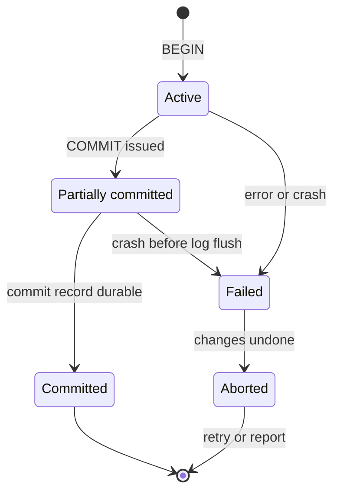

## Mental Model

A transaction is a **bundle of reads and writes that the database treats as one indivisible, isolated, permanent step**. Either all of its changes happen or none do; other sessions never see it half-done; once `COMMIT` returns, the changes survive crashes.

The classic example: transferring ₹500 from account A to B is two updates. Without a transaction, a crash between them destroys money, and a concurrent reader could see ₹500 missing from both accounts.

```sql
BEGIN;
UPDATE accounts SET balance = balance - 500 WHERE id = 'A';
UPDATE accounts SET balance = balance + 500 WHERE id = 'B';
COMMIT;
```

## Definition

| Property | Precise meaning | Implemented by |
|---|---|---|
| **Atomicity** | All of the transaction's effects happen, or none do (on error, abort or crash) | Undo information (old row versions / undo log) and WAL-based recovery |
| **Consistency** | A transaction moves the database from one state satisfying all declared constraints to another | Constraints (PK, FK, UNIQUE, CHECK) + *the application's* correct logic |
| **Isolation** | Concurrent transactions don't interfere beyond what the isolation level allows; ideally, as if run one at a time (serializable) | Locking and/or MVCC ([Isolation Levels](lesson:db-isolation-levels)) |
| **Durability** | Once committed, effects survive crashes and power loss | WAL flushed to stable storage before COMMIT returns ([WAL](lesson:db-wal-durability)) |

Consistency is the odd one out: it's mostly the application's responsibility. The database guarantees the constraints you declared; it can't know your business invariants ("total money is conserved") unless you encode them.

## Why It Exists

**The problem.** Real operations are several writes that only make sense together — debit *and* credit, order *and* its items. Two things can break that togetherness: a failure halfway through, and another request interleaving its own writes.

**Without it.** Every application would have to handle partial failure (a crash after the first of five writes) and concurrency (another request interleaving its writes) by itself. Compensation logic, retries and locking would be scattered through the code.

**The idea.** Let the application draw a boundary, BEGIN … COMMIT, and promise that everything inside behaves as a single step. It happens entirely or not at all, nobody sees it half-done, and once confirmed it stays. Transactions move that burden into the database, where it's implemented once, carefully.

**From idea to mechanism.** Each letter needs its own machinery: undo information for **A**, constraints for **C**, locks or snapshots for **I**, and a log flushed at commit for **D**. The following lessons take them one at a time.

:::callout[That's all it is]{type=insight}
A transaction is a group of statements the database treats as one: all or nothing, invisible until done, permanent once COMMIT returns. ACID is just the list of those promises.
:::

## How It Works

### Transaction control

```sql
BEGIN;                         -- or START TRANSACTION
  … statements …
  SAVEPOINT before_items;
  … statements …
  ROLLBACK TO SAVEPOINT before_items;   -- undo only part
COMMIT;                        -- or ROLLBACK;
```

- **Autocommit**: without `BEGIN`, each statement is its own transaction (the default in most drivers and `psql`).
- In PostgreSQL, **any error aborts the transaction**: further statements fail with "current transaction is aborted" until `ROLLBACK` (or rollback to a savepoint). MySQL continues after many errors, leaving it to the application.
- DDL is transactional in PostgreSQL (you can roll back a `CREATE TABLE`); MySQL commits implicitly on most DDL.

### Transactions from Java

JDBC starts in autocommit mode, so a unit of several statements needs an explicit boundary:

```java
try (Connection c = dataSource.getConnection()) {
    c.setAutoCommit(false);                 // BEGIN goes out with the next statement
    try {
        debit(c, "A", 500);
        credit(c, "B", 500);
        c.commit();
    } catch (SQLException | RuntimeException e) {
        c.rollback();                       // undo the debit if the credit failed
        throw e;
    }
}
```

Spring's `@Transactional` writes that code for you. A proxy around the bean borrows a connection, turns autocommit off, calls your method, and commits, or rolls back if the method throws. Because the proxy does the work, these situations decide whether you really get the transaction you expect:

| Situation | What happens |
|---|---|
| A method calls a `@Transactional` method *on the same object* | no transaction: the call never passes through the proxy |
| The annotated method is `private` | the annotation is ignored, for the same reason |
| The method throws a checked exception such as `IOException` | the transaction **commits**: by default only `RuntimeException` and `Error` roll back (`rollbackFor` changes that) |
| An inner `@Transactional` method throws, and the outer method catches it | the shared transaction is already marked rollback-only, so the outer commit fails with `UnexpectedRollbackException` |
| `propagation = REQUIRES_NEW` | the outer transaction is suspended but keeps its connection, and a second connection is borrowed |

PostgreSQL's "current transaction is aborted" state reaches Java as SQLState `25P02` on every statement after the first error, until the rollback.

### Atomicity: how "all or nothing" works

- During the transaction, changes are written as new row versions (PostgreSQL) or in place with undo records (InnoDB), and described in the WAL.
- On `ROLLBACK`: PostgreSQL marks the transaction aborted — its row versions become invisible instantly; InnoDB applies undo records to restore old values.
- On crash: recovery replays the WAL and treats transactions without a commit record as aborted ([Crash Recovery](lesson:db-crash-recovery)).

What a power cut does to the ₹500 transfer, depending on when it hits:

```text
power fails …                                          after restart
after UPDATE A, before COMMIT                          A's debit is undone; both balances as before
after COMMIT was sent, before the commit record        same: the transaction never committed
  reached disk
after COMMIT returned "OK"                             both updates present, even if neither data page
                                                       had been written yet (replayed from the log)
```

There is no moment at which only the debit survives. That is atomicity and durability working together.

### Durability: what COMMIT waits for

"Permanent" has to mean "on stable storage", and writing every changed page at commit would be slow. So commit waits for something much smaller. `COMMIT` writes a commit record to the WAL and waits until the WAL is flushed (`fsync`) to stable storage. Data pages are written later. Durability thus depends on the whole chain — the database's flush, the filesystem, the disk's write cache honoring flushes, and, for high availability, replication to another machine ([Durability Chain](lesson:x-durability-chain)).

### Isolation: a spectrum, not a switch

Full isolation (serializability) is expensive, so databases default to weaker levels — PostgreSQL *Read Committed*, MySQL *Repeatable Read* — that permit certain anomalies. Choosing and understanding the level is the subject of the next lessons ([Anomalies](lesson:db-anomalies), [Isolation Levels](lesson:db-isolation-levels)).

### Transaction states

The textbook state diagram, and what each state means in a real engine:



- **Active**: executing statements.
- **Partially committed**: all statements done, but the commit isn't durable yet — the database is writing the commit record to the log.
- **Committed**: the commit record is on stable storage; the effects survive any crash.
- **Failed**: something went wrong; in PostgreSQL every further statement errors with "current transaction is aborted" until you `ROLLBACK`.
- **Aborted**: rolled back; the application may retry (deadlocks and serialization failures are designed to be retried) or give up.

## Internal Mechanism

:::depth{level=advanced}
### Transaction ids and commit status

PostgreSQL assigns a transaction id (xid) when a transaction first writes. Every row version records the xid that created it (`xmin`) and deleted it (`xmax`). Commit status per xid is kept in the commit log (`pg_xact`). Visibility checks consult it: a row version is visible if its creator committed before your snapshot and its deleter didn't ([MVCC](lesson:db-mvcc)). Commit is therefore cheap: flush WAL, flip two bits in the commit log.

### Group commit

Each commit needs a WAL flush (~0.05–2 ms on SSDs, up to 10 ms on disks). Under concurrency, the database flushes once for many transactions waiting at the same moment ("group commit"), so throughput scales with concurrency even though each flush is slow.

### Trading durability for speed, deliberately

- `synchronous_commit = off` (PostgreSQL): COMMIT returns before the WAL flush; a crash can lose the last ~few hundred ms of commits — but never corrupts data or breaks atomicity. Useful for low-value writes (analytics events).
- `innodb_flush_log_at_trx_commit = 2`: similar trade in MySQL.
- `fsync = off`: can **corrupt** the database on crash — never in production.
:::

## Example

An order placement touching three tables — all or nothing:

```sql
BEGIN;
INSERT INTO orders (customer_id, status, total, order_date)
VALUES (42, 'pending', 1499.00, CURRENT_DATE) RETURNING id;          -- → 9001

INSERT INTO order_items (order_id, product_id, quantity, unit_price)
VALUES (9001, 7, 1, 1499.00);

UPDATE products SET stock = stock - 1 WHERE id = 7 AND stock > 0;     -- 0 rows? → ROLLBACK
COMMIT;
```

If the stock update affects 0 rows, the application issues `ROLLBACK` and the order and item disappear as if never inserted. If the server crashes before `COMMIT` completes, recovery discards all three changes.

## Complexity & Performance

- Commit latency ≈ WAL flush latency (plus replication round trip if synchronous replication is on).
- Long transactions cost more than their own time: they hold locks, pin old row versions (blocking vacuum → bloat) and, in InnoDB, grow undo history.
- Many tiny transactions (autocommit per row) → one flush per row; batching many rows per transaction amortizes it.

## Trade-offs

- Bigger transactions: fewer flushes and all-or-nothing semantics, but longer lock holding and more work lost on conflict/retry.
- Stronger isolation: fewer anomalies, more blocking or aborts.
- Relaxed durability: lower commit latency, bounded data loss window on crash.

## Failure Modes

- **Idle in transaction**: the app opens a transaction, then waits on a slow HTTP call or user input while holding locks and pinning snapshots. Everything behind those locks queues. Set `idle_in_transaction_session_timeout`.
- **Transactions across network calls** (call payment API inside a DB transaction): the external side effect can't be rolled back, and locks are held for the API's latency.
- **Swallowed errors**: code catches an exception mid-transaction and continues; in PostgreSQL every subsequent statement fails; in MySQL, partial work may be committed.
- **Autocommit surprises**: developers think several statements are atomic when each is committed separately.

## In Production

- Keep transactions short and free of external I/O. Do the network call before (or after, with an outbox pattern — [Distributed Transactions](lesson:db-distributed-transactions)).
- Monitor transaction age (`pg_stat_activity.xact_start`), idle-in-transaction sessions and lock waits.
- Frameworks manage transactions via decorators/annotations (`@Transactional`, `atomic()`); know where the boundary actually is and which connection it uses.

## Deeper Connections

- Atomicity + durability come from the log — the same "write intent first" idea as filesystem journaling ([Journaling](lesson:os-journaling)).
- Isolation is concurrency control — the database counterpart of mutexes and memory models ([Concurrency Everywhere](lesson:x-concurrency-everywhere)).
- Across services, ACID doesn't extend for free — sagas, outboxes and 2PC ([Distributed Transactions](lesson:db-distributed-transactions)).

## Common Misconceptions

- **"ACID means my transactions are serializable."** Most databases default to weaker isolation levels.
- **"Consistency means the database ensures my data is correct."** It enforces declared constraints; business rules you didn't declare are on you.
- **"Durable means the data is on disk when COMMIT returns."** The *log* is; data pages come later. And it's only as durable as the storage stack's flush honesty.

## Interview Questions

### [L1 · conceptual] Explain ACID.

Atomicity: a transaction's changes happen entirely or not at all. Consistency: a transaction takes the database from one valid state to another, respecting constraints (and application invariants). Isolation: concurrent transactions don't see each other's intermediate effects beyond what the isolation level allows. Durability: committed changes survive crashes, because the log is flushed to stable storage before commit returns.

### [L2 · how] How does a database implement atomicity and durability?

With a write-ahead log: every change is logged before it's applied to data pages; commit writes a commit record and flushes the log. On rollback, undo information (old versions or undo records) restores prior state or makes new versions invisible. On crash, recovery redoes logged changes of committed transactions and undoes/ignores uncommitted ones.

### [L2 · debugging] Many queries are stuck waiting on locks; `pg_stat_activity` shows a session "idle in transaction" for 40 minutes. Explain and fix.

A client began a transaction, took row or table locks (e.g., via UPDATE or SELECT … FOR UPDATE), and never committed — typically an application bug (exception path without rollback, or waiting on an external call). Its locks block other writers, and its snapshot prevents vacuum from cleaning dead rows. Immediate fix: terminate that backend (`pg_terminate_backend`). Prevention: `idle_in_transaction_session_timeout`, correct transaction scoping in code (always commit/rollback in finally blocks), no external I/O inside transactions.

### [L3 · design] Is it safe to call a payment provider's API inside a database transaction that creates the order?

No. The API call can't be rolled back if the transaction later aborts, and the transaction holds locks and a snapshot for the duration of a slow network call. Instead: create the order as 'pending' and commit; call the provider with an idempotency key; record the result in a second transaction; reconcile failures with retries or webhooks. For reliably emitting events, write them to an outbox table in the same transaction and publish asynchronously.

### [L1 · conceptual] Describe the states of a transaction.

Active (executing), partially committed (last statement finished, commit being made durable), committed (commit record durable in the log), failed (an error or crash stopped it) and aborted (its effects undone). From aborted, the application may restart the transaction — the right move for deadlocks and serialization failures — or report the error. The key subtlety is partially committed: the work is done but not yet durable, so a crash at that moment aborts it.

### [L2 · how] What is a savepoint, and when is it useful?

A named point inside a transaction you can roll back to without abandoning the whole transaction: `SAVEPOINT s1; … ROLLBACK TO SAVEPOINT s1;`. Useful for "try this optional step; if it fails, continue without it" (insert an audit row, ignore a duplicate) and in PostgreSQL to recover from an error without aborting the outer transaction. ORMs implement nested transactions with savepoints. Each savepoint costs a subtransaction, so thousands of them in one transaction can hurt performance.

### [L1 · conceptual] What is autocommit, and why does it matter?

With autocommit on (the default in most drivers and consoles), each statement is its own transaction, committed immediately. Multi-statement work like a transfer must be wrapped in an explicit `BEGIN … COMMIT`, or a failure between statements leaves partial changes. The opposite trap: turning autocommit off in a console and forgetting to commit, leaving an open transaction that holds locks and blocks vacuum.

### [L2 · how] What does Spring's `@Transactional` actually do, and when does it silently not apply?

Spring wraps the bean in a proxy. When a caller invokes an annotated method through the proxy, it gets a connection from the transaction manager, starts a transaction, calls the method, then commits, or rolls back if a `RuntimeException` or `Error` escaped. It silently does nothing when the call doesn't go through the proxy: a method calling another annotated method on `this`, or an annotated `private` method. It also commits when it might seem it shouldn't: a checked exception doesn't trigger a rollback unless `rollbackFor` says so, and an exception caught inside the method never reaches the proxy at all.

### [L3 · debugging] A service catches an exception thrown by another `@Transactional` method and carries on, but the final commit throws `UnexpectedRollbackException`. Why?

Both methods use the default propagation, `REQUIRED`, so the inner method joined the outer method's transaction instead of starting its own. When the inner method threw a `RuntimeException`, Spring's interceptor marked that shared transaction rollback-only before the exception reached the outer `catch`. Catching it doesn't undo the mark. At the end, the outer commit finds the flag, rolls everything back and throws `UnexpectedRollbackException` ("Transaction silently rolled back because it has been marked as rollback-only"). If the step really is optional, run it in its own transaction (`REQUIRES_NEW`), or behind a savepoint (`NESTED`), or don't let it throw.

### [L2 · why] Why can `REQUIRES_NEW` exhaust or deadlock a connection pool?

The outer transaction is only suspended: it keeps its connection, and its locks, while the inner transaction borrows a second one. So each request needs two connections at the same time. When every connection is held by an outer transaction waiting for its second, nobody can proceed until the pool's timeout fires. A subtler version needs only one request: if the outer transaction has updated a row and the inner one updates the same row, the inner waits for the outer's lock, while the outer waits for the inner method to return. The database can't see that cycle, because one half of it is the application thread, so it hangs until a lock or statement timeout.

## Practice

### [mcq] Which ACID property is primarily the application's responsibility?

- [ ] Atomicity
- [x] Consistency (beyond declared constraints)
- [ ] Isolation
- [ ] Durability

The database enforces constraints you declare; business invariants you don't encode can be violated by correct-but-wrong application logic.

### [mcq] In PostgreSQL, a statement inside an explicit transaction fails with a unique violation. What happens to the next statement in the same transaction?

- [ ] It runs normally
- [ ] The failed statement is retried
- [x] It fails: the transaction is aborted until ROLLBACK (or rollback to a savepoint)
- [ ] The transaction commits automatically

Use savepoints if you need to recover from an expected error inside a transaction.

### [mcq] A transaction's last statement has executed and COMMIT was issued, but the commit record hasn't reached disk when the server crashes. After recovery, the transaction is…

- [ ] Committed — all statements finished
- [ ] Partially committed, awaiting a retry
- [x] Aborted — its changes are not visible
- [ ] Committed only on replicas

It was partially committed; without a durable commit record, recovery treats it as never committed.

### [numeric 10000 unit=commits/s] Each fsync of the log takes 2 ms. Without batching, one log can complete at most 500 commits per second. With group commit flushing 20 transactions' commit records per fsync, what is the maximum?

:::answer
500 fsyncs per second × 20 commits each = **10,000** commits per second. Each transaction still waits for one fsync; it just shares it with others. That's why commit throughput rises with concurrency until the disk's bandwidth, not its latency, is the limit.
:::

### [mcq] All of a transaction's statements have run and COMMIT was issued, but the commit record is still being written to the log. Which state is it in?

- [ ] Active
- [x] Partially committed
- [ ] Committed
- [ ] Failed

It becomes committed only when the commit record is on stable storage. A crash in this window means it never committed, and recovery treats it as aborted.

### [exercise] Write a transfer of 500 from account 1 to account 2 that is atomic and can't overdraw account 1. What happens if the second UPDATE fails?

:::solution
```sql
BEGIN;
UPDATE accounts SET balance = balance - 500 WHERE id = 1 AND balance >= 500;
-- the application checks the affected row count; 0 rows → ROLLBACK and report "insufficient funds"
UPDATE accounts SET balance = balance + 500 WHERE id = 2;
COMMIT;
```

The guard `balance >= 500` and the subtraction happen in one statement under the row lock, so two concurrent transfers can't both pass the check. If the second UPDATE fails (account 2 missing, a constraint, a crash), nothing is committed: ROLLBACK — or recovery after a crash — undoes the first UPDATE, so money is never destroyed or created. A CHECK (balance >= 0) constraint is a good second line of defence.
:::

### [numeric 10] A service method uses `REQUIRES_NEW` inside an outer transaction, so each request needs two connections at once. The pool has 10 connections. What is the smallest number of simultaneous requests that can leave every one of them waiting for its second connection?

:::answer
With 10 requests, each can hold one connection for its outer transaction, leaving none for any inner one: all **10** wait until the pool's timeout. With 9, one connection is always free, so one request completes and releases two. Size such pools above the number of concurrent requests, or avoid `REQUIRES_NEW` on hot paths.
:::

### [mcq] A Spring `@Transactional` method inserts an order and then throws `IOException` (a checked exception). With default settings, what happens to the insert?

- [ ] It is rolled back, like any exception
- [x] It is committed: by default only `RuntimeException` and `Error` cause a rollback
- [ ] Spring retries the method
- [ ] The transaction stays open until the next call

Spring follows EJB's convention that checked exceptions are business outcomes. Add `rollbackFor = Exception.class` (or throw an unchecked exception) when a checked exception should undo the work.

### [exercise] In the [WAL recovery lab](lab:wal-recovery), run two experiments. First load "Crash after COMMIT" and recover. Then reset, make T1 update P1 to 50 and P2 to 250 without committing, write P1 to disk, crash, and recover. Which ACID property does each experiment demonstrate, and how?

:::solution
**Experiment 1 shows durability.** T1 moved 50 from P1 to P2 and committed, but neither page reached disk before the crash. Recovery redoes T1's logged changes, so the committed transfer survives, rebuilt from the WAL that COMMIT had flushed.

**Experiment 2 shows atomicity.** P1 = 50 reached disk before the crash, a steal, so the WAL rule first forced T1's log record for it. T1's record for P2 was still in memory and was lost in the crash, along with the P2 change itself. Recovery finds that T1 has no commit record, so it is a loser. Redo skips P1, whose page LSN shows the change is already there, and undo restores P1 to 100, writing a compensation record. P1 ends at 100 and P2 at 200: neither of T1's updates survives, although one had reached the data file.
:::

## Quick Revision

- Transaction = all-or-nothing, isolated, durable unit of work.
- A: undo/new versions + WAL. C: constraints + your logic. I: locks/MVCC, level-dependent. D: WAL flushed at COMMIT.
- Autocommit by default; PostgreSQL aborts the transaction on any error; savepoints for partial rollback.
- Keep transactions short; never hold them across network calls or user think time.
- Relaxed durability (async commit) loses recent commits, never consistency; fsync=off can corrupt.
- States: active → partially committed → committed; or → failed → aborted (then retry or report). Durable commit record = committed.
- Savepoints roll back part of a transaction; autocommit makes every statement its own transaction.
- JDBC: `setAutoCommit(false)`, `commit()`, `rollback()` in a catch. Spring `@Transactional` is a proxy: self-invocation and `private` methods get no transaction; checked exceptions commit by default.
- Inner exception under `REQUIRED` marks the shared transaction rollback-only → `UnexpectedRollbackException`. `REQUIRES_NEW` needs a second connection per request.
