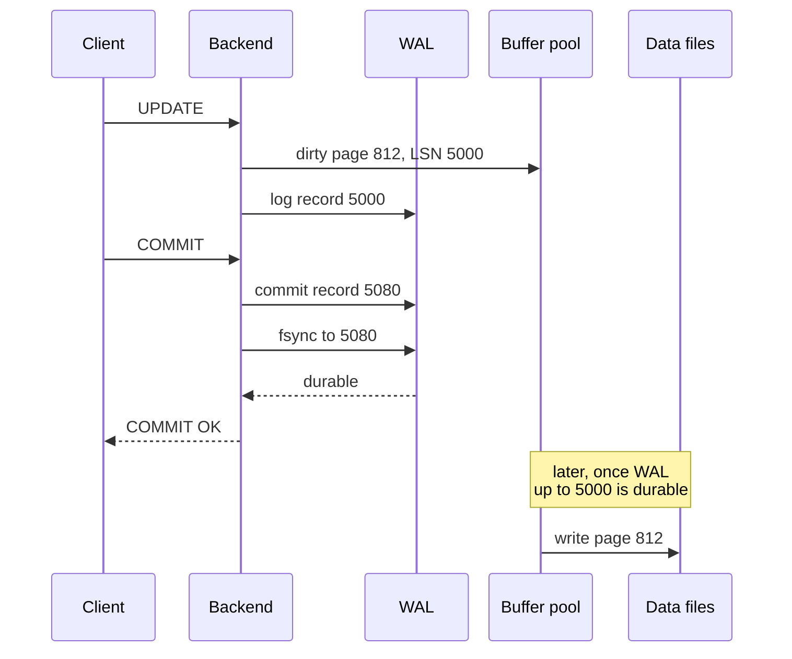

## Mental Model

Updating data pages in place at every commit would mean many random writes scattered across the disk, and a crash mid-way would leave some pages new and some old. Instead:

> **First append a description of the change to a sequential log and make *the log* durable. Apply the change to data pages in memory, and write those pages to disk later, lazily.**

If the machine crashes, the log contains everything needed to redo committed changes that hadn't reached the data files yet. The log is the source of truth; data files are a cache of the log's effects, periodically caught up.

It's how a shop keeps a sales register. Each sale is written on the next line of the register immediately; the stock shelves are tidied up at the end of the day. If someone knocks the shelves over at noon, the register says exactly what should be there. A WAL for one transfer looks like this:

```text
LSN 5000  xid 901  page 812: row 3 balance 1000 → 500
LSN 5040  xid 901  page 913: row 8 balance  200 → 700
LSN 5080  xid 901  COMMIT          ← flushed to disk before the client hears "OK"
```

## Definition

- **WAL (write-ahead log)** / redo log (InnoDB) / transaction log (SQL Server): an append-only sequence of records describing changes. For example: "page 812: insert tuple at slot 5 with bytes …", or "xid 901 committed".
- **LSN (log sequence number)**: a record's position in the log (a byte offset). Every data page stores the LSN of the last record that changed it.
- **The WAL rule**: a dirty data page may be written to disk only after all log records up to its page LSN are durable.
- **Commit rule**: a transaction is committed when its commit record is durable.
- **Checkpoint**: a point after which recovery can start; all pages dirtied before it have been flushed.
- **Group commit**: one flush covering many transactions' commit records.

## Why It Exists

**The problem.** COMMIT must guarantee the change survives a crash. But the changed rows are scattered over many pages, and writing them all synchronously is slow and can be interrupted halfway.

**The idea.** Separate *remembering* a change from *applying* it. Remembering is cheap: append a small note to the end of one file and flush that. Applying (updating the real pages) can happen later at leisure — if a crash interrupts it, the notes say exactly what to redo. The reasons this wins:

- **Sequential beats random**: appending to one file is far cheaper than updating scattered pages, especially on disks — and even on SSDs it reduces write amplification.
- **Small beats big**: a log record describing a 20-byte change is much smaller than the 8 KB page it modifies.
- **Crash consistency**: the log orders all changes; recovery can deterministically reconstruct state.

:::callout[That's all it is]{type=insight}
Write what you're about to change to an append-only log, flush the log at COMMIT, and update the real data pages later. After a crash, replay the log. The only rule: a page may not reach disk before the log entry that describes its change.
:::

## How It Works

### The path of a committed update



The client's commit waited for **one sequential log flush**. The data page was written seconds or minutes later.

### Group commit

A flush takes ~0.1–2 ms on SSDs (more with network storage). While one flush is in progress, other transactions' commit records accumulate in the WAL buffer; the next flush makes them all durable at once. At high concurrency, thousands of commits per second share a few hundred flushes.

### Checkpoints

Without checkpoints, the log would grow forever and recovery would have to replay all of it, from the beginning of time. A checkpoint answers "how far back must recovery start?":

1. Writes all dirty pages (spread over time to avoid I/O bursts — `checkpoint_completion_target`).
2. Records the checkpoint's redo start position.
3. Allows WAL segments before that position to be recycled (unless needed for replication or archiving).

Trade-off: frequent checkpoints → shorter recovery, more I/O (and more full-page writes); infrequent → longer recovery, less I/O.

### Full-page writes

After each checkpoint, the first change to a page logs a **full image** of the page, protecting against torn pages ([Pages & Records](lesson:db-pages-records)). This is why WAL volume spikes right after checkpoints.

### fsync and the storage stack

`write()` only copies data into the OS page cache ([Page Cache](lesson:os-page-cache)). Durability requires `fsync()`/`fdatasync()` (or `O_DSYNC` writes), which must travel through the filesystem, the block layer and the device — whose volatile write cache must honor flush commands (or be battery/capacitor-backed). A device that lies about flushes silently breaks durability.

### Deferred vs immediate modification (textbook log-based recovery)

Textbooks describe two classic policies, which map onto today's engines:

| | Deferred modification | Immediate modification |
|---|---|---|
| When data pages change | only after the transaction commits (changes are buffered until then) | any time, even before commit |
| Log contents needed | new values (**redo** only) | old and new values (**undo** and **redo**) |
| Recovery | redo committed transactions; uncommitted ones never touched the data | redo committed transactions, undo uncommitted ones |
| Modern equivalent | "no-steal" buffer management | "steal" — what every major engine does |

Real databases use immediate modification with steal/no-force because buffering every uncommitted change until commit would exhaust memory for large transactions ([Crash Recovery](lesson:db-crash-recovery)).

## Internal Mechanism

:::depth{level=advanced}
### Physical, logical and physiological logging

- **Physical**: byte-level page diffs — simple, idempotent, large.
- **Logical**: "insert row (…) into table T" — compact, but replay requires consistent page state.
- **Physiological** (most engines): physical to a page, logical within it ("page 812: insert this tuple into slot 5") — compact and page-local.

PostgreSQL's WAL is page-oriented; for logical decoding (CDC) it adds enough information to reconstruct row-level changes.

### One log, many uses

- **Crash recovery**: redo from the last checkpoint ([Crash Recovery](lesson:db-crash-recovery)).
- **Physical replication**: ship WAL to standbys, which replay it continuously ([Replication](lesson:db-replication)).
- **Point-in-time recovery (PITR)**: base backup + archived WAL → replay up to any moment ("restore to 14:31:59, just before the bad DELETE").
- **Logical decoding / CDC**: turn WAL into row change events for Kafka, search indexes, warehouses.

### MySQL's two logs

InnoDB has its own redo log (crash recovery) while the server layer writes the **binlog** (replication, PITR). Committing consistently across both uses an internal two-phase commit (prepare in redo, write binlog, commit in redo) — with `sync_binlog = 1` and `innodb_flush_log_at_trx_commit = 1` for full durability.

### WAL volume management

WAL is retained until checkpoints pass it *and* all consumers (replicas via replication slots, archivers) have it. An abandoned replication slot or a failing archive command makes WAL accumulate until the disk fills — a classic outage ([Replication](lesson:db-replication)). One query shows what each slot is holding back:

```sql
SELECT slot_name, active,
       pg_size_pretty(pg_wal_lsn_diff(pg_current_wal_lsn(), restart_lsn)) AS retained
FROM pg_replication_slots;
```

```text
   slot_name     | active | retained
-----------------+--------+----------
 replica_b       | t      | 18 MB
 debezium_orders | f      | 412 GB
```

The second slot belonged to a change-data-capture connector that was switched off without dropping its slot. PostgreSQL keeps every byte of WAL it might still ask for. Since PostgreSQL 13, `max_slot_wal_keep_size` caps that, at the price of invalidating the slot.

### How much WAL does a statement write?

`EXPLAIN (ANALYZE, WAL)` reports it. Measured on PostgreSQL 18, updating every row of a 100,000-row table (1,235 pages, 9.6 MB) right after a checkpoint (output abridged):

```text
Update on accounts (actual rows=0.00 loops=1)
  WAL: records=302601 fpi=1511 bytes=39577437
```

Running the same UPDATE again, with no checkpoint in between, wrote `records=303519 bytes=27215881` and no full-page images. Two lessons follow. First, WAL volume is a multiple of the data changed: each row needs a new version, index entries and page housekeeping, about three records here. Second, the first change to each page after a checkpoint adds a full page image: about 12 MB extra in this run. `pg_stat_wal` keeps the same counters for the whole server.

### The WAL rule in a few lines of Java

The same discipline makes any program crash-safe. A tiny key-value store that logs before it applies:

```java
final class TinyKv {
    private final Path file;
    private final FileChannel log;
    private final Map<String, String> data = new HashMap<>();

    TinyKv(Path file) throws IOException {
        this.file = file;
        this.log = FileChannel.open(file, StandardOpenOption.CREATE, StandardOpenOption.WRITE, StandardOpenOption.APPEND);
        replay();
    }

    void put(String key, String value) throws IOException {
        byte[] record = (key + "\t" + value + "\n").getBytes(StandardCharsets.UTF_8);
        log.write(ByteBuffer.wrap(record));   // 1. append the change to the log
        log.force(false);                     // 2. flush it: from here on, the put survives a crash
        data.put(key, value);                 // 3. only now apply it
    }

    private void replay() throws IOException {
        byte[] bytes = Files.readAllBytes(file);
        int end = bytes.length;
        while (end > 0 && bytes[end - 1] != '\n') end--;   // a last record the crash cut off...
        log.truncate(end);                                  // ...is removed, so new records start clean
        if (end == 0) return;
        for (String line : new String(bytes, 0, end, StandardCharsets.UTF_8).split("\n")) {
            String[] kv = line.split("\t", 2);
            if (kv.length == 2) data.put(kv[0], kv[1]);
        }
    }

    String get(String key) { return data.get(key); }
}
```

Step 2 is the commit point. A crash before it loses the put, and the caller was never told it succeeded. A crash after it is repaired by `replay()` on the next start. A real log adds three things this one lacks:

- a checksum per record, because a newline can't detect every torn write ([Crash Recovery](lesson:db-crash-recovery));
- checkpoints, so replay doesn't start from the beginning of time;
- group commit, so one `force` serves many writers.
:::

## Example

A crash timeline:

```text
t0  checkpoint (redo starts here)
t1  T1: UPDATE page 12 (LSN 100), COMMIT (LSN 120) — WAL flushed; page 12 still only in RAM
t2  T2: UPDATE page 40 (LSN 140) — not committed; page 40 flushed to disk by background writer (steal)
t3  power loss
```

Recovery: start at t0's redo point; replay LSN 100 onto page 12 (disk copy's LSN < 100 → apply) → T1's change restored; see T1's commit record → T1 committed. Replay LSN 140 on page 40 (already on disk, idempotent via LSN check); no commit record for T2 → T2 is aborted: its change is invisible (PostgreSQL) or undone (InnoDB). Step through this in the [WAL & Recovery lab](lab:wal-recovery).

## Complexity & Performance

- Commit cost: one sequential flush (shared via group commit).
- WAL throughput often limits bulk writes: every change, every index entry and full-page images are logged. Unlogged tables (no WAL) are much faster to write — and are truncated after a crash.
- Put WAL on fast, low-latency storage; its fsync latency is every commit's latency floor.

## Trade-offs

- `synchronous_commit` / flush settings: latency vs a bounded window of lost recent commits.
- Checkpoint frequency: recovery time vs steady-state I/O and WAL volume.
- WAL retention for replicas/PITR: safety vs disk usage.

## Failure Modes

- **Disk fills with WAL**: stuck replication slot, failing archiver, long-running backup.
- **Storage that ignores flushes** (consumer SSDs without power-loss protection, misconfigured virtual disks/RAID controllers): "committed" data lost on power failure.
- **Checkpoint storms**: large bursts of page writes and full-page-image WAL causing latency spikes.
- **fsync error handling**: after a failed fsync, Linux may drop dirty pages and report success on retry; PostgreSQL now crashes and recovers from WAL rather than trusting a retried fsync ("fsyncgate").

## In Production

- Monitor WAL generation rate (`pg_stat_wal`), replication slot lag, archive success (`pg_stat_archiver`), and checkpoint frequency and duration. Checkpoint counters moved from `pg_stat_bgwriter` to `pg_stat_checkpointer` in PostgreSQL 17, and `log_checkpoints` is on by default since PostgreSQL 15.
- Backups = base backup + continuous WAL archive; test restores regularly — a backup that has never been restored is a hope, not a backup.

## Deeper Connections

- Filesystem journaling is the same idea for metadata ([Journaling](lesson:os-journaling)); LSM trees put a WAL in front of their memtable ([LSM Trees](lesson:db-lsm-trees)); consensus protocols replicate a log ([Quorums & Consensus](lesson:db-quorums-consensus)).
- The full chain from `COMMIT` to physical media is the [Durability Chain](lesson:x-durability-chain).

## Common Misconceptions

- **"COMMIT writes my rows to the table files."** It makes the log durable; table pages are written later.
- **"The WAL is only for crash recovery."** It also drives replication, PITR and change data capture.
- **"SSD writes are durable immediately."** Only when flushed through a cache that's power-loss safe.

## Interview Questions

### [L2 · how] What is write-ahead logging and why is it needed?

Changes are first recorded in an append-only log, and the log is flushed to durable storage before the transaction is acknowledged as committed; data pages are updated in memory and written later, but never before the log records describing them are durable. This makes commits cheap (one sequential flush), keeps changes ordered, and lets recovery redo committed changes and discard uncommitted ones after a crash.

### [L2 · how] What does a checkpoint do and what's the trade-off in its frequency?

It flushes all pages dirtied before a certain log position and records that position as the recovery starting point, letting older WAL be recycled. Frequent checkpoints shorten crash recovery but increase I/O and WAL volume (more full-page images); infrequent checkpoints reduce I/O but lengthen recovery and retain more WAL.

### [L3 · incident] The database disk fills up although table sizes are stable. `pg_wal` is 400 GB. What are the likely causes?

WAL isn't being recycled because something still needs it: an inactive or lagging replication slot (a replica or CDC consumer down), a failing `archive_command`, or `wal_keep_size`/max_wal_size settings. Check `pg_replication_slots` (restart_lsn far behind) and `pg_stat_archiver` failures. Fix the consumer or drop the abandoned slot (accepting that consumer must resync), and alert on slot lag and archive failures.

### [L2 · compare] Deferred vs immediate database modification?

Deferred modification writes changes to the database only after commit, so the log needs only new values and recovery only redoes committed transactions. Immediate modification lets changes reach the database before commit, so the log needs old values too, and recovery must redo committed work and undo uncommitted work. Modern engines use immediate modification (the steal policy) because large transactions can't keep all their changes in memory until commit.

### [L2 · why] Why must the log record reach disk before the data page it describes?

If a data page with an uncommitted change reached disk first and the system crashed, the log wouldn't contain the old value needed to undo it, and the database would be left with a change from a transaction that never committed. Writing the log record first guarantees that whatever is on disk can always be redone or undone from the log. The page LSN lets the buffer manager enforce this: flush the WAL up to the page's LSN before writing the page.

### [L2 · how] How does group commit increase throughput without weakening durability?

Instead of one log flush per commit, the database waits briefly while several transactions' commit records accumulate in the WAL buffer, then makes them all durable with one `fsync`. Each transaction still waits for its own commit record to be on disk before COMMIT returns, so durability is unchanged — but one ~1 ms flush now covers dozens of commits, so throughput scales with concurrency.

### [L2 · how] How do you measure how much WAL a statement writes, and why can an UPDATE write several times the size of the data it changes?

Run it under `EXPLAIN (ANALYZE, WAL)`, which reports WAL records, full-page images (`fpi`) and bytes for the statement. Alternatively, compare `pg_current_wal_lsn()` before and after with `pg_wal_lsn_diff`, or watch `pg_stat_wal` for the whole server. An UPDATE writes a new row version (not a delta), new index entries unless the update is HOT, and page housekeeping records. Right after a checkpoint, the first change to every page also logs a full image of it. Updating a 9.6 MB table this way wrote about 40 MB of WAL, so bulk updates should be batched and scheduled with that volume in mind, for replicas and archiving too.

### [L3 · design] Design a small key-value store, in Java, that never loses an acknowledged write after a crash.

Keep the data in memory, and log every change before applying it: append a record of length, checksum and payload to a log file, `FileChannel.force` it, then update the map and acknowledge. On startup, replay the log, stopping at the first record whose length or checksum doesn't check out, since that is where the crash cut it off. Bound replay time with periodic snapshots: write the map to a new file, force it, rename it atomically over the old snapshot, then start a new log. For throughput, let concurrent writers share one `force` (group commit). These are the same pieces as a database WAL: the commit point, idempotent replay, checkpoints and group commit.

## Practice

### [mcq] Which must be durable before a transaction's COMMIT returns (with default durability settings)?

- [ ] All data pages it modified
- [ ] All index pages it modified
- [x] The WAL records up to and including its commit record
- [ ] A checkpoint covering the transaction

Data and index pages are written later; the log alone guarantees redo.

### [mcq] What does the WAL rule forbid?

- [ ] Writing WAL records before data pages
- [x] Writing a dirty data page to disk before the WAL records describing its changes are durable
- [ ] Committing more than one transaction per flush
- [ ] Reading pages that haven't been checkpointed

Otherwise a crash could leave a page change on disk with no log record to undo or explain it.

### [mcq] Under deferred modification, what does recovery do with a transaction that has no commit record in the log?

- [ ] Undoes its changes using old values from the log
- [x] Nothing — its changes never reached the database
- [ ] Redoes its changes
- [ ] Marks the database as corrupt

Deferred modification writes to the database only after commit, so uncommitted transactions left no trace to undo.

### [numeric 200 unit=segments] A server writes 3,200 MB of WAL per hour, in 16 MB segments. How many segments does it fill per hour?

:::answer
3,200 ÷ 16 = **200** segments an hour — about one every 18 seconds. That's also how many files per hour WAL archiving must copy, and what a replica must replay.
:::

### [mcq] What problem do PostgreSQL's full-page writes solve?

- [ ] Replicas missing WAL records
- [x] Torn pages: a crash in the middle of writing an 8 KB page can leave it half old and half new, and a WAL record that describes only a change can't repair it
- [ ] Slow sequential scans
- [ ] Deadlocks between checkpoints and backends

After each checkpoint, the first change to a page logs a full image of it. Recovery restores that image first and then replays later changes, so a partly written page on disk doesn't matter.

### [exercise] Immediate modification with undo/redo logging. The log on disk at the crash is: `<T1 start>`, `<T1, A, 1000, 950>`, `<T1, B, 2000, 2050>`, `<T1 commit>`, `<T2 start>`, `<T2, C, 700, 600>`. Records are (transaction, item, old value, new value). What does recovery do, and what are A, B and C afterwards?

:::solution
- **T1** has a commit record → **redo**: set A = 950 and B = 2050 (redo is idempotent, so it doesn't matter whether those pages were already written).
- **T2** has a start but no commit → **undo**, scanning backwards: set C back to its old value 700, then write `<T2 abort>` so a second crash doesn't repeat the decision.

Afterwards A = 950, B = 2050, C = 700. With deferred modification, T2's record would hold only the new value and recovery would simply ignore it, because uncommitted changes never reached the data.
:::

### [exercise] In the [WAL recovery lab](lab:wal-recovery), load "Steal, then crash" and recover. What did the WAL rule force before P3 was written to disk, and why does undo depend on it?

:::solution
T2 changed P3 from 300 to 0 and never committed, yet P3 was written to disk (a steal). Before that page write, the WAL rule forced the log up to P3's page LSN, so T2's update record, holding the old value 300, was already durable.

After the crash, analysis finds that T2 has no commit record, so it is a loser. Redo sees that P3 on disk already has the change. Undo then restores 300 from the logged old value and writes a compensation record. Without the WAL rule, the disk could hold P3 = 0 with no record of the old value anywhere, and atomicity could not be restored.
:::

### [numeric 432 unit=GB] A replication slot's consumer has been down for 6 hours, and the server writes 20 MB of WAL per second. How much WAL is the slot holding back?

:::answer
6 × 3,600 s × 20 MB/s = 432,000 MB = **432** GB, all kept in `pg_wal` until the consumer returns or the slot is dropped. Alert on slot lag long before that, or cap it with `max_slot_wal_keep_size`.
:::

## Quick Revision

- Log first, apply lazily: COMMIT = commit record durable (fsync); pages written later.
- WAL rule: page may hit disk only after WAL up to its page LSN is durable.
- Group commit amortizes flushes; checkpoints bound recovery and recycle WAL; full-page writes defeat torn pages.
- Durability depends on the whole storage stack honoring flushes.
- One log → crash recovery, physical replication, PITR, CDC. Watch WAL retention (slots, archiving).
- Deferred modification → redo-only log (no-steal); immediate modification → undo + redo (steal) — what real engines use.
- Measure WAL with `EXPLAIN (ANALYZE, WAL)` or `pg_stat_wal`: updates write several times the data size, more right after a checkpoint (full-page images).
- Slots retain WAL until consumed: check `pg_replication_slots`, cap with `max_slot_wal_keep_size`. Checkpoint stats: `pg_stat_checkpointer` (PostgreSQL 17+).
