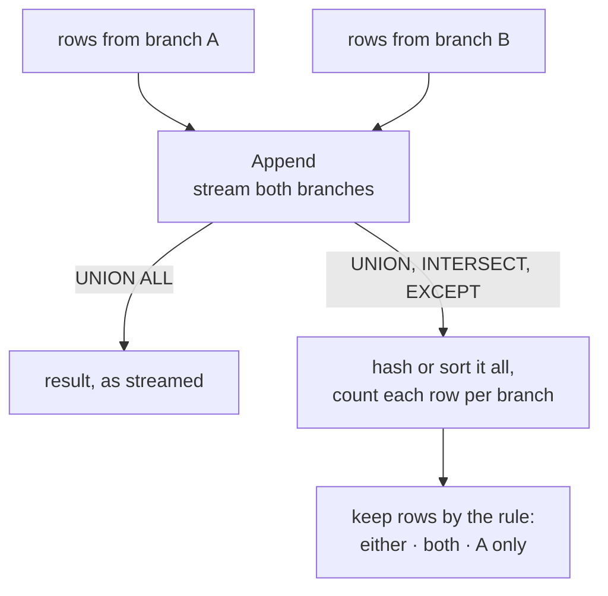

## Mental Model

Joins combine tables **side by side** (more columns). Set operations stack results **on top of each other** (more rows) or compare them row by row. Each input must have the same number of columns with compatible types, and rows are compared as whole tuples.

## Definition

On two tiny lists, A = {Asha, Ravi, Ravi} and B = {Ravi, Meera}:

```text
A UNION B       → Asha, Ravi, Meera            (stacked, duplicates removed)
A UNION ALL B   → Asha, Ravi, Ravi, Ravi, Meera (stacked, everything kept)
A INTERSECT B   → Ravi                         (in both)
A EXCEPT B      → Asha                         (in A, not in B)
```

| Operation | Result | Duplicates |
|---|---|---|
| `A UNION B` | rows in A or B | removed |
| `A UNION ALL B` | all rows of A followed by all rows of B | kept |
| `A INTERSECT B` | rows in both | removed (`INTERSECT ALL` keeps min count) |
| `A EXCEPT B` (Oracle: `MINUS`) | rows in A not in B | removed (`EXCEPT ALL` subtracts counts) |

Rules:

- Column names come from the **first** query.
- Matching is **positional**, not by name — `SELECT id, name` UNION `SELECT name, id` is an error or, worse, a silent mix-up if types happen to be compatible.
- `ORDER BY`/`LIMIT` apply to the whole combined result (put them at the end; parenthesize branches to limit individually).
- For duplicate elimination, **NULLs are treated as equal** (unlike `=`).
- Precedence: `INTERSECT` binds tighter than `UNION` and `EXCEPT`.

## Why It Exists

**The problem.** Some questions are naturally about combining result sets: "all contacts, from customers and from suppliers", "users active in both January and February", "products in the catalog but never sold". These aren't about pairing rows (joins) but about comparing or stacking whole lists.

**The idea.** Tables are sets of rows, so borrow the set operations everyone already knows — union, intersection, difference — and apply them to whole rows. Set operations express them directly.

:::callout[That's all it is]{type=insight}
UNION stacks two results (removing duplicates unless you say ALL), INTERSECT keeps rows in both, EXCEPT keeps rows only in the first. Columns match by position, so both sides must line up.
:::

## How It Works

```sql
-- One mailing list from two tables; UNION removes people present in both
SELECT email, name FROM customers
UNION
SELECT email, name FROM newsletter_subscribers;

-- Customers who ordered in both January and February 2024
SELECT customer_id FROM orders WHERE order_date >= '2024-01-01' AND order_date < '2024-02-01'
INTERSECT
SELECT customer_id FROM orders WHERE order_date >= '2024-02-01' AND order_date < '2024-03-01';

-- Products never ordered
SELECT id FROM products
EXCEPT
SELECT product_id FROM order_items;
```

### UNION vs UNION ALL — the performance rule

`UNION` must detect duplicates, which means sorting or hashing the entire combined result. `UNION ALL` just concatenates. **Default to `UNION ALL`** unless you actually need deduplication — and when branches can't overlap (e.g., different `status` filters, or a "source" literal column), `UNION ALL` is both correct and cheaper.

```sql
SELECT 'customer' AS source, email FROM customers
UNION ALL
SELECT 'supplier', email FROM suppliers;     -- rows can't collide: the source column differs
```

The extra work is easy to see in the plan. Every set operation starts by streaming both branches, and only `UNION ALL` stops there:



## Internal Mechanism

:::depth{level=advanced}
- `UNION ALL` → an **Append** node: run each branch, stream rows through. Branches can run in parallel.
- `UNION`/`INTERSECT`/`EXCEPT` → Append followed by **HashSetOp/HashAggregate** or **Sort + Unique/SetOp**. The executor tags each row with the branch it came from and counts occurrences of each distinct row. Then it emits rows according to the operation: INTERSECT keeps rows counted in both inputs; EXCEPT keeps rows counted in A but not in B.
- The optimizer can push `WHERE` conditions from an outer query into each `UNION ALL` branch. That's how partitioned tables work internally: a query on the parent becomes an Append over partitions, and pruning removes branches ([Partitioning](lesson:db-partitioning)).
:::

## Example

"Customers who ordered in 2023 but not in 2024" — as `EXCEPT` and as an anti join:

```sql
SELECT customer_id FROM orders WHERE order_date >= '2023-01-01' AND order_date < '2024-01-01'
EXCEPT
SELECT customer_id FROM orders WHERE order_date >= '2024-01-01' AND order_date < '2025-01-01';
```

```sql
SELECT DISTINCT o.customer_id
FROM orders o
WHERE o.order_date >= '2023-01-01' AND o.order_date < '2024-01-01'
  AND NOT EXISTS (SELECT 1 FROM orders o2
                  WHERE o2.customer_id = o.customer_id
                    AND o2.order_date >= '2024-01-01' AND o2.order_date < '2025-01-01');
```

Both are correct. `EXCEPT` is shorter. The anti join lets you return other columns (name, email) without another join. NULL `customer_id`s also behave differently: `EXCEPT` treats them as equal, so it removes a NULL if both years have one.

## Complexity & Performance

- UNION ALL: O(n + m), streaming.
- UNION/INTERSECT/EXCEPT: plus a hash (O(n + m) memory) or sort (O(N log N)) over all rows.
- Replacing an `OR` across different columns with `UNION ALL` of two index-friendly queries can turn a sequential scan into two index scans (be careful to avoid double counting rows that satisfy both).

## Trade-offs

- `EXCEPT`/`INTERSECT` vs `NOT EXISTS`/`EXISTS`: set operations compare *all selected columns* and deduplicate; semi/anti joins compare on chosen keys and can return extra columns. Use set ops for key lists, joins for rich results.
- `UNION` to deduplicate vs fixing the source of duplicates: `UNION` hides data-quality problems at a cost.

## Failure Modes

- Using `UNION` where `UNION ALL` was meant — silently dropping legitimate duplicate rows (two identical ₹500 payments become one) and paying for a sort.
- Positional column mismatch between branches.
- `ORDER BY` placed in the first branch (syntax error, or an unexpected meaning when the branch is parenthesized).

## In Production

- Reporting queries often `UNION ALL` several sources (current table + archive table) — the same pattern as manual partitioning.
- Large `UNION`s on OLTP systems can spill sorts to disk; check `work_mem` and EXPLAIN.

## Deeper Connections

- Set operations are the relational algebra's ∪, ∩, − operators under bag semantics ([Relational Model](lesson:db-relational-model)).
- Anti joins and EXCEPT solve the same problem with different NULL and duplicate semantics ([Semi & Anti Joins](lesson:sql-semi-anti-joins)).

## Common Misconceptions

- **"UNION and UNION ALL differ only in speed."** They differ in results whenever duplicates exist.
- **"Set operations match columns by name."** They match by position.
- **"EXCEPT and NOT IN are equivalent."** EXCEPT treats NULLs as equal and deduplicates; NOT IN collapses to no rows when a NULL is present.

## Interview Questions

### [L1 · compare] UNION vs UNION ALL?

UNION concatenates results and removes duplicate rows (requiring a sort or hash over the combined result). UNION ALL concatenates and keeps all rows, streaming them. Use UNION ALL unless deduplication is required.

### [L2 · sql] Find customers who placed orders in both 2023 and 2024.

:::answer
```sql
SELECT customer_id FROM orders WHERE order_date >= '2023-01-01' AND order_date < '2024-01-01'
INTERSECT
SELECT customer_id FROM orders WHERE order_date >= '2024-01-01' AND order_date < '2025-01-01';
```

Alternative with aggregation: `GROUP BY customer_id HAVING count(DISTINCT extract(year FROM order_date)) = 2` over orders filtered to those two years.
:::

### [L1 · conceptual] What does "union-compatible" mean?

Both queries must return the same number of columns, and corresponding columns must have compatible types (the database may cast, e.g. integer to numeric). Columns are matched by **position**, not name, and the result takes its column names from the first query — so `SELECT id, name … UNION SELECT name, id …` either fails or silently mixes values.

### [L2 · compare] INTERSECT vs INNER JOIN? EXCEPT vs NOT EXISTS?

`INTERSECT` compares **entire rows**, removes duplicates and treats NULLs as equal; an inner join pairs rows on a condition, can multiply rows and never matches NULL to NULL. Likewise `EXCEPT` removes whole rows present in the second set (NULL-equal, deduplicated) while `NOT EXISTS` filters rows of the first table by a correlated condition and keeps duplicates and other columns. Use set operations to compare sets of key values; use joins/EXISTS when you need columns from one side.

### [L2 · debugging] A report query using UNION got slow as the tables grew. What's the likely cause?

UNION must deduplicate the combined result, which means sorting or hashing every row (and spilling to disk when it's large). If the branches can't produce identical rows — different date ranges, or a literal `source` column that differs — switch to `UNION ALL`, which just appends the branches and can stream and run them in parallel.

### [L2 · trace] How do UNION ALL, INTERSECT ALL and EXCEPT ALL treat duplicates?

They work on **multisets**: UNION ALL keeps every row from both inputs; INTERSECT ALL keeps each row min(count in A, count in B) times; EXCEPT ALL keeps each row max(count in A − count in B, 0) times. With A = (1, 1, 2) and B = (1, 3): UNION ALL → 1, 1, 2, 1, 3; INTERSECT ALL → 1; EXCEPT ALL → 1, 2. The non-ALL versions first remove duplicates. (MySQL added INTERSECT and EXCEPT only in 8.0.31.)

## Practice

### [numeric 6] A has rows 1, 1, 2 and B has rows 2, 3, 3. How many rows does A UNION ALL B return?

:::answer
UNION ALL concatenates without removing anything: 3 + 3 = **6** rows (1, 1, 2, 2, 3, 3).
:::

### [mcq] Using the same A (1, 1, 2) and B (2, 3, 3), what does A UNION B return?

- [ ] 1, 1, 2, 3, 3
- [x] 1, 2, 3
- [ ] 2
- [ ] 1, 1

UNION removes duplicates from the combined result.

### [mcq] Using the same A (1, 1, 2) and B (2, 3, 3), what does A EXCEPT B return?

- [x] 1
- [ ] 1, 1
- [ ] 1, 3
- [ ] Nothing

EXCEPT removes rows present in B (2) and deduplicates what remains. `EXCEPT ALL` would return 1, 1.

### [numeric 3 unit=rows] A has rows 1, 1, 2, 2, 2 and B has rows 1, 2, 2, 3. How many rows does `A INTERSECT ALL B` return?

:::answer
INTERSECT ALL keeps each value min(count in A, count in B) times: value 1 → min(2, 1) = 1, value 2 → min(3, 2) = 2, value 3 → min(0, 1) = 0. Total **3** rows. Plain INTERSECT would return 2 rows (1 and 2).
:::

### [exercise] Return the ids of customers who ordered in January–March 2024 but not in April–June 2024, using a set operation.

:::solution
```sql
SELECT customer_id FROM orders
WHERE order_date >= DATE '2024-01-01' AND order_date < DATE '2024-04-01' AND customer_id IS NOT NULL
EXCEPT
SELECT customer_id FROM orders
WHERE order_date >= DATE '2024-04-01' AND order_date < DATE '2024-07-01';
```

EXCEPT returns distinct rows of the first query that don't appear in the second. Unlike NOT IN, it treats NULLs as equal to each other, but excluding guest orders (NULL customer) up front keeps the result meaningful. Graded in the [SQL Playground](lab:sql-playground#q1-not-q2).
:::

### [exercise] List every city that is either a department location or a customer city, each once, alphabetically.

:::solution
```sql
SELECT location AS city FROM departments
UNION
SELECT city FROM customers WHERE city IS NOT NULL
ORDER BY city;
```

UNION removes duplicates across both inputs; UNION ALL would keep them (and is cheaper when duplicates are impossible or wanted). The final ORDER BY sorts the combined result and uses the first query's column name. Graded in the [SQL Playground](lab:sql-playground#all-cities).
:::

## Quick Revision

- Set operations stack or compare whole rows; columns match by position; names come from the first query.
- UNION (dedupe, costs a sort/hash) vs UNION ALL (concatenate) — default to UNION ALL.
- INTERSECT = in both; EXCEPT = in A not in B; `ALL` variants keep multiplicities.
- NULLs are equal for set-operation deduplication (unlike `=`).
- Use EXISTS/NOT EXISTS when you need to compare on keys and return other columns.
- Union-compatible = same column count, compatible types, matched by position; names come from the first query.
- INTERSECT/EXCEPT compare whole rows (NULL-equal, deduped); joins/EXISTS compare by condition and keep columns.
