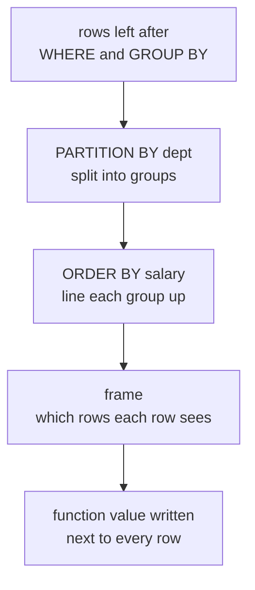

## Mental Model

`GROUP BY` squashes each group into one row. A **window function** computes the same kind of aggregate **but writes the answer next to every row**, leaving all rows in place. Each row looks through a "window" at related rows — its partition, in some order, optionally limited to a frame — and computes a value from them.

```text
name   dept  salary   avg_in_dept   rank_in_dept   running_total_in_dept
Asha   Eng   180000   150000        1              180000
Ravi   Eng   150000   150000        2              330000
Kiran  Eng   120000   150000        3              450000
Meera  Ops    90000    80000        1               90000
Dev    Ops    70000    80000        2              160000
```

Every row survives; each gets numbers computed from its department's rows.

## Definition

```sql
function(args) OVER (
  [PARTITION BY expr, …]     -- split rows into independent groups (default: one group)
  [ORDER BY expr, …]         -- order within each partition
  [frame_clause]             -- which rows relative to the current one (ROWS/RANGE/GROUPS BETWEEN …)
)
```

Window functions fall into three families:

| Family | Functions |
|---|---|
| Ranking | `row_number()`, `rank()`, `dense_rank()`, `ntile(n)`, `percent_rank()`, `cume_dist()` |
| Offset (navigation) | `lag(x, n, default)`, `lead(x, n, default)`, `first_value(x)`, `last_value(x)`, `nth_value(x, n)` |
| Aggregate | `sum`, `avg`, `count`, `min`, `max`, … with `OVER (…)` |

Window functions are evaluated **after `WHERE`/`GROUP BY`/`HAVING` and before `ORDER BY`/`LIMIT`**. So you can't filter on them in the same query's `WHERE`; wrap the query in a subquery or CTE (or use `QUALIFY` in Snowflake/BigQuery/DuckDB).

## Why It Exists

**The problem.** Some questions need *both* the individual row and a summary of the rows around it:

- "each employee and their rank in the department";
- "each month and last month's revenue";
- "each transaction and the running balance".

GROUP BY gives you the summary but throws the individual rows away.

**Without it.** Before window functions, "rank employees within department", "compare each month with the previous one" or "running balance" required self joins or correlated subqueries. Those are O(n²) and hard to read.

**The idea.** Keep every row, and for each one compute an aggregate over a chosen set of related rows (its "window"). Window functions express them directly and are computed in a single sorted pass.

:::callout[That's all it is]{type=insight}
A window function is an aggregate that doesn't collapse rows. PARTITION BY picks which rows are related, ORDER BY lines them up, and the frame says how far to look. The answer is written next to each row.
:::

## How It Works

What happens for each row, in order:



### Ranking: ROW_NUMBER vs RANK vs DENSE_RANK

Salaries in one department: 200, 150, 150, 100.

| salary | row_number() | rank() | dense_rank() |
|---|---|---|---|
| 200 | 1 | 1 | 1 |
| 150 | 2 | 2 | 2 |
| 150 | 3 | 2 | 2 |
| 100 | 4 | **4** | **3** |

- `row_number` — unique sequence; ties broken arbitrarily (add a tiebreaker to make it deterministic).
- `rank` — ties share a rank, then **skip** (Olympic ranking: 1, 2, 2, 4).
- `dense_rank` — ties share a rank, **no gaps** (1, 2, 2, 3). Use it for "Nth highest distinct salary".

### Top-N per group

```sql
SELECT *
FROM (
  SELECT e.*, dense_rank() OVER (PARTITION BY department_id ORDER BY salary DESC) AS r
  FROM employees e
) t
WHERE r <= 3;               -- top 3 distinct salaries per department (ties included)
```

Choose the function by the question: exactly N rows per group → `row_number`; "everyone in the top 3 salary levels" → `dense_rank`.

### LAG / LEAD: compare with neighbours

```sql
WITH monthly AS (
  SELECT date_trunc('month', order_date)::date AS month, sum(total) AS revenue
  FROM orders WHERE status = 'paid'
  GROUP BY 1
)
SELECT month, revenue,
       lag(revenue) OVER (ORDER BY month)                       AS prev_revenue,
       round(100.0 * (revenue - lag(revenue) OVER (ORDER BY month))
             / lag(revenue) OVER (ORDER BY month), 1)           AS mom_growth_pct
FROM monthly
ORDER BY month;
```

The first month's `lag` is NULL, so its growth is NULL — correct, there's nothing to compare with. Name the window once to avoid repetition: `… OVER w … WINDOW w AS (ORDER BY month)`.

### Running totals and moving averages: frames

Ranking needs only the order; a running total or moving average also needs to know *which* rows to add up relative to the current one. That set is the frame.

```sql
SELECT order_date, total,
       sum(total) OVER (ORDER BY order_date, id)                       AS running_total,
       avg(total) OVER (ORDER BY order_date, id
                        ROWS BETWEEN 6 PRECEDING AND CURRENT ROW)      AS moving_avg_7
FROM orders;
```

The **frame** is a window that slides along the ordered rows. Picture it on five days of values:

```text
day      1    2    3    4    5
value   10   20   30   40   50

frame at day 4                                      rows it sees            result
ROWS BETWEEN 2 PRECEDING AND CURRENT ROW            {20, 30, 40}            avg 30  (moving average)
ROWS BETWEEN UNBOUNDED PRECEDING AND CURRENT ROW    {10, 20, 30, 40}        sum 100 (running total)
no ORDER BY in the window                           {10, 20, 30, 40, 50}    sum 150 (whole partition)
```

At day 5 the moving-average frame slides one step right ({30, 40, 50}), the running total grows to include day 5, and the whole-partition frame stays the same. The frame clauses:

| Frame | Meaning |
|---|---|
| (no ORDER BY) | whole partition |
| ORDER BY, no frame | **`RANGE BETWEEN UNBOUNDED PRECEDING AND CURRENT ROW`** — from the start through the current row *and all its peers* (rows with equal ORDER BY values) |
| `ROWS BETWEEN 6 PRECEDING AND CURRENT ROW` | exactly the current row and 6 physical rows before it |
| `RANGE BETWEEN INTERVAL '7 days' PRECEDING AND CURRENT ROW` | rows whose ORDER BY value is within 7 days (value-based) |
| `ROWS BETWEEN UNBOUNDED PRECEDING AND UNBOUNDED FOLLOWING` | whole partition |

Two classic traps follow from the default frame:

1. **Running total with duplicate ORDER BY values** — rows with the same date are peers, so they all get the *same* running total (including each other). Add a unique tiebreaker or use `ROWS`.
2. **`last_value()` returns the current row** — the default frame ends at the current row. Use `ROWS BETWEEN UNBOUNDED PRECEDING AND UNBOUNDED FOLLOWING`, or `first_value` with the order reversed.

### Share of total without a join

```sql
SELECT department_id, name, salary,
       round(100.0 * salary / sum(salary) OVER (PARTITION BY department_id), 1) AS pct_of_dept
FROM employees;
```

### Top-N per group from Java

"Each customer's latest 3 orders" is one query, not one query per customer. Standard JPQL has no window functions (Hibernate 6's HQL adds them), so the usual route is native SQL. In Spring Data that means `@Query(value = "...", nativeQuery = true)`; with plain `JdbcTemplate` it looks like this:

```java
record RecentOrder(long customerId, long orderId, LocalDate orderDate) {}

static final String LATEST_ORDERS = """
    SELECT customer_id, id, order_date
    FROM (SELECT o.*,
                 row_number() OVER (PARTITION BY customer_id
                                    ORDER BY order_date DESC, id DESC) AS rn
          FROM orders o
          WHERE customer_id IS NOT NULL) t
    WHERE rn <= ?
    ORDER BY customer_id, rn""";

List<RecentOrder> latestOrders(int n) {
    return jdbc.query(LATEST_ORDERS,
            (rs, i) -> new RecentOrder(rs.getLong("customer_id"), rs.getLong("id"),
                                       rs.getObject("order_date", LocalDate.class)),
            n);
}
```

`id DESC` breaks ties. `order_date` is a date, so one customer can have two orders on the same day, and without a tie-breaker either may be "latest", differently from run to run.

## Internal Mechanism

:::depth{level=advanced}
The executor's **WindowAgg** node needs input sorted by `PARTITION BY` then `ORDER BY` keys. It either sorts (O(n log n)) or reads from an index that already supplies that order. It then streams through the rows, keeping per-partition state:

- Ranking functions: counters reset at each partition boundary.
- Running aggregates: add the new row's value (O(1) per row).
- Moving frames: add entering rows and, where the aggregate supports an inverse transition (sum, count, avg), subtract leaving rows, which is O(1) per row. Otherwise (min/max), re-aggregate the frame or use more complex structures.

Several window functions with the **same** window share one sort; different `PARTITION BY/ORDER BY` combinations require additional sorts — visible in EXPLAIN as multiple Sort + WindowAgg nodes.

Because window functions run after `WHERE`, a filter on the window's result must be applied in an outer query. The planner can't push `WHERE rn <= 3` down into the sort (though PostgreSQL 15+ can stop a `row_number()` window early for such "run conditions").
:::

## Example

"Customers whose spending increased three months in a row" — combine CTEs, aggregation and `lag`:

```sql
WITH m AS (
  SELECT customer_id, date_trunc('month', order_date)::date AS month, sum(total) AS spend
  FROM orders WHERE status = 'paid'
  GROUP BY 1, 2
), d AS (
  SELECT customer_id, month, spend,
         lag(spend, 1) OVER w AS prev1,
         lag(spend, 2) OVER w AS prev2,
         lag(month, 2) OVER w AS month2
  FROM m
  WINDOW w AS (PARTITION BY customer_id ORDER BY month)
)
SELECT DISTINCT customer_id
FROM d
WHERE spend > prev1 AND prev1 > prev2
  AND month2 = month - INTERVAL '2 months';   -- the three months must be consecutive
```

## Complexity & Performance

- One sort per distinct window specification: O(n log n); then O(n) streaming.
- An index matching `(partition cols, order cols)` removes the sort — valuable for large tables and top-N queries.
- Filtering on window results requires computing the window over all rows that pass `WHERE`; push every non-window filter into `WHERE` so fewer rows are sorted.

## Trade-offs

- Window function vs self join/correlated subquery: windows are one pass and clearer; self joins are O(n²) for "compare with previous" patterns.
- Window vs `LATERAL … LIMIT k` for top-N per group: windows process all rows; LATERAL with an index touches only k rows per group — better when groups are few and huge.
- `DISTINCT ON` (PostgreSQL) is a concise top-1-per-group: `SELECT DISTINCT ON (department_id) * FROM employees ORDER BY department_id, salary DESC;`

## Failure Modes

- Non-deterministic `row_number()` because of ties → different rows "win" on each run; results change between replicas or after a plan change.
- Default `RANGE` frame giving equal running totals to tied rows, or `last_value` returning the current row.
- Filtering a window result in `WHERE` → syntax error; filtering in the wrong layer → wrong answer.
- Integer division in percentage calculations.

## In Production

- Analytics, reporting, leaderboards, sessionization ("gap of more than 30 minutes starts a new session"), deduplication ("keep the latest row per key") and change detection all rely on window functions.
- On very large tables, windows over the whole table imply sorting everything — run them on replicas or warehouses, or restrict by time first.

## Deeper Connections

- Gaps-and-islands and deduplication patterns are built on window functions ([SQL Interview Patterns](lesson:sql-interview-patterns)).
- The sort behind a window is the same sort operator used by ORDER BY and merge joins; an index that provides order avoids all of them ([Composite Indexes](lesson:db-composite-covering-indexes)).

## Common Misconceptions

- **"Window functions reduce the number of rows."** They never do; GROUP BY does.
- **"RANK and DENSE_RANK are the same."** RANK leaves gaps after ties; DENSE_RANK doesn't.
- **"ORDER BY inside OVER sorts the output."** It orders rows within the window; the result needs its own ORDER BY.

## Interview Questions

### [L1 · compare] ROW_NUMBER vs RANK vs DENSE_RANK?

All number rows within a partition by an ordering. ROW_NUMBER gives unique consecutive numbers (ties broken arbitrarily). RANK gives tied rows the same rank and then skips (1, 2, 2, 4). DENSE_RANK gives ties the same rank without gaps (1, 2, 2, 3).

### [L2 · sql] Find the second-highest salary in each department (distinct salary values).

:::answer
```sql
SELECT department_id, salary
FROM (SELECT department_id, salary,
             dense_rank() OVER (PARTITION BY department_id ORDER BY salary DESC) AS r
      FROM employees) t
WHERE r = 2
GROUP BY department_id, salary;     -- one row per department even if several people share it
```

DENSE_RANK makes "second highest" mean the second distinct value; ROW_NUMBER would return the second *row*, which may have the same salary as the first. Departments with a single distinct salary return nothing.
:::

### [L2 · compare] How do window functions differ from GROUP BY?

GROUP BY collapses each group into one output row, so only group keys and aggregates can be selected. Window functions compute aggregates, ranks or neighbouring values over a set of related rows while keeping every input row, so detail columns and computed values appear side by side.

### [L2 · sql] Compute a running total of daily revenue.

:::answer
```sql
WITH daily AS (
  SELECT order_date, sum(total) AS revenue
  FROM orders WHERE status = 'paid'
  GROUP BY order_date
)
SELECT order_date, revenue,
       sum(revenue) OVER (ORDER BY order_date ROWS UNBOUNDED PRECEDING) AS running_total
FROM daily
ORDER BY order_date;
```

Aggregating per day first makes order_date unique, so the frame choice doesn't matter; `ROWS` makes the intent explicit.
:::

### [L3 · debugging] A running total shows the same value on several consecutive rows. Why?

With `ORDER BY` inside OVER and no explicit frame, the default frame is `RANGE BETWEEN UNBOUNDED PRECEDING AND CURRENT ROW`, which includes all peer rows sharing the current ORDER BY value. Rows with the same date get identical totals that already include each other. Use `ROWS BETWEEN UNBOUNDED PRECEDING AND CURRENT ROW` with a unique tiebreaker in ORDER BY, or aggregate to one row per date first.

### [L2 · how] What does NTILE(n) do, and how does it handle uneven division?

`NTILE(4) OVER (ORDER BY salary DESC)` splits the ordered rows into 4 buckets as evenly as possible and returns each row's bucket number (quartiles). If the row count isn't divisible, the **first** buckets get one extra row: 10 rows into 3 buckets gives sizes 4, 3, 3. Ties can land in different buckets, because NTILE counts rows, not values — use `percent_rank()` or `cume_dist()` when ties must stay together.

### [L2 · sql] Compute a 7-day moving average of daily revenue and each day's share of its month's revenue.

:::answer
```sql
WITH daily AS (
  SELECT order_date::date AS day, sum(total) AS revenue
  FROM orders WHERE status = 'paid'
  GROUP BY 1
)
SELECT day, revenue,
       avg(revenue) OVER (ORDER BY day ROWS BETWEEN 6 PRECEDING AND CURRENT ROW) AS ma_7d,
       round(100.0 * revenue / sum(revenue) OVER (PARTITION BY date_trunc('month', day)), 2) AS pct_of_month
FROM daily
ORDER BY day;
```

`ROWS … 6 PRECEDING` counts rows, so missing days shrink the window's time span; for a true calendar window generate every day first (or use `RANGE BETWEEN INTERVAL '6 days' PRECEDING AND CURRENT ROW`).
:::

### [L2 · compare] Running total with a window function vs a self join — why is the window version faster?

The self join (`SUM(b.amount) … JOIN t b ON b.ts <= a.ts`) compares every row with every earlier row: O(n²). The window version sorts once and keeps a running sum while streaming: O(n log n) for the sort and O(1) per row after it. On a million rows that's the difference between seconds and hours.

### [L3 · debugging] A nightly "latest row per key" job uses `row_number() OVER (PARTITION BY account_id ORDER BY updated_at DESC)` and has become slow. `EXPLAIN (ANALYZE)` shows `Sort Method: external merge  Disk: 2148000kB`. What is happening, and what are your options?

The window needs its input sorted by `account_id, updated_at DESC`. The sort didn't fit in `work_mem`, so PostgreSQL spilled about 2 GB to temporary files and merged them, and that disk work dominates. Options, roughly in order:

1. **Process less**: if only recently changed accounts matter, filter on `updated_at` first, so the sort is small.
2. **Give this query more memory**: `SET LOCAL work_mem = '1GB'` inside the job's transaction, not globally, since every sort in every session may use that much.
3. **Avoid the sort**: an index on `(account_id, updated_at DESC)` can feed rows already in order. For top-1 with few keys and many rows each, a `LATERAL ... LIMIT 1` per key reads only one index entry per key.
4. **Move it**: run the job on a replica or in the warehouse.

Confirm with `EXPLAIN (ANALYZE, BUFFERS)` after each change.

## Practice

### [mcq] Salaries 300, 200, 200, 100. What does DENSE_RANK() OVER (ORDER BY salary DESC) give the 100 row?

- [ ] 4
- [x] 3
- [ ] 2
- [ ] 5

The ranks are 1, 2, 2, 3: dense ranking leaves no gap after the tie.

### [mcq] Why does `last_value(salary) OVER (PARTITION BY dept ORDER BY salary)` often return the current row's salary?

- [ ] last_value is broken for numeric columns
- [x] The default frame ends at the current row (and its peers)
- [ ] PARTITION BY resets the value on every row
- [ ] ORDER BY inside OVER is ignored

Specify `ROWS BETWEEN UNBOUNDED PRECEDING AND UNBOUNDED FOLLOWING` to see the whole partition.

### [exercise] For each order, show the number of days since the same customer's previous order (NULL for their first order).

:::solution
```sql
SELECT id, customer_id, order_date,
       order_date - lag(order_date) OVER (PARTITION BY customer_id ORDER BY order_date, id)
         AS days_since_prev
FROM orders
ORDER BY customer_id, order_date, id;
```

Subtracting two `date` values gives an integer number of days in PostgreSQL. The `id` tiebreaker makes the order of same-day orders deterministic.
:::

### [numeric 4] `NTILE(3) OVER (ORDER BY id)` over 10 rows. How many rows are in bucket 1?

:::answer
10 ÷ 3 = 3 remainder 1, so the first bucket takes one extra row: sizes are 4, 3, 3. Bucket 1 has **4** rows.
:::

### [numeric 35] Daily values are 10, 20, 30, 40 in date order. What does `avg(v) OVER (ORDER BY day ROWS BETWEEN 1 PRECEDING AND CURRENT ROW)` return on the fourth day?

:::answer
The frame is the current row and the one before it: (30 + 40) ÷ 2 = **35**. On the first day the frame holds only one row, so the result is 10.
:::

### [exercise] For each department, return everyone earning the third-highest distinct salary in that department. Why is `row_number()` wrong here?

:::solution
```sql
SELECT department_id, name, salary
FROM (
  SELECT e.*, dense_rank() OVER (PARTITION BY department_id ORDER BY salary DESC) AS r
  FROM employees e
  WHERE department_id IS NOT NULL
) t
WHERE r = 3;
```

`row_number()` gives tied salaries different numbers, so of two people earning the third-highest salary only one would be returned. `dense_rank()` gives ties the same rank and doesn't skip numbers; `rank()` would skip numbers after a tie higher up. Graded in the [SQL Playground](lab:sql-playground#third-in-department).
:::

### [exercise] For every day of June 2024, return the day, that day's revenue (0 if there were no orders) and the 7-day moving average, rounded to 2 decimals.

:::solution
```sql
WITH days AS (
  SELECT d::date AS day FROM generate_series(DATE '2024-06-01', DATE '2024-06-30', interval '1 day') d
), daily AS (
  SELECT days.day, COALESCE(sum(o.total), 0) AS revenue
  FROM days LEFT JOIN orders o ON o.order_date = days.day AND o.status <> 'cancelled'
  GROUP BY days.day
)
SELECT day, revenue,
       round(avg(revenue) OVER (ORDER BY day ROWS BETWEEN 6 PRECEDING AND CURRENT ROW), 2) AS avg_7d
FROM daily ORDER BY day;
```

Without the calendar, days with no orders are missing rows, and "6 preceding rows" would reach back more than 6 days. The status filter goes in the ON clause so empty days survive the LEFT JOIN. Graded in the [SQL Playground](lab:sql-playground#moving-average).
:::

### [mcq] A query picks each customer's latest order with `row_number() OVER (PARTITION BY customer_id ORDER BY order_date DESC)` and keeps `rn = 1`. A customer placed two orders on the same date. Which one is returned?

- [ ] The one with the lower id, always
- [ ] Both, because they tie
- [x] Either one; it can change between runs, after a plan change, or between replicas
- [ ] Neither; PostgreSQL raises an error on ties

`row_number` numbers tied rows in whatever order they arrive. Add a unique tie-breaker such as `ORDER BY order_date DESC, id DESC`, or use `rank` to keep both.

## Quick Revision

- `f() OVER (PARTITION BY … ORDER BY … frame)` — aggregate/rank/offset without collapsing rows.
- ROW_NUMBER (unique), RANK (gaps), DENSE_RANK (no gaps).
- LAG/LEAD for previous/next; frames for running and moving aggregates.
- Default frame with ORDER BY = RANGE … CURRENT ROW (peers included); last_value trap.
- Evaluated after WHERE/GROUP BY/HAVING → filter results in an outer query.
- Top-N per group: window + filter, LATERAL + LIMIT, or DISTINCT ON.
- `NTILE(n)`: near-equal buckets, earlier buckets get the extras (10 → 4, 3, 3); ties may split.
- Moving average: `ROWS BETWEEN k PRECEDING AND CURRENT ROW`; share of total: `x / sum(x) OVER (PARTITION BY …)`.
- Top-N per group from Java: one native query with `row_number()` and a unique tie-breaker; a spilled sort (`external merge Disk`) is the usual reason it gets slow.
