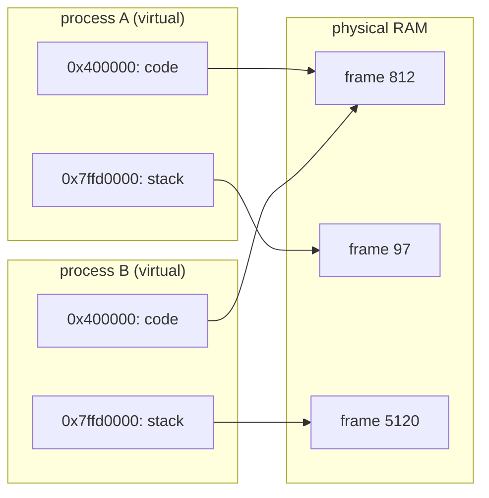

## Mental Model

Every process gets a **private map of a huge imaginary city** — its virtual address space. On this map, the code district is always in the same place, the stack always starts near the top and grows down, the heap grows up from near the bottom. Two processes can both have a house at "42 Main Street" (the same virtual address) because each has its own map. The OS and the hardware's **MMU** secretly translate each map address to a real plot of land, a physical RAM frame. Sometimes the answer is "not built yet", which is a page fault. The process never sees a physical address.



Both processes use the same virtual addresses. Their read-only code maps to the same physical frame, while each stack gets a private frame.

## Definition

- **Physical memory**: the actual RAM, addressed by physical addresses (frames).
- **Virtual address space**: the range of addresses a process can use (on x86-64, 128 TiB for user space with 4-level paging), translated to physical addresses by the MMU using per-process page tables.
- **Stack**: per-thread memory for function call frames — local variables, arguments, return addresses — allocated and freed automatically in LIFO order.
- **Heap**: memory for dynamically allocated objects (`malloc`, `new`), with lifetimes independent of function calls.
- **Static (global) memory**: `.data` (initialized globals/statics) and `.bss` (zero-initialized), allocated for the program's lifetime.
- **Text**: the program's machine code, read-only and executable.

## Why It Exists

**The problem.** RAM is one shared array of bytes. If every program uses real RAM addresses, every program has to know where the others live.

**Without it.** Before virtual memory, programs used physical addresses directly. They had to be loaded at specific locations, a bug could overwrite another program or the OS, and a program couldn't be larger than physical RAM. Virtual address spaces provide:

1. **Isolation** — a process can't even *name* another process's memory.
2. **Simplicity** — every program sees the same clean layout, starting at fixed addresses; linkers and compilers can assume it.
3. **Flexibility** — the OS can place pages anywhere in RAM, share them (libraries), or not load them at all (demand paging), and give processes more virtual memory than physical RAM.

**The idea.** Add one level of indirection. Programs use *made-up* addresses; hardware translates each one to a real address using a table the OS controls. Because the program never sees real addresses, it can't reach memory that isn't in its table — and the OS can rearrange real memory behind its back.

:::callout[That's all it is]{type=insight}
Each process gets its own private numbering of memory, and the hardware looks up every address in a per-process table to find the real location. Isolation, a tidy layout and "more memory than RAM" all come from that lookup.
:::

## How It Works

### Logical addresses and address binding (the textbook view)

Textbooks call the address a program uses a **logical address** and the one sent to RAM a **physical address**. Turning one into the other is **address binding**, and it can happen at three times:

- **Compile time**: the compiler writes absolute physical addresses. The program can only ever run at that spot in memory (old MS-DOS `.COM` files).
- **Load time**: the loader adjusts the addresses when it places the program in memory. The program can't move once it is running.
- **Execution time**: every address is translated by hardware on every access, so the OS can move the program at any time. All modern systems do this.

The simplest execution-time hardware is a pair of registers. The **base** (relocation) register holds where the process starts in physical memory; the **limit** register holds its size:

```text
base = 14000, limit = 3000
logical 346   → 346 < 3000, so physical = 14000 + 346 = 14346
logical 3500  → 3500 ≥ 3000 → trap to the OS: addressing error
```

Paging, covered in the [Paging](lesson:os-paging) lesson, generalizes this: a base per page instead of one per process.

### The layout (Linux x86-64, simplified)

```text
0x7fff_ffff_ffff ┌──────────────────────────┐  top of user space
                 │ stack (main thread) ↓     │  grows down; 8 MB limit by default
                 │                           │
                 │ mmap region               │  shared libraries, thread stacks,
                 │  (libc.so, libssl.so,     │  large malloc blocks, mapped files
                 │   thread stacks, …)       │
                 │                           │
                 │ heap ↑                    │  grows up via brk()
                 ├──────────────────────────┤
                 │ .bss   zero-initialized   │  static int counter;
                 │ .data  initialized        │  static int limit = 100;
                 │ .rodata constants         │  "hello"
                 │ .text  code (r-x)         │
0x0000_0040_0000 └──────────────────────────┘
0x0000_0000_0000   unmapped (null pointer dereferences fault here)
```

Addresses are randomized per run by **ASLR** (address space layout randomization) to make exploits harder.

### Where does each thing live?

In a Java program, the same question has JVM-shaped answers:

```java
public class Handler {
    static int limit = 100;                 // static field: stored with the Class object, on the heap
    static final String MSG = "hello";      // the String object lives on the heap (in the string pool)

    void handle(int n) {                    // bytecode in metaspace; JIT-compiled code in the code cache
        int local = n * 2;                  // this call's stack frame (or just a register)
        byte[] buf = new byte[64];          // the reference is on the stack; the array is on the heap
        StringBuilder sb = new StringBuilder();   // if it never escapes, the JIT may avoid allocating it at all
        sb.append(local);
    }
}
```

Local primitives and references live in the thread's stack frame or in registers. **Objects** always live on the garbage-collected heap, with one exception: if escape analysis proves an object never leaves the method, HotSpot can *scalar-replace* it, keeping its fields in registers so no heap allocation happens.

From the OS's point of view, the JVM is an ordinary process, and its regions sit in the layout above:

| JVM region | Where it is in the process's address space |
|---|---|
| Java heap (`-Xmx`) | One large `mmap` reservation, committed as it grows |
| Metaspace, code cache, GC data | More `mmap` regions (native memory, outside the Java heap) |
| Each thread's stack (`-Xss`, default 1 MB) | A separate `mmap` region with a guard page |
| `libjvm.so`, `libc` | The mmap region, mapped from files |

### How the stack works

Why a separate stack at all: function calls nest and return in strict last-in-first-out order, so their memory can be managed with a single pointer — no searching, no free lists. Each function call pushes a **stack frame**: return address, saved registers, the caller's frame pointer, local variables. Returning pops it by moving the stack pointer — allocation and deallocation are just arithmetic on one register, which is why stack memory is extremely fast.

```text
higher addresses
┌──────────────┐
│ main's frame │
├──────────────┤
│ handle(n)    │  return addr → main, saved rbp, local, buf[64]
├──────────────┤  ← stack pointer (rsp) after handle's prologue
│ (free)       │
lower addresses
```

Every thread has its own stack, and the stacks of all threads live in the same address space. So in C a pointer to a stack variable *can* be passed to another thread, which is dangerous once the frame is gone.

## Internal Mechanism

### Mappings, not memory

The address space is mostly empty — 128 TiB of numbers, a few hundred MB used. Storing it as "a table entry per address" would be absurd, so the kernel stores *descriptions of ranges* instead. An address space is a list of **mappings** (Linux: VMAs — virtual memory areas), each with a range, permissions (r/w/x), and a backing: a file (code, libraries, mmap'd files) or anonymous memory (heap, stack). You can see them:

```bash
$ cat /proc/self/maps | head -5
55d0c3a00000-55d0c3a02000 r--p 00000000 08:01 131 /usr/bin/cat
55d0c3a02000-55d0c3a07000 r-xp 00002000 08:01 131 /usr/bin/cat
55d0c4c3f000-55d0c4c60000 rw-p 00000000 00:00 0   [heap]
7f2b9e200000-7f2b9e228000 r--p 00000000 08:01 812 /usr/lib/x86_64-linux-gnu/libc.so.6
7ffd6bb9e000-7ffd6bbbf000 rw-p 00000000 00:00 0   [stack]
```

Creating a mapping doesn't allocate RAM. Physical frames are assigned lazily when pages are first touched (a **page fault**), which is why `VSZ` (virtual size) is often far larger than `RSS` (resident set size). See [Paging](lesson:os-paging) and [Page Faults](lesson:os-page-faults).

### Kernel space

The upper half of the address space (on x86-64 canonical addresses starting 0xffff…) maps the kernel. It's present in every process's page tables (so a syscall doesn't need to switch page tables) but marked supervisor-only. After the Meltdown vulnerability, **KPTI** unmaps most of it while in user mode, at some syscall cost.

:::depth{level=advanced}
### Stack growth and guard pages

The main thread's stack grows on demand: touching just below the current stack triggers a page fault the kernel recognizes as stack growth (up to `ulimit -s`, default 8 MB). Thread stacks are fixed-size `mmap` regions with an unmapped **guard page** below them; overflowing into it causes a segfault instead of silently corrupting adjacent memory. "Stack clash" attacks tried to jump over guard pages with huge stack allocations; compilers now probe large frames page by page.
:::

## Example

Why the stack's size limit matters in Java: every call pushes a frame, and the thread's stack is a fixed-size region.

```java
record Node(Node child) {}

static int depth(Node n) {                  // each call pushes a frame on this thread's stack
    return n == null ? 0 : 1 + depth(n.child());
}

// A chain nested 100,000 levels deep (e.g. from hostile JSON input) throws StackOverflowError:
// the frames no longer fit in the thread's stack (1 MB by default) and hit its guard page.
```

The fix is to walk iteratively, keeping the "to do" list on the heap, or to cap the nesting depth when parsing input:

```java
static int depth(Node n) {
    int d = 0;
    for (Node cur = n; cur != null; cur = cur.child()) d++;   // constant stack usage
    return d;
}
```

C's classic stack bug is returning a pointer to a local variable whose frame has been popped. That can't happen in Java. A method can't hand out a reference to its stack frame, and objects live on the heap for as long as anything refers to them.

## Complexity & Performance

| | Stack | Heap |
|---|---|---|
| Allocation | Move a pointer: ~1 ns | Allocator search/bookkeeping: ~20–100 ns (more under contention) |
| Deallocation | Automatic on return | Explicit `free` / GC |
| Size | Small (MBs per thread) | Large (GBs) |
| Lifetime | Tied to function call | Arbitrary |
| Locality | Excellent (hot, contiguous) | Depends on allocation patterns |
| Thread safety | Private per thread | Shared — needs synchronization |

## Trade-offs

- **Stack**: fastest, automatic, but limited in size and lifetime. Large arrays or deep recursion overflow it.
- **Heap**: flexible lifetime and size, but slower, fragmentable, and prone to leaks/use-after-free in manual languages or GC pauses in managed ones.
- **Static**: zero allocation cost, but global state complicates testing and thread safety.

## Failure Modes

- **Stack overflow**: infinite/deep recursion or huge local arrays → segfault (C) or `StackOverflowError` (Java) or `RecursionError` (Python, which limits depth itself).
- **Null pointer dereference**: address 0 is deliberately unmapped → `SIGSEGV`.
- **Dangling pointers** to popped stack frames or freed heap memory.
- **Buffer overflows** on the stack overwrite return addresses (classic exploit; mitigated by stack canaries, non-executable stacks, ASLR).
- **Address space exhaustion** in 32-bit processes (only 3–4 GB of virtual space).

## In Production

- `VSZ` vs `RSS` in `ps`/`top`: don't panic about huge VSZ (e.g., JVM or Go reserve large virtual ranges); RSS is what uses RAM. `PSS` (proportional set size) divides shared pages fairly among sharers.
- Container memory limits count resident memory (plus page cache charged to the cgroup), not virtual size.
- Thread stack size matters when running thousands of threads: 8 MB virtual each is fine (not resident), but setting large `-Xss` values in Java multiplies memory use.

## Deeper Connections

- The heap's allocator: [Dynamic Memory Allocation](lesson:os-dynamic-allocation).
- The translation machinery: [Paging](lesson:os-paging), [TLB](lesson:os-tlb).
- Lazy allocation and copy-on-write: [Page Faults](lesson:os-page-faults), [Copy-on-Write & mmap](lesson:os-cow-mmap).
- Database processes map huge shared memory regions for buffer pools — same mechanism ([Buffer Pool](lesson:db-buffer-pool)).

## Common Misconceptions

- **"Local variables are always on the stack, objects always on the heap."** Compilers keep locals in registers; JIT/Go escape analysis puts non-escaping objects on the stack.
- **"Virtual memory means using disk as RAM."** Swapping is one use; the core purpose is isolation and flexible mapping.
- **"A 20 GB VSZ means the process uses 20 GB."** Virtual size includes reserved but untouched ranges and shared libraries.
- **"The heap is one contiguous block."** Modern allocators use `brk` for small allocations and `mmap` for large ones, spread across the address space.

## Interview Questions

### [L1 · compare] What is the difference between stack and heap memory?

The stack holds function call frames (locals, arguments, return addresses) per thread; allocation is automatic and very fast (pointer arithmetic), lifetime is tied to the call, and size is limited. The heap holds dynamically allocated data shared by all threads; allocation is explicit (malloc/new) or GC-managed, slower, arbitrary lifetime and size, and can fragment or leak.

### [L1 · conceptual] What are the segments of a process's memory layout?

Text (code, read-only/executable), data (initialized globals/statics), BSS (zero-initialized globals/statics), heap (dynamic allocations growing upward), memory-mapped region (shared libraries, mmap'd files, thread stacks), and stack (growing downward). The kernel occupies the upper part of the address space, inaccessible from user mode.

### [L2 · why] Why does each process have its own virtual address space?

Isolation (a process can't access another's memory because it can't even form its physical addresses), a uniform layout that simplifies compilers and linkers, and flexibility for the OS to place, share, lazily load, or swap pages transparently.

### [L1 · compare] What is the difference between a logical and a physical address, and when can address binding happen?

A logical (virtual) address is what the program uses; a physical address is the location sent to RAM. Binding maps one to the other at **compile time** (absolute code that must run at a fixed location), **load time** (the loader relocates addresses once, when placing the program) or **execution time** (hardware translates every access, so the OS can move the process at will). Modern systems bind at execution time with an MMU: a base and limit register in the simplest form, page tables in practice. The limit check also gives protection, since any logical address beyond the limit traps.

### [L2 · trace] What happens if a function returns a pointer to a local array?

The function's frame is popped on return; the pointer refers to stack memory that is still mapped but logically free. The next function calls overwrite it, so the data changes unpredictably. It's undefined behavior in C/C++ — the program may appear to work, crash, or corrupt data.

### [L3 · debugging] A C service crashes with SIGSEGV only under heavy load, in deep recursive JSON parsing of large payloads. What's likely and how do you fix it?

Stack overflow: deeply nested input drives recursion depth beyond the thread's stack size (worker threads may have smaller stacks than the main thread); the access hits the guard page → SIGSEGV. Confirm with a core dump showing a huge call depth. Fix: limit nesting depth (also a DoS defense), convert recursion to iteration with an explicit heap-allocated stack, or increase thread stack size as a stopgap.

### [L3 · compare] VSZ is 30 GB but RSS is 2 GB for a JVM. Is that a problem?

Not necessarily. VSZ counts all mapped virtual ranges — the JVM reserves address space for the heap maximum, code cache, metaspace, thread stacks, and mapped libraries/files — most of which may never be touched. RSS (2 GB) is the physical memory actually resident. Watch RSS, container memory usage and GC metrics instead.

### [L4 · design] You're designing a system that runs 20,000 concurrent tasks. Memory-wise, what changes between using OS threads and goroutines/virtual threads?

OS threads each need a fixed stack mapping (default 8 MB virtual, typically tens to hundreds of KB resident as used) plus kernel structures; 20,000 threads mean large virtual reservations, significant resident stack memory and scheduler overhead. Goroutines start with ~2–8 KB growable stacks allocated on the heap and move/grow as needed; virtual threads store stack frames on the heap when unmounted. So memory scales with *actual* stack depth, making 20,000 tasks cheap. Trade-off: deep recursion on user-level stacks costs copying/growth, and blocking in native code can pin carriers.

## Practice

### [mcq] Where is a `static int count = 0;` declared inside a function stored?

- [ ] On the stack
- [ ] On the heap
- [x] In the BSS segment
- [ ] In the text segment

Static locals live for the whole program; zero-initialized ones go to BSS.

### [mcq] Why is address 0 typically unmapped in a process's address space?

- [ ] Because the kernel lives there
- [x] So that null pointer dereferences fault immediately
- [ ] Because the stack starts at 0
- [ ] It isn't; code starts at 0

Leaving the first pages unmapped turns null dereferences into immediate SIGSEGVs rather than silent corruption.

### [numeric 14346] A process's base register holds 14000 and its limit register 3000. What physical address does the logical address 346 map to?

:::answer
346 is below the limit (3000), so the access is allowed, and physical = base + logical = 14000 + 346 = **14346**.
:::

### [numeric 2999] With the same limit register of 3000, what is the largest logical address the process can use?

:::answer
Valid logical addresses are 0 to limit − 1, so the largest is **2999**. Address 3000 or above traps to the OS as an addressing error.
:::

### [mcq] Inside a Java method, `byte[] buf = new byte[64];` runs. Where are the reference and the array stored?

- [ ] Both on the stack
- [x] The reference in the method's stack frame (or a register); the array on the heap
- [ ] Both on the heap
- [ ] The reference in metaspace; the array on the stack

Arrays are objects, and objects live on the garbage-collected heap. Only the local variable that refers to it is in the frame. (If the JIT proves the array never escapes, it may eliminate the allocation, but that is an optimization, not where the language puts it.)

### [exercise] A Java service runs in a container with a 2 GB memory limit. It starts with `-Xmx1800m` and uses 250 threads. Under load the kernel OOM-kills it, although GC logs show the heap never went above 1.8 GB. Account for the memory and fix the configuration.

:::solution
The container limit counts the whole process's resident memory, not just the Java heap. Rough budget:

- Java heap: up to 1800 MB.
- Thread stacks: 250 threads × up to 1 MB = up to 250 MB (resident as deep as each stack has been used).
- Metaspace (class metadata): commonly 100–200 MB for a framework-heavy app.
- Code cache (JIT output): tens of MB, up to 240 MB by default.
- GC bookkeeping, direct `ByteBuffer`s (Netty), `libc` arenas: tens to hundreds of MB.

Together that exceeds 2 GB, so the cgroup OOM killer ends the process (exit code 137) before Java ever throws `OutOfMemoryError`.

Fix: leave room for non-heap memory, for example `-XX:MaxRAMPercentage=70` instead of a hard-coded `-Xmx`, and cap the other regions (`-XX:MaxMetaspaceSize`, `-XX:MaxDirectMemorySize`, fewer threads or virtual threads). Measure with `-XX:NativeMemoryTracking=summary` and `jcmd <pid> VM.native_memory summary`.
:::

### [numeric 3] With 4 KB pages, which virtual page number holds the address `0x3A7F`? Try it in the [address translation lab](lab:address-translation), then check by hand.

:::answer
**3**. A 4 KB page needs a 12-bit offset, so the page number is the address shifted right by 12 bits: `0x3A7F >> 12 = 0x3`, with offset `0xA7F`. The program only ever sees `0x3A7F`. The MMU turns page 3 into whichever physical frame this process's page table names. That is why two processes can both use address `0x3A7F` without touching each other's memory.
:::

## Quick Revision

- Virtual address space = private map; MMU + page tables translate to physical frames.
- Layout: text → data/rodata/bss → heap ↑ … mmap region … ↓ stack; kernel above, inaccessible; ASLR randomizes.
- Stack: per thread, LIFO frames, ~1 ns alloc, limited (8 MB default main thread).
- Heap: shared, malloc/new or GC, flexible, slower, fragmentation/leaks.
- Static: `.data` (initialized), `.bss` (zero).
- Mappings ≠ RAM: VSZ ≫ RSS is normal; pages allocated on first touch.
- Bugs: stack overflow, dangling pointers to frames, buffer overflows.
- Binding: compile time, load time, execution time (MMU). Base/limit: physical = base + logical if logical < limit, else trap.
- JVM: objects on the heap, references and primitives in frames; heap, metaspace, code cache and thread stacks are all `mmap` regions. A container limit counts all of them.
