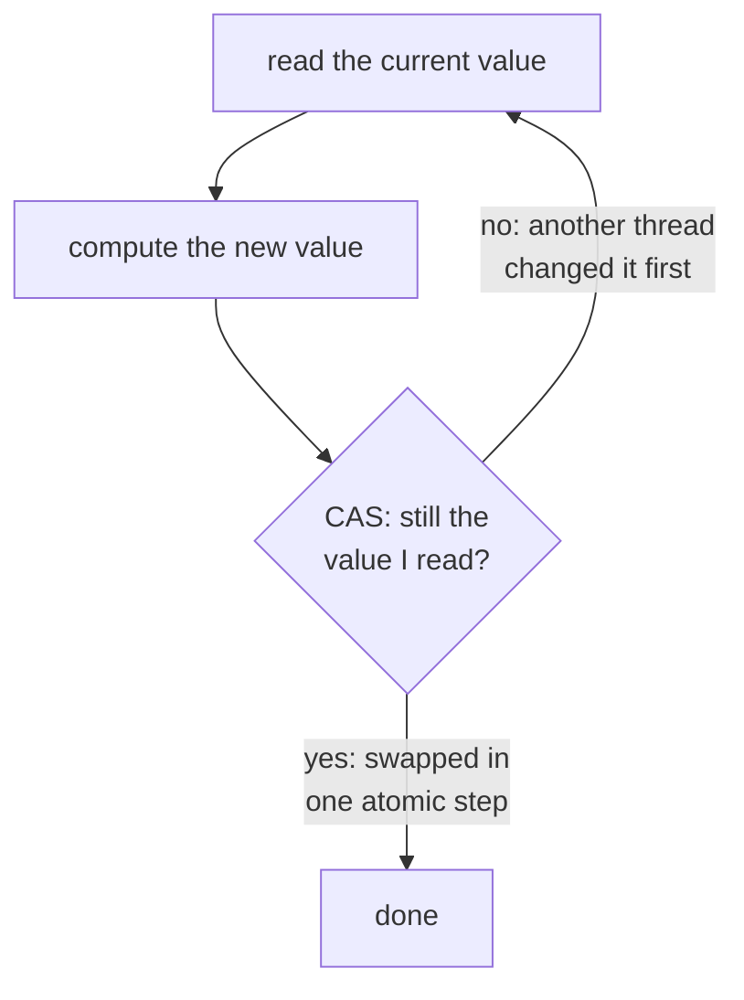

## Mental Model

Software alone can't reliably make "check the value and change it" indivisible on modern CPUs. So the hardware provides a handful of instructions that do exactly that — **read, compute, and write a memory word as one indivisible step**, even with many cores racing.

**Compare-and-swap** is the most important one. Think of it as a very strict clerk: *"Change the record from A to B — but only if it still says A. If someone changed it in the meantime, reject my request and tell me what it says now."* That one idea underlies almost every lock, atomic counter, concurrent queue and optimistic concurrency scheme, including database version checks.

## Definition

- **Test-and-set (TAS)**: atomically write 1 to a location and return its old value.
- **Compare-and-swap (CAS)** / compare-and-exchange: `CAS(addr, expected, new)` atomically sets `*addr = new` **only if** `*addr == expected`, returning success (or the old value).
- **Fetch-and-add (FAA)**: atomically add to a location and return the old value.
- **Load-linked / store-conditional (LL/SC)**: a pair (ARM `ldxr/stxr`, RISC-V `lr/sc`): the store succeeds only if no other write touched the location since the linked load.

On x86 these are `xchg`, `lock cmpxchg`, `lock xadd`; the `lock` prefix makes the read-modify-write atomic via the cache-coherence protocol.

## Why It Exists

**The problem.** Every race comes down to the same gap: you *read* a value, decide, then *write* — and another core slips in between the read and the write.

**Without it.** [Peterson's algorithm](lesson:os-critical-section-problem) showed mutual exclusion is possible with plain reads and writes — but only for two parties, with busy-waiting, and only under sequential consistency. **The idea.** Software can't close the gap between a read and a write — but the hardware can, by doing both in one step that no other core can interrupt. Atomic read-modify-write instructions give a simple, correct, scalable foundation on real multicore hardware with weak memory ordering.

:::callout[That's all it is]{type=insight}
An atomic instruction is "read and write this memory word as one step". With that single guarantee you can build locks (test-and-set), fair locks (fetch-and-add) and lock-free data structures (compare-and-swap).
:::

## How It Works

### A spinlock with test-and-set

```java
class SpinLock {
    private final AtomicBoolean locked = new AtomicBoolean(false);

    void lock() {
        while (locked.getAndSet(true)) {     // TAS: set true, get the old value
            Thread.onSpinWait();             // old was true → someone holds it; spin
        }
    }

    void unlock() {
        locked.set(false);                   // a volatile store, so it has release semantics
    }
}
```

Mutual exclusion ✔ (only one TAS can observe 0), progress ✔, bounded waiting ✘ (no fairness).

**Test-and-test-and-set (TTAS)** improves performance: spin on a plain *read* (cache-local, no bus traffic) and only attempt the expensive TAS when the lock looks free:

```java
void lock() {
    while (true) {
        while (locked.get()) Thread.onSpinWait();   // spin on a read: served from the local cache
        if (!locked.getAndSet(true)) return;        // looks free: now try the atomic exchange
    }
}
```

`Thread.onSpinWait()` compiles to the CPU's pause instruction (`PAUSE` on x86), which makes the spin loop cheaper for the core and its hyperthread sibling.

### A ticket lock with fetch-and-add (fair)

The TAS spinlock's flaw is that whoever happens to win the race gets the lock — an unlucky thread can lose forever. The fix is the bakery idea from the previous lesson, now cheap thanks to one atomic instruction: take a numbered ticket and wait for your number.

```java
class TicketLock {
    private final AtomicInteger next = new AtomicInteger();
    private final AtomicInteger serving = new AtomicInteger();

    void lock() {
        int my = next.getAndIncrement();                  // take a number (fetch-and-add)
        while (serving.get() != my) Thread.onSpinWait();  // wait until it is called
    }

    void unlock() {
        serving.incrementAndGet();                        // call the next number
    }
}
```

FIFO order → bounded waiting ✔.

### A lock-free counter and stack with CAS

Locks have a weakness: if the thread holding one is paused (preempted, page-faulted), everyone else waits. CAS allows a different style — don't lock at all; just *try* to install your change, and retry if someone beat you to it.

```java
// A counter: the CAS retry loop
AtomicInteger counter = new AtomicInteger();
int old;
do {
    old = counter.get();
} while (!counter.compareAndSet(old, old + 1));

// A Treiber stack: push with CAS
class LockFreeStack<T> {
    private record Node<E>(E value, Node<E> next) {}
    private final AtomicReference<Node<T>> top = new AtomicReference<>();

    void push(T value) {
        Node<T> old, fresh;
        do {
            old = top.get();
            fresh = new Node<>(value, old);
        } while (!top.compareAndSet(old, fresh));   // retry if another thread changed top
    }
}
```

The **CAS retry loop** is the universal pattern: read the current state, compute the desired new state, CAS it in; if someone else changed it first, re-read and retry. No thread ever blocks while holding anything, so a paused or preempted thread can't stop the others — that's **lock-freedom**: *some* thread always makes progress.



`AtomicInteger.incrementAndGet()` hides this loop; on x86 the JIT replaces it with a single `lock xadd` instruction.

## Internal Mechanism

### How the hardware makes it atomic

Modern CPUs implement a locked read-modify-write by taking the cache line in **exclusive (Modified)** state in the core's cache (MESI protocol). The core refuses to give the line up to other cores until the operation completes. No global bus lock is needed. Consequence: every atomic operation on a shared variable forces that cache line to migrate to the executing core. Under contention, a line ping-pongs between cores at ~50–200 ns per transfer — so a "cheap" atomic can become the bottleneck.

### Progress guarantees

| Guarantee | Meaning | Example |
|---|---|---|
| Blocking | A stalled thread can stop others | Mutex |
| Obstruction-free | A thread running alone completes | Some STM designs |
| **Lock-free** | Some thread always completes in a finite number of steps | CAS loops (Treiber stack, Michael-Scott queue) |
| **Wait-free** | *Every* thread completes in a bounded number of its own steps | Fetch-and-add counter on x86 |

### The ABA problem

The catch hidden in "compare": CAS checks that the value **is** A — not that it **stayed** A.

1. Thread 1 reads `top = A` (with `A->next = B`) and is preempted.
2. Thread 2 pops A, pops B, then pushes A back (A's memory reused). Now `top = A`, `A->next = C`.
3. Thread 1 resumes: CAS(`top`, A, B) **succeeds** — `top` is A — and sets `top = B`, a node that was already freed. The stack is corrupted.

Fixes:

- pair the pointer with a **version counter** incremented on every change (double-width CAS, tagged pointers);
- use LL/SC, which fails on *any* intervening write;
- use safe memory reclamation (**hazard pointers**, **epoch-based reclamation**), so a node can't be reused while a thread may still reference it.
 Garbage-collected languages largely avoid ABA for pointers because a node can't be reused while referenced.

In Java, the stack above can't hit ABA. Thread 1 still holds a reference to node A, so the garbage collector can't free it and hand its memory to a new node. ABA is still possible with *values*, for example a counter that goes 5 → 6 → 5. For that, Java has `AtomicStampedReference`, which CASes a reference together with an integer stamp, the version counter from the fix above.

:::depth{level=advanced}
### Memory ordering of atomics

Atomics carry ordering semantics. `seq_cst` (the default in C++/Java/Go) is simplest: all seq_cst operations appear in one global order. `acquire` (on loads) and `release` (on stores) are enough for lock handoff and publication, and are cheaper on weakly-ordered CPUs (ARM, POWER). `relaxed` gives atomicity only — fine for statistics counters, wrong for publishing data. A lock's acquire must be an acquire operation and its release a release operation; that's what makes the critical section's writes visible to the next holder.
:::

## Example

The same CAS pattern in three layers of the stack:

| Layer | "Update only if unchanged" |
|---|---|
| CPU | `lock cmpxchg [mem], new` with expected value in `eax` |
| Java | `AtomicInteger.compareAndSet(expected, new)`, `ConcurrentHashMap.putIfAbsent` |
| Database | `UPDATE accounts SET balance = ?, version = version + 1 WHERE id = ? AND version = ?` — optimistic concurrency ([Optimistic vs Pessimistic](lesson:db-optimistic-pessimistic)) |
| HTTP | `If-Match: "etag"` conditional requests ([HTTP Caching](lesson:cn-http-caching)) |
| Distributed KV | etcd transactions / compare-and-set on key revision |

## Complexity & Performance

- Uncontended atomic RMW: ~5–20 ns (roughly an L1/L2 access plus ordering).
- Contended: dominated by cache-line transfers; throughput of a single contended counter across many cores can be *lower* than on one core.
- CAS retry loops under heavy contention waste work (failed CASes); backoff or sharding helps.
- Spinlocks burn CPU while waiting; only use when hold times are shorter than a context switch.

## Trade-offs

| | Lock-based | Lock-free (CAS) |
|---|---|---|
| Correctness difficulty | Moderate | Very high (ABA, memory reclamation, ordering) |
| Progress under preemption | A preempted holder blocks everyone | Others continue |
| Performance | Great uncontended; convoys under contention | Good under moderate contention; retries under heavy contention |
| Composability | Hard (deadlock) | Hard (multi-location updates need complex designs) |

Rule of thumb: use well-tested libraries (`java.util.concurrent`, `crossbeam`, Folly) rather than writing lock-free structures yourself.

## Failure Modes

- **ABA** corruption in hand-written lock-free structures.
- **Livelock-ish CAS storms**: many threads failing CAS repeatedly.
- **Spinning on a descheduled holder** (spinlocks in user space, especially in VMs with vCPU preemption).
- **Wrong memory ordering** (`relaxed` where `acquire/release` was needed) — works on x86, breaks on ARM.
- **False sharing**: two independent atomics on the same 64-byte line contend as if shared ([CPU Caches & Contention](lesson:os-cpu-caches-contention)).

## In Production

- Every mutex in glibc, Java's `AbstractQueuedSynchronizer`, Go's `sync.Mutex` starts with a CAS fast path.
- Linux kernel spinlocks are queued (qspinlock, MCS-based) to avoid cache-line thundering.
- Reference counting (`shared_ptr`, `Arc`) uses atomic increments — a hidden contention point when many threads copy the same pointer.
- Databases use CAS-like latches on buffer pages and lock-free structures in hot paths (e.g., WAL insertion slots).

## Deeper Connections

- CAS is the hardware version of **optimistic concurrency**: validate-then-commit, retry on conflict — the same model as MVCC's first-committer-wins and HTTP `If-Match`.
- Cache coherence cost links to [CPU Caches & Contention](lesson:os-cpu-caches-contention).
- Condition variables and semaphores are built from these atomics plus kernel wait queues ([Semaphores & Monitors](lesson:os-semaphores-monitors)).

## Common Misconceptions

- **"Lock-free means faster."** It means non-blocking progress; performance depends on contention and often loses to a good mutex.
- **"Atomic operations are free."** Uncontended they're cheap; contended they serialize on a cache line.
- **"CAS guarantees the value never changed."** Only that it equals the expected value now (ABA).

## Interview Questions

### [L1 · conceptual] What is compare-and-swap?

An atomic instruction that updates a memory location to a new value only if it currently holds an expected value, reporting whether it succeeded. It's the basis of lock-free algorithms and of lock implementations: read a value, compute a new one, CAS it in, retry if another thread changed it first.

### [L2 · how] How would you implement a spinlock using test-and-set?

`lock`: loop on `atomic_exchange(&flag, 1)` until it returns 0 (the lock was free and we set it). `unlock`: store 0 with release semantics. Improve with test-and-test-and-set (spin on a plain load until it's 0, then try the exchange) and a pause instruction, to reduce cache-coherence traffic.

### [L2 · compare] Test-and-set vs compare-and-swap vs fetch-and-add?

TAS unconditionally sets a flag and returns the old value — enough for a simple lock. CAS conditionally writes only if the current value matches the expected one — general enough to implement arbitrary lock-free updates. FAA atomically increments and returns the old value — ideal for counters and ticket locks, and wait-free on hardware that supports it directly.

### [L3 · trace] Explain the ABA problem with an example.

In a CAS-based stack, a thread reads top = A (A.next = B) and is preempted. Other threads pop A and B and push A back (A.next now C). The first thread's CAS(top, A, B) succeeds because top equals A again, setting top to B — a node no longer in the stack. The CAS checked the value, not the history. Fixes: version-tagged pointers, LL/SC, hazard pointers or epoch reclamation.

### [L3 · why] Why can a spinlock perform terribly inside a virtual machine?

If the vCPU running the lock holder is descheduled by the hypervisor, other vCPUs spin for their entire time slice waiting for a lock that can't be released ("lock-holder preemption"). Paravirtualized spinlocks and pause-loop exiting (the hypervisor detects spinning and yields) mitigate it.

### [L4 · design] A metrics library increments a global atomic counter on every request; at 64 cores throughput stops scaling. Explain and redesign.

Each increment requires exclusive ownership of the counter's cache line, so all cores serialize on it and the line ping-pongs between them — the counter is a hidden global lock. Redesign with per-thread or per-CPU counters (padded to separate cache lines) summed on read (like `LongAdder`), or thread-local batching with periodic flushes. Reads become slightly stale, which is acceptable for metrics.

## Practice

### [mcq] Which property does a basic test-and-set spinlock NOT guarantee?

- [ ] Mutual exclusion
- [ ] Progress
- [x] Bounded waiting
- [ ] Atomicity of the lock acquisition

Any spinner may win after a release; a thread can starve.

### [mcq] In a CAS retry loop, what should a thread do when CAS fails?

- [ ] Give up permanently
- [x] Re-read the current value, recompute, and try again
- [ ] Acquire a mutex
- [ ] Sleep for a fixed 1 second

The failure means another thread made progress; retry against the new state (optionally with backoff).

### [numeric 10 unit=million/s] 64 cores all increment one `AtomicLong`. Each increment needs the counter's cache line moved to the incrementing core, which takes about 100 ns. Roughly how many increments per second can the whole machine do, in millions?

:::answer
The line can only be in one core's cache at a time, so increments happen one after another: 1 s / 100 ns = 10,000,000 per second, that is **10** million, whether 2 or 64 cores take part. Adding cores adds waiting, not throughput. `LongAdder` avoids this by giving threads separate cells.
:::

### [numeric 3] Four threads read an `AtomicInteger` holding 0 at the same moment, and each then calls `compareAndSet(0, 1)`. How many of those CAS calls fail?

:::answer
Exactly one CAS finds the value still 0 and sets it to 1; the other **3** find 1 and fail. Their retry loops re-read 1 and try `compareAndSet(1, 2)`, and again only one succeeds. Under contention most CAS attempts are wasted work.
:::

### [mcq] What problem does Java's `AtomicStampedReference` solve?

- [ ] It makes `compareAndSet` faster under contention
- [x] ABA: it changes a reference only if both the reference and an integer stamp (version) still match, so "changed and changed back" is detected
- [ ] It prevents false sharing between atomics
- [ ] It guarantees that every thread's CAS eventually succeeds

A plain CAS checks only that the current value equals the expected one. Bumping a stamp on every update makes an A → B → A history visible, because the stamp is different.

### [exercise] Add a lock-free `pop()` to the Java `LockFreeStack` above. Then explain why the ABA scenario from this lesson (pop A, pop B, push A back) can't corrupt it in Java, while the same algorithm in C can.

:::solution
```java
T pop() {
    Node<T> old, next;
    do {
        old = top.get();
        if (old == null) return null;           // empty stack
        next = old.next();
    } while (!top.compareAndSet(old, next));    // retry if top changed meanwhile
    return old.value();
}
```

In C, the ABA scenario needs node A's memory to be freed and reused for a new node that gets pushed. A stale thread then sees the same address with a different `next`, and its CAS succeeds wrongly. In Java, the stale thread still holds a reference to A, so the garbage collector can't reclaim it, and `push(value)` always allocates a fresh `Node`. If `top` is "A" again, it really is the same, unchanged node, and its `next` is still correct. The CAS's success is therefore safe. The protection comes from the GC: an object pool that recycled nodes would bring ABA back.
:::

### [exercise] In the [race condition lab](lab:race-condition), find an interleaving of the two `LOAD / ADD / STORE` sequences that loses an update. Then explain why Java's `AtomicInteger.incrementAndGet()` gives the right answer under every interleaving without a lock. (On x86 it compiles to a single `lock xadd` instruction.)

:::solution
One losing interleaving: T1 LOAD (reads 0), T2 LOAD (reads 0), T1 ADD, T1 STORE (writes 1), T2 ADD, T2 STORE (writes 1). Two increments ran, and the counter shows 1.

The update is lost because the other thread runs in the gap between a LOAD and its STORE. `lock xadd` reads, adds and writes as one indivisible instruction. The `lock` prefix keeps the cache line in exclusive state for the whole instruction, so no other core can read or write it in between. With no gap, the lab's schedules of six instructions shrink to two schedules of one instruction each (T1 first or T2 first), and both end at 2.

The lab's mutex also removes the gap, but a thread that finds the mutex held has to spin or sleep until it's released. With the atomic instruction there is nothing to hold. Contending cores take turns owning the cache line, at a cost of tens of nanoseconds each.
:::

## Quick Revision

- Atomic RMW: **TAS**, **CAS**, **FAA**, **LL/SC** — read-compute-write indivisibly via cache coherence.
- TAS spinlock (no fairness) → TTAS (less traffic) → ticket lock (FIFO) → MCS/queued locks (scalable).
- CAS retry loop = optimistic concurrency at the hardware level.
- Lock-free: some thread always progresses; wait-free: every thread does.
- **ABA**: value returned to A; fix with version tags, LL/SC, hazard pointers/epochs.
- Contended atomics serialize on a cache line → shard counters.
- Java: `AtomicBoolean.getAndSet` = TAS, `getAndIncrement` = FAA, `compareAndSet` = CAS, `Thread.onSpinWait()` = PAUSE, `AtomicStampedReference` = versioned CAS (ABA).
