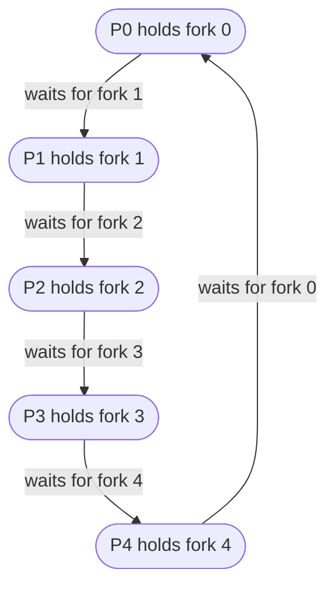

## Mental Model

These three problems are not puzzles for their own sake. Each is a **template** for a family of real bugs:

| Problem | Real-world shape | Core difficulty |
|---|---|---|
| **Producer–Consumer** (bounded buffer) | Work queues, pipelines, Kafka consumers, TCP send buffers | Coordinating *waiting* when full or empty, plus mutual exclusion |
| **Readers–Writers** | Caches, config maps, database rows (shared vs exclusive locks) | Maximizing concurrency without starving anyone |
| **Dining Philosophers** | Transferring money between two accounts, acquiring multiple locks | Deadlock when each party holds one resource and waits for another |

## Definition

- **Producer–Consumer**: producers generate items into a buffer of fixed capacity N; consumers remove them. Producers must wait when the buffer is full; consumers when it is empty; buffer updates must be mutually exclusive.
- **Readers–Writers**: many threads access shared data; readers only read, writers modify. Multiple readers may proceed together, but a writer needs exclusive access.
- **Dining Philosophers**: five philosophers around a table alternate thinking and eating; eating requires both the left and right fork, each shared with a neighbor.

## Why It Exists

**The problem.** It's hard to judge a synchronization tool in the abstract. You need standard situations that every tool must handle — and that expose the typical failure (lost wakeups, starvation, deadlock).

**The idea.** Dijkstra and Courtois et al. formulated them in the 1960s–70s to test whether a synchronization mechanism could express common coordination patterns cleanly and without deadlock or starvation. They remain the standard way to reason about correctness properties. Each problem isolates exactly *one* hard thing: Producer–Consumer is about *waiting* for a state, Readers–Writers about *sharing fairly*, Dining Philosophers about *needing two resources at once*.

:::callout[That's all it is]{type=insight}
Three toy stories, three real problems: wait until there's room or work (producer–consumer), let readers share but writers go alone (readers–writers), and don't deadlock when you need two locks (philosophers). Recognise the shape in real code and the known fix applies.
:::

## How It Works

### 1. Producer–Consumer with semaphores

Two different needs, so two different tools: the producer must *wait for a free slot* and the consumer must *wait for an item* (counting), and both must not corrupt the buffer's indices (mutual exclusion).

```java
Semaphore mutex = new Semaphore(1);    // mutual exclusion on the buffer
Semaphore empty = new Semaphore(N);    // number of empty slots
Semaphore full  = new Semaphore(0);    // number of filled slots

void producer() throws InterruptedException {
    while (true) {
        Item item = produce();
        empty.acquire();                 // wait for a free slot
        mutex.acquire();
        buffer.insert(item);
        mutex.release();
        full.release();                  // one more item
    }
}

void consumer() throws InterruptedException {
    while (true) {
        full.acquire();                  // wait for an item
        mutex.acquire();
        Item item = buffer.remove();
        mutex.release();
        empty.release();                 // one more free slot
        consume(item);
    }
}
```

Key points:

- `empty` and `full` do the **waiting**; `mutex` protects the buffer's internal state (indices).
- **Order matters**: counting semaphore first, then mutex. Reversing them in the producer (`wait(mutex); wait(empty)`) deadlocks when the buffer is full — the producer sleeps holding the mutex.
- `produce()` and `consume()` happen *outside* the critical section — never do slow work while holding the lock.
- Invariant: `empty + full = N` (between operations).

::viz{id=producer-consumer}

### 2. Readers–Writers

**First readers–writers solution (reader preference):**

```java
Semaphore rwMutex = new Semaphore(1);   // exclusive access for writers (and the first reader)
Semaphore mutex = new Semaphore(1);     // protects readCount
int readCount = 0;

void write() throws InterruptedException {
    rwMutex.acquire();
    /* write */
    rwMutex.release();
}

void read() throws InterruptedException {
    mutex.acquire();
    readCount++;
    if (readCount == 1) rwMutex.acquire();   // first reader locks out writers
    mutex.release();

    /* read */

    mutex.acquire();
    readCount--;
    if (readCount == 0) rwMutex.release();   // last reader lets writers in
    mutex.release();
}
```

`rwMutex` must be a semaphore, not a `ReentrantLock`. The first reader acquires it, but the last reader, often a different thread, releases it. A `ReentrantLock` has an owner and throws `IllegalMonitorStateException` if another thread unlocks it; a semaphore has no owner.

Readers run concurrently. But as long as at least one reader is present, new readers keep entering — **writers can starve** under a steady stream of reads.

**Second solution (writer preference)**: once a writer is waiting, block new readers (add a `read_try` semaphore that writers acquire while waiting). Now **readers can starve** if writers keep arriving.

**Fair solution**: a FIFO "service queue" semaphore that every reader and writer passes through in arrival order, so neither can overtake the other indefinitely. Real RW locks (e.g., `ReentrantReadWriteLock(fair=true)`, Linux's rwsem) implement variants of this with explicit queues.

### 3. Dining Philosophers

The story stands for any task that needs *two* resources at once (two accounts in a transfer, two locks). Naive solution: each philosopher picks up the left fork, then the right.

```java
Semaphore[] fork = { new Semaphore(1), new Semaphore(1), new Semaphore(1),
                     new Semaphore(1), new Semaphore(1) };   // one per fork

void philosopher(int i) throws InterruptedException {
    fork[i].acquire();                 // left
    fork[(i + 1) % 5].acquire();       // right
    eat();
    fork[(i + 1) % 5].release();
    fork[i].release();
}
```

If all five pick up their left fork simultaneously, each waits forever for the right one: **deadlock** — all four Coffman conditions hold, with a cycle of five waits ([Deadlocks](lesson:os-deadlocks)).



Deadlock-free fixes — each breaks a different Coffman condition:

| Fix | Mechanism | Condition broken |
|---|---|---|
| **Resource ordering** | Always pick up the lower-numbered fork first (philosopher 4 picks fork 0 before fork 4) | Circular wait |
| **At most 4 at the table** | Semaphore `room = 4` — at least one philosopher can get both forks | Circular wait (pigeonhole) |
| **Pick up both atomically** | Take both forks inside a monitor only if both are free (state: THINKING/HUNGRY/EATING; eat only if neighbors aren't eating) | Hold and wait |
| **Asymmetry** | Odd philosophers pick left first, even pick right first | Circular wait |
| **Timeout and back off** | If the second fork isn't available soon, put down the first and retry after a random delay | Hold and wait (but risks livelock without randomization) |

The monitor solution (Dijkstra/Tanenbaum's `test(i)`) is deadlock-free but can still **starve** a philosopher whose neighbors alternate eating; fairness needs extra bookkeeping (e.g., priority to the hungriest).

### 4. The sleeping barber

A shop has one barber, one barber chair and N waiting chairs. With no customers the barber sleeps. An arriving customer wakes the barber if he's asleep, waits in a free chair if he's busy, and leaves if every chair is taken.

```java
Semaphore customers = new Semaphore(0);  // waiting customers; the barber sleeps on it
Semaphore barber = new Semaphore(0);     // the barber calling the next customer
Semaphore mutex = new Semaphore(1);      // protects `waiting`
int waiting = 0;
static final int CHAIRS = 5;

void barber() throws InterruptedException {
    while (true) {
        customers.acquire();     // sleep until a customer arrives
        mutex.acquire();
        waiting--;
        barber.release();        // call one customer to the chair
        mutex.release();
        cutHair();
    }
}

void customer() throws InterruptedException {
    mutex.acquire();
    if (waiting < CHAIRS) {
        waiting++;
        customers.release();     // wake the barber if he is asleep
        mutex.release();
        barber.acquire();        // wait to be called
        getHaircut();
    } else {
        mutex.release();         // shop full: leave
    }
}
```

It's producer–consumer with a twist: when the buffer (the chairs) is full, the producer (a customer) *gives up* instead of waiting. That is exactly a `ThreadPoolExecutor` with one worker, a bounded queue and an `AbortPolicy`.

## Internal Mechanism

### What each problem teaches about primitives

- Producer–Consumer: **counting semaphores or two condition variables** encode *conditions* (not full, not empty); a mutex alone can't express waiting.
- Readers–Writers: a **policy question** — there's no single correct answer; you're trading throughput (reader concurrency) against latency and starvation.
- Dining Philosophers: **acquiring multiple resources** is where deadlock lives; lock ordering is the most common production fix.

:::depth{level=advanced}
### Condition-variable version of the bounded buffer

With a monitor (a `ReentrantLock` plus `notFull` and `notEmpty` conditions):

```java
void put(T x) throws InterruptedException {
    lock.lock();
    try {
        while (count == items.length) notFull.await();
        items[in] = x; in = (in + 1) % items.length; count++;
        notEmpty.signal();
    } finally { lock.unlock(); }
}

T take() throws InterruptedException {
    lock.lock();
    try {
        while (count == 0) notEmpty.await();
        T x = items[out]; out = (out + 1) % items.length; count--;
        notFull.signal();
        return x;
    } finally { lock.unlock(); }
}
```

Two conditions allow precise `signal()` instead of `broadcast()`. Lock-free alternatives exist for single-producer/single-consumer ring buffers (two indices, each written by one side only, with acquire/release ordering) — used by LMAX Disruptor, io_uring's submission/completion queues, and network drivers.
:::

## Example

Producer–Consumer in production:

- **TCP**: the socket send buffer is a bounded buffer between your application (producer) and the kernel's transmitter (consumer). A full buffer blocks `write()` (or returns `EAGAIN`) — that's flow control reaching your code ([Flow Control](lesson:cn-tcp-flow-control)).
- **Log shipping**: an app writes logs into an in-memory queue; a background thread ships them. When the queue is full, you must choose: block the app (backpressure), drop logs, or spill to disk.
- **Kafka**: producers append to partitions; consumer groups read at their own pace — a durable, distributed bounded buffer (bounded by retention).

Readers–Writers in production: database **shared (S) and exclusive (X) locks** on rows are exactly this problem. A lock manager must decide whether a waiting X lock blocks new S requests. Most do, to avoid writer starvation — see [Locking](lesson:db-locking).

Dining Philosophers in production: two transactions transferring money A→B and B→A, each locking the source account first → deadlock. Fix: always lock accounts in ID order.

## Complexity & Performance

- Bounded buffer throughput is limited by the mutex under many producers/consumers; sharded queues or lock-free queues scale better.
- Readers–writers: reader concurrency helps only when read critical sections are long; for short reads a plain mutex or RCU/copy-on-write is better ([Synchronization Primitives](lesson:os-sync-primitives)).
- Dining philosophers with ordering: deadlock-free with no runtime overhead — just discipline.

## Trade-offs

| Problem | Option | Gains | Costs |
|---|---|---|---|
| Producer–Consumer | Block when full | No data loss, natural backpressure | Producer latency |
| | Drop when full | Producer never blocks | Data loss |
| Readers–Writers | Reader preference | Max read throughput | Writer starvation |
| | Writer preference | Fresh data sooner | Reader starvation |
| | Fair queue | No starvation | Less concurrency |
| Dining Philosophers | Ordering | Simple, zero overhead | Must know all resources up front |
| | Timeout/backoff | Works with dynamic resources | Wasted work, possible livelock |

## Failure Modes

- Semaphore wait order reversed → deadlock (producer–consumer).
- Starvation of writers (config never updates) or readers.
- Livelock with symmetric timeouts (all philosophers back off and retry in lockstep) — add randomized backoff.
- Unbounded buffers hiding a slow consumer until memory runs out.

## In Production

- `BlockingQueue` (Java), `queue.Queue` (Python), buffered channels (Go) implement producer–consumer for you.
- RW locks: `ReentrantReadWriteLock`, `sync.RWMutex`, `pthread_rwlock_t`; for read-mostly data, `StampedLock` optimistic reads or RCU.
- Deadlock avoidance by ordering is a code-review rule in many codebases ("always acquire locks in the order: account, then ledger").

## Deeper Connections

- Deadlock theory and handling strategies: [Deadlocks](lesson:os-deadlocks), [Deadlock Handling](lesson:os-deadlock-handling).
- Bounded buffers + backpressure are the heart of [thread pools](lesson:os-thread-pools) and [overloaded servers](lesson:x-overloaded-server).
- S/X locks and lock ordering reappear in [database locking](lesson:db-locking).

## Common Misconceptions

- **"The mutex alone solves producer–consumer."** It provides exclusion but not waiting for "not full"/"not empty" — you'd busy-wait or lose items.
- **"The first readers–writers solution is correct, so it's the answer."** It's deadlock-free but starves writers; interviewers expect you to mention starvation.
- **"Dining philosophers is solved by making philosophers wait."** Waiting is what deadlocks; you must break a Coffman condition.

## Interview Questions

### [L1 · conceptual] Explain the producer–consumer problem and its semaphore solution.

Producers put items into a bounded buffer and consumers remove them; producers must wait when full, consumers when empty, and buffer access must be mutually exclusive. Use three semaphores: `empty` (initially N) counts free slots, `full` (initially 0) counts items, `mutex` (1) protects the buffer. Producer: wait(empty), wait(mutex), insert, signal(mutex), signal(full). Consumer: wait(full), wait(mutex), remove, signal(mutex), signal(empty).

### [L2 · what-if] In the producer–consumer solution, what happens if wait(mutex) and wait(empty) are swapped in the producer?

When the buffer is full, a producer acquires the mutex and blocks on `empty` while holding it. Consumers can't acquire the mutex to remove items, so `empty` is never signaled: deadlock.

### [L2 · compare] What's the difference between the first and second readers–writers problems?

The first gives readers priority: no reader waits unless a writer already holds the lock, so writers can starve. The second gives writers priority: once a writer is waiting, new readers are blocked, so readers can starve. Fair solutions serve requests in arrival order.

### [L2 · why] Why can the dining philosophers deadlock, and how do you prevent it?

If every philosopher picks up the left fork at the same time, each holds one fork and waits for the right one held by its neighbor: mutual exclusion, hold and wait, no preemption and a circular wait all hold. Prevent it by breaking one condition: impose a global ordering on forks (pick up the lower-numbered first), allow at most four at the table, acquire both forks atomically, or use asymmetric acquisition.

### [L3 · compare] Deadlock vs starvation in the dining philosophers problem?

Deadlock: every philosopher is blocked forever and nobody eats — a system-wide stall. Starvation: the system makes progress but one philosopher never gets both forks because neighbors keep eating alternately. A monitor-based solution can be deadlock-free yet still permit starvation; fairness requires additional policy (queues, priorities, aging).

### [L3 · debugging] A service that transfers money between accounts occasionally hangs under load; thread dumps show pairs of threads each waiting for a lock the other holds. Explain and fix.

It's the dining-philosophers pattern: transfer(A→B) locks A then B while transfer(B→A) locks B then A. Under concurrency they deadlock. Fix by always acquiring account locks in a canonical order (lower account ID first), or by using a single transaction with the database handling locking — which also needs consistent ordering or deadlock-retry logic.

### [L4 · design] Design a log-shipping pipeline where the app must never block on logging but log loss should be minimized.

Producer–consumer with a bounded in-memory ring buffer (lock-free SPSC or MPSC queue) between request threads and a shipping thread. On full buffer, the producer does not block: it increments a dropped-logs counter (or spills to a local file with its own bound), and emits a sampled summary. The shipper batches and compresses, with retries and backoff to the collector; if the collector is down, spill to disk with bounded size. Export metrics: queue depth, drops, ship latency. This makes the loss/latency trade-off explicit.

## Practice

### [mcq] In the semaphore bounded-buffer solution with N slots, what are the initial values of empty and full?

- [x] empty = N, full = 0
- [ ] empty = 0, full = N
- [ ] empty = 1, full = 1
- [ ] empty = N, full = N

Initially all slots are empty and no items are available.

### [mcq] Which change makes the naive dining philosophers solution deadlock-free?

- [ ] Making each philosopher think longer
- [ ] Using binary semaphores for forks
- [x] Having every philosopher pick up the lower-numbered fork first
- [ ] Adding a sixth fork to the table's center that nobody uses

A global resource ordering makes a circular wait impossible.

### [numeric 2] Five philosophers use the "at most 4 at the table" fix. What is the largest number that can be eating at the same moment?

:::answer
Eating needs 2 forks and there are 5, so at most ⌊5 / 2⌋ = **2** philosophers can eat at once, and they can't be neighbours. The limit of 4 seated is about preventing deadlock, not about how many eat.
:::

### [numeric 3] In the sleeping barber problem with 5 waiting chairs, the barber is cutting hair and all 5 chairs are taken. 3 more customers arrive before anyone leaves. How many of them leave without a haircut?

:::answer
Each newcomer finds `waiting == CHAIRS`, so all **3** leave. The bounded waiting room is load shedding: the shop turns customers away instead of letting the line grow without limit. Compare the bounded buffer in the [producer–consumer lab](lab:producer-consumer).
:::

### [mcq] In the Java readers–writers code, why is `rwMutex` a `Semaphore` rather than a `ReentrantLock`?

- [ ] Semaphores are faster than locks
- [x] The first reader acquires it and the last reader releases it, and those may be different threads; a `ReentrantLock` can only be unlocked by the thread that locked it
- [ ] `ReentrantLock` can't be shared between readers and writers
- [ ] Semaphores prevent writer starvation automatically

Ownership is the difference. A lock remembers which thread holds it, which enables reentrancy and misuse checks. A semaphore is just a count, so any thread may release it. (In production, use `ReentrantReadWriteLock` instead of building this yourself.)

### [exercise] Rewrite the Java dining philosophers so it can never deadlock, using resource ordering, and explain why a cycle of waits becomes impossible.

:::solution
```java
void philosopher(int i) throws InterruptedException {
    int left = i, right = (i + 1) % 5;
    int first = Math.min(left, right), second = Math.max(left, right);
    fork[first].acquire();      // always the lower-numbered fork first
    fork[second].acquire();
    eat();
    fork[second].release();
    fork[first].release();
}
```

Philosophers 0–3 still take their left fork first. Philosopher 4 needs forks 4 and 0, so it now takes fork 0 first. A deadlock needs a cycle in which everyone holds one fork and waits for a higher one. But every thread waits only for a fork with a *higher* number than one it holds, and numbers can't keep increasing around a cycle. The highest-numbered fork in any chain of waits is free or held by someone not waiting, so that philosopher eats and releases. The same rule fixes the bank transfer: lock the lower account ID first.
:::

## Quick Revision

- **Producer–Consumer**: `empty=N`, `full=0`, `mutex=1`; wait on the counting semaphore **before** the mutex; do slow work outside.
- **Readers–Writers**: reader preference → writer starvation; writer preference → reader starvation; fair queue → neither. DB S/X locks are this problem.
- **Dining Philosophers**: naive left-then-right deadlocks. Fix: lock ordering, ≤ 4 seated, atomic pick-up, asymmetry, timeouts with random backoff.
- Deadlock (nobody progresses) ≠ starvation (someone never progresses).
- **Sleeping barber**: `customers` (0), `barber` (0), `mutex` (1), `waiting` counter; full waiting room → customer leaves (load shedding).
- Java: reader-count locks must be ownerless (`Semaphore`); in real code use `ReentrantReadWriteLock` and `BlockingQueue`.
