## Mental Model

- **Concurrency** is about **structure**: a single barista taking orders, steaming milk and pulling shots by switching between tasks. Many tasks are *in progress* at once.
- **Parallelism** is about **execution**: three baristas working at the same time. Many tasks *execute* at the same instant.

You can have concurrency without parallelism (one core interleaving threads, a Node.js event loop), and parallelism without much concurrency (a matrix multiply split across 32 cores, each doing the same thing). Rob Pike's phrase: *concurrency is dealing with lots of things at once; parallelism is doing lots of things at once.*

Two tasks, A and B, each needing 4 ms of CPU:

```mermaid
%%{init: {"gantt": {"useWidth": 560, "leftPadding": 90, "rightPadding": 20, "barHeight": 30, "fontSize": 15, "sectionFontSize": 15}}}%%
gantt
    dateFormat x
    axisFormat %Q ms
    section One core
    A           :0, 2
    B           :2, 4
    A           :4, 6
    B           :6, 8
    section Two cores
    A on core 1 :0, 4
    B on core 2 :0, 4
```



On one core both tasks are in progress the whole time, but they take turns and finish after 8 ms. On two cores they really run at the same instant and finish after 4 ms.

## Definition

- **Concurrency**: the composition of independently progressing tasks whose lifetimes overlap. It is a property of the program's design.
- **Parallelism**: the simultaneous execution of computations on multiple processing units. It is a property of the execution.
- **Speedup** `S(N) = T(1) / T(N)` — how much faster a job finishes on N processors.

## Why It Exists

**The problem.** The two words get mixed up because they're answers to two *different* problems that look alike from far away. Two different pressures:

1. **Waiting is everywhere** — for disks, networks, users. Concurrency lets a program make progress on other tasks while one waits, even on a single core. This is why servers handle thousands of clients.
2. **Single cores stopped getting much faster** (~2005, the end of Dennard scaling). Performance growth moved to more cores. Parallelism is the only way a single job can use them.

The first is about *not sitting idle while waiting*; the second is about *doing more work per second*. Confusing them leads to the classic mistakes: adding cores to a program that's just waiting on a database (no help), or adding threads to a CPU-bound job on 4 cores (no help past 4).

:::callout[That's all it is]{type=insight}
Concurrency: many tasks started, taking turns — useful when tasks wait. Parallelism: many tasks running at the same instant — useful when tasks compute. One is how you organise the work; the other is how much hardware runs it.
:::

## How It Works

### CPU-bound vs I/O-bound

| Workload | Bottleneck | What helps | Rough thread count |
|---|---|---|---|
| **CPU-bound** (compression, image processing, JSON parsing at scale) | Cores | Parallelism: one thread per core | ≈ number of cores |
| **I/O-bound** (web handlers calling DBs and APIs) | Waiting on I/O | Concurrency: many tasks in flight | Many more than cores, or async I/O |

A useful sizing heuristic for a pool doing mixed work: `threads ≈ cores × (1 + wait_time / compute_time)`. A handler that computes 5 ms and waits 45 ms on the database: `cores × 10`.

### Amdahl's Law — the ceiling on speedup

The intuition before the formula: adding workers only speeds up the part of the job that *can* be split. The part that can't is done by one worker regardless, so it eventually becomes the whole wait. If a fraction **p** of a job can be parallelized and **(1 − p)** is inherently serial:

```text
S(N) = 1 / ((1 − p) + p / N)          and as N → ∞,  S → 1 / (1 − p)
```

| Parallel fraction p | Speedup on 8 cores | on 64 cores | Maximum possible |
|---|---|---|---|
| 50% | 1.78× | 1.97× | 2× |
| 90% | 4.7× | 8.8× | 10× |
| 95% | 5.9× | 15.4× | 20× |
| 99% | 7.5× | 39.3× | 100× |

A 5% serial portion — a single lock, a sequential merge step, one coordinator — caps the job at **20×** no matter how many cores you buy.

:::depth{level=advanced}
### Gustafson's Law — the optimistic view

Amdahl fixes the problem size. In practice, bigger machines are used for bigger problems: the parallel part grows while the serial part often stays constant. Gustafson's scaled speedup `S = N − (1 − p)(N − 1)` is closer to how HPC and data systems scale (process 10× more data in the same time). Both are true; they answer different questions.

### Beyond Amdahl: contention and coherence

Real systems do worse than Amdahl because of **contention** (waiting for shared resources) and **coherence** costs (keeping shared data consistent across cores — cache-line bouncing, cross-node chatter). Neil Gunther's **Universal Scalability Law** adds a term that grows with N²: past some point, adding workers makes throughput **go down**. This is what you see when a thread pool or cluster is "scaled up" past its optimum.
:::

## Internal Mechanism

On a single core, "concurrent" threads are interleaved by the scheduler via [context switches](lesson:os-context-switch) — no two instructions run at the same instant, but the interleaving is arbitrary, so race conditions are still possible. On multiple cores, threads run truly simultaneously and additional hazards appear: stale cached values, reordered memory operations ([Race Conditions](lesson:os-race-conditions)), and cache-line contention ([CPU Caches & Contention](lesson:os-cpu-caches-contention)).

## Example

A report job: load data (serial, 2 s), compute per-customer statistics (parallelizable, 18 s), write the result (serial, 1 s). Total 21 s, p = 18/21 ≈ 0.857.

- On 8 cores: 2 + 18/8 + 1 = **5.25 s** (4× speedup, not 8×).
- On 64 cores: 2 + 18/64 + 1 ≈ **3.28 s** (6.4×).
- Infinite cores: **3 s** (7× cap). To go faster, parallelize the load and write phases.

The same job in Java, with the serial and parallel parts visible in the code:

```java
List<Row> rows = load();                                     // serial: 2 s
Map<Long, Double> avgByCustomer = rows.parallelStream()      // parallel: 18 s of work, split across cores
        .collect(Collectors.groupingByConcurrent(Row::customerId,
                 Collectors.averagingDouble(Row::amount)));
write(avgByCustomer);                                        // serial: 1 s
```

`parallelStream()` runs on the JVM-wide `ForkJoinPool.commonPool()`, which has one worker per core minus one, plus the calling thread. It speeds up only the middle line. However many cores the machine has, `load()` and `write()` still take 3 s.

## Complexity & Performance

- **Throughput** (jobs/second) and **latency** (time per job) respond differently: concurrency mostly increases throughput for I/O-bound work; parallelism can reduce latency of a single CPU-bound job.
- [Little's Law](lesson:os-performance-method) connects them: `in-flight requests = throughput × latency`. To sustain 1,000 req/s at 200 ms each, you need ~200 requests in flight — i.e., ~200 concurrent tasks, whether threads or async tasks.

## Trade-offs

- More parallelism → more coordination overhead (locks, merging results, communication). Past a point, overhead exceeds gains.
- More concurrency (threads) → memory and context-switch overhead; async concurrency → code complexity.
- Parallel speedup vs **efficiency**: 64 cores giving 15× speedup is only 23% efficient — maybe fine for latency, wasteful for cost.

## Failure Modes

- **Oversubscription**: more CPU-bound threads than cores → switching overhead, cache thrash, worse throughput.
- **Hidden serialization**: a global lock, a single DB row everyone updates, a synchronized logger — parallel code that runs serially.
- **Nested parallelism**: a parallel library (BLAS, a parallel stream) called from an already-parallel pool spawns cores² threads.
- **Container CPU limits**: runtimes that size pools from the host's core count (e.g., 64) inside a container limited to 2 CPUs get throttled heavily.

## In Production

- Kubernetes CPU limits use CFS quotas; a Go or Java process that ignores them and runs 64 threads on a 2-CPU quota exhausts its quota early in each 100 ms period and is **throttled**, causing latency spikes. Modern JVMs and Go (1.25+ adjusts GOMAXPROCS for cgroup CPU limits) are container-aware; older versions needed explicit settings.
- Databases parallelize large queries (parallel sequential scans, parallel hash joins) but only benefit analytical queries; OLTP relies on concurrency across many small queries instead.

## Deeper Connections

- Amdahl's serial fraction is often a **lock**: shrinking critical sections is the same as increasing p ([Synchronization Primitives](lesson:os-sync-primitives)).
- In distributed systems the serial fraction is a **coordinator** or **consensus leader** ([Consensus](lesson:db-quorums-consensus)) — the same law at a larger scale.
- Event loops give concurrency without parallelism; production Node.js clusters add parallelism with multiple processes ([epoll & Event Loops](lesson:os-epoll-event-loops)).

## Common Misconceptions

- **"Concurrency and parallelism are the same."** Concurrency is structure; parallelism is simultaneous execution.
- **"More threads = more performance."** Only while they have independent work and free cores; beyond that, overhead dominates.
- **"Single-core concurrency can't have race conditions."** Preemption can interleave threads at any instruction.
- **"Doubling cores halves the runtime."** Only if the job is 100% parallel with no contention — never true in practice.

## Interview Questions

### [L1 · compare] What is the difference between concurrency and parallelism?

Concurrency is when multiple tasks are in progress during overlapping time periods — they may be interleaved on one core. Parallelism is when multiple tasks execute at the same instant on multiple cores. Concurrency is a way to structure a program to handle many things; parallelism is a way to execute faster. You can have either without the other.

### [L2 · numerical] A program is 80% parallelizable. What is the maximum speedup on 4 cores, and with infinitely many?

4 cores: 1 / (0.2 + 0.8/4) = 1 / 0.4 = **2.5×**. Infinite cores: 1 / 0.2 = **5×**.

### [L2 · how] How would you size a thread pool for a service that spends 10 ms computing and 90 ms waiting on a database per request, on 8 cores?

`threads ≈ cores × (1 + wait/compute) = 8 × (1 + 90/10) = 80`. Then validate with load tests: watch CPU utilization, queueing, and — critically — the database, which may not tolerate 80 concurrent queries from each instance. The downstream capacity often sets the real limit.

### [L2 · why] Why is it a bad idea to make blocking calls (HTTP, JDBC) inside a Java parallel stream?

Parallel streams run on `ForkJoinPool.commonPool()`, which has only about one thread per core and is shared by the whole JVM: every parallel stream and every `CompletableFuture.supplyAsync` without an explicit executor uses it. Its threads are sized for CPU work. If they block on I/O, the pool's few threads sit idle while waiting, so unrelated parallel work across the application stalls behind them, and the I/O gets no more concurrency than the core count. Blocking work belongs on its own executor sized for waiting (`cores × (1 + wait/compute)`), or on virtual threads; parallel streams are for CPU-bound work on in-memory data.

### [L3 · why] Why can adding threads to a CPU-bound service reduce throughput?

Beyond the core count, threads compete for cores: the scheduler time-slices them, adding context-switch overhead and evicting each thread's working set from caches and the TLB. Shared locks and cache lines become more contended (coherence traffic). The Universal Scalability Law captures this: throughput peaks and then declines.

### [L3 · debugging] A batch job on a 32-core machine uses only ~3 cores' worth of CPU despite a 32-thread pool. What would you check?

A serial bottleneck: a global lock (profile with `perf lock`/thread dumps showing BLOCKED threads), a single-threaded stage feeding the pool (producer too slow), I/O waits (iostat, `%iowait`), a synchronized shared resource (logger, connection pool of size 4), or container CPU limits. Also check whether the work is actually partitioned — e.g., all tasks hashing to one queue.

### [L4 · design] Your nightly ETL takes 6 hours on 16 cores; the business wants 1 hour. How do you reason about whether more hardware helps?

Profile the stages and measure the serial fraction: if loading, sorting or writing is single-threaded, Amdahl caps the benefit of more cores. Parallelize those stages (partitioned reads, parallel writes, merge-sort in parallel), remove shared bottlenecks (one DB table with a hot index, one output file), and consider scaling out (partitioning data across machines) — with Gustafson in mind: work that grows with data can scale. Estimate using the measured p before buying hardware; also check I/O and database capacity, which often become the new bottleneck.

## Practice

### [numeric 4.71 ±0.05] A job is 90% parallelizable. What speedup does it achieve on 8 cores? (2 decimals)

:::answer
S = 1 / (0.1 + 0.9/8) = 1 / (0.1 + 0.1125) = 1 / 0.2125 ≈ **4.71×**.
:::

### [numeric 20] What is the maximum speedup (infinite cores) for a job that is 95% parallel?

:::answer
1 / (1 − 0.95) = **20×**.
:::

### [mcq] A Node.js server handles 10,000 connections on one thread. This is an example of:

- [x] Concurrency without parallelism
- [ ] Parallelism without concurrency
- [ ] Both concurrency and parallelism
- [ ] Neither

Many tasks are in progress, interleaved on one thread via an event loop — nothing executes simultaneously.

### [numeric 200] A service sustains 1,000 requests per second and each request takes 200 ms from arrival to response. On average, how many requests are in flight at once?

:::answer
Little's Law: in flight = throughput × latency = 1,000/s × 0.2 s = **200**. That many concurrent tasks are needed, whether they are threads, virtual threads or async callbacks.
:::

### [numeric 160] Each request computes for 4 ms and then waits 36 ms on a database. Using the sizing heuristic, how many threads should a pool on 16 cores have?

:::answer
threads ≈ cores × (1 + wait / compute) = 16 × (1 + 36/4) = 16 × 10 = **160**. Start there and check with a load test. The database's tolerance for 160 concurrent queries per instance is often the real limit.
:::

### [mcq] A Java service calls a slow REST API from inside `list.parallelStream().map(...)`. Under load, unrelated parallel streams elsewhere in the JVM become slow. Why?

- [ ] Parallel streams always run on a single thread
- [x] All parallel streams share `ForkJoinPool.commonPool()`, and its few threads are stuck waiting on the REST API
- [ ] The REST client is not thread-safe
- [ ] The JIT compiler cannot optimize lambdas

The common pool has about one thread per core and is shared JVM-wide. Blocking calls occupy those threads, so every other user of the pool queues behind them. Move I/O to a dedicated executor or to virtual threads.

### [exercise] A nightly Java batch job reads input files for 30 s (one thread), transforms the records for 270 s of CPU work using a parallel stream on 8 cores, and writes to the database for 60 s over a single connection. Estimate the run time. Then estimate it again with the writes spread over 4 connections, assuming the database keeps up. Which stage should you attack next?

:::solution
Transform: 270 s / 8 cores ≈ 33.75 s. Total ≈ 30 + 33.75 + 60 = **123.75 s**. Without parallelism it would be 360 s, so the speedup is only about 2.9× on 8 cores, because 90 of the 360 seconds are serial (p = 270/360 = 0.75).

With 4 write connections: writes ≈ 60 / 4 = 15 s, so total ≈ 30 + 33.75 + 15 = **78.75 s**.

The biggest remaining serial stage is the 30 s read. Reading files in parallel (one task per file, or split large files by byte range) would attack it next. More cores barely help now: even infinitely fast transforms would save only 33.75 s.
:::

## Quick Revision

- **Concurrency** = structure (many tasks in progress); **parallelism** = simultaneous execution.
- CPU-bound → threads ≈ cores. I/O-bound → many tasks or async; `threads ≈ cores × (1 + wait/compute)`.
- **Amdahl**: `S = 1 / ((1−p) + p/N)`, max `1/(1−p)`. 5% serial → ≤ 20×.
- **Gustafson**: bigger machines → bigger problems. **USL**: contention/coherence make throughput fall past a peak.
- Hidden serialization (global locks, hot rows) kills parallel speedup.
- Container CPU limits + host-sized thread pools → throttling.
- Java: `parallelStream()` and default `CompletableFuture` async use the shared common pool (≈ cores − 1 threads) → CPU work only, never blocking I/O.
