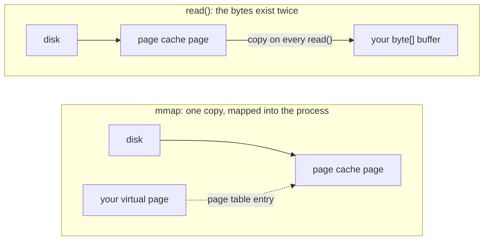

## Mental Model

**Copy-on-write** is "share until someone wants to scribble". After `fork`, parent and child point at the same physical pages marked read-only. The first time either one writes to a page, the kernel quietly makes that one page private for the writer. Pages never written are never copied.

**mmap** is "make the file *be* memory". Instead of `read()`ing bytes into a buffer, you map the file into your address space; touching an address page-faults the corresponding file page in from the page cache. The file and the memory become two views of the same pages.

Both are the same trick: **manipulate page tables and let page faults do the work lazily.**

## Definition

- **Copy-on-write (COW)**: pages shared between address spaces are mapped read-only; a write triggers a fault that copies the page and gives the writer a private writable copy.
- **`mmap(addr, len, prot, flags, fd, offset)`**: creates a mapping of a file (or anonymous memory) into the address space.
  - **`MAP_SHARED`**: writes go to the shared page-cache pages and eventually to the file; visible to other mappers.
  - **`MAP_PRIVATE`**: copy-on-write; writes create private copies never written back to the file.
  - **`MAP_ANONYMOUS`**: not backed by a file (zero-filled) — used by allocators and for shared memory between related processes.
- **`msync`**: flush dirty pages of a shared mapping to the file (durability).

## Why It Exists

**The problems.** Two expensive operations kept showing up: *copying a whole address space* (every `fork`) and *copying file data into user buffers* (every `read`). Both copy memory that is often never modified.

**The idea.** Don't copy until you must — and let the MMU tell you when you must. Map the same physical pages in two places, mark them read-only, and let the first write fault into the kernel. Copy-on-write is that trick applied to `fork`; `mmap` is the same trick applied to files.

- **COW** makes `fork` cheap, enables instant snapshots (Redis persistence, filesystem snapshots in Btrfs/ZFS), and lets `MAP_PRIVATE` mappings of executables share code pages while keeping writable data private.
- **mmap** avoids copying file data between the page cache and user buffers: the one page-cache copy is mapped directly. It also gives random access with pointer arithmetic, lets many processes share one copy of a file in memory, and loads programs and libraries lazily.

:::callout[That's all it is]{type=insight}
Point two page tables at the same RAM and mark it read-only; copy a page only when someone writes to it. `mmap` uses the same machinery to make a file's cached pages appear directly in your address space.
:::

## How It Works

### COW after fork

```text
Before write:                         After child writes page 2:
parent PT ─┬─> frame A (page 1) RO     parent PT ─┬─> frame A (page 1) RO
child PT  ─┘                           child PT  ─┘
parent PT ─┬─> frame B (page 2) RO     parent PT ───> frame B (page 2) RW (refcount 1)
child PT  ─┘                           child PT  ───> frame C (copy of B) RW
```

Steps on the write fault: check the VMA allows writes and the page is COW-shared (refcount > 1) → allocate frame C → copy 4 KB → map C writable in the child → decrement B's refcount. If the parent is now B's only user, a later parent write just flips B to writable, with no copy.

### mmap of a file

In Java, `FileChannel.map` is the `mmap` call:

```java
try (FileChannel ch = FileChannel.open(Path.of("data.bin"), StandardOpenOption.READ)) {
    MappedByteBuffer p = ch.map(FileChannel.MapMode.READ_ONLY, 0, ch.size());   // mmap, read-only
    long sum = 0;
    for (int i = 0; i < p.limit(); i += 4096) {
        sum += p.get(i);                          // one byte per page: page faults load pages lazily
    }
}
```

Each first touch of a page is a page fault: minor if the page is in the page cache, major (disk read) if not. Read-ahead fetches following pages on sequential access.

The Java map modes line up with the `mmap` flags: `READ_ONLY` and `READ_WRITE` are shared mappings (`MAP_SHARED`), `PRIVATE` is copy-on-write (`MAP_PRIVATE`), and `MappedByteBuffer.force()` is `msync`. A `MappedByteBuffer` is indexed by `int`, so one mapping covers at most 2 GB, and it is unmapped only when the garbage collector reclaims it. Since Java 22, mapping into a `MemorySegment` removes both limits:

```java
try (FileChannel ch = FileChannel.open(Path.of("data.bin"), StandardOpenOption.READ);
     Arena arena = Arena.ofConfined()) {
    MemorySegment data = ch.map(FileChannel.MapMode.READ_ONLY, 0, ch.size(), arena);  // any size
    long sum = 0;
    for (long off = 0; off < data.byteSize(); off += 4096) {
        sum += data.get(ValueLayout.JAVA_BYTE, off);
    }
}   // closing the arena unmaps the file right away
```



### read() vs mmap

| | `read()` into a buffer | `mmap` |
|---|---|---|
| Copies | Page cache → user buffer (1 extra copy) | None; page-cache pages mapped directly |
| Syscalls | One per read call | One mmap; then page faults |
| Error handling | Return codes (`EIO`) | Errors arrive as **SIGBUS** on access |
| Control over I/O timing | Explicit | Implicit (whenever a fault happens) |
| Address space use | Buffer only | Whole mapping (a problem on 32-bit) |
| Best for | Streaming, sequential, most code | Random access to large read-mostly files, sharing between processes |

## Internal Mechanism

### Shared memory via mmap

`MAP_SHARED` mappings of the same file (or of a `shm_open`/`memfd` object) in several processes point to the **same physical pages** — the fastest IPC ([IPC](lesson:os-ipc)). PostgreSQL's shared buffers are created this way (anonymous shared mmap or System V shared memory).

### Durability of mmap writes

The convenience of mmap — "the kernel moves the data for you" — becomes a liability when *you* need to decide when data reaches disk. Writes to a `MAP_SHARED` mapping dirty page-cache pages; the kernel writes them back eventually (writeback thresholds, dirty expiry ~30 s by default). For durability you must call **`msync(MS_SYNC)`** (or `fsync` on the fd). Worse, you can't control *when* dirty pages are written. The kernel may flush a half-updated data structure before you're ready. That breaks crash-consistency protocols such as WAL ordering, where the data page must not reach disk before its log record.

:::depth{level=advanced}
### Why many databases avoid mmap for their data

The CIDR 2022 paper "Are You Sure You Want to Use MMAP in Your Database Management System?" (Crotty, Leis, Pavlo) summarizes the problems:

1. **Transactional safety**: the OS can flush dirty pages at any time, violating write-ahead ordering; workarounds (MAP_PRIVATE + copying, shadow paging) add complexity.
2. **I/O stalls**: a page fault blocks the thread with no async alternative; the DB can't schedule or prioritize I/O.
3. **Error handling**: I/O errors surface as SIGBUS at arbitrary memory accesses.
4. **Performance at scale**: page-table contention, TLB shootdowns on eviction, and single-threaded kernel eviction limit throughput with fast NVMe.

Counterexamples exist: **LMDB** uses a read-only mmap plus copy-on-write B+ tree pages written with explicit writes, getting great read performance; MongoDB's original MMAPv1 engine was replaced by WiredTiger (own cache). PostgreSQL uses `read()/write()` via its own buffer pool plus the OS page cache; InnoDB manages its own buffer pool with `O_DIRECT`.
:::

## Example

**Redis BGSAVE with COW**: Redis forks; the child iterates the dataset and writes a snapshot file while the parent keeps serving writes. Memory overhead = pages the parent modifies during the snapshot. With a write-heavy workload touching most pages, memory use approaches 2×. Transparent huge pages make it worse (a small write copies 2 MB), which is why Redis warns to disable THP.

**Zero-copy static file serving**: `sendfile()` (or mmap + write) serves file bytes straight from the page cache to the socket without copying into user space — how Nginx and Kafka achieve high throughput.

## Complexity & Performance

- COW `fork` cost ∝ page-table size; each subsequent write to a shared page costs a fault + 4 KB copy (~1–5 µs).
- mmap sequential scans are competitive with `read()`; random access to a hot, cached file is often faster (no syscalls); cold random access is dominated by major faults either way.
- `munmap` or eviction of mapped pages in multithreaded processes triggers TLB shootdowns ([TLB](lesson:os-tlb)).

## Trade-offs

- **COW**: cheap snapshots and forks, but unpredictable memory growth and latency when writes break sharing.
- **mmap**: zero-copy and simple code, but no control over I/O timing, awkward error handling, durability pitfalls, and address-space limits on 32-bit systems.

## Failure Modes

- **COW memory blowup** during fork-based snapshots → OOM.
- **SIGBUS** when accessing an mmap'd page past end of a truncated file or on I/O error.
- **Stale reads** across processes if one uses `write()` and another uses `MAP_PRIVATE` mappings (private pages don't see later file changes once copied).
- **Durability surprises**: assuming `munmap` or process exit flushes to disk — it flushes to the page cache, not to stable storage.

## In Production

- Kafka, Elasticsearch/Lucene (memory-mapped index files via `MMapDirectory`), LMDB, SQLite (optional mmap I/O) rely on mmap for reads.
- Snapshot-based persistence: Redis RDB, Btrfs/ZFS snapshots, VM snapshots, container image layers (overlay filesystems are COW at the file level).
- `vm.max_map_count` must be raised for applications creating many mappings (Elasticsearch requires 262,144).

## Deeper Connections

- COW at the page level ↔ MVCC at the row level: never overwrite what readers might still be using; create a new version ([MVCC](lesson:db-mvcc)).
- mmap's durability problems explain why databases use a WAL and their own buffer pool ([Buffer Pool](lesson:db-buffer-pool), [WAL](lesson:db-wal-durability)).
- The page cache sits under both `read()` and `mmap` ([Page Cache](lesson:os-page-cache)).

## Common Misconceptions

- **"fork doubles memory usage."** Only pages that get written are copied.
- **"mmap makes file I/O free."** The first access to each page still costs a fault and possibly a disk read.
- **"Writing to an mmap'd file makes it durable."** Only after msync/fsync completes.

## Interview Questions

### [L2 · how] How does copy-on-write work after fork()?

The kernel duplicates the parent's page tables for the child and marks all writable private pages read-only in both, incrementing each page's reference count. When either process writes to such a page, a protection fault occurs; the kernel allocates a new frame, copies the page, maps it writable for the writer, and restarts the instruction. Unwritten pages stay shared.

### [L2 · compare] What's the difference between MAP_SHARED and MAP_PRIVATE?

MAP_SHARED maps the file's page-cache pages directly; writes modify those pages, are visible to other processes mapping the file, and are eventually written to the file. MAP_PRIVATE maps pages copy-on-write; writes create private copies that aren't visible to others and aren't written to the file.

### [L2 · compare] When would you use mmap instead of read()?

For large files accessed randomly or repeatedly (indexes, lookup tables), when multiple processes should share one in-memory copy, or to avoid copying data between the page cache and user buffers. Prefer read() for streaming/sequential processing, when you need explicit error handling and I/O control, or for writes requiring careful durability ordering.

### [L2 · how] How do you memory-map a file in Java, and what are the pitfalls?

`FileChannel.map(mode, position, size)` calls `mmap` and returns a `MappedByteBuffer`. `READ_ONLY` and `READ_WRITE` are shared mappings (writes reach the page cache and eventually the file); `PRIVATE` is copy-on-write. Pitfalls: a buffer is `int`-indexed, so each mapping is at most 2 GB (large files need several mappings, or `MemorySegment` since Java 22); the mapping is released only when the buffer is garbage-collected, so files can stay mapped and undeletable on Windows (an `Arena`-based `MemorySegment` unmaps on close); writes are durable only after `force()` (msync); and I/O errors surface as an `InternalError` or a crash-like fault at the accessing instruction, not as an `IOException`. Lucene's `MMapDirectory` is the best-known user, which is why Elasticsearch needs `vm.max_map_count` raised.

### [L3 · why] Why do many databases avoid mmap for their data files?

They lose control over when dirty pages are written (breaking write-ahead logging order), page faults block threads without async alternatives, I/O errors appear as SIGBUS, and kernel eviction/TLB shootdowns limit scalability on fast SSDs. A self-managed buffer pool lets the DB control eviction, prefetching, durability order and I/O scheduling.

### [L3 · incident] During Redis background saves, memory usage spikes and the instance is OOM-killed. Explain and mitigate.

BGSAVE forks; the child writes the snapshot while the parent keeps handling writes. Every page the parent modifies is copied (COW), so memory can approach twice the dataset under write-heavy load; with transparent huge pages, each small write copies 2 MB. Mitigate: disable THP, provision headroom (maxmemory well below the limit), reduce write load during saves or save less frequently, use replicas for persistence, and ensure `vm.overcommit_memory = 1` so fork itself isn't refused.

## Practice

### [mcq] A process maps a file with MAP_PRIVATE and writes to it. What happens to the file on disk?

- [ ] It's updated after msync()
- [ ] It's updated when the process exits
- [x] It is not modified; the writes go to private copies of the pages
- [ ] It's corrupted

Private mappings are copy-on-write; the file never sees the changes.

### [mcq] How are I/O errors reported to a program reading an mmap'd file whose disk sector fails?

- [ ] read() returns -1 with EIO
- [x] The process receives SIGBUS when accessing the page
- [ ] mmap() returns MAP_FAILED at mapping time
- [ ] The page silently contains zeros

There's no system call to return an error from — the fault is delivered as a signal.

### [numeric 3 unit=GB] Redis holds a 10 GB dataset in 4 KB pages and forks for BGSAVE. While the child writes the snapshot, the parent modifies 30% of the pages. How much extra memory does copy-on-write use?

:::answer
Each modified page is copied once: 30% × 10 GB = **3** GB extra. Pages the parent doesn't touch stay shared. A workload that rewrote every page would approach 10 GB extra, doubling memory.
:::

### [numeric 2000 unit=MB] With transparent huge pages (2 MB), the Redis parent makes one small write into each of 1,000 different huge pages during a BGSAVE. How much memory gets copied?

:::answer
Copy-on-write copies a whole page: 1,000 × 2 MB = **2000** MB. With 4 KB pages the same 1,000 writes would copy only 1,000 × 4 KB ≈ 4 MB. That 500× amplification is why Redis tells you to disable THP.
:::

### [mcq] A Java program maps a file with `FileChannel.MapMode.PRIVATE` and writes into the buffer. What happens to the file?

- [ ] It changes after `force()` is called
- [ ] It changes when the channel is closed
- [x] It never changes; the writes go to private copy-on-write pages that are discarded when unmapped
- [ ] The write throws `ReadOnlyBufferException`

`PRIVATE` is `MAP_PRIVATE`: the first write to each page copies it for this process only. Other processes and the file keep seeing the original data.

### [exercise] A Java service must scan a 10 GB file of fixed-size 64-byte records and sum one 8-byte field from each record. Write it with memory mapping, explain why a single `MappedByteBuffer` won't do, and say what the OS does while your loop runs.

:::solution
A single `MappedByteBuffer` can't span 10 GB because its index is an `int` (2 GB maximum). Use a `MemorySegment` (Java 22+):

```java
static long sumField(Path file) throws IOException {
    try (FileChannel ch = FileChannel.open(file, StandardOpenOption.READ);
         Arena arena = Arena.ofConfined()) {
        MemorySegment data = ch.map(FileChannel.MapMode.READ_ONLY, 0, ch.size(), arena);
        long sum = 0;
        for (long off = 0; off + 64 <= data.byteSize(); off += 64) {
            sum += data.get(ValueLayout.JAVA_LONG_UNALIGNED, off + 8);   // the field at byte 8
        }
        return sum;
    }
}
```

(On older Java versions, map the file in 1 GB windows with several `MappedByteBuffer`s.)

While the loop runs, the first access to each 4 KB page causes a page fault. If the page is in the page cache, it's a minor fault and the kernel just maps it; otherwise it's a major fault and the thread sleeps while the page is read. On this sequential pattern the kernel's read-ahead fetches the following pages in large chunks, so most faults are minor. No `read()` system calls happen and no bytes are copied into a Java buffer. Closing the arena unmaps the file at once.
:::

## Quick Revision

- **COW**: share pages read-only; copy a page on first write. Powers fork, snapshots, MAP_PRIVATE.
- **mmap**: file pages from the page cache mapped into memory; faults load pages lazily.
- `MAP_SHARED` (writes go to file, visible to others) vs `MAP_PRIVATE` (COW, invisible) vs `MAP_ANONYMOUS`.
- Durability needs `msync`/`fsync`; errors arrive as **SIGBUS**.
- DBs often avoid mmap: no control over flush order/I/O, blocking faults, SIGBUS, eviction scalability.
- Redis BGSAVE: COW growth under writes; disable THP.
- Java: `FileChannel.map` = mmap (`PRIVATE` = MAP_PRIVATE, `force()` = msync); `MappedByteBuffer` ≤ 2 GB and GC-unmapped; `MemorySegment` + `Arena` (Java 22) has neither limit.
