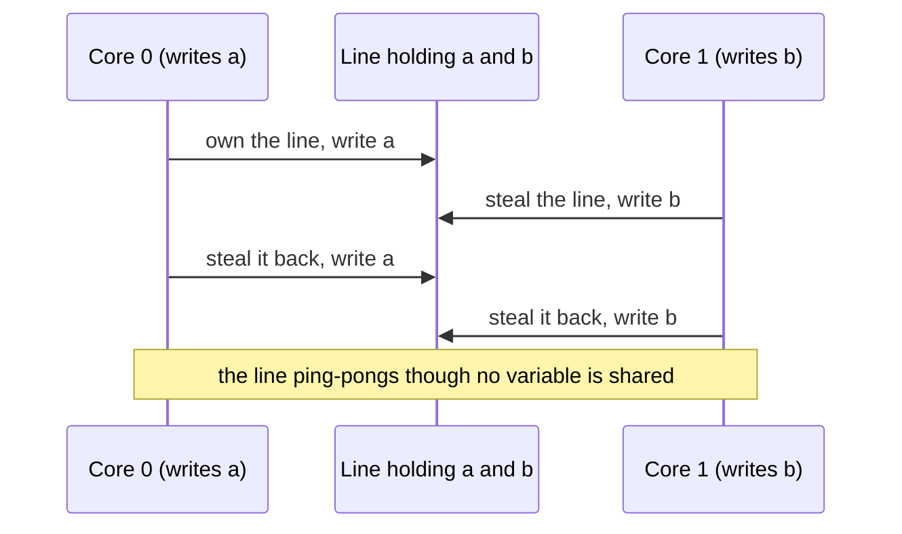

## Mental Model

Each core has its own private notebook (L1/L2 cache), and they share a whiteboard (L3 and RAM). When one core writes a value, every other core's copy of that **page of the notebook** (a 64-byte **cache line**) must be torn out. The others then re-copy it from whoever has the latest version.

Suppose two cores keep writing to the same line, even to **different variables** that merely happen to sit on it. The line then ping-pongs between them hundreds of thousands of times per second. Code that looks perfectly parallel runs *slower* on eight cores than on one.

## Definition

- **Cache line**: the unit of transfer between memory levels, typically 64 bytes on x86 and many ARM cores (Apple M-series use 128 bytes).
- **Cache coherence protocol** (e.g., **MESI**: Modified, Exclusive, Shared, Invalid): hardware protocol ensuring all cores see a consistent value for each line.
- **True sharing**: multiple threads actually access the same variable (e.g., a shared counter).
- **False sharing**: threads access *different* variables that live on the same cache line, causing coherence traffic as if they were shared.
- **Lock contention**: threads frequently compete for the same lock, waiting and bouncing its cache line.

## Why It Exists

**The problem.** Private caches are necessary for speed; coherence is necessary for correctness. Put them together and every *write* to shared data must chase down and invalidate other cores' copies.

**Why it's surprising.** The cost of coherence is invisible in source code — it depends on memory layout and access patterns — so it's a common cause of "mysterious" scaling failures. Two lines of code that look independent can fight over the same 64 bytes.

**The idea for fixing it.** Coherence works at cache-line granularity, so design at cache-line granularity: give each thread's hot data its own line, write shared data rarely, and batch updates.

:::callout[That's all it is]{type=insight}
Cores keep private copies of 64-byte lines; a write by one core invalidates everyone else's copy. If several cores keep writing the same line — even different variables on it — the line bounces between them and parallel code runs slower than serial.
:::

## How It Works

### MESI in one table

| State | Meaning | On a write by this core | On a read by another core |
|---|---|---|---|
| Modified | Only copy, dirty | Write locally | Supply data, → Shared |
| Exclusive | Only copy, clean | Write locally, → Modified (no bus traffic) | → Shared |
| Shared | Several clean copies | Must invalidate others first (→ Modified) | Stay Shared |
| Invalid | Not present / stale | Must fetch with ownership | — |

A write to a line in Shared state requires a **read-for-ownership**/invalidate round-trip to all other holders: tens to hundreds of cycles — far more across sockets ([NUMA](lesson:os-hugepages-numa)).

### False sharing, concretely

The hardware doesn't know about variables; it only knows lines. So two variables that happen to be neighbours behave as if they were one shared variable.

```java
class Counters {
    volatile long a;    // written only by thread 1
    volatile long b;    // written only by thread 2, but it sits next to a, on the same 64-byte line
}

// thread 1: for (...) counters.a++;     core 0 keeps taking the line
// thread 2: for (...) counters.b++;     core 1 keeps taking it back
```

The threads never touch each other's data, but every increment invalidates the other core's copy. Typical slowdown vs padded layout: **several times to 10×+**.



Fix: give each hot field its own cache line. The JDK has an annotation for exactly this:

```java
// Outside the JDK, run with -XX:-RestrictContended, and compile with
// --add-exports java.base/jdk.internal.vm.annotation=ALL-UNNAMED
class Counters {
    @jdk.internal.vm.annotation.Contended volatile long a;   // padded onto its own line
    @jdk.internal.vm.annotation.Contended volatile long b;
}
```

In application code, prefer classes that already do this: `LongAdder` pads its cells with `@Contended`, and the LMAX Disruptor pads its sequence counters. Hand-written padding fields are unreliable in Java because the JVM chooses the field layout. Go's runtime pads hot structures, and Linux uses `____cacheline_aligned_in_smp`.

### Contended locks and atomics

A mutex's state word is a cache line. Under contention:

1. every acquire attempt pulls the line in exclusive mode;
2. waiters that sleep need futex syscalls and wakeups (context switches);
3. the critical section runs serially — Amdahl's serial fraction ([Concurrency vs Parallelism](lesson:os-concurrency-vs-parallelism)).

Symptoms: throughput flattens or drops as threads are added; CPU shows high `%sys` (futex) or spinning; profiles show time in lock functions.

### Context-switch tax

Each switch costs ~µs directly plus cold caches/TLB for the incoming thread ([Context Switching](lesson:os-context-switch)). Oversubscribed thread pools and lock convoys multiply switches. Measure with `vmstat cs`, `pidstat -w`, `perf sched`.

## Internal Mechanism

### Locality: the other half of cache performance

- **Spatial locality**: sequential access uses every byte of each line and lets the prefetcher run ahead. Arrays of structs vs structs of arrays: if a loop touches only one field, a struct-of-arrays layout wastes no bandwidth.
- **Temporal locality**: reuse data while it's hot — blocking/tiling in matrix operations, processing a batch before moving on.
- **Pointer chasing** (linked lists, trees of small nodes, hash maps with chained buckets) defeats prefetchers — every hop can be a DRAM miss (~100 ns).

:::depth{level=advanced}
### Diagnosing with hardware counters

`perf stat -e cycles,instructions,cache-misses,LLC-load-misses ./app` gives **IPC** (instructions per cycle): > 2 means compute-efficient; < 0.5 often means memory-bound (stalled on misses). `perf c2c` ("cache to cache") specifically detects false sharing by reporting cache lines with heavy cross-core HITM (hit-modified) traffic and the code offsets touching them. Intel's top-down analysis (`perf stat --topdown` / VTune) classifies stalls as frontend, backend-memory, backend-core, bad speculation or retiring.
:::

## Example

Scaling a request counter in a web service across 32 threads:

| Implementation | Throughput (relative) |
|---|---|
| `synchronized` increment of a global long | 1× (lock contention + line bouncing) |
| `AtomicLong.incrementAndGet()` | ~3–5× (no lock, still one hot line) |
| `LongAdder` (striped, padded cells) | ~20–30× (mostly core-local lines) |
| Per-thread counter, summed on read | ~30×+ |

(Illustrative orders of magnitude; the pattern is robust across hardware.)

## Complexity & Performance

| Event | Approximate cost |
|---|---|
| L1 hit | ~1 ns |
| Line transfer between cores, same socket | ~40–80 ns |
| Line transfer across sockets | ~100–200 ns |
| DRAM miss | ~80–100 ns local, more remote |
| Uncontended lock | ~20 ns |
| Contended lock with sleep/wake | µs |

## Trade-offs

- Padding eliminates false sharing but wastes memory and can hurt locality for read-mostly data.
- Sharding (per-thread/per-CPU state) scales writes but makes reads more expensive and approximate.
- Fine-grained locking improves parallelism but increases complexity and lock overhead; coarse locks are simple but contended.

## Failure Modes

- Performance that **drops** when adding cores/threads.
- Benchmarks that look fine on a laptop (few cores, one socket) and collapse on a 2-socket server.
- Hot shared data structures (a global cache map, a metrics registry, a shared allocator arena).
- Reference counting on shared objects (`shared_ptr` copies, `Arc::clone`) creating hidden hot lines.

## In Production

- Allocators (jemalloc, tcmalloc) and runtime schedulers are designed around per-CPU/per-thread structures precisely to avoid contention.
- Databases partition hot structures (buffer pool hash partitions, lock manager partitions, WAL insertion locks in PostgreSQL) for the same reason.
- Case study: [Thread contention](case:thread-contention).

## Deeper Connections

- Atomics and memory ordering: [Atomic Instructions](lesson:os-atomic-instructions), [Race Conditions](lesson:os-race-conditions).
- Hot rows in databases are the same phenomenon one level up: many transactions updating one row serialize on its lock ([Locking](lesson:db-locking)); hot partitions in distributed systems likewise ([Sharding](lesson:db-sharding)).

## Common Misconceptions

- **"If threads don't share variables, they don't interfere."** False sharing makes adjacent variables interfere.
- **"Atomics are free, locks are expensive."** Contended atomics serialize on a cache line just like locks do.
- **"More cores = linear speedup for thread-parallel code."** Only when threads mostly touch core-local data.

## Interview Questions

### [L2 · conceptual] What is false sharing?

When threads on different cores modify different variables that happen to reside on the same cache line, the coherence protocol treats the whole line as shared: each write invalidates the other cores' copies, so the line bounces between cores, drastically slowing both threads even though they share no data logically. Fix by padding/aligning per-thread data to separate cache lines.

### [L2 · how] How does cache coherence work at a high level?

Each cache line in each core's cache has a state (e.g., MESI). Before a core writes a line, it must obtain exclusive ownership, invalidating other copies; reads of a line modified elsewhere fetch the latest data from the owner. This keeps all cores consistent at the cost of inter-core traffic for shared, written data.

### [L2 · how] How do you avoid false sharing in Java?

Keep data written by different threads apart. Prefer per-thread state (a local variable, merged at the end) or JDK classes designed for it: `LongAdder` and `LongAccumulator` spread updates over padded cells, and `ConcurrentHashMap` counts its size with striped cells. When you must place hot fields yourself, `@jdk.internal.vm.annotation.Contended` pads a field (or a group of fields) onto its own cache line. Outside the JDK it needs `--add-exports java.base/jdk.internal.vm.annotation=ALL-UNNAMED` to compile and `-XX:-RestrictContended` to take effect. Manual padding with dummy `long` fields is fragile, because HotSpot decides field order. Confirm the problem and the fix with `perf c2c` or a JMH benchmark that runs the threads on different cores.

### [L3 · debugging] A multithreaded aggregation job gets slower when you go from 4 to 16 threads, with CPU at 100%. How do you investigate?

Suspect contention: false sharing on per-thread accumulators, a shared atomic counter, a contended lock, or allocator contention. Use `perf c2c` to find cache lines with heavy cross-core modified hits, `perf top`/flame graphs for time in lock/atomic functions, and check IPC. Fix with per-thread accumulators padded to cache lines, sharded structures, and merging results at the end.

### [L3 · why] Why can a linked list be slower than an array by an order of magnitude for the same number of elements?

Array elements are contiguous: each cache line holds several elements and the prefetcher streams them. List nodes are scattered, so each traversal step is a dependent load that likely misses cache (~100 ns) and the prefetcher can't predict the next address.

### [L4 · design] Design a metrics library that records counters and histograms from thousands of request threads with negligible overhead.

Per-thread (or per-CPU) buffers of counters/histogram buckets, cache-line padded, updated with plain or relaxed atomic operations without locks; a background collector periodically aggregates and resets or reads cumulative values. Avoid string lookups in the hot path (pre-registered handles). Keep histograms as fixed bucket arrays (HDR-style). Accept slightly stale reads. This moves all sharing to the rare aggregation step.

## Practice

### [mcq] Two threads increment `stats.hits` and `stats.misses`, adjacent 8-byte fields in one struct. What is the most likely performance problem?

- [ ] Data race on the same variable
- [x] False sharing of one cache line
- [ ] TLB misses
- [ ] Priority inversion

Different variables, same 64-byte line.

### [mcq] A program has IPC of 0.3 and a high last-level cache miss rate. It is most likely:

- [ ] Branch-misprediction bound
- [x] Memory-bound
- [ ] I/O-bound
- [ ] Syscall-bound

Low IPC with many LLC misses means cores stall waiting on memory.

### [numeric 16.7 ±0.2 unit=million/s] Two threads on different cores alternately increment fields that share one cache line, and moving the line between cores takes 60 ns. At most, how many increments per second can they make together, in millions?

:::answer
Every increment needs the line moved first, so increments happen one at a time, 60 ns apart: 1 s / 60 ns ≈ 16,666,667 per second, about **16.7** million. Two threads on padded lines could each do hundreds of millions per second.
:::

### [numeric 512 unit=bytes] Eight per-thread counters (8-byte `long`s) are each padded onto their own 64-byte cache line. How much memory do they occupy?

:::answer
8 × 64 = **512** bytes, against 64 bytes unpadded. The 448 bytes of padding buy freedom from false sharing, a good trade for a handful of hot counters and a bad one for millions of objects.
:::

### [mcq] You annotate a field of your own class with `@jdk.internal.vm.annotation.Contended`, but measurements show no change. What is the most likely reason?

- [ ] The annotation only works on `static` fields
- [x] Outside the JDK it is ignored unless the JVM runs with `-XX:-RestrictContended`
- [ ] It requires the G1 collector
- [ ] It only pads `int` fields

By default the JVM honours `@Contended` only for JDK classes. `LongAdder` gets the padding automatically, which is one reason to use it rather than rolling your own.

### [exercise] Write a small Java experiment showing false sharing: two threads each increment their own `volatile long` field 100 million times, first with the fields in one object, then with each field padded onto its own line. Predict the results and list what could make the measurement misleading.

:::solution
```java
class Shared  { volatile long a; volatile long b; }
class Padded  {
    // compile with --add-exports java.base/jdk.internal.vm.annotation=ALL-UNNAMED
    @jdk.internal.vm.annotation.Contended volatile long a;   // run with -XX:-RestrictContended
    @jdk.internal.vm.annotation.Contended volatile long b;
}

static long run(Runnable r1, Runnable r2) throws InterruptedException {
    Thread t1 = new Thread(r1), t2 = new Thread(r2);
    long start = System.nanoTime();
    t1.start(); t2.start(); t1.join(); t2.join();
    return (System.nanoTime() - start) / 1_000_000;          // milliseconds
}

// Shared s = new Shared();
// run(() -> { for (int i = 0; i < 100_000_000; i++) s.a++; },
//     () -> { for (int i = 0; i < 100_000_000; i++) s.b++; });
// ...then the same with Padded p.
```

**Prediction**: the shared version is several times slower, often 3–10×, because every increment of a volatile field must own the line, and the other core keeps taking it away. In the padded version each core keeps its line in its own cache.

**What can mislead you**: JIT warm-up (run each version several times and ignore the first runs, or use JMH); both threads landing on the same physical core's hyperthreads, which share L1 so the effect shrinks (pin them, or run on an idle machine); and forgetting `-XX:-RestrictContended`, which makes both versions identical. Confirm with `perf c2c`, which should show heavy cross-core "HITM" traffic on one line in the shared version only.
:::

## Quick Revision

- Cache line = 64 B unit; coherence (MESI) invalidates other copies on writes.
- **True sharing** vs **false sharing** (different variables, same line) → pad/align to 64 B.
- Contended locks/atomics serialize on one line; shard (per-thread/per-CPU) and merge.
- Locality: sequential > pointer chasing; struct-of-arrays for field scans.
- Diagnose: `perf stat` (IPC, misses), `perf c2c` (false sharing), `vmstat cs`, lock profiles.
- Java: `@Contended` (+ `-XX:-RestrictContended`) pads a field; prefer `LongAdder` and per-thread state; manual padding is unreliable.
