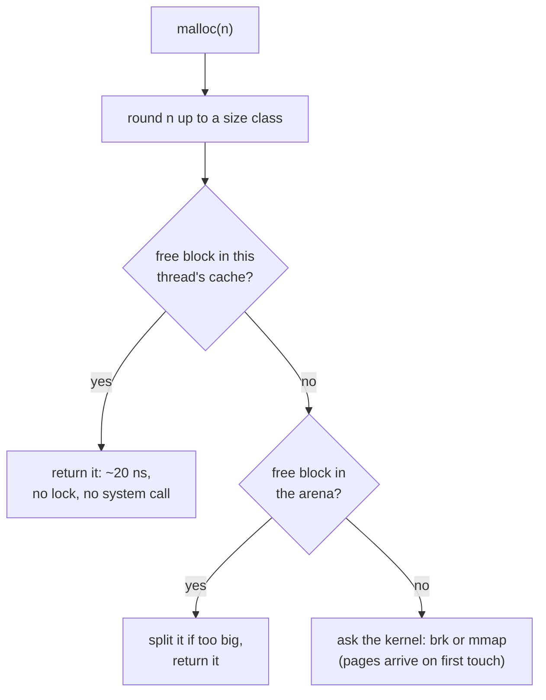

## Mental Model

The kernel sells memory **wholesale** — in pages (4 KB) via `brk` and `mmap` system calls, which are relatively expensive. `malloc` is the **retailer**: it buys large chunks from the kernel and sells small pieces to your program, keeping track of which pieces are free so it can resell them after `free`.

The retailer's hardest problem is **fragmentation**: after many allocations and frees, free memory is scattered in small holes. There may be 1 MB free in total but no single hole larger than 4 KB — so a 64 KB request fails or forces buying more from the kernel.

## Definition

- **`malloc(n)` / `free(p)`**: user-space allocator functions (in libc or a replacement like jemalloc/tcmalloc/mimalloc) that manage heap memory.
- **Internal fragmentation**: wasted space *inside* allocated blocks (asking for 13 bytes and receiving a 16- or 32-byte block; a page-granular allocation using only part of the page).
- **External fragmentation**: free memory split into non-contiguous holes too small to satisfy requests, even though the total free space is sufficient.
- **Placement policies**: first fit, next fit, best fit, worst fit — which free hole to use for a request.
- **Garbage collection (GC)**: automatic reclamation of heap objects that are no longer reachable.

## Why It Exists

**The problem.** Programs need memory whose size and lifetime are only known at runtime (a request body, a growing list, a cache).

**Without it.** The stack can't hold data that outlives a function. Asking the kernel for every tiny object would cost a syscall and a whole page each: a 24-byte object would occupy 4,096 bytes and take ~1 µs to get.

**The idea.** Buy in bulk, sell retail. A user-space allocator amortizes kernel calls and packs small objects densely. Everything inside `malloc` — headers, free lists, splitting, coalescing — is just the bookkeeping a shopkeeper needs to remember which pieces of the bulk purchase are sold and which are back on the shelf.

**The catch that drives the rest of the lesson.** Objects are freed in a different order from how they were allocated, so free space ends up scattered in holes (fragmentation). Placement policies, size classes and garbage collectors are each a different answer to "how do we keep the holes useful?"

:::callout[That's all it is]{type=insight}
`malloc` gets big chunks from the kernel and hands out small pieces, keeping a list of which pieces are free. The hard part isn't giving memory out; it's reusing the gaps after things are freed.
:::

## How It Works

### Getting memory from the kernel

- **`brk`/`sbrk`** move the end of the heap ("program break") upward — used for small allocations in glibc's main arena.
- **`mmap(MAP_ANONYMOUS)`** creates a new zero-filled region anywhere in the address space — used for large allocations (glibc default threshold 128 KB, adaptive) and for additional arenas.

Either way, the kernel only reserves address space; physical pages arrive on first touch ([Page Faults](lesson:os-page-faults)).

### Inside malloc: blocks, headers and free lists

`free(p)` receives only a pointer — not a size. So the allocator must be able to find "how big is this block?" from the pointer alone, and "where are the free blocks?" quickly. Each block carries a small **header** (size, in-use flag). Free blocks are linked into **free lists**. On `malloc(n)`:

1. Round `n` up to alignment (16 bytes on x86-64) plus header → **internal fragmentation**.
2. Search the free lists for a suitable block (by size class or policy).
3. If the block is much larger, **split** it; return the pointer after the header.
4. If nothing fits, extend the heap (`brk`) or `mmap` a new chunk.

On `free(p)`: read the header, mark the block free, **coalesce** with adjacent free neighbors (using boundary tags — a footer with the size — to find the previous block), and insert into a free list.



### Contiguous allocation: fixed vs variable partitions

Early operating systems faced the same problem for whole processes, and textbooks still ask about it:

- **Fixed partitions**: memory is divided in advance into partitions of set sizes, and each process gets one. A 90 KB process in a 100 KB partition wastes 10 KB inside it: **internal** fragmentation.
- **Variable partitions**: each process gets exactly what it asks for, carved from free memory. Nothing is wasted inside, but as processes come and go, the free space breaks into holes between them: **external** fragmentation.

How bad does external fragmentation get? Knuth's **50-percent rule**: with first fit, if N blocks are allocated, about N/2 more blocks' worth of memory is lost in holes. That means about **one third** of memory can be unusable. Compaction (moving processes together) fixes it but requires execution-time address binding, so the processes can be moved.

### Placement policies

When several holes are big enough, which one should you use? Using one changes which holes are left for future requests, so the choice decides how bad fragmentation gets. Free holes (in address order): **[100 KB] [500 KB] [200 KB] [300 KB] [600 KB]**. Requests arrive: 212 KB, 417 KB, 112 KB, 426 KB.

| Policy | 212 KB | 417 KB | 112 KB | 426 KB |
|---|---|---|---|---|
| **First fit** — first hole big enough | 500 → 288 left | 600 → 183 left | 288 → 176 left | **fails** (largest hole 300) |
| **Best fit** — smallest hole big enough | 300 → 88 left | 500 → 83 left | 200 → 88 left | 600 → 174 left ✔ |
| **Worst fit** — largest hole | 600 → 388 left | 500 → 83 left | 388 → 276 left | **fails** (largest hole 300) |
| **Next fit** — first fit starting from the last position | like first fit but continues after the previous allocation | | | |

Here best fit satisfies all four requests. In general, simulations show first fit and best fit have similar utilization, first fit is faster, and worst fit is usually worst. Best fit tends to leave tiny unusable slivers.

::lab{id=memory-allocator}

### Modern allocators: size classes and per-thread caches

The textbook allocator has two real-world problems: searching lists is slow, and one global lock serialises every thread's `malloc`. Real allocators don't do a linear search:

- **Segregated free lists / size classes**: separate lists for 16, 32, 48, … bytes. Small allocations take the head of the right list — O(1) — with some internal fragmentation from rounding.
- **Thread caches / arenas**: glibc uses multiple arenas; tcmalloc and jemalloc keep **per-thread (or per-CPU) caches** so most mallocs take no lock at all.
- **Slabs/runs**: a page (or run of pages) holds objects of one size class; freeing is a bitmap flip.

### Kernel allocators

- **Buddy system**: memory split into power-of-two blocks; a request is rounded up to a power of two, and a block of size 2ᵏ is split into two "buddies" of 2ᵏ⁻¹ as needed. On free, a block merges with its buddy if the buddy is free. Fast coalescing, but internal fragmentation up to ~50% (a 33 KB request takes 64 KB). Linux uses it for physical page allocation.
- **Slab allocator** (SLUB in Linux): caches of pre-initialized objects of one type (inodes, task structs, socket buffers), carved out of pages. There's no fragmentation within a cache, allocation is fast, and constructed state can be reused.

## Internal Mechanism

### Garbage collection

The problem GC solves isn't speed — it's *people*. Manual `free` produces two classic bugs: forgetting it (leak) and doing it too early (use-after-free, a top security bug). Managed languages replace `free` with a collector that finds unreachable objects:

- **Reference counting** (Python's primary mechanism, Swift, `shared_ptr`): free when the count hits zero. Immediate reclamation; can't collect cycles alone (Python adds a cycle detector); counts are write-heavy and contended across threads.
- **Tracing (mark-sweep, mark-compact, copying)**: from roots (stacks, globals, registers), mark everything reachable; everything else is garbage. **Compacting/copying** collectors move live objects together, **eliminating external fragmentation** and enabling bump-pointer allocation (just increment a pointer — as fast as a stack).
- **Generational**: most objects die young, so collect the young generation often and cheaply (copying), the old generation rarely (JVM G1/ZGC, .NET, V8).
- **Allocation in the JVM**: because the GC compacts, the free space in the young generation is one contiguous region. Each thread gets a private chunk of it, a **TLAB** (thread-local allocation buffer), and `new` just bumps a pointer inside it: no free list, no lock, a few instructions. That is why allocating short-lived objects in Java is so cheap.
- **Pauses**: stop-the-world phases pause application threads; concurrent collectors (ZGC, Shenandoah, Go's collector) keep pauses to milliseconds or less at the cost of CPU and memory overhead.

:::depth{level=advanced}
### Why RSS doesn't shrink after free()

Freed memory usually returns to the allocator's free lists, not to the kernel. The heap top can only shrink with `brk` if the *topmost* memory is free; a single live object near the top pins everything below it. Allocators return memory by `madvise(MADV_DONTNEED/MADV_FREE)` on free pages or `munmap` of large blocks, often lazily. So a process that briefly allocated 4 GB may keep a high RSS — expected behavior, not necessarily a leak. jemalloc/tcmalloc have tunables for decay/return rates; glibc offers `malloc_trim()`.
:::

## Example

Internal vs external fragmentation, concretely:

- **Internal**: a slab allocator with 64-byte size class serving 40-byte requests wastes 24 bytes per object (37.5%).
- **External**: allocate A(100 KB), B(50 KB), C(100 KB), D(50 KB), E(100 KB) contiguously, then free B and D. In total 100 KB is free, but in two 50 KB holes, so a 60 KB request can't be satisfied without growing the heap.

Compaction (moving blocks together) would fix it, but C and E can't be moved in C/C++ because raw pointers to them exist — only GC'd runtimes with pointer tracking (or handle-based designs) can compact.

A leak in a garbage-collected language looks like this: nothing is forgotten, but nothing ever becomes unreachable either.

```java
// One entry per request ID, kept forever: the map is static, so every value stays reachable
static final Map<String, byte[]> RENDERED = new ConcurrentHashMap<>();

byte[] render(String requestId) {
    return RENDERED.computeIfAbsent(requestId, id -> expensiveRender(id));
}
```

The heap grows with traffic until the GC runs constantly and then fails with `OutOfMemoryError`. Bound the cache so old entries become garbage:

```java
static final int MAX_ENTRIES = 1_000;
static final Map<String, byte[]> RENDERED = Collections.synchronizedMap(
        new LinkedHashMap<>(MAX_ENTRIES, 0.75f, true) {          // true = access order (LRU)
            @Override
            protected boolean removeEldestEntry(Map.Entry<String, byte[]> eldest) {
                return size() > MAX_ENTRIES;                      // evict the least recently used
            }
        });
```

(In production, a cache library such as Caffeine gives size and time limits without the global lock.)

## Complexity & Performance

| Operation | Typical cost |
|---|---|
| Stack allocation | ~1 ns |
| malloc small, thread-cache hit | ~10–30 ns |
| malloc with lock contention / arena search | 100 ns – µs |
| New page from kernel (first touch fault) | ~0.1–1 µs per 4 KB (plus zeroing) |
| Large mmap/munmap | µs, plus TLB shootdowns on munmap |
| GC young collection | ms-scale pauses (or concurrent) |

## Trade-offs

- **First fit**: fast, decent utilization; fragments the start of memory.
- **Best fit**: good utilization; slow without indexing; tiny slivers.
- **Worst fit**: leaves big holes early; usually poor.
- **Size classes**: O(1), low external fragmentation; internal fragmentation from rounding.
- **Manual memory**: predictable latency; leaks and use-after-free bugs.
- **GC**: safety and compaction; CPU/memory overhead and pauses.

## Failure Modes

- **Memory leaks**: allocated memory never freed (C/C++) or unintentionally kept reachable (caches without eviction, listeners never unregistered, growing maps keyed by request IDs) in GC languages. RSS grows until the OOM killer strikes. Case study: [Memory Leak & OOM](case:memory-leak).
- **Use-after-free / double free**: corrupts allocator metadata; classic security vulnerabilities.
- **Fragmentation-driven growth**: long-running processes with varied allocation sizes slowly grow RSS without leaking (switching glibc → jemalloc often helps; e.g., Redis ships jemalloc and has "activedefrag").
- **Allocator lock contention**: many threads hammering one arena.
- **GC death spiral**: live data near the heap limit → constant full collections → CPU at 100%, throughput near zero.

## In Production

- Swap allocators with `LD_PRELOAD=libjemalloc.so` to measure fragmentation/contention impact.
- Tools: Valgrind/ASan (leaks, use-after-free), `heaptrack`, jemalloc profiling, Go `pprof` heap profiles, Java heap dumps + MAT, Python `tracemalloc`.
- JVM: heap sizing (`-Xmx`) inside containers must leave room for non-heap memory (metaspace, thread stacks, direct buffers, GC structures) — otherwise the container OOMs while the Java heap looks fine.

## Deeper Connections

- Paging largely eliminates external fragmentation of **physical** memory ([Paging](lesson:os-paging)); fragmentation remains a user-space (virtual) problem.
- Database storage engines face the same problems in their pages: free space inside pages, page splits, and compaction/vacuum ([Pages & Records](lesson:db-pages-records), [MVCC](lesson:db-mvcc)).
- LSM trees trade in-place updates for append-and-compact — compaction is garbage collection for data ([LSM Trees](lesson:db-lsm-trees)).

## Common Misconceptions

- **"malloc makes a system call every time."** Usually not; it serves from memory already obtained.
- **"free() returns memory to the OS."** Usually it returns memory to the allocator.
- **"Garbage-collected languages can't leak memory."** Anything reachable is kept — unbounded caches and listeners leak.
- **"Best fit always wastes the least memory."** It often leaves many unusable tiny fragments.

## Interview Questions

### [L1 · compare] What is the difference between internal and external fragmentation?

Internal fragmentation is unused space inside an allocated block, caused by rounding requests up to block/size-class/page granularity. External fragmentation is free memory that's split into non-contiguous holes, none large enough for a request even though the total free space would suffice.

### [L1 · compare] Explain first fit, best fit and worst fit.

First fit allocates the first free hole large enough (fast). Best fit allocates the smallest hole that fits (minimizes leftover but leaves slivers, slower to search). Worst fit allocates the largest hole (leaves large leftovers; usually performs worst). Next fit is first fit resuming from where the last search ended.

### [L2 · how] What happens when you call malloc(100)?

The allocator rounds 100 up to its alignment/size class plus header (e.g., 112 bytes), checks the calling thread's cache or the arena's free list for that class, and returns a block if available (no syscall). If not, it carves one from a larger free chunk or obtains more memory from the kernel via brk or mmap; physical pages are only allocated when the memory is first touched (page fault).

### [L2 · numerical] With the buddy system on a 1 MB block, how much memory is allocated for a 70 KB request, and how much is internal fragmentation?

Round up to the next power of two: 128 KB. Internal fragmentation = 128 − 70 = **58 KB** (~45%).

### [L3 · why] Why can't C/C++ allocators compact the heap to remove external fragmentation, while Java's GC can?

Compaction moves objects, which requires updating every pointer to them. In C/C++, pointers are raw addresses stored anywhere (even as integers), and the allocator can't find them all. A tracing GC knows the location of every reference (precise root and heap maps), so it can move objects and fix references.

### [L3 · debugging] A long-running C++ service's RSS grows steadily over days but leak checkers find no leaks. What could be happening?

Heap fragmentation with the default allocator: varied allocation sizes leave free holes that can't be reused or returned to the OS, so the allocator keeps requesting new memory. Also possible: arena proliferation per thread (glibc), caches growing without bound (not technically leaks), or freed memory not released to the OS. Try jemalloc/tcmalloc, compare `malloc_stats`, cap arenas (`MALLOC_ARENA_MAX`), and inspect application caches.

### [L4 · incident] A Java service in a 4 GB container is OOM-killed while heap usage graphs show only 2.5 GB used with -Xmx3g. Explain.

The container limit covers total process memory, not just the Java heap: thread stacks (hundreds of threads × up to 1 MB), metaspace, JIT code cache, GC data structures, direct/NIO buffers (Netty), memory-mapped files, and native library allocations (plus glibc arena fragmentation). With a 3 GB heap limit, non-heap usage > 1 GB exceeds 4 GB. Fixes: set heap as a percentage of the container (`-XX:MaxRAMPercentage`), cap direct memory, reduce thread count/stack size, use Native Memory Tracking to measure, and leave headroom.

## Practice

### [exercise] Holes (in order): 100, 500, 200, 300, 600 KB. Requests: 212, 417, 112, 426 KB. Which policy satisfies all requests?

:::solution
**Best fit**: 212→300 (88 left), 417→500 (83 left), 112→200 (88 left), 426→600 (174 left). First fit and worst fit both fail the 426 KB request because their earlier choices consumed the 600 KB hole.
:::

### [numeric 58] Buddy system: a process requests 70 KB. How many KB of internal fragmentation result?

:::answer
The request is rounded up to 128 KB; 128 − 70 = **58 KB** wasted.
:::

### [mcq] Which technique eliminates external fragmentation in the heap of a garbage-collected language?

- [ ] Reference counting
- [x] Compacting (or copying) garbage collection
- [ ] Best-fit allocation
- [ ] Increasing the page size

Compaction moves live objects together, leaving one contiguous free region.

### [numeric 80 unit=KB] Memory has fixed partitions of 100, 200 and 300 KB. Processes of 90, 180 and 250 KB are placed one per partition, in that order. What is the total internal fragmentation?

:::answer
Waste inside each partition: (100 − 90) + (200 − 180) + (300 − 250) = 10 + 20 + 50 = **80** KB. That memory is free but unusable, because each partition belongs to one process.
:::

### [numeric 8 unit=bytes] An allocator rounds every request up to a multiple of 16 bytes (16, 32, 48, …). How many bytes are wasted when a program asks for 40 bytes?

:::answer
40 rounds up to 48, so 48 − 40 = **8** bytes of internal fragmentation (17%). Smaller size-class steps waste less but need more free lists.
:::

### [numeric 33.3 ±0.5 unit=%] By Knuth's 50-percent rule, with first fit and N allocated blocks, about N/2 blocks' worth of memory is lost in holes. What fraction of memory is unusable?

:::answer
For every N blocks in use, N/2 are lost: unusable / total = 0.5N / (N + 0.5N) = 1/3 ≈ **33.3**%. Try first fit against best fit on your own request sequences in the [memory allocation lab](lab:memory-allocator).
:::

### [mcq] A Java service's heap grows steadily with traffic until it throws `OutOfMemoryError`. A heap dump shows millions of entries in a `static ConcurrentHashMap<String, Session>` keyed by request ID. What kind of problem is this?

- [ ] The garbage collector has a bug and is not freeing unreachable objects
- [x] A leak in a garbage-collected language: the static map keeps every entry reachable, so none of it is garbage
- [ ] External fragmentation of the Java heap
- [ ] The JVM's TLABs are too small

The GC frees only unreachable objects. A static map is reachable from the class, and so is everything it holds. Bound the map (an LRU or time-based eviction), or remove entries when the request ends.

## Quick Revision

- malloc = user-space retailer; kernel = wholesaler (`brk`, `mmap`); pages arrive on first touch.
- Blocks + headers + free lists; split on alloc, coalesce on free.
- **Internal** fragmentation = waste inside blocks (rounding); **external** = unusable scattered holes.
- First fit (fast), best fit (tight, slivers), worst fit (usually worst), next fit.
- Modern: size classes + per-thread caches (tcmalloc/jemalloc). Kernel: **buddy** (powers of two) + **slab** (object caches).
- GC: refcount (no cycles alone), tracing (mark/sweep/compact), generational; compaction kills external fragmentation.
- `free` rarely returns memory to the OS; RSS growth ≠ necessarily a leak.
- Fixed partitions → internal fragmentation; variable partitions → external. **50% rule**: ≈ ⅓ of memory lost to holes with first fit.
- JVM: compacting GC → TLAB bump-pointer allocation. GC leaks = unbounded reachable collections (static maps, listeners).
