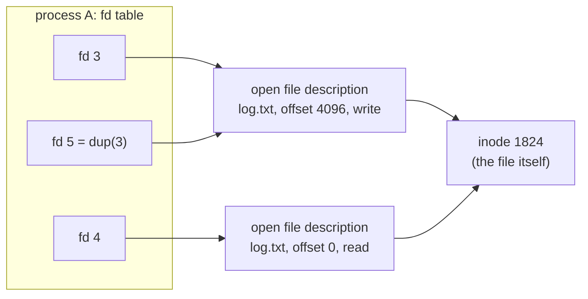

## Mental Model

A file descriptor is a **coat-check ticket**. When you open something — a file, a socket, a pipe, a device — the kernel keeps the real object behind the counter and hands you a small integer ticket. Every later operation (`read`, `write`, `close`) just shows the ticket. Because *everything* is accessed through tickets, the same code can read from a file, a network connection or a terminal: **"everything is a file"** really means "everything is behind a file descriptor".

## Definition

A **file descriptor (fd)** is a small non-negative integer that indexes a per-process table of open I/O resources. By convention, **0 = stdin, 1 = stdout, 2 = stderr**. New fds get the **lowest unused number**.

Three kernel data structures sit behind it:

1. **Per-process file descriptor table**: fd → pointer to an open file description (+ per-fd flags like `FD_CLOEXEC`).
2. **System-wide open file table** (open file descriptions): current **offset**, access mode (read/write/append), status flags (`O_NONBLOCK`), reference count, pointer to the inode/socket.
3. **Inode table** (in-memory inodes / vnodes): the file's metadata and data location — one per file, no matter how many times it's opened.

## Why It Exists

**The problem.** A program needs to refer to things that live in the kernel: an open file, a socket, a pipe. But it must not hold a pointer into kernel memory, because it could forge or corrupt it.

**The idea.** Give the program a meaningless small number and keep the real object on the kernel's side of the counter. The number is only valid in *that* process's table, so it can't be forged into access to someone else's file. And because every kind of object is reached the same way, one set of calls works for all of them. A uniform handle means:

- one set of system calls (`read`, `write`, `close`, `poll`) works for files, pipes, sockets, terminals, devices, timers (`timerfd`), events (`eventfd`), signals (`signalfd`);
- programs compose: the shell can wire any program's stdout to any other program's stdin, a file or a socket;
- the kernel keeps ownership and can enforce permissions once, at `open` time, then check a cheap integer afterward.

**Why three tables, not one.** Different things are shared at different levels: two programs opening the same file share the *file* but not the read position; `dup` and `fork` share the read position too. Three layers (fd → open description → inode) let each kind of sharing happen at the right level.

:::callout[That's all it is]{type=insight}
An fd is an index into a per-process array of pointers to kernel objects. `read(3, ...)` means "do a read on whatever slot 3 points at" — a file, a socket or a pipe, it doesn't matter.
:::

## How It Works



- `open()` creates a **new open file description** (new offset) every time — fds 3 and 4 above are two independent opens of the same file with separate offsets.
- `dup(fd)` / `dup2(old, new)` create another fd pointing to the **same** open file description — they share the offset and flags.
- `fork()` copies the fd table, so parent and child fds point to the **same** descriptions and share their offsets. That's why a parent and child writing to the same inherited log fd don't overwrite each other's output.
- `close(fd)` removes the table entry and decrements the description's refcount; the file is actually released when the last reference goes away.

### Redirection is just dup2

`cmd > out.txt 2>&1` from Java:

```java
Process p = new ProcessBuilder("cmd")
        .redirectOutput(new File("out.txt"))    // stdout → out.txt
        .redirectErrorStream(true)              // stderr → wherever stdout goes (2>&1)
        .start();
p.waitFor();
```

In the child, before running `cmd`, the JDK makes the same system calls a shell does:

```text
openat("out.txt", O_WRONLY|O_CREAT|O_TRUNC) = 3
dup2(3, 1)       fd 1 (stdout) → out.txt
dup2(1, 2)       fd 2 (stderr) → the same open file description, so the same offset
close(3)
execve("cmd", ...)
```

Order matters: `2>&1 > out.txt` would point stderr at the *old* stdout (the terminal) first.

### Offsets and O_APPEND

Each open file description has one offset. With `O_APPEND`, each `write` atomically seeks to the end before writing — so multiple processes appending to a log with `O_APPEND` don't clobber each other (for writes on local filesystems; not guaranteed on NFS).

## Internal Mechanism

### Limits

- Per-process soft/hard limit: `ulimit -n` (`RLIMIT_NOFILE`) — often 1024 by default for shells, higher for services (systemd `LimitNOFILE`).
- System-wide: `fs.file-max` / `fs.nr_open`.
- Exceeding the per-process limit → `EMFILE` ("Too many open files"); the system limit → `ENFILE`.

Every TCP connection is an fd, so a server with 50,000 concurrent connections needs a limit above 50,000 — plus files, pipes, epoll fds.

### Close-on-exec

The inheritance that makes shell redirection work has a side effect. By default fds survive `exec`. That's how stdin/stdout reach new programs — but it also leaks sockets, database connections and secret files into child processes you spawn. Open everything with **`O_CLOEXEC`** (or `SOCK_CLOEXEC`, `accept4(..., SOCK_CLOEXEC)`) unless you intend to pass it on. Most modern runtimes (Java, Go, Python 3.4+) do this by default.

:::depth{level=advanced}
### Unlinked-but-open files

Deleting a file (`unlink`) removes its directory entry, but the inode and data survive as long as any open file description refers to it. Classic incident: a log file is deleted to free disk space, but the process still has it open and keeps writing — `df` shows the disk full while `du` can't find the space. `lsof +L1` lists such files; fix by restarting the process or truncating via `/proc/<pid>/fd/<n>`. This behavior is also a feature: programs create temp files and immediately unlink them so they disappear on crash.
:::

## Example

Inspecting a live process's descriptors:

```bash
$ ls -l /proc/2291/fd
lr-x------ 0 -> /dev/null
l-wx------ 1 -> /var/log/app/out.log
l-wx------ 2 -> /var/log/app/out.log
lrwx------ 3 -> socket:[48121]        # listening socket
lrwx------ 4 -> anon_inode:[eventpoll]  # epoll instance
lrwx------ 7 -> socket:[48355]        # client connection
$ lsof -p 2291 | wc -l               # total open fds
$ cat /proc/2291/limits | grep "open files"
Max open files            65536                65536                files
```

## Complexity & Performance

- fd lookup is an array index — O(1).
- `open()` involves path resolution (directory lookups, permission checks) — often cached in the dentry cache.
- Allocating "lowest available fd" is fast thanks to bitmaps, but massive fd tables (millions) grow memory and slow `fork` (copying the table).

## Trade-offs

- A uniform fd abstraction simplifies composition but hides very different performance characteristics (a `read` on a pipe vs a socket vs a disk file behave differently under blocking/non-blocking modes — e.g., regular files are always "ready" for poll/epoll even when a read would block on disk).
- Integer handles are cheap but reusable: a bug that closes fd 7 twice may close someone else's newly opened fd 7.

## Failure Modes

- **fd leaks**: forgetting to close files/sockets (especially on error paths) → slowly hitting `EMFILE`, then `accept()` fails and the server stops accepting connections. In Java, every `FileInputStream`, `Socket`, `FileChannel`, and the streams from `Files.lines`, `Files.list` and `Files.walk` hold an fd until closed. Use try-with-resources:

  ```java
  try (Stream<String> lines = Files.lines(Path.of("access.log"))) {   // holds an open fd
      long errors = lines.filter(l -> l.contains(" 500 ")).count();
  }   // closed here, even if an exception was thrown
  ```
- **Double close** closing an unrelated resource that reused the number.
- **Inherited fds** keeping ports bound or files open in child processes.
- **Deleted-but-open files** consuming disk space.

## In Production

- Alert on open-fd count vs limit (`process_open_fds` / `process_max_fds` in Prometheus client libraries).
- High-connection servers raise `LimitNOFILE` and kernel limits; containers inherit limits from the runtime.
- Case study: [TCP connection exhaustion](case:connection-exhaustion) — fds and ephemeral ports run out together.

## Deeper Connections

- Sockets are fds ([Sockets](lesson:cn-sockets)); epoll monitors fds ([epoll & Event Loops](lesson:os-epoll-event-loops)).
- The inode behind the open file description: [Filesystem Internals](lesson:os-filesystem-internals).
- Connection pools exist partly because each connection costs an fd on both sides ([Connection Management](lesson:x-connection-management)).

## Common Misconceptions

- **"An fd is a pointer to a file."** It's an index into a per-process table pointing to an open file description, which points to an inode.
- **"Two opens of the same file share the offset."** Only dup'd or inherited fds share it; separate `open()` calls don't.
- **"Deleting a file frees its space immediately."** Not while it's open.

## Interview Questions

### [L1 · conceptual] What is a file descriptor?

A small integer handle the kernel returns when a process opens a file, socket, pipe or device. It indexes the process's file descriptor table, which points to kernel open-file objects. All I/O system calls take the fd. 0, 1 and 2 are stdin, stdout and stderr.

### [L2 · compare] What's the difference between two fds from two open() calls and two fds from dup()?

Two `open()` calls create two separate open file descriptions, each with its own file offset and flags, pointing to the same inode. `dup()` creates a second fd pointing to the same open file description, so both fds share the offset and status flags — reading from one advances the other.

### [L2 · how] How does the shell implement `cmd > file 2>&1`?

In the child before exec: open the file (getting some fd), `dup2(fd, 1)` so stdout refers to it, then `dup2(1, 2)` so stderr refers to the same open file description (sharing the offset), close the original fd, and exec the command.

### [L3 · debugging] A server starts failing to accept new connections with "Too many open files" after running for days. How do you investigate?

Check the process's fd count against its limit (`ls /proc/<pid>/fd | wc -l`, `/proc/<pid>/limits`). If it grows steadily, it's a leak: inspect what the fds are (`lsof -p`) — sockets in CLOSE_WAIT indicate the app isn't closing connections after the peer closes; many file handles indicate files opened without closing on error paths. Fix the leak (try-with-resources/defer/with), add timeouts for idle connections, and raise limits only as a capacity measure, not a fix.

### [L2 · how] How would you find a file-descriptor leak in a Java service?

Watch the count first: `ls /proc/<pid>/fd | wc -l` against `/proc/<pid>/limits`, or from inside the JVM, `((com.sun.management.UnixOperatingSystemMXBean) ManagementFactory.getOperatingSystemMXBean()).getOpenFileDescriptorCount()`, which most metrics libraries export. If it climbs steadily, classify the fds with `lsof -p <pid>`. Many `socket` entries in `CLOSE_WAIT` mean the peer closed but the code never closed its side (often an HTTP response body or JDBC result that wasn't closed). Many regular files point to streams opened without try-with-resources, such as `Files.lines`. A heap dump then shows which objects own the leaked `FileDescriptor`s.

### [L3 · incident] df says the disk is 100% full but du on the directory shows only 30% used. What happened?

Files were deleted while processes still hold them open (typically rotated or manually deleted log files). Their inodes and blocks remain allocated until the last fd closes. Find them with `lsof +L1`, then restart or signal the process to reopen logs (or truncate via `/proc/<pid>/fd/N`). Use proper log rotation (copytruncate or reopen on SIGHUP).

## Practice

### [mcq] A process has fds 0, 1, 2 and 4 open. It calls open() on a new file. Which fd is returned?

- [x] 3
- [ ] 5
- [ ] 4
- [ ] A random free number

The kernel returns the lowest unused descriptor number.

### [mcq] After fork(), parent and child both write to an inherited fd for the same file. What is shared?

- [ ] Nothing — each has an independent copy of the file
- [x] The open file description, including the file offset
- [ ] Only the inode, not the offset
- [ ] Only if the file was opened with O_APPEND

The fd table is copied, but entries point to the same open file descriptions.

### [numeric 4] A process has fds 0, 1 and 2 open. It opens files a, b and c, closes the fd for b, then opens file d. Which fd does d get?

:::answer
a, b and c get 3, 4 and 5. Closing b frees 4, and the kernel always hands out the lowest free number, so d gets **4**.
:::

### [numeric 32718] A proxy has a limit of 65,536 open fds. About 100 are used by files, logs, listening sockets and epoll. Each proxied request needs two sockets, one to the client and one upstream. How many requests can be in flight at most?

:::answer
(65,536 − 100) / 2 = 65,436 / 2 = **32718** requests. Past that, `accept()` or `connect()` fails with `EMFILE`, so a proxy's fd limit must be set from its target concurrency.
:::

### [mcq] Which Java code leaks a file descriptor every time it runs?

- [ ] `try (var in = Files.newInputStream(p)) { return in.readAllBytes(); }`
- [x] `return Files.lines(p).filter(l -> l.startsWith("ERROR")).count();`
- [ ] `return Files.readAllLines(p).size();`
- [ ] `return Files.readString(p).length();`

`Files.lines` returns a lazy `Stream` backed by an open file, and terminal operations like `count()` don't close it. Without try-with-resources, the fd stays open until the garbage collector happens to clean it up. `readAllLines` and `readString` open and close the file themselves.

### [exercise] A Java service calls a REST API thousands of times per minute. After a few hours, `lsof` shows thousands of sockets in `CLOSE_WAIT`, and then requests fail with "Too many open files". The code is `HttpResponse<InputStream> r = client.send(req, BodyHandlers.ofInputStream()); if (r.statusCode() != 200) return null; return parse(r.body());`. Explain and fix.

:::solution
`CLOSE_WAIT` means the server closed its side of the connection, but this process hasn't closed its socket. On the non-200 path, the code returns without reading or closing the response body stream. That stream holds the connection, so the socket (an fd) is never released. Each failed call leaks one fd until the limit is reached.

Fix: always close the body, on every path:

```java
HttpResponse<InputStream> r = client.send(req, HttpResponse.BodyHandlers.ofInputStream());
try (InputStream body = r.body()) {          // closed on every path, including errors
    if (r.statusCode() != 200) return null;
    return parse(body);
}
```

Or use a body handler that reads and closes for you (`ofString()`, `ofByteArray()`) when responses are small. Then watch the open-fd metric to confirm it stays flat.
:::

## Quick Revision

- fd = index into per-process table → open file description (offset, mode, flags) → inode.
- 0/1/2 = stdin/stdout/stderr; lowest free number wins.
- `open` twice → separate offsets; `dup`/`fork` → shared description and offset.
- Redirection = `dup2`; order matters.
- `O_CLOEXEC` to avoid leaking fds into exec'd children; `O_APPEND` for atomic appends.
- Limits: `ulimit -n` → `EMFILE`. Every socket is an fd.
- Deleted-but-open files keep their space (`lsof +L1`).
- Java: every stream, socket and channel is an fd → try-with-resources (including `Files.lines`/`list`/`walk`); `CLOSE_WAIT` piles = unclosed sockets.
