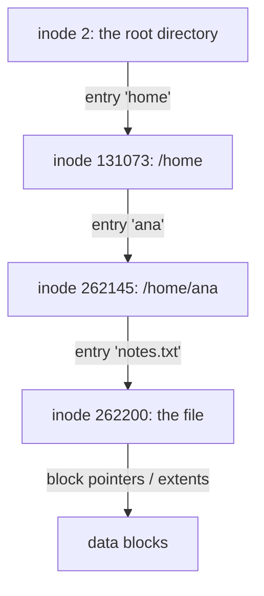

## Mental Model

A filesystem is a **library built on a warehouse of numbered shelves** (disk blocks). Each book has an **index card** — the **inode** — listing its size, owner, permissions, timestamps and which shelves hold its pages. The **card catalog** — directories — maps human-friendly names to index-card numbers. The name is *not* part of the book: several catalog entries can point to the same card (hard links), and a catalog entry can even say "see that other name over there" (symbolic link).

## Definition

- **Inode (index node)**: the on-disk structure describing a file: type, permissions, owner (UID/GID), size, timestamps (atime, mtime, ctime), link count, and pointers to data blocks. **It does not contain the file name.**
- **Directory**: a special file whose contents are entries mapping names → inode numbers.
- **Hard link**: an additional directory entry pointing to the same inode.
- **Symbolic (soft) link**: a small file whose contents are a path to another file.
- **Superblock**: filesystem-wide metadata (size, block size, inode count, free counts, state).
- **VFS (virtual filesystem switch)**: the kernel layer that gives all filesystems (ext4, XFS, Btrfs, NFS, procfs) one interface.

## Why It Exists

**The problem.** Raw disks offer only numbered blocks. Programs need named, hierarchical, growable, access-controlled files — and the filesystem must allocate space efficiently, find data quickly, and survive crashes ([Journaling](lesson:os-journaling)).

**Without it.** Every program would track "my data is in blocks 9,812 to 9,840" itself — and two programs would happily overwrite each other's blocks.

**The idea.** Separate three questions that are easy to tangle:

- *What is this file?* An inode: metadata plus where its blocks are.
- *What is it called?* A directory entry: just name → inode number.
- *Which blocks are free?* Bitmaps.
 Keeping the name out of the inode is what makes hard links, cheap renames and "delete while open" possible.

:::callout[That's all it is]{type=insight}
A filesystem is a small database on the disk: a table of inodes (file metadata + block locations), directories that map names to inode numbers, and bitmaps of free space. Opening a path is a series of lookups through those directories.
:::

## How It Works

### On-disk layout (ext4-style, simplified)

```text
| boot | superblock | group descriptors | block bitmap | inode bitmap | inode table | data blocks … |
```

Bitmaps track free blocks and free inodes, and the inode table holds fixed-size inodes (typically 256 bytes). The ext4 filesystem divides the disk into **block groups**, each with its own bitmaps and inode table, to keep a file's inode near its data.

### The textbook allocation methods

Every filesystem must record which disk blocks belong to which file. Textbooks name three ways:

| Method | How a file's blocks are recorded | Strengths | Weaknesses |
|---|---|---|---|
| **Contiguous** | Start block + length; the file occupies consecutive blocks | Fastest sequential and random access (block *i* is at start + *i*) | External fragmentation; hard to grow a file; needs the size in advance |
| **Linked** | Each block holds a pointer to the next; the directory stores the first block | No external fragmentation; files grow easily | Random access must follow the chain (block *i* needs *i* + 1 reads); a pointer in every block; one bad block breaks the chain |
| **Indexed** | An index block lists all the file's block addresses | Fast random access, no external fragmentation | The index block costs space even for tiny files; big files need multi-level indexes |

**FAT** (File Allocation Table, used on USB drives and SD cards) is linked allocation with the links pulled out of the data blocks into one table, entry *b* holding the block after *b*. The table is small enough to cache in memory, so following a chain costs no disk reads. The Unix inode below is **indexed** allocation, made multi-level for large files.

```text
contiguous: start 100, length 20  → byte 50,000 is in block 100 + 50,000 / 4,096 = 100 + 12 = 112
linked:     to read block 10 of a file, read blocks 0, 1, …, 10 to follow the pointers: 11 reads
indexed:    read the index block, then block 10 directly: 2 reads
```

### Free-space management

The filesystem must also know which blocks are free:

- **Bitmap**: one bit per block. Compact and makes finding a run of free blocks easy. A 1 TB disk with 4 KB blocks has 2²⁸ blocks, so the bitmap is 2²⁸ bits = 32 MB. ext4 uses bitmaps per block group.
- **Linked list**: free blocks point to the next free block. No extra space, but finding many free blocks is slow.
- **Grouping**: the first free block stores the addresses of *n* free blocks, the last of which stores the next *n*.
- **Counting**: store (first free block, count of free blocks after it). The same idea as extents.

### Directory structures and access methods

Directories evolved in four steps. A **single-level** directory is one list for everyone, so names collide. **Two-level** gives each user a directory. A **tree** adds subdirectories, as today. An **acyclic graph** adds links, so one file can appear in two directories. A **general graph** with cycles would make deletion and traversal hard, which is why Unix forbids hard links to directories.

Programs read files by one of two **access methods**. *Sequential* access reads in order, like a tape (`InputStream.read()` in Java). *Direct* access jumps to any block by number (`RandomAccessFile.seek()` or `FileChannel.position()`). Contiguous and indexed allocation make direct access cheap; linked allocation doesn't.

### Finding a file's data: block pointers vs extents

The design tension: most files are tiny, but a few are enormous. The inode is fixed-size, so it can't hold a list of a million blocks — yet small files should need no extra reads. **Classic Unix inode (ext2/ext3)**: 12 **direct** pointers, then **single**, **double** and **triple indirect** pointers.

With 4 KB blocks and 4-byte block addresses (1,024 addresses per block):

| Pointer | Blocks addressable | Data |
|---|---|---|
| 12 direct | 12 | 48 KB |
| Single indirect | 1,024 | 4 MB |
| Double indirect | 1,024² | 4 GB |
| Triple indirect | 1,024³ | 4 TB |

Small files are fast (direct pointers); large files need extra reads through indirect blocks.

::lab{id=file-allocation}

**Extents (ext4, XFS, Btrfs)**: if blocks are usually allocated contiguously anyway, listing each one is wasteful — say "blocks 5000 to 37,767" once. Extents describe runs of contiguous blocks as `(start block, length)`. One extent can cover up to 128 MB in ext4; a large contiguous file needs a handful of extents instead of millions of pointers. Extent trees handle fragmented files.

### Path resolution

Opening `/home/ana/notes.txt`:

1. Start at the root inode (inode 2 in ext4).
2. Read the root directory's data; find `home` → inode 131073.
3. Check execute (search) permission on each directory along the way.
4. Read `home` directory → `ana` → inode 262145; read it → `notes.txt` → inode 262200.
5. Check permissions on the target inode; create an open file description.



The **dentry cache** (name → inode lookups) and **inode cache** make repeated resolution cheap.

### Hard links vs symbolic links

```bash
$ echo hi > a.txt
$ ln a.txt b.txt          # hard link: new name, same inode
$ ln -s a.txt c.txt       # symlink: new inode containing the path "a.txt"
$ ls -li
262200 -rw-r--r-- 2 ana ana 3 a.txt        # link count 2
262200 -rw-r--r-- 2 ana ana 3 b.txt        # same inode number
262201 lrwxrwxrwx 1 ana ana 5 c.txt -> a.txt
$ rm a.txt
$ cat b.txt   # "hi" — data survives: inode link count 1
$ cat c.txt   # No such file — dangling symlink
```

| | Hard link | Symbolic link |
|---|---|---|
| What it is | Another directory entry for the same inode | A file containing a path |
| Survives deleting the original name | Yes | No (dangles) |
| Across filesystems | No (inode numbers are per-filesystem) | Yes |
| To directories | Not allowed (would create cycles) | Allowed |
| Own inode | No | Yes |

The same experiment from Java:

```java
Path a = Path.of("a.txt");
Files.writeString(a, "hi\n");
Files.createLink(Path.of("b.txt"), a);              // hard link: a new name for the same inode
Files.createSymbolicLink(Path.of("c.txt"), a);      // symlink: a new file containing the path "a.txt"

System.out.println(Files.isSameFile(a, Path.of("b.txt")));   // true: same inode
System.out.println(Files.getAttribute(a, "unix:nlink"));     // 2 (OpenJDK's "unix" view, Linux/macOS)

Files.setPosixFilePermissions(a, PosixFilePermissions.fromString("rw-r-----"));   // chmod 640
```

A file's data is freed only when its **link count** reaches 0 **and** no process has it open.

### Permissions

Each inode has owner/group/other permission bits `rwx` plus special bits:

```text
-rwxr-x---   owner: rwx   group: r-x   other: ---     (octal 750)
```

- For **files**: r = read, w = modify contents, x = execute.
- For **directories**: r = list names, w = create/delete/rename entries, x = **traverse** (access entries by name). Deleting a file requires write permission on the **directory**, not the file.
- **setuid** (`chmod u+s`): run the executable with the file owner's UID (`passwd` runs as root). **setgid**: run with the file's group (on directories: new files inherit the group). **Sticky bit** on directories (`/tmp`): only a file's owner can delete it.
- The kernel checks permissions at `open`/`exec` time using the process's effective UID/GID (and capabilities; root bypasses most checks). ACLs and SELinux/AppArmor add finer control.

## Internal Mechanism

:::depth{level=advanced}
### Directories at scale

Early directories were linear lists — lookups O(n). ext4 uses **HTree** (hashed B-tree) directory indexing; XFS and Btrfs use B+ trees. That's why a directory with a million files is still usable, though tools like `ls` (which sort) remain slow. Filesystems are, in effect, specialized databases: B+ trees for directories and extents, allocation bitmaps, and journals for crash consistency — the same toolkit as [B+ Trees](lesson:db-btree) and [WAL](lesson:db-wal-durability).

### Block allocation strategies

Allocators try to keep files contiguous (fewer seeks, fewer extents): ext4 uses **delayed allocation** (choose blocks at writeback time when the final size is better known), **multi-block allocation** and preallocation (`fallocate`). Copy-on-write filesystems (Btrfs, ZFS) never overwrite blocks in place — they write new versions and update pointers up to the root, enabling cheap snapshots but causing fragmentation for random-update workloads like databases.
:::

## Example

Inspecting an inode:

```bash
$ stat notes.txt
  File: notes.txt
  Size: 18231       Blocks: 40         IO Block: 4096   regular file
Device: 259,2       Inode: 262200      Links: 1
Access: (0640/-rw-r-----)  Uid: ( 1000/ ana)   Gid: ( 1000/ ana)
Modify: 2026-09-20 10:14:03
Change: 2026-09-20 10:14:03
$ df -i /home     # inode usage: you can run out of inodes before running out of space
```

## Complexity & Performance

- Path lookup: one directory lookup per component — cached in the dentry cache in practice.
- Small-file-heavy workloads (millions of tiny files) stress inode allocation and directory operations — object stores and databases often pack small items into large files instead.
- Metadata operations (create, rename, fsync of directories) are often the bottleneck in build systems and mail servers.

## Trade-offs

- **Block pointers vs extents**: pointers handle fragmentation gracefully; extents are compact and fast for contiguous files.
- **In-place update vs copy-on-write filesystems**: in-place is friendly to database random writes; COW gives snapshots and checksums (data integrity) but fragments over time.
- **Hard vs soft links**: hard links are robust but restricted; symlinks are flexible but can dangle and be abused (symlink attacks in world-writable directories).

## Failure Modes

- **Inode exhaustion**: `No space left on device` while `df -h` shows free space (millions of tiny files — `df -i` reveals it).
- **Permission bugs**: world-writable files, setuid binaries with vulnerabilities, missing execute bit on a parent directory.
- **Symlink races (TOCTOU)** in `/tmp`.
- **Huge directories** making operations slow.

## In Production

- Container image layers use **overlayfs**: a read-only lower directory stack plus a writable upper layer; modifying a file copies it up (file-level COW).
- Kubernetes volume permissions (`fsGroup`, `runAsUser`) are the same UID/GID model.
- Databases prefer XFS or ext4 with appropriate mount options; avoid COW filesystems for hot DB files unless you disable COW for them (Btrfs `chattr +C`).

## Deeper Connections

- File descriptors point to open file descriptions that point to inodes ([File Descriptors](lesson:os-file-descriptors)).
- Crash consistency of all these structures: [Journaling](lesson:os-journaling).
- Databases build a filesystem-like structure (pages, free-space maps, B+ trees) inside files ([Pages & Records](lesson:db-pages-records)).

## Common Misconceptions

- **"The inode stores the filename."** Names live in directory entries.
- **"You need write permission on a file to delete it."** You need write (and execute) permission on the directory.
- **"A symlink and a hard link are the same thing."** A hard link is another name for the same inode; a symlink is a separate file containing a path.

## Interview Questions

### [L1 · conceptual] What is an inode? What does it contain?

The on-disk data structure that describes a file: its type, permissions, owner and group, size, timestamps, link count, and the locations of its data blocks (direct/indirect pointers or extents). It doesn't contain the file's name — names are stored in directory entries that map names to inode numbers.

### [L1 · compare] Hard link vs symbolic link?

A hard link is an additional directory entry referencing the same inode; the file persists until all hard links are removed; hard links can't cross filesystems or point to directories. A symbolic link is a separate file containing a path; it can cross filesystems and point to directories, but becomes dangling if the target is removed or moved.

### [L1 · compare] Compare contiguous, linked and indexed file allocation.

Contiguous allocation stores a file in consecutive blocks, recorded as (start, length): sequential and random access are fastest, but it suffers external fragmentation and files are hard to grow. Linked allocation chains blocks with a pointer in each: no external fragmentation and easy growth, but reaching block *i* takes *i* + 1 reads, pointers waste space, and a damaged block breaks the chain (FAT moves the pointers into a cached table to fix the speed problem). Indexed allocation keeps all block addresses in an index block: direct access to any block and no external fragmentation, at the cost of an index block per file and multi-level indexes for large files. Unix inodes are multi-level indexed allocation; ext4 extents mix in contiguous runs.

### [L2 · numerical] With 4 KB blocks, 4-byte block pointers, 12 direct pointers plus single, double and triple indirect pointers, what is the maximum file size?

Pointers per block = 4096/4 = 1024. Blocks: 12 + 1024 + 1024² + 1024³ ≈ 1,074,791,436 blocks × 4 KB ≈ **4 TB** (48 KB + 4 MB + 4 GB + 4 TB).

### [L2 · how] What happens when you open("/a/b/c.txt")?

The kernel resolves the path component by component: starting from the root inode, it reads each directory (or finds the entry in the dentry cache), checks search (x) permission, finds the inode number of the next component, and finally the file's inode. It checks the requested access against the file's permissions, creates an open file description, and returns the lowest free fd.

### [L3 · debugging] Writes fail with "No space left on device" but df -h shows 40% free. Why?

The filesystem ran out of inodes, not blocks — typically millions of tiny files (cache files, session files, mail spools). Confirm with `df -i`. Fix: delete or consolidate the small files, or recreate the filesystem with more inodes (ext4 fixes the count at mkfs time; XFS allocates inodes dynamically).

### [L3 · why] Why do you need write permission on the directory, not the file, to delete a file?

Deleting removes a name from the directory — modifying the directory's contents. The file itself (inode and data) is only freed when its link count and open references reach zero; its own permission bits govern reading and writing its contents, not whether names pointing to it can be removed.

## Practice

### [mcq] You delete a file that has another hard link. What happens to its data?

- [ ] It is deleted immediately
- [x] It remains accessible through the other link; the link count drops by one
- [ ] The other link becomes dangling
- [ ] The filesystem marks it for deletion at next reboot

Data is freed only when the link count reaches zero and no process holds it open.

### [mcq] Which permission on a directory allows accessing files inside it by name?

- [ ] r
- [ ] w
- [x] x
- [ ] t (sticky)

Execute ("search") permission on a directory allows traversing it.

### [numeric 112] A file uses contiguous allocation starting at block 100, with 4 KB (4,096-byte) blocks. Which disk block holds byte 50,000 of the file?

:::answer
Block within the file = ⌊50,000 / 4,096⌋ = 12 (block 12 covers bytes 49,152–53,247). Disk block = 100 + 12 = **112**. One calculation, no reads, which is why contiguous allocation gives the fastest direct access.
:::

### [numeric 11] With linked allocation (a pointer to the next block stored inside each data block), how many disk reads does it take to read block 10 of a file (blocks are numbered from 0)?

:::answer
The directory gives block 0; each block reveals the next. Reaching block 10 means reading blocks 0 through 10: **11** reads. With FAT cached in memory, the chain is followed in RAM, and it takes 1 disk read.
:::

### [numeric 32 unit=MB] A 1 TB disk uses 4 KB blocks and a free-space bitmap with one bit per block. How big is the bitmap?

:::answer
Blocks = 2⁴⁰ / 2¹² = 2²⁸. Bits = 2²⁸, so bytes = 2²⁸ / 8 = 2²⁵ = **32** MB. Small enough to keep the hot parts in memory.
:::

### [numeric 65802 unit=KB] An inode has 10 direct pointers, one single indirect and one double indirect pointer. Blocks are 1 KB and block addresses are 4 bytes. What is the maximum file size in KB?

:::answer
Addresses per block = 1,024 / 4 = 256. Blocks: 10 + 256 + 256² = 10 + 256 + 65,536 = 65,802 blocks × 1 KB = **65802** KB (about 64.3 MB).
:::

### [mcq] In Java, `Files.isSameFile(Path.of("a.txt"), Path.of("b.txt"))` returns true, although the two names are different and neither is a symbolic link. What is the relationship?

- [ ] b.txt is a copy of a.txt
- [x] They are hard links: two directory entries for the same inode
- [ ] They are in the same directory
- [ ] b.txt is open in another process

`isSameFile` compares the underlying files (device and inode), not names. Two different names for one inode is the definition of a hard link.

### [exercise] Choose an allocation method (contiguous, linked or indexed) for each file and justify it: (a) a 4 GB video written once and streamed from start to end; (b) a database file read at random block offsets; (c) a log file that grows by small appends for months.

:::solution
- **(a) Contiguous** (or large extents): the size is known when it's written and it never grows, so there is no growth problem. Streaming reads consecutive blocks with almost no seeking, and readers can skip ahead by arithmetic.
- **(b) Indexed** (multi-level, like an inode or extent tree): random access needs any block's address quickly. Linked allocation would need up to N reads to reach block N; indexed needs a few, usually cached.
- **(c) Indexed with extents**, or linked if random access is never needed: the file grows unpredictably, which contiguous allocation handles badly (it may have to move the file). Indexed allocation appends block addresses as the file grows, and an extent-based filesystem keeps appended runs contiguous where it can. A pure linked scheme also grows easily, but makes reading recent entries near the end slow.
:::

### [numeric 1036] With ext2's 4 KB blocks and 4-byte block addresses, what is the first logical block of a file that is reached through the double indirect pointer? Check it in the [file allocation lab](lab:file-allocation).

:::answer
**1036**. The 12 direct pointers cover blocks 0–11. The single indirect block holds 4,096 ÷ 4 = 1,024 addresses, so it covers blocks 12–1,035. Block 1,036 is the first one reached through the double indirect pointer. It starts at byte 1,036 × 4,096 = 4,243,456, just past 4 MB + 48 KB, and reading it takes 3 disk reads once the inode is in memory: two index blocks, then the data block.
:::

## Quick Revision

- Inode = metadata + data block pointers/extents; **no name**. Directory = name → inode number.
- Classic pointers: 12 direct + single/double/triple indirect (4 KB blocks → ~4 TB max). ext4/XFS use **extents**.
- Path resolution walks directories; dentry/inode caches make it fast.
- Hard link = same inode (link count); symlink = file containing a path (can dangle, cross FS).
- Permissions rwx for user/group/other; directory x = traverse, w = create/delete names; setuid/setgid/sticky.
- Out of inodes ≠ out of space (`df -i`).
- Allocation: **contiguous** (start + length; fast, fragments), **linked** (chain; block *i* = *i* + 1 reads; FAT caches the chain), **indexed** (index block; Unix inodes).
- Free space: bitmap (1 bit per block: 1 TB / 4 KB → 32 MB), linked list, grouping, counting.
- Directories: single-level → two-level → tree → acyclic graph (no hard links to directories). Access: sequential vs direct.
- Java: `Files.createLink`, `createSymbolicLink`, `isSameFile`, `setPosixFilePermissions`.
