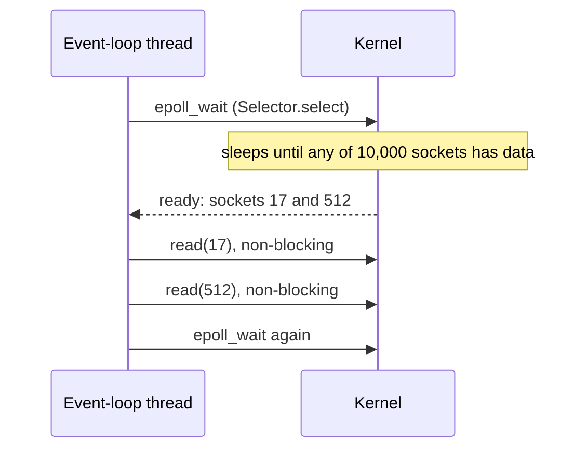

## Mental Model

You ordered food at a counter. How do you wait for it?

- **Blocking**: stand at the counter until it's ready. Simple, but you can't do anything else — to serve many orders you need many people (threads).
- **Non-blocking polling**: walk away, and every few seconds come back and ask "ready yet?" — mostly getting "no" (`EAGAIN`). Wastes effort.
- **Multiplexing (select/poll/epoll)**: hand the counter a list of all your orders and wait **once** until *any* of them is ready; then go pick up the ready ones. One person can manage hundreds of orders.
- **Asynchronous (io_uring, Windows IOCP)**: "deliver it to my table when done". You never go back to the counter; the food (data) arrives in your buffer and you get a notification.

## Definition

Two separate phases in any input operation:

1. **Waiting for data to be ready** (a packet to arrive, a disk read to complete).
2. **Copying the data** from the kernel into the user buffer.

| Model | Phase 1 (wait) | Phase 2 (copy) | Classification |
|---|---|---|---|
| **Blocking I/O** | Thread blocks in the syscall | Thread blocks during copy | Synchronous, blocking |
| **Non-blocking I/O** | Returns `EAGAIN` immediately if not ready; app polls | Blocks during copy (short) | Synchronous, non-blocking |
| **I/O multiplexing** (select/poll/epoll) | Thread blocks in `epoll_wait` for *many* fds | Blocks during `read` of a ready fd | Synchronous (the read still copies on the caller's time) |
| **Signal-driven I/O** (`SIGIO`) | Kernel signals readiness | Blocks during copy | Synchronous |
| **Asynchronous I/O** (io_uring, POSIX AIO, IOCP) | Doesn't wait | Kernel copies into your buffer; notifies on completion | Asynchronous |

POSIX definition: an operation is **synchronous** if the requesting thread is blocked until the I/O completes (including the copy); only the last model is truly asynchronous.

## Why It Exists

**The problem.** A server handling 10,000 connections spends most of its time waiting on the network. With blocking I/O you need a thread per connection — 10,000 threads, with their stacks and context switches (the **C10K problem**, 1999). **The idea.** The expensive thing was never the waiting — it was dedicating a whole thread to each wait. Instead, let *one* thread say "wake me when any of these 10,000 is ready" (multiplexing), and make sure reading a ready socket never blocks (non-blocking). Non-blocking + multiplexing lets one thread wait on thousands of sockets. Asynchronous I/O goes further: submitting work and harvesting completions in batches with minimal syscalls, and it works for disk files, where readiness models don't.

:::callout[That's all it is]{type=insight}
I/O has two parts: waiting until data is there, and copying it. The models differ only in who waits (your thread or the kernel) and how many things one wait covers (one fd or thousands).
:::

## How It Works

### Blocking

```java
int n = socket.getInputStream().read(buf);    // sleeps until at least 1 byte arrives
```

Thread-per-connection servers (classic Apache prefork/worker, early Java servers) — simple code, poor scaling past thousands of connections.

### Non-blocking

```java
channel.configureBlocking(false);              // O_NONBLOCK on the socket
int n = channel.read(buffer);                  // a SocketChannel and a ByteBuffer
if (n == 0) { /* nothing yet (EAGAIN underneath): do something else, try later */ }
if (n == -1) { /* the peer closed the connection */ }
```

Alone, it leads to busy-polling loops. Its real purpose: combined with multiplexing, so that after readiness notification a read never blocks the event loop.

### Multiplexing with epoll

In Java this is NIO's `Selector`, which is implemented with epoll on Linux:

```java
Selector selector = Selector.open();                          // epoll_create
ServerSocketChannel server = ServerSocketChannel.open();
server.bind(new InetSocketAddress(8080));
server.configureBlocking(false);
server.register(selector, SelectionKey.OP_ACCEPT);            // epoll_ctl(ADD)

while (true) {
    selector.select();                                         // epoll_wait: block until ≥1 channel is ready
    Iterator<SelectionKey> it = selector.selectedKeys().iterator();
    while (it.hasNext()) {
        SelectionKey key = it.next();
        it.remove();
        if (key.isAcceptable()) acceptNewConnections(selector, server);   // non-blocking accepts
        else if (key.isReadable()) handleReadable(key);                    // non-blocking reads
    }
}
```

One thread, thousands of connections, and CPU spent only on connections with actual activity. Netty, Vert.x and the Tomcat NIO connector are built on this loop. Details in [epoll & Event Loops](lesson:os-epoll-event-loops).



### Asynchronous with io_uring (Linux 5.1+)

Two ring buffers shared between the process and the kernel:

- **Submission queue (SQ)**: the app writes requests ("read 4 KB from fd 7 into buf at offset X") without syscalls.
- **Completion queue (CQ)**: the kernel posts results ("request 42 done, 4096 bytes").

One `io_uring_enter` call submits a batch and optionally waits for completions; with `SQPOLL`, a kernel thread polls the SQ and submission needs no syscall at all. It supports files, sockets, timeouts, accept, send/recv — a general async interface.

The JDK has no io_uring API. Java's NIO.2 "asynchronous" channels offer a completion-style API, but on Linux `AsynchronousSocketChannel` is built on epoll, and `AsynchronousFileChannel` runs ordinary blocking reads on a thread pool. Libraries such as Netty's io_uring transport add real io_uring support.

::viz{id=io-models}

## Internal Mechanism

### Readiness vs completion

The two families answer different questions: "*when can* I do the I/O without blocking?" vs "*please do* the I/O and tell me when it's done".

- **Readiness-based** (epoll, kqueue): the kernel tells you *you may now read without blocking*; you then perform the I/O yourself.
- **Completion-based** (io_uring, IOCP): you describe the I/O up front; the kernel tells you *it's done*. Buffers must stay valid until completion.

**Regular files are always "ready"** for select/poll/epoll — a read on a file may still block on disk because readiness doesn't track page-cache misses. That's why Node.js (libuv) uses a thread pool for filesystem operations, and why io_uring matters for storage-heavy systems.

### Where blocking still hides

Even "non-blocking" servers block in places:

- DNS resolution via `getaddrinfo` blocks (libraries use thread pools or async resolvers);
- page faults on mmap'd data block the thread;
- logging to disk may block on writeback throttling;
- CPU-heavy work blocks an event loop just as surely as I/O.

## Example

The same echo server in three models:

| Model | Threads for 10k connections | Syscalls per message (approx.) | Code style |
|---|---|---|---|
| Blocking, thread per connection | 10,000 | read + write | Straight-line |
| epoll event loop | 1–N (≈ cores) | epoll_wait (amortized) + read + write | Callbacks/state machines |
| io_uring | 1–N | Amortized: one enter per batch | Completion handlers |

Languages hide this: Go uses epoll under goroutines (blocking-style code, event-loop runtime); Java virtual threads do the same; Node.js/Netty expose event loops; Rust's Tokio offers async/await on epoll or io_uring.

## Complexity & Performance

- `select`: O(n) per call over all watched fds (and a 1024-fd limit with `FD_SETSIZE`).
- `poll`: O(n), no hard limit.
- `epoll`: O(1) per ready event after registration; cost scales with **active** fds, not total.
- io_uring: amortizes syscalls across batches; can reach millions of IOPS per core with polling.

## Trade-offs

| | Blocking + threads | Event loop (epoll) | Async (io_uring) |
|---|---|---|---|
| Code simplicity | Highest | Callbacks/state machines (async/await helps) | Similar to event loop, buffer lifetime concerns |
| Scalability (idle connections) | Poor (thread each) | Excellent | Excellent |
| Disk I/O | Works | Files always "ready" → need thread pool | First-class |
| CPU-heavy tasks | Fine (preemptive threads) | Block the loop — offload | Offload |
| Portability | Everywhere | epoll (Linux), kqueue (BSD/macOS), IOCP (Windows) | Linux 5.x+ |

## Failure Modes

- **Blocking the event loop**: one slow synchronous call (DNS, file read, CPU-heavy JSON parsing, a blocking DB driver) stalls every connection on that loop — latency spikes for all clients.
- **Busy-polling** non-blocking sockets without multiplexing → 100% CPU.
- **Mishandled `EAGAIN`/partial writes**: non-blocking `write` may accept only part of the buffer; code must keep the rest and wait for writability.
- **Buffer lifetime bugs** with completion-based APIs.

## In Production

- Nginx, HAProxy, Redis, Node.js, Netty, Envoy: event loops on epoll/kqueue.
- Go, Java virtual threads, Erlang: blocking-style APIs implemented on event loops in the runtime.
- Databases and storage engines adopt io_uring for disk I/O; network proxies experiment with it for sockets.
- Case study: [High CPU](case:high-cpu) includes a blocked-event-loop pattern.

## Deeper Connections

- Epoll internals and event-loop architecture: [epoll & Event Loops](lesson:os-epoll-event-loops).
- Thread pools as the alternative for blocking work: [Thread Pools](lesson:os-thread-pools).
- Sockets and their buffers (what "readable" means): [Sockets](lesson:cn-sockets).
- How this shapes backend servers under load: [Overloaded Servers](lesson:x-overloaded-server).

## Common Misconceptions

- **"Non-blocking means asynchronous."** Non-blocking calls return immediately if not ready, but the app still performs (and waits for) the copy; asynchronous means the kernel completes the whole operation and notifies you.
- **"epoll is asynchronous I/O."** It's synchronous I/O multiplexing — readiness notification.
- **"epoll works for disk files."** Regular files always appear ready; reads can still block on disk.
- **"Event loops are always faster than threads."** They win on many idle connections; for few connections with CPU-heavy work, threads may be simpler and just as fast.

## Interview Questions

### [L1 · compare] What's the difference between blocking and non-blocking I/O?

A blocking call puts the calling thread to sleep until the operation can complete (e.g., data arrives). A non-blocking call returns immediately — with data if available, or an error like EAGAIN if not — letting the thread do other work and retry later, usually driven by a readiness notification mechanism like epoll.

### [L2 · compare] Synchronous vs asynchronous I/O — and where does epoll fit?

Synchronous I/O: the thread performs the transfer and waits for it (blocking or after a readiness check). Asynchronous I/O: the thread submits the request and continues; the kernel performs the whole operation, including copying into the buffer, and notifies on completion (io_uring, IOCP). epoll is synchronous I/O multiplexing: it reports readiness; the application still performs the read/write itself.

### [L2 · compare] select vs poll vs epoll?

`select` takes fixed-size bitmaps (1024-fd limit), and the kernel scans all of them on each call: O(n). `poll` uses an array of structs (no limit) but is still O(n) per call and copies the whole list each time. `epoll` registers fds once in a kernel object and returns only ready fds, so each wait costs O(ready events); it supports edge-triggered mode and scales to hundreds of thousands of connections.

### [L2 · why] Why can't you just use epoll for disk file reads in an event loop?

epoll reports regular files as always readable, since readiness isn't defined in terms of page-cache state; a read on a file whose data isn't cached still blocks the thread on disk I/O, stalling the event loop. Event-loop runtimes offload file I/O to thread pools (libuv), or use io_uring, which handles file I/O asynchronously.

### [L2 · compare] Which OS I/O model does each Java I/O API use on Linux?

`java.io` streams and blocking `Socket`s use **blocking I/O**: one thread per in-progress operation. NIO channels with a `Selector` use **non-blocking I/O plus multiplexing**: the `Selector` is epoll, and Netty, Vert.x and Tomcat's NIO connector are built on it. NIO.2 `AsynchronousSocketChannel` exposes a completion-style API but is implemented on epoll underneath, and `AsynchronousFileChannel` uses a thread pool doing blocking reads, because the JDK has no io_uring. Virtual threads (Java 21) let you write blocking-style code: when one blocks on a socket, the JVM parks it and registers the socket with its own epoll-based poller, so you get event-loop scaling with thread-per-request code.

### [L3 · debugging] A Node.js API's p99 latency spikes to seconds occasionally, even for trivial endpoints. What would you suspect?

Something blocks the single event loop: synchronous work (JSON.parse/stringify of huge payloads, crypto, regexes with catastrophic backtracking, sync fs calls, large loops) or an exhausted libuv thread pool (DNS lookups, file I/O, crypto queued behind slow tasks). Measure event-loop lag (perf_hooks `monitorEventLoopDelay`), profile with `--prof`/clinic, move CPU work to worker threads, increase `UV_THREADPOOL_SIZE` if pool-starved, and avoid sync APIs in request paths.

### [L4 · design] You're building a proxy handling 200k concurrent mostly idle connections with occasional bursts. Which I/O model and why?

An event-loop architecture: one loop per core (N threads), each owning a set of connections via epoll (edge-triggered) or io_uring, with non-blocking sockets. Idle connections cost only kernel socket buffers and a small per-connection state object — no threads. Use SO_REUSEPORT to spread accepts across loops, bounded per-connection buffers for backpressure, timers via a timing wheel, and offload anything blocking (DNS, TLS key operations if slow) to helper threads. Raise fd limits; tune socket buffer sizes to control memory (200k × buffers adds up).

## Practice

### [mcq] Which model is truly asynchronous according to the POSIX definition?

- [ ] Non-blocking I/O with polling
- [ ] epoll-based multiplexing
- [ ] Signal-driven I/O
- [x] io_uring / POSIX AIO completion-based I/O

Only completion-based models don't block the thread during the data copy.

### [mcq] A non-blocking read() on a socket with no data returns:

- [ ] 0
- [x] -1 with errno EAGAIN (or EWOULDBLOCK)
- [ ] It blocks anyway
- [ ] SIGIO

A return of 0 means the peer closed the connection (EOF).

### [mcq] A Java `SocketChannel` is in non-blocking mode and no data has arrived. What does `channel.read(buffer)` return?

- [x] 0
- [ ] −1
- [ ] It blocks until data arrives
- [ ] It throws `WouldBlockException`

Java translates `EAGAIN` into "0 bytes read". It returns −1 only at end of stream, when the peer has closed the connection, which is the opposite of the C convention, where 0 means EOF.

### [numeric 10000 unit=MB] A thread-per-connection Java server holds 10,000 mostly idle WebSocket connections, and each platform thread reserves a 1 MB stack. How much virtual address space do the stacks reserve?

:::answer
10,000 × 1 MB = **10000** MB, about 10 GB of address space, plus 10,000 kernel threads for the scheduler to track. An event loop (or virtual threads) serves the same idle connections with a handful of threads.
:::

### [numeric 1024] `select()` uses fixed-size bit sets of `FD_SETSIZE` bits. On Linux, how many file descriptor numbers can one `select()` call watch at most?

:::answer
`FD_SETSIZE` is **1024**, so only fds 0–1023 can be watched, and the kernel scans every bit on each call. `poll` removes the limit, and `epoll` removes the per-call scan.
:::

### [exercise] A Netty-based Java service calls a JDBC repository method directly inside its channel handler. Under load, latency for every client rises together, even for requests that don't touch the database. Explain what is happening at the I/O-model level and fix it. Compare the models in the [I/O models visualization](viz:io-models).

:::solution
Netty runs a few event-loop threads (about 2 per core), each serving thousands of connections through one `Selector` (epoll). JDBC is blocking I/O: the event-loop thread sits in a socket `read` waiting for the database. While it waits, it can't call `select()` or run any other handler, so every connection assigned to that loop stalls, including ones that never touch the database. With a slow query, a few loop threads are enough to freeze the service.

Fix: never block an event-loop thread. Hand blocking work to a separate executor and continue when it completes:

```java
ExecutorService dbPool = Executors.newFixedThreadPool(32);    // sized for the DB, not the CPU

public void channelRead(ChannelHandlerContext ctx, Object msg) {
    CompletableFuture
        .supplyAsync(() -> repository.findOrder(parse(msg)), dbPool)      // blocking call off the loop
        .thenAccept(order -> ctx.writeAndFlush(toResponse(order)));       // Netty hands the write back to the loop
}
```

Alternatives: a non-blocking database driver (R2DBC, the Vert.x clients), or virtual threads with a blocking framework (Spring MVC on Java 21), where blocking is cheap because it parks only a virtual thread.
:::

## Quick Revision

- Two phases: **wait for readiness**, then **copy**. Models differ in who waits and how.
- Blocking (thread sleeps) → thread per connection. Non-blocking (`EAGAIN`) → needs a notifier.
- **Multiplexing** (select O(n), poll O(n), **epoll** O(ready)) = synchronous readiness notification for many fds.
- **Async** (io_uring SQ/CQ rings, IOCP) = completion notification; works for files.
- Regular files are always "ready" → event loops offload file I/O.
- Never block an event loop (sync I/O, CPU-heavy work, DNS).
- Java: `java.io` = blocking; NIO `Selector` = epoll multiplexing (non-blocking `read` returns 0, EOF = −1); NIO.2 async = completion API over epoll / thread pool; no io_uring in the JDK.
